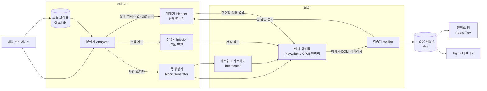

# dui 설계 v0 (개발자 도구)

> 상태: 초안 · 작성 2026-11-19 · 대상 독자: dui를 만들 개발자
> 이 문서의 외부 사실(라이선스·스타 수·버전)은 2026-11-19에 GitHub API로 확인했다. 확인 못 한 것은 `미확인`으로 적는다.

## 1. 문제와 사용자

**사용자**: TypeScript 또는 Rust로 UI를 만드는 개발자·디자이너·QA.

**문제**
- 한 화면에도 상태가 많다(빈 목록, 로딩, 오류, 권한 없음, 긴 텍스트, 마지막 장 승인 후 …). 지금은 직접 클릭해서 그 상태까지 가야 볼 수 있다.
- 어떤 상태를 아직 한 번도 그려본 적 없는지 알 방법이 없다.
- 반응형 폭마다 따로 창 크기를 바꿔 봐야 한다.
- Storybook은 상태를 사람이 하나하나 써야 하고, Figma는 실제 코드가 아니다.

**dui가 하는 일**: 코드베이스를 읽고, 앱의 **모든 화면 × 모든 상태 × 모든 폭**을 실제 코드로 렌더해서 Figma처럼 무한 캔버스에 펼친다. 못 그린 칸은 `미검증`으로 보인다. 목표 커버리지는 99%이며 측정 방법은 §8에 정의한다.

## 2. 목표와 비목표

**목표**
- 타입 있는 언어만: TypeScript(웹·웹뷰), Rust(GPUI 네이티브).
- 사람이 상태를 쓰지 않아도 AI + 타입으로 상태를 찾아내고 목 값을 만든다.
- 프레임워크별 어댑터를 손으로 쓰지 않는다. AI가 대상 코드에 맞는 주입 코드를 그때그때 만든다.
- 결과는 측정 가능해야 한다(분모·분자가 있는 커버리지).

**비목표**
- 캔버스 안에서 클릭·입력 같은 상호작용. 정지 화면만 보여준다.
- 시각 회귀 테스트(픽셀 비교 승인 흐름). Chromatic·Percy 영역이다. 나중에 붙일 수는 있다.
- 타입 없는 JavaScript, Python, Dart, Swift, Kotlin 등. (v0 범위 밖)
- 프로덕션 빌드에 SDK를 남기는 것. 모든 주입 코드는 개발 빌드 전용이다.
- 디자인 편집 도구. Figma로 내보내기는 하지만 Figma를 대체하지 않는다.

## 3. 핵심 아이디어

1. **AI가 상태가 사는 곳을 전부 찾는다**: 전역 store, 컴포넌트 로컬 상태(`useState` 등), context, URL·라우트, 서버 응답 캐시, GPUI Entity/모델 필드.
2. **빌드할 때 강제 주입 코드를 끼운다**: 소스는 그대로 두고, 개발 빌드 변환(TS는 Vite/Babel/SWC 플러그인, Rust는 proc-macro·build 스크립트)으로 "이 값으로 시작하라" 입구를 만든다. 그래서 로컬 상태도 밖에서 넣을 수 있다.
3. **API는 네트워크에서 가로챈다**: 타입에서 생성한 목으로 응답한다.
4. **넣고, 그리고, 검사한다**: 상태를 주입해 폭별로 렌더하고, 렌더 결과가 의도한 상태와 맞는지 검사한다. 안 맞으면 `미검증`.

타입이 핵심인 이유: 타입이 있어야 (a) 상태의 모양을 빠짐없이 나열하고 (b) 유효한 목 값을 자동으로 만들고 (c) 주입 코드가 컴파일러 검사를 통과했는지로 1차 검증이 된다.

## 4. 아키텍처



| 구성요소 | 하는 일 | 입력 → 출력 |
|---|---|---|
| `dui` CLI | 전체 실행·캐시·설정. `dui scan`, `dui render`, `dui open` | 설정 파일 → 실행 |
| 분석기 | 화면·상태 위치·이벤트·상태 변경 지점·전환 규칙 찾기. Graphify 그래프 + 타입 정보 + AI | 코드 → `Screen`, `StateSlot`, `Rule` |
| 주입기 | 상태 위치마다 개발용 주입 입구를 빌드 시 삽입 | `StateSlot` → 변환된 개발 빌드 |
| 목 생성기 | 타입·스키마(zod, OpenAPI, Rust 타입)에서 대표값 생성 | 타입 → 값 묶음 |
| 계획기 | 데이터 모양 × 분기 × 순서를 조합해 렌더할 상태 목록 생성, 안 덮인 분기는 다시 계획 | 규칙·커버리지 → `State[]` |
| 네트워크 가로채기 | API 요청을 가로채 상태에 맞는 목 응답 | 요청 → 목 응답 |
| 렌더 워커 | 상태 주입 후 폭별 렌더, 이미지·DOM·커버리지 수집. 병렬 실행 | `State` × 폭 → `RenderCell` |
| 검증기 | 렌더가 의도한 상태인지 검사 | `RenderCell` → 검증 상태 |
| 스냅샷 저장소 | 모든 결과를 파일로 저장(`.dui/`), 커밋 해시 단위 | — |
| 캔버스 앱 | 화면×상태 노드, 폭 열, 전환 선을 무한 캔버스에 배치 | 저장소 → 화면 |
| Figma 내보내기 | 같은 배치를 Figma 파일로 | 저장소 → Figma |

## 5. 데이터 모델

```ts
type Lang = "ts" | "rust";
type Provenance = "추출됨" | "추정됨" | "검증됨"; // 코드에 명시 / AI 추론 / 재생으로 확인

interface Screen {
  id: string;                 // "review", "export", "settings.team"
  route?: string;             // 웹: "/projects/$id/review"
  entry: SourceRef;           // 화면 루트 컴포넌트 또는 GPUI View
  lang: Lang;
}

interface StateSlot {         // 상태가 사는 한 곳
  id: string;
  kind: "store" | "local" | "context" | "route" | "server" | "entity";
  owner: SourceRef;           // 이 상태를 가진 컴포넌트·store·Entity
  type: TypeRef;              // 타입 정보(목 생성의 근거)
  injectable: boolean;        // 주입 입구 생성 성공 여부
}

interface State {
  id: string;                 // 내용 해시
  screenId: string;
  label: string;              // "목록 비어 있음", "마지막 장 승인 후"
  kind: "data-shape" | "branch" | "sequence";
  values: Record<StateSlotId, unknown>;   // 슬롯별 주입 값
  network: MockResponse[];    // 이 상태에서 API가 돌려줄 응답
  path?: EdgeId[];            // sequence 상태: 처음부터 여기까지 경로
  expect: Assertion[];        // 검증기가 확인할 것
  targets: BranchId[];        // 이 상태로 덮으려는 코드 분기
}

interface Edge {              // 상태 전환
  id: string;
  from: StateId;
  to: StateId;
  event: string;              // "onClick: 승인", "단축키 1"
  rule: SourceRef;            // 근거가 된 핸들러·reducer
  provenance: Provenance;
}

interface Snapshot {          // 한 번의 실행 결과 묶음
  id: string;
  commit: string;             // 대상 레포 커밋
  createdAt: string;
  widths: number[];           // 예: [375, 768, 1280]
  axes?: { theme?: ("light" | "dark")[]; locale?: string[] };
}

interface RenderCell {        // 캔버스의 칸 하나 = 상태 × 폭(× 축)
  snapshotId: string;
  stateId: string;
  width: number;
  image?: string;             // 파일 경로
  dom?: string;               // 웹: 직렬화 DOM / 접근성 트리
  coveredBranches: BranchId[];
  status: VerificationStatus;
}

type VerificationStatus =
  | { kind: "verified" }                          // 검증 통과
  | { kind: "unverified"; reason: "render-failed" | "assert-failed" | "not-injectable" | "not-rendered" }
  | { kind: "suspect"; reason: string };          // 시각 검사만 실패, 사람 확인 필요
```

`미검증` = `unverified` 전부. 캔버스에는 회색 빗금 칸 + 이유로 보인다.

## 6. 파이프라인

1. **스캔** (`dui scan`)
   - Graphify로 호출·import 그래프 생성.
   - 화면 찾기: 라우터 정의(TanStack Router, Next app 디렉터리 등), GPUI 루트 View.
   - 상태 위치 찾기: 타입 정보 + AI. 결과는 `StateSlot[]`.
   - 코드 분기 목록: 화면에서 도달 가능한 렌더 분기(조건부 JSX, early return, `match`).
2. **상태 나열** (계획기) — 세 종류를 합친다.
   - **데이터 모양**: 타입에서 대표값 생성. 목록은 0·1·많음, 문자열은 빈 값·보통·아주 긺, optional은 있음·없음, union은 모든 갈래, API는 성공·오류(4xx/5xx)·지연.
   - **코드 분기**: 각 분기 조건을 거꾸로 풀어 그 분기로 들어가는 값을 AI가 만든다.
   - **순서**: 이벤트 핸들러 → 상태 변경 지점까지 그래프를 따라가 `상태 + 이벤트 → 다음 상태` 규칙을 만든다. 처음 상태부터 규칙을 펼친다(모델 검사 방식). 무한 펼침은 대표값(0, 1, 마지막, 마지막 다음)과 깊이 한도로 자른다. 같은 값 묶음은 하나로 합친다.
3. **주입 빌드**: 주입기가 개발 빌드를 만든다. 컴파일 실패한 슬롯은 `injectable=false`.
4. **렌더** (`dui render`): 워커가 상태마다 주입 값 + 목 응답을 넣고, 폭별로 렌더. 이미지·DOM·분기 커버리지 저장.
5. **검증**: §7.
6. **보충 반복**: 안 덮인 분기가 남으면 2단계로 돌아가 그 분기 전용 상태를 만든다. 개선이 없거나 반복 한도에 닿으면 멈춘다.
7. **순서 재생 검증**: sequence 상태는 주입만이 아니라 처음 상태에서 경로대로 이벤트를 실제로 재생해 같은 화면이 나오는지 확인한다. 맞으면 해당 선이 `검증됨`.
8. **보기** (`dui open`): 캔버스 앱 실행 또는 Figma 내보내기.

## 7. 검증

렌더가 "그렸다"는 것과 "의도한 상태를 그렸다"는 다르다. 세 단계로 검사한다.

1. **값 확인**(필수): 렌더 직후 주입한 슬롯의 실제 값을 다시 읽어 의도한 값과 같은지. 다르면 주입 실패.
2. **의미 확인**(필수): 상태에서 자동 생성한 단언을 DOM·접근성 트리(웹) 또는 GPUI 요소 트리(네이티브, 가능 여부 `미확인`)에 대해 검사. 예: "빈 목록 상태 → 목록 항목 0개 + 빈 안내 문구 존재", "오류 상태 → role=alert 존재".
3. **시각 확인**(보조): AI가 이미지를 보고 상태 설명과 맞는지 판정. 이것만 실패하면 `suspect`.

추가로 **커버리지 확인**: 그 상태가 덮으려던 분기(`targets`)가 실제로 실행됐는지 커버리지로 확인. 안 됐으면 `unverified: assert-failed`.

## 8. 99%를 어떻게 재나

감이 아니라 숫자로 잰다. 분모를 명확히 정의한다.

- **분모** = (화면별 렌더 분기 수 + 화면별 데이터 모양 대표값 수 + 깊이 한도 안에서 도달 가능한 순서 상태 수) × 설정한 폭 수.
  - 렌더 분기: 화면 루트에서 도달 가능한 컴포넌트 안의 조건부 렌더 분기(조건부 JSX, 삼항, early return, `match` 갈래). 화면에 그려지는 것에 영향 없는 분기(로깅 등)는 제외 규칙으로 뺀다.
  - 분모 자체도 분석기가 만든 것이므로 "분모에서 빠진 분기"를 따로 잰다: 런타임 커버리지 도구(V8 coverage / istanbul, Rust는 `cargo llvm-cov` 계열)의 전체 분기 목록과 대조.
- **분자** = 분모 중 `verified` 칸 수.
- **보고**: 화면별·종류별 % + 미검증 칸 목록(이유 포함). 예: `review 97.8% (분기 44/45, 모양 18/18, 순서 23/24) × 3폭`.
- **99% 조건**: 우리 코드(obora, pippip)는 화면 상태를 타입·reducer·상태 기계로 한곳에 모으는 규칙을 둔다. 그래야 순서 상태의 분모가 정확해진다.

## 9. 언어별 세부

### 9.1 TypeScript (웹, Electron·Tauri 웹뷰)

| 항목 | 방법 |
|---|---|
| 화면 찾기 | 라우터 정의 정적 분석(TanStack Router, React Router, Next app 디렉터리). obora-web은 TanStack Router(확인됨) |
| 타입 | TypeScript 컴파일러 API로 슬롯 타입 해석. zod 스키마가 있으면 우선 사용(obora-web은 zod 사용, 확인됨) |
| 로컬 상태 주입 | Vite 플러그인(내부는 Babel 또는 SWC 변환)이 `useState(init)`을 `useState(__dui.get("slotId") ?? init)` 꼴로 바꾼다. `useReducer`, context Provider value도 같은 방식 |
| store 주입 | Zustand·Redux·Jotai 등은 생성 지점에서 초기값을 같은 방식으로 감싼다 |
| 서버 캐시 | TanStack Query는 렌더 전 `QueryClient`에 데이터 미리 채우기 또는 네트워크 목 |
| 네트워크 | MSW(MIT, 확인됨) 같은 Service Worker 가로채기. Node 쪽 요청은 MSW node 모드 |
| 렌더 | Playwright(Apache-2.0, 확인됨)로 폭별 뷰포트 렌더. 이미지 + DOM + 접근성 트리 + V8 커버리지 |
| Electron | 렌더러는 웹과 같다. preload/IPC 호출은 목으로 막고 렌더러 번들을 브라우저에서 띄우거나 Playwright Electron 모드 사용 |
| Tauri | `invoke` 호출을 목으로 막고 웹과 동일하게 렌더 |
| 순서 재생 | Playwright로 실제 클릭·키 입력 재생 |

주입 런타임 `__dui`는 개발 빌드에만 들어가고, 프로덕션 빌드에서는 변환이 꺼진다. 빌드 산출물에 `__dui`가 없음을 CI에서 검사한다.

### 9.2 Rust (GPUI 네이티브)

pippip은 `gpui-pre 0.3.12` + `gpui-kit 0.10.0`, HTTP는 `reqwest` 사용(Cargo.toml에서 확인). GPUI crate 라이선스는 Apache-2.0(zed 레포 `crates/gpui/Cargo.toml`에서 확인).

| 항목 | 방법 |
|---|---|
| 화면 찾기 | 루트 View와 화면 전환 지점 정적 분석 + AI |
| 타입 | rust-analyzer 또는 `syn` 기반 파싱으로 Entity/모델 필드 타입 해석 |
| 상태 주입 | `#[dui::state]` proc-macro를 개발 feature에서만 붙여 모델 타입에 `serde` 직렬화 + "이 값으로 시작" 생성자를 만든다. 붙이는 작업은 AI가 build 단계에서 패치로 생성 |
| 상태 꺼내기 | 같은 매크로로 현재 상태 덤프(실사용 중 상태 수집에도 사용) |
| 네트워크 | HTTP 클라이언트 생성 지점을 개발 feature에서 목 서버(로컬) 주소로 돌리거나 클라이언트를 감싼 trait로 교체 |
| 렌더 | 앱 안 `dui` 갤러리 모드: 상태 파일을 읽어 View를 만들고 폭별 창 크기로 그린 뒤 이미지 저장. `gpui-pre 0.3.12` 소스에 `HeadlessAppContext::capture_screenshot`·`Window::render_to_image`(`test-support` feature)가 있음을 확인(2026-11-19, [언어 조사](language-survey.md)). pippip에서 실제 실행은 `미확인` → M2 스파이크 1순위. 안 되면 숨김 창 + OS 캡처로 대체 |
| 순서 재생 | 갤러리 모드에서 액션 디스패치로 재생 |
| 검증 | 값 확인은 덤프 비교로 가능. 요소 트리 기반 의미 확인은 `미확인` |

전제 규칙: 화면 상태는 Entity/모델에 둔다. View 안에 흩어진 상태는 덤프·주입에서 빠지므로 `not-injectable`로 표시된다.

## 10. 그래프 엔진

- 1순위 **Graphify** (Apache-2.0, ★150,430, 2026-11-19 확인): tree-sitter로 약 40개 언어, 선마다 `EXTRACTED`/`INFERRED` 태그(README에서 확인). dui는 이 위에 상태 전환 층을 얹고 태그를 `추출됨`/`추정됨`/`검증됨`으로 확장한다.
- 2순위 **CodeGraph** (MIT, ★78,082, 2026-11-19 확인): 프레임워크별 라우트 인식, TypeScript·Rust 지원(README에서 확인).
- 통합 방식(라이브러리로 부를지, CLI 출력 파일을 읽을지)은 `미확인` → M0에서 결정.
- 그래프 엔진은 바꿀 수 있게 dui 내부에는 `CodeGraphPort`(노드·선 읽기) 한 가지 인터페이스만 둔다.

## 11. 캔버스

배치: **행 = 화면×상태, 열 = 폭(및 테마·언어 축), 선 = 전환**. 미검증 칸은 회색 빗금 + 이유.

| 후보 | 라이선스(2026-11-19 확인) | 판단 |
|---|---|---|
| React Flow (`xyflow/xyflow`) | MIT, ★39,087 | **1순위**. 노드 안에 이미지 또는 iframe(웹은 살아있는 DOM) |
| tldraw (`tldraw/tldraw`) | 자체 라이선스(GitHub 표기 NOASSERTION). LICENSE.md: 개발 환경에서만 무료, **프로덕션 사용은 별도 상업 라이선스 또는 체험 라이선스 키 필요**, 라이선스 키·워터마크 강제, 사용 데이터 전송 가능 | **v0에서 제외**. dui가 상업 제품이라 비용·조건 확인 전에는 쓰지 않음 |
| Figma 내보내기 | Figma 플러그인/REST API (요금·한도 `미확인`) | 보조 출력. 이미지 노드로 같은 배치 생성 |

## 12. 라이선스 정책

- dui는 **상업용**이다. 의존성은 MIT·Apache-2.0·BSD·ISC 등 상업 사용 허용 라이선스만.
- 금지: 비상업(PolyForm Noncommercial 등), AGPL·GPL 같은 강한 카피레프트, tldraw처럼 프로덕션 사용에 별도 계약이 필요한 것(계약 전까지).
- 확인 방법: 새 의존성은 `gh api repos/<owner>/<repo> --jq .license.spdx_id`와 LICENSE 원문으로 확인하고, JS는 라이선스 검사 도구, Rust는 `cargo deny`로 CI에서 막는다.
- 배포물에 라이선스·저작권 고지를 남긴다(Apache-2.0은 NOTICE 포함).

| 의존성 | 라이선스 | 상태 |
|---|---|---|
| Graphify | Apache-2.0 | 허용 |
| CodeGraph | MIT | 허용 |
| React Flow | MIT | 허용 |
| MSW | MIT | 허용 |
| Playwright | Apache-2.0 | 허용 |
| GPUI (crate) | Apache-2.0 | 허용 |
| GitNexus | PolyForm Noncommercial | 금지 |
| tldraw | 자체(프로덕션은 유료 계약) | 보류 |

## 13. MVP 범위와 단계

**MVP**: obora-web 화면 3개(검수, 내보내기, 설정) × 자동 발견 상태 × 3폭을 React Flow 캔버스에 펼치고, 화면별 커버리지 숫자를 보여준다. 네이티브는 MVP 다음.

| 단계 | 내용 | 완료 기준 |
|---|---|---|
| **M0 스파이크** | obora-web 검수 화면 1개. 손으로 고른 상태 5개를 Vite 변환 주입 + MSW + Playwright로 3폭 렌더. Graphify를 obora에 돌려 통합 방식 결정 | 로컬 상태 1개 이상을 밖에서 주입해 렌더 성공, 이미지 15장 |
| **M1 자동 상태** | 분석기 + 목 생성기 + 계획기. 데이터 모양·코드 분기 자동 나열, 커버리지 측정, 보충 반복 | 검수 화면 분기 커버리지 숫자 출력, 미검증 목록 |
| **M2 GPUI 스파이크** | pippip 화면 1개. 오프스크린 렌더 가능 여부 확인, `#[dui::state]` 매크로 시제품 | 상태 파일 → 이미지 1장 |
| **M3 순서 상태** | 이벤트→상태 변경 규칙 추출, 펼치기, Playwright 재생 검증, 선 `검증됨` 표시 | 검수 화면 "마지막 장 승인 후" 같은 순서 상태 자동 생성·검증 |
| **M4 캔버스** | React Flow 캔버스(행=상태, 열=폭, 선=전환, 미검증 표시), `dui open` | obora 화면 3개 전체 배치 |
| **M5 obora 99% 시도** | 3개 화면 99% 목표, 상태 명시 규칙 적용, Figma 내보내기 | 화면별 커버리지 보고 |
| M6 이후 | pippip 전체, Electron(obora-desktop), Vue·Svelte | — |

## 14. 위험과 열린 질문

**위험**
- **주입 지점 오판**: AI가 슬롯을 틀리게 찾거나 변환이 동작을 바꿀 수 있다. → 값 확인 + 컴파일 검사 + 의미 단언으로 걸러 `미검증` 처리.
- **상태 폭발**: 순서 상태 조합이 커진다. → 대표값·깊이 한도·같은 렌더 합치기. 한도는 측정 후 조정.
- **분모 신뢰도**: 분석기가 놓친 분기는 분모에도 없다. → 런타임 커버리지 전체 분기와 대조해 "분모 밖" 수치를 따로 보고.
- **비결정 렌더**: 시간·난수·애니메이션·폰트 로딩. → 시계·난수 고정, 애니메이션 끄기, 폰트 로딩 대기.
- **GPUI 렌더 경로 불확실**: 오프스크린 렌더가 안 되면 OS 캡처로 가야 하고 macOS 권한·속도 문제가 생긴다.
- **AI 비용·시간**: 큰 코드베이스에서 스캔 비용. → 그래프·결과를 커밋 단위 캐시, 바뀐 파일만 다시.
- **Graphify 의존**: 외부 프로젝트 방향이 바뀔 수 있다. → `CodeGraphPort`로 교체 가능하게.

**열린 질문** (중요한 순)
1. GPUI(`gpui-pre 0.3.12`)의 헤드리스 캡처 API(코드에 존재 확인)가 pippip 화면에서 실제로 동작하나? 안 되면 네이티브 렌더 경로를 무엇으로 하나.
2. 커버리지 분모에서 "화면에 영향 없는 분기"를 어떻게 자동으로 빼나. 이 규칙이 99%의 의미를 결정한다.
3. 순서 상태의 펼침 한도(깊이, 대표값)를 얼마로 잡아야 실용적인 렌더 수 안에서 의미 있는 상태를 다 덮나.
4. Graphify를 라이브러리로 쓸지 CLI 출력만 읽을지, 그리고 TS 타입 정보와 어떻게 합칠지.
5. 캔버스를 웹 앱으로 낼지(개발자 로컬 `dui open`) 호스팅 서비스로 낼지. 호스팅이면 스냅샷 저장 비용·보안 검토 필요.
6. Figma 내보내기의 요금·API 한도 (`미확인`).

## 원칙: 조합은 AI가 아니라 시스템이 만든다 (2026-11-19 결정)
AI는 상태가 **어디 있고 무슨 타입인지 찾는 데만** 쓴다. 어떤 조합을 그릴지는 결정적 알고리즘으로 정해서 매번 같은 결과가 나오게 한다.
1. 대표값은 타입에서 기계적으로: 목록 0/1/많음, bool 둘 다, enum 전부, 문자열 빈 값/보통/아주 긺, optional은 null 포함, 숫자는 0/경계값.
2. 독립 분해: 코드 그래프에서 같은 렌더 영역에 함께 쓰이는 상태끼리만 묶고, 나머지는 따로 펼친다(곱 → 합).
3. 묶음 안은 pairwise(모든 두 값 쌍을 최소 1회) 결정적 생성.
4. 순서 상태는 깊이 제한 BFS, 방문한 상태 재방문 안 함.
5. 불가능 조합은 타입·코드 조건(판별 유니온, 가드)으로 제거.

**보장 범위**: 타입·enum·판별 유니온·상태 머신으로 명확히 표현된 상태만 보장한다. 흩어진 암묵 상태는 `미검증`으로 정직하게 표시한다. 상태를 명확히 쓸수록 커버리지가 올라가는 것이 dui가 주는 "좋은 코드로 가는 지름길"이다.
