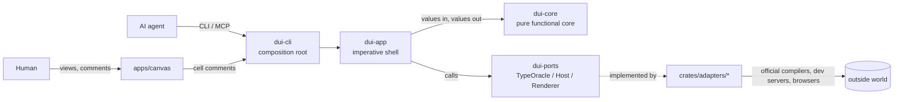
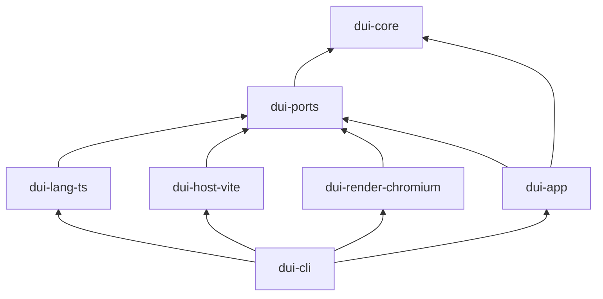

# dui architecture

English | [简体中文](../zh-CN/architecture.md) | [한국어](../ko/architecture.md)

> Status: decided 2026-11-20 · source of truth for code structure. Design context: [design v0](design-v0.md). Domain entities and storage port: [domain model](domain-model.md). Supported stacks: [Supported frameworks](supported-frameworks.md).

This document fixes how dui's Rust code is shaped: the architectural style, the patterns we use and ban, the module and crate boundaries, and the gates for M0 and M1. Where it overlaps with [design v0](design-v0.md), this document wins for code structure.

## 1. Style: Functional Core + Imperative Shell

dui is one Rust binary. Finding, combining, and judging states is done by **pure functions over immutable data** (the functional core). Asking official compilers, starting dev builds, driving browsers, reading files, and talking to the AI over CLI / MCP is done by **thin code at the edges** (the imperative shell).

Rules for the core (`dui-core`):

- **Zero I/O**: no file system, network, process, environment, clock, or randomness.
- **Zero async**: no `async fn`, no runtime, no futures in its API.
- **Same input, same output**: every function is deterministic. Inputs that come from the world (source snapshot, compiler answers, render observations, AI-inferred facts) are passed in as values.

Effects are pushed to the edges: the shell (`dui-app`) runs them through port traits and feeds the results back to the core as plain values.



Share rendering and measurement at the platform boundary. Web apps that run in Chromium use one browser host for navigation, captures and layout evidence. Add router or compiler rules where source declarations supply facts the browser cannot observe. Adapters emit the same screen graph so cards, storage and coverage keep the same meaning across frameworks.

## 2. Patterns we use

### 2.1 Functional Core + Imperative Shell

| Role | Rust form |
|---|---|
| Keep all logic testable without compilers or browsers | `dui-core` has only pure `fn`s over owned / borrowed data. The shell gathers inputs, calls the core, executes the returned effects |
| Keep effects visible | Effects are values (`Effect` enum, §2.6), never hidden calls inside analysis |

### 2.2 Ports & Adapters

There are exactly **three port traits**, all in `dui-ports`, and only at real I/O boundaries:

```rust
pub trait TypeOracle {
    async fn query(&mut self, snapshot: &SourceSnapshot, queries: &[TypeQuery])
        -> PortResult<CompilerAnswers>;
}
pub trait Host {
    async fn start(&mut self, build: &DevBuild) -> PortResult<Target>;
    async fn stop(&mut self, target: Target) -> PortResult<()>;
}
pub trait Renderer {
    async fn open(&mut self, target: &Target, job: &RenderJob) -> PortResult<Session>;
    async fn capture(&mut self, session: &mut Session) -> PortResult<Observation>;
    async fn close(&mut self, session: Session) -> PortResult<()>;
}
```

- **`TypeOracle`** asks the project's own official compiler (same exact version) for symbols and types. Each answer carries its query ID and `Known | Unknown(reason)`. The AST finds candidates; the compiler decides types; AI only fills gaps and is recorded as `Inferred`.
- **`Host`** starts the injected dev build and returns a `Target` (a web URL or a native entry point). Source transforms belong to the language adapter.
- **`Renderer`** opens one cell at a `Target`, then collects values, image, semantic tree, and executed branches.
- **`Store` ports** ([domain model §5](domain-model.md#5-storage-ports)) split persistence by bounded context (`WorkspaceRepository`, `RunRepository`, `ArtifactStore`, `CacheRepository`, `CommentRepository`, composed into `Store`) in `dui-core::storage` over pure `dui-core::model` aggregates and value objects. Concrete storage backends (local file archives, SQLite via `rusqlite` / Drizzle, or a future remote API) sit behind these ports as adapters; `dui-core` has zero storage dependencies.
- Port traits may be `async` because adapters talk to processes and browsers. Async stops at `dui-ports`; `dui-core` never sees it.
- Framework knowledge is **never** code in the core: no `if framework == …`, no per-stack plugin hierarchy. It lives in rule packs (§2.5) or in one adapter crate.

Mapping example: React and TanStack Query are rule packs; Vite is a `Host`; Chromium over CDP is a `Renderer`; TypeScript is a `TypeOracle` plus an injection transform. Rust web apps reuse the same Chromium renderer.

### 2.3 Immutable data and a stage-typed pipeline

Each stage has its own type, so a later stage cannot receive an earlier stage's data by mistake:

```rust
queries(&SourceSnapshot) -> Vec<TypeQuery>
facts(&SourceSnapshot, &CompilerAnswers, &[InferredFact]) -> Facts
model(&Facts, &[RulePack]) -> StateModel
plan(&StateModel, &PlanBudget, &BranchFeedback) -> Plan
jobs(&Plan, &[Width]) -> Vec<RenderJob>
verify(&[RenderJob], &OutcomesByCellId) -> Vec<Verification>
coverage(&[Verification]) -> Coverage
```

- **Newtypes** for IDs and units: `CellId`, `SymbolId`, `StateId`, `Width(u32)`.
- **Smart constructors**: outside input is parsed once with `TryFrom` / `Result` at the boundary (parse, don't validate). Private fields make invalid values impossible to build.
- **Algebraic data types** for statuses: `Evidence = Extracted | Inferred`; `CellStatus = Verified | Unverified(reason) | Unrenderable(reason)`; project-level `Support = Supported | Unsupported(reason)`. Every `match` on our own enums is exhaustive.
- **Workspace lints** (root `Cargo.toml`, `[workspace.lints.clippy]`): `unwrap_used = "deny"`, `wildcard_enum_match_arm = "deny"`. The wildcard lint protects our internal enums; a match on a foreign `#[non_exhaustive]` enum at a port boundary may use a local `#[expect(clippy::wildcard_enum_match_arm, reason = "…")]`.

### 2.4 Deterministic transforms

- IDs are **content hashes of canonical (normalized) data**, never counters or addresses.
- Outputs use `BTreeMap` / `BTreeSet` or explicit sorting. Clippy `iter_over_hash_type` is denied in `dui-core`.
- No timestamps, random values, or concurrency completion order inside facts, plans, IDs, or verdicts. Run metadata (time, tool versions, OS) is recorded beside results, not inside them.
- Reports are a `fold` over cells.

### 2.5 Declarative `RulePack` data, separate from execution

- A rule pack says what a resolved symbol means: **package + original symbol + type condition → slots, states, representative-value hints**. Aliases and re-exports match the same original symbol because the compiler resolved them.
- Format: a **versioned small JSON schema** (`rules/schema/rule-pack.v1.schema.json`). There is **no ast-grep YAML syntax layer**: matching is on compiler-resolved symbols, not on syntax shapes.
- Loading a pack parses it into a typed `RulePack` (parse, don't validate). A bad pack fails at load time with a clear error.
- Packs contain **no scripts, loops, or shell commands**. A new operation needed by several stacks is added as a tested pure Rust function in `dui-core::rules`.
- A `RenderJob` is also plain data: what to inject, what to intercept, what to assert.

### 2.6 Decider pattern + `Effect` enum

Analysis stays a pure pipeline (§2.3). **Run orchestration and interactive canvas sessions** (run started → cell captured → verdict → human highlight / comment → AI redraw → file change invalidation) use the Decider pattern:

```rust
pub fn decide(cmd: &Command, state: &SessionState) -> (Vec<Event>, Vec<Effect>);
pub fn evolve(state: SessionState, event: &Event) -> SessionState;
```

- `Command`, `Event`, `Effect`, `SessionState` are enums / structs in `dui-core::session`. No library is needed.
- `Effect` describes side effects as values, e.g. `QueryTypes`, `StartHost`, `RenderCell`, `StopHost`, `PersistSnapshot`, `PublishCanvas`, `NotifyAgent`. The core never performs them.
- `dui-app` is the **effect interpreter**: it executes each `Effect` through a port or the store and turns the result into the next `Command`.
- Tests are given-when-then: given events, when a command, then expected events and effects. Sessions can be replayed from their event log.

### 2.7 Typestate

Order mistakes are compile errors:

- `Host<Stopped>::start(self, …) -> PortResult<Host<Running>>`; `Host<Running>::stop(self) -> PortResult<Host<Stopped>>`. Only `Host<Running>` exposes its `Target`.
- `Cell<Planned>::capture(self, …) -> Cell<Captured>`; `Cell<Captured>::judge(self, …) -> Judged`, where `Judged` is an enum holding `Cell<Verified>` or the other statuses. A `Cell<Planned>` can also become `Unrenderable` directly.
- Coverage only accepts judged cells, so it cannot be computed from unjudged ones.
- Typestate wrappers live where the state lives: cell states in `dui-core::model`, host / session handles in `dui-app`. Port traits stay simple.

### 2.8 RAII guards with explicit `close(self)`

- Dev-server processes, Chromium sessions / tabs, and temporary injection directories are owned by guard types.
- The normal path is an **explicit, fallible** `close(self) -> PortResult<()>` / `stop(self)` that reports errors.
- `Drop` is the **fallback** for panics and cancellation: best-effort cleanup, no panics in `Drop`, a warning is recorded. `Drop` is never the only cleanup path.
- The shell also cleans up the hosts and sessions it started on failure paths.

## 3. Anti-patterns we ban

| Banned | Why | Instead |
|---|---|---|
| Hidden I/O in analysis (calling a compiler or reading a file inside the core) | Cannot cache, snapshot-test, or replay | Shell gathers inputs; `Effect` values |
| `async` or runtime types in `dui-core` | Couples logic to a runtime | Async only in ports / adapters / shell |
| `if framework == …` or version branches (`if react_18`) in the core | Grows with every stack; old majors are unsupported anyway | Rule packs; one adapter crate |
| Stringly-typed states (`"loading"`) | No exhaustiveness | Enums and newtypes |
| `unwrap()` in non-test code; `_ =>` on our own enums | Hides failures and new variants | `Result` + `?`; exhaustive `match` (lints deny both) |
| Iterating hash maps into outputs | Flaky snapshots | `BTreeMap`, sorting |
| A rule format that grows into a language | Untestable logic in data | Pure Rust function + test |
| Deep trait-object plugin hierarchies | Hard to follow and change | Plain data + free functions; traits only at the 3 ports |
| Adapters depending on other adapters | Hidden coupling between stacks | Shared code goes to `dui-core` or `dui-ports` |
| Concrete adapters inside `dui-app` | Shell becomes stack-aware | Wire adapters only in `dui-cli` |
| Accepting snapshots blindly in CI | Silent regressions | Reviewed snapshot diffs |
| An adapter or rule pack without a fixture | Untested support | No fixture, no merge |
| Copying code from other projects; non-permissive dependencies | License and clean-room rules | Ideas only; allowlist (§6.2) |

## 4. Finalized decisions (2026-11-20)

| Topic | Decision | Reason |
|---|---|---|
| Rule packs | Versioned small JSON schema. No ast-grep YAML syntax layer | Matching is on compiler-resolved symbols and types, not syntax shapes |
| WASM plugins | Deferred past M0 / M1. In-process Rust crates + typed JSON compiler sidecars first. Revisit only when outside contributors must ship code that rule-pack data cannot express | The current boundaries are met by built-in adapters and data packs; compilers and browsers are processes anyway |
| Version tracking bot | Renovate, **as an external service only**. It updates the dependency catalog (exact npm fixture versions) and the lockfiles in the same PR. Never bundled in dui. Raising a support baseline still happens only in a dui major release | It can track custom files such as `stacks.toml`. Renovate is AGPL-3.0, so its code never ships with dui |
| Chromium for golden renders | Golden CI pins an **exact stable build**. Normal runs record the Chromium version used | Separates browser changes from app changes. Golden runs also fix OS, fonts, clock, randomness, and animations; update PRs review the diffs |
| salsa | Deferred until profiling shows recomputation unrelated to the change is the main bottleneck (e.g. in the MCP edit loop). Content-hash cache first, keyed by stage inputs plus tool and pack versions | The core is pure, so incremental queries can be added later without a rewrite |

## 5. Monorepo layout

The target layout is a **polyglot monorepo**: a Cargo workspace for Rust, a pnpm workspace for the TypeScript parts, plus data, fixtures, docs, and tooling. `stacks.toml` is the single source of truth for supported stacks.

For the current npm packages, edit [dependency-catalog.json](../../dependency-catalog.json) and run `npm run deps:sync`. CI runs `npm run deps:check` to check manifests and lockfiles. Rust crates inherit dependency requirements from the root `[workspace.dependencies]`. The catalog controls dui’s own dependencies and fixtures. Support baselines are a separate release decision.

```text
dui/
├── Cargo.toml                 # Cargo workspace root: members, [workspace.lints], shared versions
├── clippy.toml                # disallowed methods / types for the core (§6.2)
├── dependency-catalog.json    # exact npm versions for tooling, apps and fixtures
├── pnpm-workspace.yaml        # JS workspace: packages/*, apps/*
├── package.json
├── stacks.toml                # single source of truth: supported stacks, baselines, adapter + pack mapping
├── renovate.json              # config for the external Renovate service
├── crates/
│   ├── dui-core/              # pure functional core
│   │   └── src/
│   │       ├── model/         # immutable IR, newtypes, ADTs, typestate cells
│   │       ├── pipeline/      # queries → facts → model → plan → jobs → verify → coverage
│   │       ├── rules/         # RulePack parsing (TryFrom) + symbol matching
│   │       ├── session/       # Decider: Command, Event, Effect, SessionState, decide, evolve
│   │       └── hash.rs        # canonical content hashing, ordering helpers
│   ├── dui-ports/             # TypeOracle, Host, Renderer + typed request / response contracts
│   ├── dui-app/               # imperative shell: Effect interpreter, content-hash cache, store, shared CLI / MCP use cases
│   ├── dui-cli/               # the only binary `dui`: composition root, CLI, MCP server, embedded canvas server
│   └── adapters/
│       ├── dui-lang-ts/       # TS 7 TypeOracle (talks to packages/ts-sidecar) + oxc parsing / injection
│       ├── dui-host-vite/     # Vite dev-server Host
│       └── dui-render-chromium/ # Chromium over CDP Renderer (chromiumoxide)
├── packages/
│   ├── ts-sidecar/            # Node sidecar on the project's own TS 7 (typed JSON over stdio)
│   └── schemas/               # shared JSON Schemas (IR, results, sidecar protocol) for Rust and TS
├── apps/
│   └── canvas/                # React + React Flow canvas UI; built assets embedded in `dui`
├── rules/
│   ├── schema/rule-pack.v1.schema.json
│   └── packs/                 # react.json, tanstack-query.json, zod.json, …
├── fixtures/                  # one golden fixture per stack + insta snapshots
├── docs/                      # en (source of truth) / zh-CN / ko
└── xtask/                     # repo tooling (Rust): generation and boundary checks (§6.2)
```

| Unit | Responsibility | May depend on (workspace) |
|---|---|---|
| `dui-core` | Pure functional core: `model`, `pipeline`, `rules`, `session`, `hash` | nothing |
| `dui-ports` | The 3 port traits + typed contracts (`TypeQuery`, `CompilerAnswers`, `DevBuild`, `Target`, `RenderJob`, `Observation`, `PortResult`) | `dui-core` |
| `crates/adapters/*` | One concrete port implementation each | `dui-ports`, `dui-core` (types) — **never another adapter** |
| `dui-app` | Effect interpreter, cache, store, use cases shared by CLI and MCP; works against port traits only | `dui-core`, `dui-ports` — **no concrete adapters** |
| `dui-cli` | Single binary `dui`; wires concrete adapters (composition root); CLI (JSON output, stable exit codes, no prompts), MCP server, embedded canvas server | everything above |
| `xtask` | Generates the 3-language framework tables and the CI matrix from `stacks.toml`; enforces dependency boundaries and the license allowlist | not linked into `dui` |
| `packages/ts-sidecar` | Answers type queries with the project's official `typescript` 7 | `packages/schemas` |
| `apps/canvas` | Human-viewable canvas; cell comments go back to the AI over MCP | `packages/schemas` |

New stacks follow the same shape: a new language adds `crates/adapters/dui-lang-<x>`; a new dev server adds `dui-host-<x>`; a new renderer adds `dui-render-<x>`; most frameworks and libraries add only `rules/packs/<x>.json` + a fixture + a `stacks.toml` entry.

## 6. Dependency direction and enforcement

### 6.1 Direction



Arrows point from the user to the provider. Adapters have no arrows between them. Only `dui-cli` knows concrete adapters.

### 6.2 Automated checks (CI fails on any violation)

1. **Workspace lints**: `unwrap_used` and `wildcard_enum_match_arm` denied everywhere; `iter_over_hash_type` denied in `dui-core`.
2. **Core purity**: `clippy.toml` `disallowed-methods` / `disallowed-types` block `std::fs`, `std::net`, `std::process`, `std::env`, `SystemTime::now`, `Instant::now` and similar in `dui-core`.
3. **Dependency graph** (`cargo xtask check-deps`, reading `cargo metadata`):
   - `dui-core` has no workspace dependencies and no async / I/O crates (e.g. async runtimes, HTTP, process, file-watching crates) — checked against an allowlist of pure crates;
   - `dui-ports` depends only on `dui-core` inside the workspace;
   - each adapter depends only on `dui-ports` / `dui-core` inside the workspace;
   - `dui-app` depends on no adapter;
   - only `dui-cli` produces a binary.
4. **Licenses** (`cargo xtask check-licenses`, plus `cargo-deny` for Rust and an equivalent check for the pnpm workspace): direct and transitive dependencies must be MIT, Apache-2.0, BSD-2-Clause / BSD-3-Clause, ISC, or Zlib. Build-only exception: unmodified `lightningcss` (MPL-2.0) and its official platform binaries may be installed transitively by Vite and Tailwind to process CSS. Build tooling may also install unmodified `tslib` (0BSD) as an optional transitive development dependency. Exclude their code and binaries from browser assets, the Rust executable, and release archives. All other dependencies follow the allowlist.
5. **Generated files are current**: `cargo xtask gen` output (framework tables in 3 languages, CI matrix) must match the committed files.
6. **Fixtures**: every `stacks.toml` entry has a fixture and reviewed snapshots.
7. **Web and tooling sources**: Oxlint checks TypeScript, React hooks and JSX accessibility. Oxfmt checks TypeScript and CSS formatting. Local and PR checks use `npm run check:style`. Apply formatting with `npm run format`.

### 6.3 Project-owned design audit

The CLI runs project code only when the caller explicitly supplies a trusted manifest with `dui audit RUN_DIR --design MANIFEST`. Add these fields to the capture manifest.

```json
{ "designSpec": "./tokens.json", "plugins": ["./token-check.mjs"] }
```

Paths resolve inside the manifest directory. The CLI uses Node.js to invoke each plugin once per verified cell with a non-empty render tree, in manifest order. It runs `.mjs` files with Node.js and other executables directly. Plugins have the caller's local permissions. Each receives one JSON object on stdin and writes one JSON object to stdout.

- Input fields are `version` (1), `index` (zero-based cell position), `path`, `width`, `state`, `locale`, `scenario`, `renderTree` and `designSpec`. The spec contains its configured `path` and `content`, parsed as JSON for `.json` files or read as UTF-8 text for files such as `DESIGN.md`.
- Output contains `findings` and optionally `unverified`, a list of reasons. Each finding carries `rule`, `severity` (`info`, `warning`, or `error`), `nodeId`, `rect`, `summary`, `measured`, `expected` and an optional `specRef`. The node ID and rectangle must match the same captured node.
- The coverage report gains a `designAudit` object with cell locations and plugin paths. A clean check returns 0. Any finding or missing evidence returns 5. Invalid configuration returns 2. A failed plugin, malformed response or 30-second plugin timeout returns 3.

The [reference checker](../../examples/design-audit/token-check.mjs) reads its tag, computed-style property and token from the [project spec](../../examples/design-audit/tokens.json). It accepts computed-style strings and six-digit sRGB hex colors.

```sh
dui run examples/design-audit examples/design-audit/dui.json ./capture
dui audit ./capture --design examples/design-audit/dui.json
```

## 7. M0 and M1 gates

**M0 — prove the real render path with hand-picked states.** One obora-web review screen, after obora meets the TS 7 baseline.

1. The single `dui` binary renders 5 hand-picked states at 3 widths: 15 distinct cell IDs and 15 images.
2. At least one local state is injected from outside with oxc and its actual value is read back and matches. CDP Fetch is shown to have returned the mock response for a chosen request.
3. The injected dev build passes the project's official `tsc` check, and the production build contains 0 occurrences of `__dui`. In tests with injected failures, no planned cell ID disappears.

**M1 — compute states and coverage automatically for the same screen.**

1. From React, TanStack Router, TanStack Query, and zod fixtures, screens, slots, representative values, and target branches are extracted automatically. The original import, an alias, and a re-export must produce the same facts. At least one case gets real type answers from the official stable TS. Beta APIs or AI inference alone cannot pass this gate.
2. With the same snapshot, compiler answers, packs, inferred inputs, and budget, facts, IR, plan, and cell IDs are identical even when execution order changes. Checked with `insta` snapshots; `proptest` checks budget compliance and that uncovered valid value pairs are reported.
3. For the review screen, JSON output gives **executed target branches / all target branches** and **verified cells / renderable cells** separately, plus branches found at runtime outside the denominator, the unverified list, and unrenderable reasons. The fill-in loop stops on no improvement or at the configured limit.
4. CLI and MCP return the same plan and verdicts for the same input.

Reproducible M1 gate inputs, commands, and verified outputs live in [M1 gates](m1-gates.md) (`npm run check:m1`).

Use the [roadmap](roadmap.md) for release order and the [web viewer architecture](web-viewer.md) for the v0.0.2 implementation contract.

## 8. Remaining risks

1. How much structured type information TS 7 stable exposes is `unconfirmed`. M0 tests symbol / type queries on fixtures; unanswered queries stay `Unknown`.
2. Branches the analyzer misses can also be missing from cell coverage. From M1, runtime branch lists are compared and out-of-denominator branches are reported separately.
3. GPUI capture and semantic-tree access are `unconfirmed`. M2 tests both on a pippip screen; a captured cell whose semantic assertions cannot be checked stays `unverified`.
