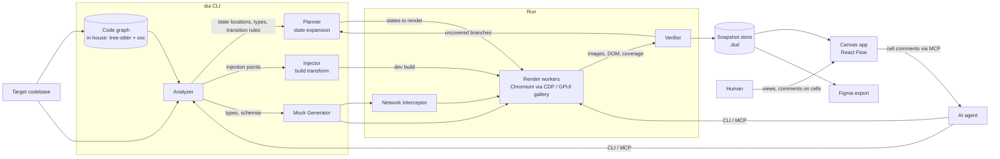

# dui design v0 (developer tool)

English | [简体中文](../zh-CN/design-v0.md) | [한국어](../ko/design-v0.md)

> Status: draft · written 2026-11-19 · audience: developers building dui
> External facts in this document (licenses, star counts, versions) were checked with the GitHub API on 2026-11-19. Anything not confirmed is marked `unconfirmed`.
> Code structure, patterns, ports, and crate boundaries: [Architecture](architecture.md) (decided 2026-11-20). Where the two overlap, the architecture document wins for code structure.

> **Positioning**: design-generation tools show *how it will be built*: AI imagines screens that do not exist yet. dui shows *how it is actually built*: it reads existing code through the official compilers and really renders every state that exists. Nothing is invented; what cannot be shown is marked `unverified` or `unrenderable`.

## 0. Core principle: AI-native

**dui is AI-native. AI uses everything; humans only look at the canvas.** (decided 2026-11-19)

| Surface | Who | What |
|---|---|---|
| AI surface | AI agents | The `dui` CLI + an MCP server. JSON output, stable exit codes, no interactive prompts, idempotent commands. AI runs analyze / inject / render / verify and fixes `unverified` cells itself |
| Human surface | Humans | **The canvas only.** No settings screens and no command instructions in the UI. It shows screens × states × widths × transitions |
| Loop | Both | A human comments on a canvas cell → AI reads the comments via MCP → fixes the code → the canvas re-renders |

Every component below is designed for this split: anything a person would "run" is run by an AI agent; anything a person needs to "see" is on the canvas.

### Principle #2: official-compiler-dependent (decided 2026-11-19)

**dui is an official-compiler-dependent project.**

- Only each language's **official compiler / toolchain** is supported: TypeScript → `tsc` from Microsoft's `typescript` package, **7.0+ only**; Rust → `rustc` (Cargo) with rust-analyzer for type queries; later Swift → `swiftc` + SourceKit-LSP; Kotlin → `kotlinc`.
- Unofficial or alternative compilers / toolchains are **`unsupported`**.
- dui uses the official compiler already in the user's project (exact version). It **does not reimplement type checking**.
- Details: [Tech stack](#tech-stack-decided-2026-11-19).

## 1. Problem and users

**Users**: developers, designers, and QA who build UI in TypeScript or Rust.

**Problem**
- Even one screen has many states (empty list, loading, error, no permission, long text, after approving the last page …). Today you can only see one by clicking your way to it.
- There is no way to know which states have never been drawn.
- You have to resize the window separately for every responsive width.
- Storybook requires a person to write each state by hand, and Figma is not real code.

**What dui does**: it reads the codebase, renders **every screen × every state × every width** of the app from real code, and lays them out on an infinite canvas like Figma. Cells it could not draw show as `unverified`. The target coverage is 99%; how it is measured is defined in §8.

## 2. Goals and non-goals

**Goals**
- Typed languages only: TypeScript (web, webviews) and Rust (GPUI native).
- Find states and produce mock values with AI + types, without people writing states.
- No hand-written per-framework adapters. AI generates injection code that fits the target code on demand.
- Results must be measurable (coverage with a numerator and a denominator).

**Non-goals**
- Direct input into an archived screenshot. Live state inspection uses a running app in v0.0.2.
- Visual regression testing (pixel-diff approval flows). That is Chromatic's and Percy's area. It may be added later.
- Untyped JavaScript, Python, Dart, Swift, Kotlin, etc. (out of scope for v0)
- Leaving the SDK in production builds. All injection code is dev-build only.
- A design editing tool. dui exports to Figma but does not replace it.

## 3. Core ideas

1. **AI finds every place where state lives**: global stores, component-local state (`useState`, etc.), context, URL / route, server response caches, GPUI Entity / model fields.
2. **Insert forced-injection code at build time**: leave the source as is and create a "start with this value" entry point with a dev-build transform (oxc transform for TS, proc-macro / build script for Rust; see [Tech stack](#tech-stack-decided-2026-11-19)). That way even local state can be set from outside.
3. **Intercept APIs at the network level**: respond with mocks generated from types.
4. **Inject, render, check**: inject the state, render at each width, and check that the result matches the intended state. If it does not, it is `unverified`.

Why types are the key: with types we can (a) enumerate state shapes completely, (b) generate valid mock values automatically, and (c) get a first-pass check from whether the injection code passes the compiler.

## 4. Architecture

This section is the component view. How the code is split into a pure core, three ports (`TypeOracle`, `Host`, `Renderer`), adapters, and crates is defined in [Architecture](architecture.md).



| Component | What it does | Input → output |
|---|---|---|
| `dui` CLI | Entry point **for AI agents** (not for humans): runs everything, caching, config. `dui scan`, `dui render`, `dui open`. JSON output, stable exit codes, no prompts, idempotent | config file → run |
| MCP server | Same operations as the CLI for AI agents, plus reading and resolving canvas cell comments | MCP calls → JSON |
| Analyzer | Finds screens, state locations, events, state-change points, transition rules. In-house code graph + type info from the official compiler + AI | code → `Screen`, `StateSlot`, `Rule` |
| Injector | Inserts a dev-only injection entry point at each state location at build time | `StateSlot` → transformed dev build |
| Mock generator | Generates representative values from types / schemas (zod, OpenAPI, Rust types) | type → value sets |
| Planner | Combines data shapes × branches × sequences into the list of states to render; re-plans for uncovered branches | rules, coverage → `State[]` |
| Network interceptor | Intercepts API requests and returns mock responses matching the state | request → mock response |
| Render workers | Inject state, render per width, collect image / DOM / coverage. Run in parallel | `State` × width → `RenderCell` |
| Verifier | Checks the render is the intended state | `RenderCell` → verification status |
| Snapshot store | Stores all results as files (`.dui/`), per commit hash | — |
| Canvas app | Lays out screen×state nodes, width columns, transition edges on an infinite canvas | store → view |
| Figma export | Same layout as a Figma file | store → Figma |

## 5. Data model

```ts
type Lang = "ts" | "rust";
type Provenance = "extracted" | "inferred" | "verified"; // explicit in code / AI inference / confirmed by replay

interface Screen {
  id: string;                 // "review", "export", "settings.team"
  route?: string;             // web: "/projects/$id/review"
  entry: SourceRef;           // screen root component or GPUI View
  lang: Lang;
}

interface StateSlot {         // one place where state lives
  id: string;
  kind: "store" | "local" | "context" | "route" | "server" | "entity";
  owner: SourceRef;           // component / store / Entity that owns this state
  type: TypeRef;              // type info (basis for mock generation)
  injectable: boolean;        // whether an injection entry point was generated
}

interface State {
  id: string;                 // content hash
  screenId: string;
  label: string;              // "list empty", "after approving the last page"
  kind: "data-shape" | "branch" | "sequence";
  values: Record<StateSlotId, unknown>;   // injected value per slot
  network: MockResponse[];    // responses the API returns in this state
  path?: EdgeId[];            // sequence states: path from the start to here
  expect: Assertion[];        // what the verifier checks
  targets: BranchId[];        // code branches this state aims to cover
}

interface Edge {              // state transition
  id: string;
  from: StateId;
  to: StateId;
  event: string;              // "onClick: approve", "shortcut 1"
  rule: SourceRef;            // handler / reducer the rule came from
  provenance: Provenance;
}

interface Snapshot {          // one run's bundle of results
  id: string;
  commit: string;             // target repo commit
  createdAt: string;
  widths: number[];           // e.g. [375, 768, 1280]
  axes?: { theme?: ("light" | "dark")[]; locale?: string[] };
}

interface RenderCell {        // one canvas cell = state × width (× axes)
  snapshotId: string;
  stateId: string;
  width: number;
  image?: string;             // file path
  dom?: string;               // web: serialized DOM / accessibility tree
  coveredBranches: BranchId[];
  status: VerificationStatus;
}

type VerificationStatus =
  | { kind: "verified" }                          // passed verification
  | { kind: "unverified"; reason: "render-failed" | "assert-failed" | "not-injectable" | "not-rendered" }
  | { kind: "unrenderable"; reason: "no-render-env" | "system-ui" | string }; // cannot be rendered in this environment; see "Rendering limits"
```

`unverified` = every `unverified` kind. On the canvas it shows as a grey hatched cell with the reason.

`unrenderable` is a separate status, not a kind of `unverified`: the cell can't be drawn at all in the current render environment. It shows on the canvas as "unrenderable (reason)".

## 6. Pipeline

1. **Scan** (`dui scan`)
   - Build the call / import graph with dui's in-house code graph (tree-sitter + oxc).
   - Find screens: router definitions (TanStack Router, Next app directory, etc.), GPUI root Views.
   - Find state locations: type info + AI. Result: `StateSlot[]`.
   - List code branches: render branches reachable from the screen (conditional JSX, early return, `match`).
2. **Enumerate states** (planner) — three kinds are combined.
   - **Data shape**: representative values from types. Lists 0 / 1 / many, strings empty / normal / very long, optional present / absent, every arm of a union, API success / error (4xx/5xx) / delay.
   - **Code branch**: AI solves each branch condition backwards to produce values that enter that branch.
   - **Sequence**: follow the graph from event handlers to state-change points to build `state + event → next state` rules. Expand the rules from the initial state (model-checking style). Infinite expansion is cut with representative values (0, 1, last, one past last) and a depth limit. Identical value sets are merged.
3. **Injection build**: the injector produces a dev build. Slots that fail to compile get `injectable=false`.
4. **Render** (`dui render`): workers inject values + mock responses per state and render per width. Save image, DOM, and branch coverage.
5. **Verify**: §7.
6. **Fill-in loop**: if uncovered branches remain, go back to step 2 and create states for those branches. Stop when there is no improvement or the iteration limit is reached.
7. **Sequence replay verification**: for sequence states, not only inject but actually replay the events along the path from the initial state and check the same screen appears. If it matches, the edge becomes `verified`.
8. **View**: the AI agent publishes the canvas (`dui open`) or exports to Figma; humans only look at the canvas and comment on cells. Comments go back to step 1 via MCP.

## 7. Verification

"It rendered" is different from "it rendered the intended state". Three checks:

1. **Value check** (required): right after rendering, read back the actual value of each injected slot and compare with the intended value. A mismatch means injection failed.
2. **Semantic check** (required): run assertions generated from the state against the DOM / accessibility tree (web) or the GPUI element tree (native; feasibility `unconfirmed`). E.g. "empty-list state → 0 list items + an empty-state message", "error state → role=alert exists".
3. **Visual check** A visual discrepancy is recorded as review evidence. The verifier returns one of the three cell statuses.

Also a **coverage check**: confirm via coverage that the branches the state aimed at (`targets`) actually executed. If not, `unverified: assert-failed`.

## 8. How 99% is measured

Measured as a number, not a feeling. The denominator is defined explicitly.

- **Denominator** = (render branches per screen + data-shape representative values per screen + reachable sequence states within the depth limit) × number of configured widths.
  - Render branches: conditional render branches (conditional JSX, ternaries, early returns, `match` arms) inside components reachable from the screen root. Branches with no effect on what is drawn (logging, etc.) are removed by exclusion rules.
  - Because the analyzer builds the denominator itself, "branches missing from the denominator" are measured separately: compare with the full branch list from runtime coverage tools (V8 coverage / istanbul; for Rust, the `cargo llvm-cov` family).
- **Unrenderable cells** (see "Rendering limits") are **excluded from the denominator** but always reported as a separate count with reasons. So coverage = `verified` cells ÷ renderable cells.
- **Unsupported** projects / modules (older than the current latest stable major, or non-official compilers; see Tech stack) are rejected before scanning and are not measured at all.
- **Numerator** = the number of `verified` cells in the denominator.
- **Report**: renderable coverage % per screen and per kind + a list of unverified cells (with reasons) + the unrenderable count (with reasons). E.g. `review 97.8% (branches 44/45, shapes 18/18, sequences 23/24) × 3 widths; unrenderable 2 (system-ui)`.
- **Condition for 99%**: our code (obora, pippip) follows a rule to gather screen state in one place with types, reducers, or state machines. That keeps the sequence-state denominator accurate.

## 9. Per-language specifics

### 9.1 TypeScript (web, Electron / Tauri webviews)

| Item | Approach |
|---|---|
| Finding screens | Static analysis of router definitions (TanStack Router, React Router, Next app directory). obora-web uses TanStack Router (confirmed) |
| Types | Resolve slot types through `TypeOracle` with the project's official TypeScript compiler (see Tech stack). Prefer zod schemas when present (obora-web uses zod, confirmed) |
| Local state injection | An oxc transform in the dev build rewrites `useState(init)` to the form `useState(__dui.get("slotId") ?? init)`. Same approach for `useReducer` and context Provider values |
| Store injection | Wrap initial values at creation sites for Zustand, Redux, Jotai, etc. in the same way |
| Server cache | TanStack Query: pre-fill the `QueryClient` before rendering, or mock the network |
| Network | Intercept requests with the CDP Fetch domain and answer with mocks (no MSW). Interception of requests made outside the browser (server side) is `unconfirmed` |
| Rendering | Drive Chromium over CDP from Rust (chromiumoxide) and render per viewport width. Image + DOM + accessibility tree + V8 coverage |
| Electron | Renderer is the same as web. Mock preload / IPC calls and open the renderer bundle in Chromium via CDP |
| Tauri | Mock `invoke` calls and render the same as web |
| Sequence replay | Replay real clicks and key presses via CDP input events |

The `__dui` injection runtime is included only in dev builds; the transform is off for production builds. CI checks that `__dui` is absent from build output.

### 9.2 Rust (GPUI native)

pippip uses `gpui-pre 0.3.12` + `gpui-kit 0.10.0`, and `reqwest` for HTTP (confirmed in Cargo.toml). The GPUI crate license is Apache-2.0 (confirmed in `crates/gpui/Cargo.toml` of the zed repo).

| Item | Approach |
|---|---|
| Finding screens | Static analysis of root Views and screen-switch points + AI |
| Types | Resolve Entity / model field types with rust-analyzer or `syn`-based parsing |
| State injection | Under a dev feature only, attach a `#[dui::state]` proc-macro to model types that generates `serde` serialization + a "start with this value" constructor. AI generates the patch that attaches it during the build step |
| Extracting state | The same macro dumps current state (also used to collect states during real use) |
| Network | Under a dev feature, point the HTTP client at a local mock server, or swap the client behind a wrapping trait |
| Rendering | In-app `dui` gallery mode: read a state file, build the View, draw at each width's window size, save an image. Confirmed that the `gpui-pre 0.3.12` source has `HeadlessAppContext::capture_screenshot` and `Window::render_to_image` (`test-support` feature) (2026-11-19, [language survey](language-survey.md)). Actually running it in pippip is `unconfirmed` → top priority of the M2 spike. If it does not work, fall back to a hidden window + OS capture |
| Sequence replay | Replay by dispatching actions in gallery mode |
| Verification | Value checks via dump comparison. Element-tree-based semantic checks are `unconfirmed` |

Precondition rule: screen state lives in Entities / models. State scattered inside Views is missed by dump / injection and is marked `not-injectable`.

## 10. Graph engine

- **Changed 2026-11-19**: the core is Rust, so the code graph is **built in-house on tree-sitter + oxc** inside the dui binary. Graphify is Python and cannot be the embedded engine.
- **Graphify** (Apache-2.0, ★150,430, checked 2026-11-19) is now **reference only (ideas)**: ~40 languages via tree-sitter and `EXTRACTED` / `INFERRED` tags on every edge (confirmed in the README). dui keeps the idea and extends the tags to `extracted` / `inferred` / `verified`.
- **CodeGraph** (MIT, ★78,082, checked 2026-11-19): reference only for framework-aware routes (confirmed in the README).
- The code graph is a pure data structure in `dui-core`, built only from parser facts. It is not a port: ports exist only at I/O boundaries ([Architecture §2.2](architecture.md#22-ports--adapters)).

## 11. Canvas

Layout: **rows = screen×state, columns = widths (and theme / locale axes), edges = transitions**. Unverified cells are grey hatched + reason.

<a id="web-viewer"></a>

### Web viewer

**v0.0.2 uses React 19 and TypeScript 7 for the viewer, TanStack Start for routing and the application build, shadcn/ui for controls, Tailwind CSS for layout and theme tokens, and React Flow for the screen map.** Use Start’s SPA mode to build the static shell. The Rust binary serves the shell, its assets and local capture data. Direct navigation to a viewer route must load the shell; a missing capture or asset must return its own error. The existing standalone HTML gallery remains readable. [SPA mode](https://tanstack.com/start/latest/docs/framework/react/guide/spa-mode)

A selection identifies the project, run, screen, state and capture width. Preserve it across the overview, inspector, browser Back and reload using validated route parameters. Offer keyboard navigation through both the map and a screen list. Display the report’s verification status and reason next to the capture. [Router search parameters](https://tanstack.com/router/latest/docs/framework/react/guide/search-params) · [Viewer implementation and review skill](../../.agents/skills/dui-web-viewer/SKILL.md)

**Maintenance boundaries.** Rust owns capture evidence, verification and coverage. The viewer decodes saved report and graph data at one boundary into typed values shared by the map, list and inspector. Handle older optional fields there. An unknown status or invalid required field produces a readable data error. The router owns the selected cell. React Flow owns map layout and pan/zoom. Components own temporary interaction state such as an open menu.

[Web viewer architecture](web-viewer.md)

| Candidate | License (checked 2026-11-19) | Decision |
|---|---|---|
| React Flow (`xyflow/xyflow`) | MIT, ★39,087 | **First choice**. Image or iframe inside nodes (live DOM for web) |
| tldraw (`tldraw/tldraw`) | Custom license (GitHub shows NOASSERTION). LICENSE.md: free in development environments only; **production use requires a separate commercial or trial license key**; license key and watermark are enforced; usage data may be sent | **Excluded from v0**. Its production terms would pass on to users and companies who use dui commercially, so not used until cost and terms are checked |
| Figma export | Figma plugin / REST API (pricing and limits `unconfirmed`) | Secondary output. Same layout as image nodes |

### Referenced project: Whiteboard (ideas only)

[devdotfast/whiteboard](https://github.com/devdotfast/whiteboard) (MIT, ★3,553, checked 2026-11-19) is a desktop app where humans and AI agents design software on a shared canvas. dui references **ideas only; no code is copied**:

| Idea in Whiteboard | How dui uses the idea |
|---|---|
| An SDK that lets the agent draw on the canvas (AI draws through an API) | Model for the canvas side of dui's MCP server |
| Clicking a canvas item jumps to the underlying code | Clicking a dui cell jumps to the code where that state is defined |
| A human highlights something and the agent redraws | Same as dui's loop: canvas cell comment → AI fixes code → canvas re-renders |

dui does **not** embed Whiteboard: it vendors Code-OSS (heavy to bundle) and sends anonymous telemetry unless the user turns it off. A possible future integration is showing dui results as a Whiteboard plugin. dui names never use the Whiteboard trademark.

## 12. License policy

- dui is **Apache-2.0 open source**. Dependencies must allow commercial use (MIT, Apache-2.0, BSD, ISC) so that users and companies can use dui commercially.
- Forbidden: noncommercial (PolyForm Noncommercial, etc.), strong copyleft such as AGPL and GPL, and anything like tldraw that needs a separate contract for production use (until such a contract exists).
- How to check: for each new dependency, check `gh api repos/<owner>/<repo> --jq .license.spdx_id` and the LICENSE text, and block in CI with a license checker for JS and `cargo deny` for Rust.
- Keep license and copyright notices in distributions (including NOTICE for Apache-2.0).

| Dependency | License | Status |
|---|---|---|
| Graphify | Apache-2.0 | Allowed (reference only, not a dependency) |
| CodeGraph | MIT | Allowed (reference only, not a dependency) |
| React Flow | MIT | Allowed |
| rmcp (official Rust MCP SDK) | Apache-2.0 | Allowed |
| oxc | MIT | Allowed |
| tree-sitter | MIT | Allowed |
| chromiumoxide | MIT OR Apache-2.0 | Allowed |
| syn, `ra_ap_*` | MIT OR Apache-2.0 | Allowed |
| GPUI (crate) | Apache-2.0 | Allowed |
| GitNexus | PolyForm Noncommercial | Forbidden |
| tldraw | Custom (production requires a paid contract) | On hold |

## 13. MVP scope and milestones

**MVP**: lay out 3 obora-web screens (review, export, settings) × auto-discovered states × 3 widths on a React Flow canvas and show a coverage number per screen. Native comes after the MVP.

| Milestone | Content | Done when |
|---|---|---|
| **M0 spike** | One obora-web screen: review (obora will move to TS 7 first; TS < 7 is `unsupported`). Render 5 hand-picked states at 3 widths with oxc-transform injection + CDP Fetch interception + Chromium via CDP, all driven by the Rust binary | [Architecture §7](architecture.md#7-m0-and-m1-gates) M0 gates (15 cell IDs and 15 images, read-back value match, 0 `__dui` in production) |
| **M1 automatic states** | Analyzer + mock generator + planner. Auto-enumerate data shapes and code branches, measure coverage, fill-in loop | [Architecture §7](architecture.md#7-m0-and-m1-gates) M1 gates (branch and cell coverage in JSON, unverified list, same results from CLI and MCP) |
| **M2 GPUI spike** | One pippip screen. Check offscreen rendering, prototype the `#[dui::state]` macro | State file → one image |
| **M3 sequence states** | Extract event → state-change rules, expand, verify by CDP replay, mark edges `verified` | Sequence states such as "after approving the last page" on the review screen generated and verified automatically |
| **M4 canvas** | React Flow canvas (rows = states, columns = widths, edges = transitions, unverified and unrenderable marks); the AI agent opens it via CLI / MCP (`dui open`), humans only view it | All 3 obora screens laid out |
| **M5 obora 99% attempt** | 99% target for the 3 screens, apply the explicit-state rule, Figma export | Coverage report per screen |
| M6 and later | All of pippip, Electron (obora-desktop), then the remaining stacks in [Supported frameworks](supported-frameworks.md) priority order | — |

## 14. Risks and open questions

**Risks**
- **Wrong injection points**: AI may find the wrong slots, or a transform may change behavior. → Filter with value checks + compile checks + semantic assertions; mark as `unverified`.
- **State explosion**: sequence-state combinations grow large. → Representative values, depth limits, merging identical renders. Tune limits after measuring.
- **Denominator reliability**: branches the analyzer misses are also missing from the denominator. → Compare with all branches from runtime coverage and report the "outside the denominator" number separately.
- **Non-deterministic rendering**: time, randomness, animations, font loading. → Freeze clock and randomness, disable animations, wait for fonts.
- **GPUI rendering path uncertainty**: if offscreen rendering does not work we must use OS capture, which brings macOS permission and speed problems.
- **AI cost and time**: scan cost on large codebases. → Cache graphs and results per commit; redo only changed files.
- **Dependency on official compiler APIs**: the TS 7 programmatic API is new (7.1 beta) and `ra_ap_*` has no compatibility guarantee. → Keep them behind `TypeOracle`; pin versions.

**Open questions** (in order of importance)
1. Does GPUI's (`gpui-pre 0.3.12`) headless capture API (confirmed to exist in code) actually work on pippip screens? If not, what is the native rendering path?
2. How to automatically remove "branches with no effect on the screen" from the coverage denominator. This rule defines what 99% means.
3. What expansion limits (depth, representative values) for sequence states cover all meaningful states within a practical number of renders?
4. How the TS adapter talks to TS 7.1's API from Rust (a small Node sidecar using `typescript/sync`, or a documented wire protocol, which is `unconfirmed`).
5. Figma export pricing and API limits (`unconfirmed`).

## Principle: combinations are produced by the system, not by AI (decided 2026-11-19)
AI is used **only to find where state lives and what type it is**. Which combinations to draw is decided by deterministic algorithms so the result is the same every time.
1. Representative values come mechanically from types: lists 0 / 1 / many, bool both, every enum value, strings empty / normal / very long, optional including null, numbers 0 / boundary values.
2. Independent decomposition: group only states that are used together in the same render region of the code graph; expand the rest separately (product → sum).
3. Inside a group, deterministic pairwise generation (every pair of values at least once).
4. Sequence states: depth-limited BFS; visited states are not revisited.
5. Impossible combinations are removed by type and code conditions (discriminated unions, guards).

**Guarantee scope**: only states expressed clearly with types, enums, discriminated unions, or state machines are guaranteed. Scattered implicit state is honestly shown as `unverified`. The more clearly state is written, the higher the coverage — that is the "shortcut to good code" dui offers.

## Rendering limits (decided 2026-11-19)

Some UI can't be rendered everywhere. The Apple ecosystem is the main example:

| Limit | Details |
|---|---|
| Toolchain lock-in | SwiftUI / UIKit / AppKit render only on macOS with the Xcode toolchain. A Mac runner is required; Linux CI can't render them |
| iOS rendering | Needs the simulator, `ImageRenderer`, or snapshot testing. All are slow and run only on a Mac |
| System UI | UI outside the app (permission prompts, notifications, keyboard, some sheets) can't be injected or rendered |
| OS-dependent rendering | Fonts, dark mode, Dynamic Type, and OS version can change the result, so renders may differ between OS versions |

Principle:

1. Cells that can't be rendered are never hidden. They show on the canvas as a separate status, **unrenderable (reason)**, distinct from `unverified`.
2. Each platform documents the render environment it requires (e.g. a Mac runner with Xcode for Apple platforms).

## Tech stack (decided 2026-11-19)

**Rust core from day one**: one binary with no Node or Python runtime of its own. The CLI, the MCP server, the analyzer, and the deterministic combination rules all live in Rust. This replaces earlier mentions of Vite / Babel / SWC, MSW, Playwright, ts-morph, and Graphify as an engine. Versions and licenses were checked on 2026-11-19 (crates.io, npm, GitHub).

| Layer | Choice | License | Notes |
|---|---|---|---|
| Core | Rust, edition 2024 | — | Single binary. Building dui needs Rust ≥ 1.98 because oxc 0.159.0 and `ra_ap_hir` 0.0.363 declare `rust-version` 1.98 (crates.io) |
| MCP server | `rmcp` 3.11.0 (official SDK, [modelcontextprotocol/rust-sdk](https://github.com/modelcontextprotocol/rust-sdk)) | Apache-2.0 (workspace `Cargo.toml`; GitHub shows NOASSERTION) | Same operations as the CLI + reading canvas comments |
| Fast scan | `tree-sitter` 0.27.2 | MIT | Screen and file lists, any language |
| TS/JS parsing + injection transform | `oxc` 0.159.0 (`oxc_parser`, `oxc_semantic`, `oxc_transformer`) | MIT | Replaces Babel / SWC / Vite plugins |
| Code graph | In-house on tree-sitter + oxc, a pure data structure in `dui-core` (no port) | — | Graphify (Python) and CodeGraph are reference only |
| TS types | `TypeOracle` → TypeScript adapter → the project's official compiler | Apache-2.0 ([microsoft/TypeScript](https://github.com/microsoft/TypeScript)) | See "TypeScript compiler status" below. If types are unavailable, the result is `inferred` |
| Rust types | `ra_ap_*` (pinned; `ra_ap_hir` 0.0.363) + `syn` 3.0.10 | MIT OR Apache-2.0 | `ra_ap_*` has no compatibility guarantee → pin |
| Web rendering | `chromiumoxide` 0.9.1 (released 2026-02-25), Chromium over CDP, one viewport per width | MIT OR Apache-2.0 | Last release 2026-02-25 → watch maintenance |
| Network interception | CDP Fetch domain (`Fetch.pdl` and `examples/interception.rs` in chromiumoxide) | — | No MSW |
| GPUI rendering | Later, in the same Rust process (`gpui-pre`) | Apache-2.0 | See §9.2 |
| Canvas UI | React 19, TanStack Start, shadcn/ui, Tailwind CSS, React Flow | Per-package review (§12) | TypeScript 7 build, static assets served by Rust |

**TypeScript compiler status** (official sources):
- TS 7.0 is the Go-native compiler. Stable `typescript` 7.0.2 on npm on 2026-07-08. From 7.0 RC on, the command is `tsc` (the preview name `tsgo` is gone) ([typescript-go README](https://github.com/microsoft/typescript-go), now archived; development moved to microsoft/TypeScript). TS 7 provides an LSP language server ([TS 7.0 announcement](https://devblogs.microsoft.com/typescript/announcing-typescript-7-0/)).
- The programmatic API returns in **TS 7.1** (beta 2026-10-20) as JS entry points `typescript/sync`, `typescript/async`, `typescript/fs`, `typescript/ast` ([TS 7.1 beta announcement](https://devblogs.microsoft.com/typescript/announcing-typescript-7-1-beta/)).
- So the TS adapter runs a small sidecar on the project's own Node that loads the project's `typescript` and answers type queries. Calling the native compiler directly from Rust without Node needs a documented protocol, which is `unconfirmed`.

### Language adapters: the core is language-agnostic

- The Rust core knows no language. Each language plugs in through one **language adapter** = a `TypeOracle` (type info from the official compiler) + the dev-only injection transform. Dev servers plug in as `Host` adapters and render environments as `Renderer` adapters ([Architecture](architecture.md)).
- **Adding a language = adding one adapter.** The core does not change.
- **Compiler resolution policy**:
  1. Use the official compiler already in the user's project, with the **exact version** the project uses.
  2. Only if it is missing, download the **official distribution** of the version the project declares and cache it.
  3. Otherwise the project is `unsupported` (reason shown).

| Language | Official compiler / toolchain | License (source) | Status |
|---|---|---|---|
| TypeScript | `tsc` from npm `typescript` (Microsoft) | Apache-2.0 ([microsoft/TypeScript](https://github.com/microsoft/TypeScript)) | v0 |
| Rust | `rustc` / Cargo; rust-analyzer for type queries | MIT and Apache-2.0 ([rust-lang/rust README](https://github.com/rust-lang/rust)); rust-analyzer MIT OR Apache-2.0 | v0 |
| Swift | `swiftc` + SourceKit-LSP | Apache-2.0 with Runtime Library Exception ([swiftlang/swift LICENSE.txt](https://github.com/swiftlang/swift/blob/main/LICENSE.txt)); SourceKit-LSP Apache-2.0 | Later. Apple-platform rendering needs Xcode (Apple's license) → dui uses an installed Xcode and never downloads or redistributes it |
| Kotlin | `kotlinc` (JetBrains) | Apache-2.0 ([JetBrains/kotlin license/README.md](https://github.com/JetBrains/kotlin/blob/master/license/README.md); GitHub shows no SPDX id) | Later |

### Supported versions: current latest stable major only

**Rule (decided 2026-11-20)**: for each stack, dui supports **only the current latest stable major version** (as of November 2026) and anything newer. Newer versions are always supported. Older majors are rejected up front by `dui scan` as **`unsupported` (reason)**: this is not `unrenderable`, is not a cell status, and is excluded from coverage (§8). Unofficial compilers are `unsupported` the same way. The baseline is only raised in a **future dui major release**.

Checked 2026-11-20 against official sources (npm registry, crates.io, GitHub releases, nodejs.org):

| Stack | Supported baseline | Latest stable (date, source) | Unsupported |
|---|---|---|---|
| TypeScript | **7.x** (7.0+) | 7.0.2 (2026-07-08, npm `latest`; 7.1.0 is still beta) | 6.x and older |
| React | **19.x** (19.0+) | 19.3.1 (2026-10-14, npm `latest`) | 18.x and older |
| Node.js (runs the TS sidecar, from the project) | **26.x** | 26.13.1 (2026-11-10, LTS "Lithium"; nodejs.org; 26.0.0: 2026-05-05; 27 is only alpha) | 25.x and older |
| Rust | **edition 2024** | Latest edition per the [Edition Guide](https://doc.rust-lang.org/edition-guide/); latest toolchain 1.100.0 (2026-11-12, GitHub release) | edition 2021 and older |
| GPUI (`gpui-pre`) | **0.3.x** | 0.3.13 (2026-11-16, crates.io) | 0.2.x and older |

Notes:
- **Rust** has no major release after 1.0, so the edition is used as the "major". Whether to also require a minimum toolchain version is an open decision (`unconfirmed`).
- **`gpui-pre`** is a 0.x crate. Under Cargo's semver rules a 0.x minor bump is breaking, so 0.3 is treated as the major line.
- **TypeScript**: the type API dui uses (`typescript/sync`) arrives in 7.1, which is still beta. Until 7.1 is stable, the TS adapter's API path is `unconfirmed`.
- **Chromium**: not pinned in v0. Which browser binary dui drives over CDP is `unconfirmed`.
- obora (the M0 target) will move to TS 7.

**Supported frameworks**: the full list of supported stacks (38, in priority order), the 11 not supported yet, and the condition for adding each is in [Supported frameworks](supported-frameworks.md). It follows the rule above: one baseline per stack, the current latest stable major.
