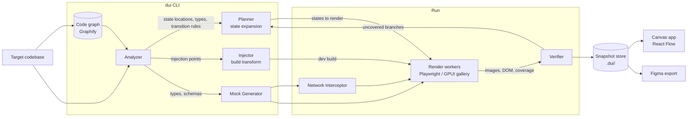

# dui design v0 (developer tool)

English | [简体中文](../zh-CN/design-v0.md) | [한국어](../ko/design-v0.md)

> Status: draft · written 2026-11-19 · audience: developers building dui
> External facts in this document (licenses, star counts, versions) were checked with the GitHub API on 2026-11-19. Anything not confirmed is marked `unverified`.

## 1. Problem and users

**Users**: developers, designers, and QA who build UI in TypeScript or Rust.

**Problem**
- Even one screen has many states (empty list, loading, error, no permission, long text, after approving the last page …). Today you can only see one by clicking your way to it.
- There is no way to know which states have never been drawn.
- You have to resize the window separately for every responsive width.
- Storybook requires a person to write each state by hand, and Figma is not real code.

**What dui does**: it reads the codebase, renders **every screen × every state × every width** of the app from real code, and lays them out on an infinite canvas like Figma. Cells it could not draw show as `unverified`. The target coverage is 99%; how it is measured is defined in §8.

## 2. Goals and non-goals

**Goals**
- Typed languages only: TypeScript (web, webviews) and Rust (GPUI native).
- Find states and produce mock values with AI + types, without people writing states.
- No hand-written per-framework adapters. AI generates injection code that fits the target code on demand.
- Results must be measurable (coverage with a numerator and a denominator).

**Non-goals**
- Interaction inside the canvas such as clicking or typing. Only still screens are shown.
- Visual regression testing (pixel-diff approval flows). That is Chromatic's and Percy's area. It may be added later.
- Untyped JavaScript, Python, Dart, Swift, Kotlin, etc. (out of scope for v0)
- Leaving the SDK in production builds. All injection code is dev-build only.
- A design editing tool. dui exports to Figma but does not replace it.

## 3. Core ideas

1. **AI finds every place where state lives**: global stores, component-local state (`useState`, etc.), context, URL / route, server response caches, GPUI Entity / model fields.
2. **Insert forced-injection code at build time**: leave the source as is and create a "start with this value" entry point with a dev-build transform (Vite/Babel/SWC plugin for TS, proc-macro / build script for Rust). That way even local state can be set from outside.
3. **Intercept APIs at the network level**: respond with mocks generated from types.
4. **Inject, render, check**: inject the state, render at each width, and check that the result matches the intended state. If it does not, it is `unverified`.

Why types are the key: with types we can (a) enumerate state shapes completely, (b) generate valid mock values automatically, and (c) get a first-pass check from whether the injection code passes the compiler.

## 4. Architecture



| Component | What it does | Input → output |
|---|---|---|
| `dui` CLI | Runs everything, caching, config. `dui scan`, `dui render`, `dui open` | config file → run |
| Analyzer | Finds screens, state locations, events, state-change points, transition rules. Graphify graph + type info + AI | code → `Screen`, `StateSlot`, `Rule` |
| Injector | Inserts a dev-only injection entry point at each state location at build time | `StateSlot` → transformed dev build |
| Mock generator | Generates representative values from types / schemas (zod, OpenAPI, Rust types) | type → value sets |
| Planner | Combines data shapes × branches × sequences into the list of states to render; re-plans for uncovered branches | rules, coverage → `State[]` |
| Network interceptor | Intercepts API requests and returns mock responses matching the state | request → mock response |
| Render workers | Inject state, render per width, collect image / DOM / coverage. Run in parallel | `State` × width → `RenderCell` |
| Verifier | Checks the render is the intended state | `RenderCell` → verification status |
| Snapshot store | Stores all results as files (`.dui/`), per commit hash | — |
| Canvas app | Lays out screen×state nodes, width columns, transition edges on an infinite canvas | store → view |
| Figma export | Same layout as a Figma file | store → Figma |

## 5. Data model

```ts
type Lang = "ts" | "rust";
type Provenance = "extracted" | "inferred" | "verified"; // explicit in code / AI inference / confirmed by replay

interface Screen {
  id: string;                 // "review", "export", "settings.team"
  route?: string;             // web: "/projects/$id/review"
  entry: SourceRef;           // screen root component or GPUI View
  lang: Lang;
}

interface StateSlot {         // one place where state lives
  id: string;
  kind: "store" | "local" | "context" | "route" | "server" | "entity";
  owner: SourceRef;           // component / store / Entity that owns this state
  type: TypeRef;              // type info (basis for mock generation)
  injectable: boolean;        // whether an injection entry point was generated
}

interface State {
  id: string;                 // content hash
  screenId: string;
  label: string;              // "list empty", "after approving the last page"
  kind: "data-shape" | "branch" | "sequence";
  values: Record<StateSlotId, unknown>;   // injected value per slot
  network: MockResponse[];    // responses the API returns in this state
  path?: EdgeId[];            // sequence states: path from the start to here
  expect: Assertion[];        // what the verifier checks
  targets: BranchId[];        // code branches this state aims to cover
}

interface Edge {              // state transition
  id: string;
  from: StateId;
  to: StateId;
  event: string;              // "onClick: approve", "shortcut 1"
  rule: SourceRef;            // handler / reducer the rule came from
  provenance: Provenance;
}

interface Snapshot {          // one run's bundle of results
  id: string;
  commit: string;             // target repo commit
  createdAt: string;
  widths: number[];           // e.g. [375, 768, 1280]
  axes?: { theme?: ("light" | "dark")[]; locale?: string[] };
}

interface RenderCell {        // one canvas cell = state × width (× axes)
  snapshotId: string;
  stateId: string;
  width: number;
  image?: string;             // file path
  dom?: string;               // web: serialized DOM / accessibility tree
  coveredBranches: BranchId[];
  status: VerificationStatus;
}

type VerificationStatus =
  | { kind: "verified" }                          // passed verification
  | { kind: "unverified"; reason: "render-failed" | "assert-failed" | "not-injectable" | "not-rendered" }
  | { kind: "suspect"; reason: string };          // only the visual check failed; needs a human
```

`unverified` = every `unverified` kind. On the canvas it shows as a grey hatched cell with the reason.

## 6. Pipeline

1. **Scan** (`dui scan`)
   - Build the call / import graph with Graphify.
   - Find screens: router definitions (TanStack Router, Next app directory, etc.), GPUI root Views.
   - Find state locations: type info + AI. Result: `StateSlot[]`.
   - List code branches: render branches reachable from the screen (conditional JSX, early return, `match`).
2. **Enumerate states** (planner) — three kinds are combined.
   - **Data shape**: representative values from types. Lists 0 / 1 / many, strings empty / normal / very long, optional present / absent, every arm of a union, API success / error (4xx/5xx) / delay.
   - **Code branch**: AI solves each branch condition backwards to produce values that enter that branch.
   - **Sequence**: follow the graph from event handlers to state-change points to build `state + event → next state` rules. Expand the rules from the initial state (model-checking style). Infinite expansion is cut with representative values (0, 1, last, one past last) and a depth limit. Identical value sets are merged.
3. **Injection build**: the injector produces a dev build. Slots that fail to compile get `injectable=false`.
4. **Render** (`dui render`): workers inject values + mock responses per state and render per width. Save image, DOM, and branch coverage.
5. **Verify**: §7.
6. **Fill-in loop**: if uncovered branches remain, go back to step 2 and create states for those branches. Stop when there is no improvement or the iteration limit is reached.
7. **Sequence replay verification**: for sequence states, not only inject but actually replay the events along the path from the initial state and check the same screen appears. If it matches, the edge becomes `verified`.
8. **View** (`dui open`): launch the canvas app or export to Figma.

## 7. Verification

"It rendered" is different from "it rendered the intended state". Three checks:

1. **Value check** (required): right after rendering, read back the actual value of each injected slot and compare with the intended value. A mismatch means injection failed.
2. **Semantic check** (required): run assertions generated from the state against the DOM / accessibility tree (web) or the GPUI element tree (native; feasibility `unverified`). E.g. "empty-list state → 0 list items + an empty-state message", "error state → role=alert exists".
3. **Visual check** (auxiliary): AI looks at the image and judges whether it matches the state description. If only this fails, the result is `suspect`.

Also a **coverage check**: confirm via coverage that the branches the state aimed at (`targets`) actually executed. If not, `unverified: assert-failed`.

## 8. How 99% is measured

Measured as a number, not a feeling. The denominator is defined explicitly.

- **Denominator** = (render branches per screen + data-shape representative values per screen + reachable sequence states within the depth limit) × number of configured widths.
  - Render branches: conditional render branches (conditional JSX, ternaries, early returns, `match` arms) inside components reachable from the screen root. Branches with no effect on what is drawn (logging, etc.) are removed by exclusion rules.
  - Because the analyzer builds the denominator itself, "branches missing from the denominator" are measured separately: compare with the full branch list from runtime coverage tools (V8 coverage / istanbul; for Rust, the `cargo llvm-cov` family).
- **Numerator** = the number of `verified` cells in the denominator.
- **Report**: % per screen and per kind + a list of unverified cells (with reasons). E.g. `review 97.8% (branches 44/45, shapes 18/18, sequences 23/24) × 3 widths`.
- **Condition for 99%**: our code (obora, pippip) follows a rule to gather screen state in one place with types, reducers, or state machines. That keeps the sequence-state denominator accurate.

## 9. Per-language specifics

### 9.1 TypeScript (web, Electron / Tauri webviews)

| Item | Approach |
|---|---|
| Finding screens | Static analysis of router definitions (TanStack Router, React Router, Next app directory). obora-web uses TanStack Router (confirmed) |
| Types | Resolve slot types with the TypeScript compiler API. Prefer zod schemas when present (obora-web uses zod, confirmed) |
| Local state injection | A Vite plugin (internally a Babel or SWC transform) rewrites `useState(init)` to the form `useState(__dui.get("slotId") ?? init)`. Same approach for `useReducer` and context Provider values |
| Store injection | Wrap initial values at creation sites for Zustand, Redux, Jotai, etc. in the same way |
| Server cache | TanStack Query: pre-fill the `QueryClient` before rendering, or mock the network |
| Network | Service Worker interception like MSW (MIT, confirmed). Node-side requests via MSW node mode |
| Rendering | Render per viewport width with Playwright (Apache-2.0, confirmed). Image + DOM + accessibility tree + V8 coverage |
| Electron | Renderer is the same as web. Mock preload / IPC calls and open the renderer bundle in a browser, or use Playwright's Electron mode |
| Tauri | Mock `invoke` calls and render the same as web |
| Sequence replay | Replay real clicks and key presses with Playwright |

The `__dui` injection runtime is included only in dev builds; the transform is off for production builds. CI checks that `__dui` is absent from build output.

### 9.2 Rust (GPUI native)

pippip uses `gpui-pre 0.3.12` + `gpui-kit 0.10.0`, and `reqwest` for HTTP (confirmed in Cargo.toml). The GPUI crate license is Apache-2.0 (confirmed in `crates/gpui/Cargo.toml` of the zed repo).

| Item | Approach |
|---|---|
| Finding screens | Static analysis of root Views and screen-switch points + AI |
| Types | Resolve Entity / model field types with rust-analyzer or `syn`-based parsing |
| State injection | Under a dev feature only, attach a `#[dui::state]` proc-macro to model types that generates `serde` serialization + a "start with this value" constructor. AI generates the patch that attaches it during the build step |
| Extracting state | The same macro dumps current state (also used to collect states during real use) |
| Network | Under a dev feature, point the HTTP client at a local mock server, or swap the client behind a wrapping trait |
| Rendering | In-app `dui` gallery mode: read a state file, build the View, draw at each width's window size, save an image. Confirmed that the `gpui-pre 0.3.12` source has `HeadlessAppContext::capture_screenshot` and `Window::render_to_image` (`test-support` feature) (2026-11-19, [language survey](language-survey.md)). Actually running it in pippip is `unverified` → top priority of the M2 spike. If it does not work, fall back to a hidden window + OS capture |
| Sequence replay | Replay by dispatching actions in gallery mode |
| Verification | Value checks via dump comparison. Element-tree-based semantic checks are `unverified` |

Precondition rule: screen state lives in Entities / models. State scattered inside Views is missed by dump / injection and is marked `not-injectable`.

## 10. Graph engine

- First choice **Graphify** (Apache-2.0, ★150,430, checked 2026-11-19): ~40 languages via tree-sitter, `EXTRACTED` / `INFERRED` tags on every edge (confirmed in the README). dui adds a state-transition layer on top and extends the tags to `extracted` / `inferred` / `verified`.
- Second choice **CodeGraph** (MIT, ★78,082, checked 2026-11-19): framework-aware routes, TypeScript and Rust support (confirmed in the README).
- How to integrate (call it as a library or read its CLI output files) is `unverified` → decided in M0.
- To keep the graph engine replaceable, dui has only one internal interface, `CodeGraphPort` (read nodes and edges).

## 11. Canvas

Layout: **rows = screen×state, columns = widths (and theme / locale axes), edges = transitions**. Unverified cells are grey hatched + reason.

| Candidate | License (checked 2026-11-19) | Decision |
|---|---|---|
| React Flow (`xyflow/xyflow`) | MIT, ★39,087 | **First choice**. Image or iframe inside nodes (live DOM for web) |
| tldraw (`tldraw/tldraw`) | Custom license (GitHub shows NOASSERTION). LICENSE.md: free in development environments only; **production use requires a separate commercial or trial license key**; license key and watermark are enforced; usage data may be sent | **Excluded from v0**. Its production terms would pass on to users and companies who use dui commercially, so not used until cost and terms are checked |
| Figma export | Figma plugin / REST API (pricing and limits `unverified`) | Secondary output. Same layout as image nodes |

## 12. License policy

- dui is **Apache-2.0 open source**. Dependencies must allow commercial use (MIT, Apache-2.0, BSD, ISC) so that users and companies can use dui commercially.
- Forbidden: noncommercial (PolyForm Noncommercial, etc.), strong copyleft such as AGPL and GPL, and anything like tldraw that needs a separate contract for production use (until such a contract exists).
- How to check: for each new dependency, check `gh api repos/<owner>/<repo> --jq .license.spdx_id` and the LICENSE text, and block in CI with a license checker for JS and `cargo deny` for Rust.
- Keep license and copyright notices in distributions (including NOTICE for Apache-2.0).

| Dependency | License | Status |
|---|---|---|
| Graphify | Apache-2.0 | Allowed |
| CodeGraph | MIT | Allowed |
| React Flow | MIT | Allowed |
| MSW | MIT | Allowed |
| Playwright | Apache-2.0 | Allowed |
| GPUI (crate) | Apache-2.0 | Allowed |
| GitNexus | PolyForm Noncommercial | Forbidden |
| tldraw | Custom (production requires a paid contract) | On hold |

## 13. MVP scope and milestones

**MVP**: lay out 3 obora-web screens (review, export, settings) × auto-discovered states × 3 widths on a React Flow canvas and show a coverage number per screen. Native comes after the MVP.

| Milestone | Content | Done when |
|---|---|---|
| **M0 spike** | One obora-web screen: review. Render 5 hand-picked states at 3 widths with Vite-transform injection + MSW + Playwright. Run Graphify on obora and decide how to integrate it | At least one local state injected from outside and rendered; 15 images |
| **M1 automatic states** | Analyzer + mock generator + planner. Auto-enumerate data shapes and code branches, measure coverage, fill-in loop | Branch coverage number for the review screen, list of unverified cells |
| **M2 GPUI spike** | One pippip screen. Check offscreen rendering, prototype the `#[dui::state]` macro | State file → one image |
| **M3 sequence states** | Extract event → state-change rules, expand, verify by Playwright replay, mark edges `verified` | Sequence states such as "after approving the last page" on the review screen generated and verified automatically |
| **M4 canvas** | React Flow canvas (rows = states, columns = widths, edges = transitions, unverified marks), `dui open` | All 3 obora screens laid out |
| **M5 obora 99% attempt** | 99% target for the 3 screens, apply the explicit-state rule, Figma export | Coverage report per screen |
| M6 and later | All of pippip, Electron (obora-desktop), Vue, Svelte | — |

## 14. Risks and open questions

**Risks**
- **Wrong injection points**: AI may find the wrong slots, or a transform may change behavior. → Filter with value checks + compile checks + semantic assertions; mark as `unverified`.
- **State explosion**: sequence-state combinations grow large. → Representative values, depth limits, merging identical renders. Tune limits after measuring.
- **Denominator reliability**: branches the analyzer misses are also missing from the denominator. → Compare with all branches from runtime coverage and report the "outside the denominator" number separately.
- **Non-deterministic rendering**: time, randomness, animations, font loading. → Freeze clock and randomness, disable animations, wait for fonts.
- **GPUI rendering path uncertainty**: if offscreen rendering does not work we must use OS capture, which brings macOS permission and speed problems.
- **AI cost and time**: scan cost on large codebases. → Cache graphs and results per commit; redo only changed files.
- **Dependency on Graphify**: an external project's direction may change. → Keep it replaceable via `CodeGraphPort`.

**Open questions** (in order of importance)
1. Does GPUI's (`gpui-pre 0.3.12`) headless capture API (confirmed to exist in code) actually work on pippip screens? If not, what is the native rendering path?
2. How to automatically remove "branches with no effect on the screen" from the coverage denominator. This rule defines what 99% means.
3. What expansion limits (depth, representative values) for sequence states cover all meaningful states within a practical number of renders?
4. Whether to use Graphify as a library or only read its CLI output, and how to merge it with TS type info.
5. Whether to ship the canvas as a web app (developer-local `dui open`) or a hosted service. Hosting needs a review of snapshot storage cost and security.
6. Figma export pricing and API limits (`unverified`).

## Principle: combinations are produced by the system, not by AI (decided 2026-11-19)
AI is used **only to find where state lives and what type it is**. Which combinations to draw is decided by deterministic algorithms so the result is the same every time.
1. Representative values come mechanically from types: lists 0 / 1 / many, bool both, every enum value, strings empty / normal / very long, optional including null, numbers 0 / boundary values.
2. Independent decomposition: group only states that are used together in the same render region of the code graph; expand the rest separately (product → sum).
3. Inside a group, deterministic pairwise generation (every pair of values at least once).
4. Sequence states: depth-limited BFS; visited states are not revisited.
5. Impossible combinations are removed by type and code conditions (discriminated unions, guards).

**Guarantee scope**: only states expressed clearly with types, enums, discriminated unions, or state machines are guaranteed. Scattered implicit state is honestly shown as `unverified`. The more clearly state is written, the higher the coverage — that is the "shortcut to good code" dui offers.
