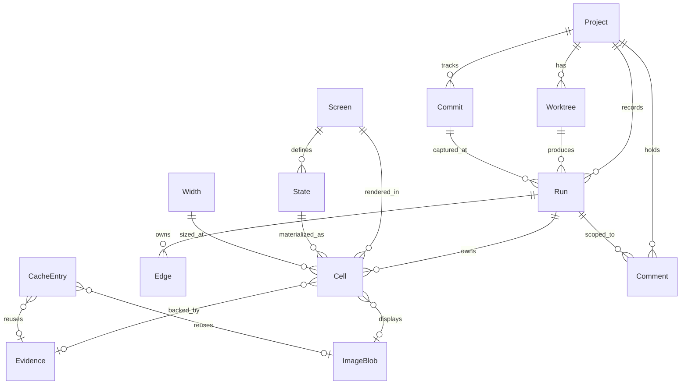

# dui domain model

English | [简体中文](../zh-CN/domain-model.md) | [한국어](../ko/domain-model.md)

> Status: decided 2026-11-21 · canonical entity model for `dui-core`, storage adapters, screen maps, caching, diffs and review comments. Related: [Architecture](architecture.md) · [Web viewer](web-viewer.md) · [Roadmap](roadmap.md#v002).

This document defines the 13 domain entities in `dui-core::model`, their deterministic identities, mutability rules, algebraic statuses, and the thin `Store` port in `dui-core::storage`. All types are pure Rust values with no database, filesystem or async dependency.

## 1. Entity relationships



### Ownership and mutability

- **Shared, immutable artifacts:** `Commit`, `Screen`, `State`, `Width`, `Evidence`, and `ImageBlob` are content-addressed values. Identical images and runtime observations are stored once and referenced across runs, branches and worktrees.
- **Run-owned, immutable records:** A `Run` owns its `Cell` rows and run-scoped `Edge` transitions. Once published, a run and its cells never change; saving a live edit (#3) publishes a new `Run` (`RunKind::LiveSave`).
- **Mutable pointers and review records:** Only `Project` (`display_name`), `Worktree` (`branch` on checkout), `Comment` (`body`, `status`, `updated_at_ms`), and `CacheEntry` (`last_hit_at_ms`, eviction/replacement) change in place. Unreferenced `ImageBlob`s may be pruned only when no `Cell` or `CacheEntry` points to them.

## 2. Entities and identities

All hash IDs are validated 64-character lowercase hex SHA-256 digests (`ContentHash`). Derived IDs hash a canonical `[tag, payload]` tuple using deterministic ordering (`BTreeMap` / `BTreeSet`). Identifiers are stored as text and timestamps as integer Unix epoch milliseconds (`i64`) so SQLite and future Postgres schemas stay portable.

| Entity | ID type & derivation | Fields | Ownership | Mutability & lifetime |
|---|---|---|---|---|
| **Project** | `ProjectId` — `sha256(primary_root_bytes)` (compatible with `~/.dui/projects/<id>`) | `id`, `display_name`, `primary_root` | Shared across runs | Mutable `display_name` (pinned on first capture); persists while project history exists |
| **Worktree** | `WorktreeId` — `sha256(["dui:worktree:v1", project_id, path, app_relative])` | `id`, `project_id`, `path`, `app_relative`, `branch` | Shared across runs | Mutable `branch`; updated on checkout |
| **Commit** | `CommitId` — `sha256(["dui:commit:v1", project_id, git_sha, dirty, tree_digest])` | `id`, `project_id`, `git_sha`, `dirty`, `tree_digest` | Shared across runs | Immutable |
| **Run** | `RunId` — non-empty portable run ID (supports existing `~/.dui` snapshot IDs) | `id`, `project_id`, `worktree_id`, `commit_id`, `kind`, `created_at_ms`, `environment`, `source_files` | Owns `Cell`s and run `Edge`s | Immutable once published |
| **Screen** | `ScreenId` — `sha256(["dui:screen:v1", path])` | `id`, `path`, `origin` (`Entry` \| `Router` \| `Anchor`) | Shared by route | Immutable value |
| **State** | `StateId` — `sha256(["dui:state:v1", screen_id, scenario, locale, inputs])` | `id`, `screen_id`, `scenario`, `locale`, `inputs`, `plan_index` | Shared by cell inputs | Immutable value |
| **Width** | `Width(NonZeroU32)` — positive CSS pixels | `pixels` | Value object | Immutable |
| **Cell** | `CellId` — `sha256(["dui:cell:v1", run_id, screen_id, state_id, width, locale])` | `id`, `run_id`, `screen_id`, `state_id`, `width`, `locale`, `status`, `image_blob`, `evidence_id`, `cache` | Owned by one `Run` | Immutable once `Run` publishes |
| **Evidence** | `EvidenceId` — `sha256(["dui:evidence:v1", canonical_observation])` | `id`, `observed_path`, `observed_width`, `ready`, `settled`, `slots`, `instances`, `hits`, `links`, `responses`, `assertions`, `live_edits` | Shared content-addressed artifact | Immutable |
| **ImageBlob** | `BlobId` — `sha256(image_bytes)` | `id`, `media_type`, `byte_len`, `width_px`, `height_px` | Shared blob on disk (metadata in store) | Immutable; prunable only when unreferenced |
| **Edge** | `EdgeId` — `sha256(["dui:edge:v1", run_id, from, to, source, trigger])` | `id`, `run_id`, `from`, `to`, `source`, `trigger`, `selector`, `observed_widths` | Owned by `Run` | Immutable per run (replay publishes a `Verified` edge) |
| **Comment** | `CommentId` — `sha256(["dui:comment:v1", run_id, target, author, created_at_ms, initial_body])` | `id`, `project_id`, `run_id`, `target`, `author`, `body`, `status`, `created_at_ms`, `updated_at_ms` | Scoped to `Project` & `Run` target | Mutable (`body`, `status`, `updated_at_ms`) |
| **CacheEntry** | `CacheKey` — `sha256(["dui:cache:v1", cache_inputs])` | `key`, `inputs`, `status`, `image_blob`, `evidence_id`, `created_at_ms`, `last_hit_at_ms` | Shared across runs & worktrees | Mutable pointer (`last_hit_at_ms`, evictable on prune) |

## 3. Pure domain rules (ADTs)

Defined in `crates/dui-core/src/model.rs` with exhaustive matching and no storage code:

- **`CellStatus`** — `Verified | Unverified { reason } | Unrenderable { reason }`. `Unverified` and `Unrenderable` are separate variants and both require a non-empty reason. Coverage (`CoverageSummary::from_cells`) excludes `Unrenderable` cells from the `renderable` denominator and reports them separately.
- **`EdgeSource`** — `Extracted | Inferred | Verified`. DOM anchor discovery records `Extracted`; AI inference records `Inferred`; only replay confirmation constructs `Verified`.
- **`CacheOutcome`** — `Hit { key } | Miss { key, changed: BTreeSet<CacheInputKind> }`. `evaluate_cache` compares `CacheInputs` (`source_files`, `types_digest`, `mocks_digest`, `state_id`, `width`, `locale`, `dui_version`, `rule_pack_digest`, `renderer_env_digest`) and returns the exact set of changed inputs on a miss (`Forced` when bypassing cache, `Missing` when no prior entry exists).

## 4. Feature coverage without extra entities

| Feature | How the 13 entities represent it |
|---|---|
| Screen map ([#7](https://github.com/de-novo/dui/issues/7)) | `Run` → `Screen` (`origin`), `State`, `Width`, `Cell` (`CellStatus`, `ImageBlob`, `Evidence`), and `Edge` (`EdgeSource::Extracted`, `selector`, `observed_widths`). |
| Saved live captures ([#3](https://github.com/de-novo/dui/issues/3)) | A new immutable `Run` with `RunKind::LiveSave { source_run, source_state, source_width, revision }`, one `Cell`, its `ImageBlob`, and `Evidence` carrying `live_edits` and assertions. |
| Content-addressed cache ([#8](https://github.com/de-novo/dui/issues/8)) | `CacheEntry` maps `CacheKey` (`CacheInputs`) to existing `ImageBlob` + `Evidence` + `CellStatus`; `Cell.cache` records `Hit` or `Miss(changed)`. |
| SQLite + Drizzle storage ([#10](https://github.com/de-novo/dui/issues/10)) | One SQL table per entity behind the `Store` port; text IDs/hashes, integer epoch ms timestamps, and JSON payloads stay portable to Postgres. Large PNG bytes remain content-addressed files keyed by `BlobId`. |
| Capture diff ([#11](https://github.com/de-novo/dui/issues/11)) | Compare two `Run`s by `Cell::diff_key()` (`screen_id`, `state_id`, `width`, `locale`); identical `(status, image_blob, evidence_id)` cells are unchanged. |
| Multi-locale capture ([#12](https://github.com/de-novo/dui/issues/12)) | `State.locale`, `Cell.locale`, and `CacheInputs.locale` include the locale dimension in IDs and cache keys. |
| Review comments (v0.0.5) | `Comment` attaches to `CommentTarget::{Screen, State, Cell, Edge}` on a `Project`/`Run` and tracks `Open` / `Resolved` status. |

## 5. Storage port

`crates/dui-core/src/storage.rs` defines the synchronous, storage-agnostic `Store` trait and `RunBundle` / `RunFilter` / `RunSummary` value types, plus a pure `BTreeMap`-backed `MemoryStore` for tests:

```rust
pub trait Store {
    fn upsert_project(&mut self, project: &Project) -> StoreResult<()>;
    fn upsert_worktree(&mut self, worktree: &Worktree) -> StoreResult<()>;
    fn put_commit(&mut self, commit: &Commit) -> StoreResult<()>;
    fn put_blob(&mut self, blob: &ImageBlob, bytes: &[u8]) -> StoreResult<()>;
    fn get_blob(&self, id: &BlobId) -> StoreResult<Option<(ImageBlob, Vec<u8>)>>;
    fn put_evidence(&mut self, evidence: &Evidence) -> StoreResult<()>;
    fn get_evidence(&self, id: &EvidenceId) -> StoreResult<Option<Evidence>>;
    fn save_run(&mut self, bundle: &RunBundle) -> StoreResult<()>;
    fn load_run(&self, id: &RunId) -> StoreResult<Option<RunBundle>>;
    fn list_runs(&self, filter: &RunFilter) -> StoreResult<Vec<RunSummary>>;
    fn get_cache(&self, key: &CacheKey) -> StoreResult<Option<CacheEntry>>;
    fn put_cache(&mut self, entry: &CacheEntry) -> StoreResult<()>;
    fn upsert_comment(&mut self, comment: &Comment) -> StoreResult<()>;
    fn list_comments(&self, run_id: &RunId) -> StoreResult<Vec<Comment>>;
    fn unreferenced_blobs(&self) -> StoreResult<Vec<BlobId>>;
    fn delete_blob(&mut self, id: &BlobId) -> StoreResult<()>;
}
```

Concrete storage backends (file archives, SQLite via `rusqlite` / Drizzle in #10, or remote HTTP sync) implement `Store` in adapter layers outside `dui-core`.
