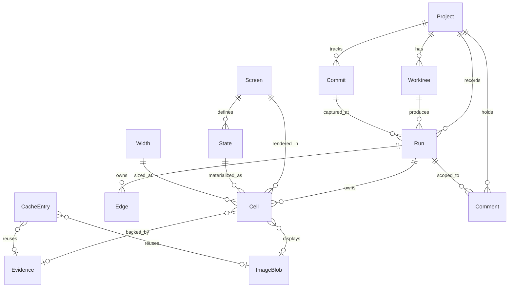

# dui domain model

English | [简体中文](../zh-CN/domain-model.md) | [한국어](../ko/domain-model.md)

> Status: decided 2026-11-21 · canonical DDD model for `dui-core`, storage adapters, screen maps, caching, diffs and review comments. Related: [Architecture](architecture.md) · [Web viewer](web-viewer.md) · [Roadmap](roadmap.md#v002).

This document defines dui's four bounded contexts, aggregate roots, entities, immutable value objects, domain invariants, and context-scoped repository ports in `dui-core::model` and `dui-core::storage`. All types are pure Rust values with private fields, smart constructors, and zero database, filesystem or async dependency.

## 1. Bounded contexts and entity relationships



| Bounded context | Module | Aggregate roots & entities | Value objects | Repository port |
|---|---|---|---|---|
| **Workspace** | `dui_core::model::workspace` | `Project`, `Worktree` | `Commit` | `WorkspaceRepository` |
| **Capture / Map** | `dui_core::model::capture` | `RunAggregate` (root owning `Run`, `Cell`, `Edge`) | `Screen`, `State`, `Width`, `Evidence`, `ImageBlob`, `CellStatus`, `EdgeSource`, `CoverageSummary` | `RunRepository`, `ArtifactStore` |
| **Build Cache** | `dui_core::model::cache` | `CacheEntry` | `CacheInputs`, `CacheOutcome`, `CacheInputKind` | `CacheRepository` |
| **Review** | `dui_core::model::review` | `Comment` | `CommentTarget`, `CommentStatus` | `CommentRepository` |

### Ownership and mutability

- **Shared immutable value objects:** `Commit`, `Screen`, `State`, `Width`, `Evidence`, and `ImageBlob` are content-addressed values. Identical images and runtime observations are stored once and referenced across runs, branches and worktrees.
- **Run-owned immutable aggregate:** `RunAggregate` is the aggregate root for a published run and enforces referential integrity across its `Run`, `Screen`s, `State`s, `Cell`s, and `Edge`s at construction (`RunAggregate::publish`). Once published, a run never changes; saving a live edit (#3) publishes a new `Run` (`RunKind::LiveSave`).
- **Mutable aggregate roots with behavior methods:** `Project::rename`, `Worktree::checkout`, `Comment::{edit, resolve, reopen}`, and `CacheEntry::record_hit` enforce invariants (non-empty text, valid status transitions, monotonic timestamps). Unreferenced `ImageBlob`s may be pruned only when no `Cell` or `CacheEntry` references them.

## 2. Entities, value objects, and identities

All hash IDs are validated 64-character lowercase hex SHA-256 digests (`ContentHash`). Derived IDs hash a canonical `[tag, payload]` tuple using deterministic ordering (`BTreeMap` / `BTreeSet`). Identifiers are stored as text and timestamps as integer Unix epoch milliseconds (`i64`) so SQLite and future Postgres schemas stay portable.

| Type | DDD role & context | ID type & derivation | Fields | Mutability & invariants |
|---|---|---|---|---|
| **Project** | Aggregate root (`workspace`) | `ProjectId` — `sha256(primary_root_bytes)` (compatible with `~/.dui/projects/<id>`) | `id`, `display_name`, `primary_root` | Mutable via `rename`; non-empty root and display name |
| **Worktree** | Aggregate root (`workspace`) | `WorktreeId` — `sha256(["dui:worktree:v1", project_id, path, app_relative])` | `id`, `project_id`, `path`, `app_relative`, `branch` | Mutable `branch` via `checkout`; non-empty path |
| **Commit** | Value object (`workspace`) | `CommitId` — `sha256(["dui:commit:v1", project_id, git_sha, dirty, tree_digest])` | `id`, `project_id`, `git_sha`, `dirty`, `tree_digest` | Immutable |
| **Run** | Root header of `RunAggregate` (`capture`) | `RunId` — non-empty portable run ID (supports existing `~/.dui` snapshot IDs) | `id`, `project_id`, `worktree_id`, `commit_id`, `kind`, `created_at_ms`, `environment`, `source_files` | Immutable once `RunAggregate::publish` succeeds |
| **Screen** | Value object (`capture`) | `ScreenId` — `sha256(["dui:screen:v1", path])` | `id`, `path`, `origin` (`Entry` \| `Router` \| `Anchor`) | Immutable; non-empty route path |
| **State** | Value object (`capture`) | `StateId` — `sha256(["dui:state:v1", screen_id, scenario, locale, inputs])` | `id`, `screen_id`, `scenario`, `locale`, `inputs`, `plan_index` | Immutable; non-empty scenario |
| **Width** | Value object (`capture`) | `Width(NonZeroU32)` — positive CSS pixels | `pixels` | Immutable; strictly `> 0` |
| **Cell** | Entity owned by `RunAggregate` (`capture`) | `CellId` — `sha256(["dui:cell:v1", run_id, screen_id, state_id, width, locale])` | `id`, `run_id`, `screen_id`, `state_id`, `width`, `locale`, `status`, `image_blob`, `evidence_id`, `cache` | Immutable; `Unrenderable` cells cannot hold an `image_blob` |
| **Evidence** | Value object (`capture`) | `EvidenceId` — `sha256(["dui:evidence:v1", canonical_observation])` | `id`, `observed_path`, `observed_width`, `ready`, `settled`, `slots`, `instances`, `hits`, `links`, `responses`, `assertions`, `live_edits` | Immutable content-addressed artifact |
| **ImageBlob** | Value object (`capture`) | `BlobId` — `sha256(image_bytes)` | `id`, `media_type`, `byte_len`, `width_px`, `height_px` | Immutable blob on disk; prunable only when unreferenced |
| **Edge** | Entity owned by `RunAggregate` (`capture`) | `EdgeId` — `sha256(["dui:edge:v1", run_id, from, to, source, trigger])` | `id`, `run_id`, `from`, `to`, `source`, `trigger`, `selector`, `observed_widths` | Immutable per run; `Verified` requires `confirm_by_replay` with non-empty widths |
| **Comment** | Aggregate root (`review`) | `CommentId` — `sha256(["dui:comment:v1", run_id, target, author, created_at_ms, initial_body])` | `id`, `project_id`, `run_id`, `target`, `author`, `body`, `status`, `created_at_ms`, `updated_at_ms` | Mutable via `edit` / `resolve` / `reopen`; monotonic timestamps, non-empty body |
| **CacheEntry** | Aggregate root (`cache`) | `CacheKey` — `sha256(["dui:cache:v1", cache_inputs])` | `key`, `inputs`, `status`, `image_blob`, `evidence_id`, `created_at_ms`, `last_hit_at_ms` | Mutable `last_hit_at_ms` via `record_hit`; `Unrenderable` cannot hold an `image_blob` |

## 3. Pure domain rules (ADTs)

Defined across `crates/dui-core/src/model/` with private fields, exhaustive matching, and no storage code:

- **`CellStatus`** — `Verified | Unverified { reason: NonEmptyText } | Unrenderable { reason: NonEmptyText }`. `Unverified` and `Unrenderable` are separate variants and both require a non-empty reason. `Cell::new` rejects any `Unrenderable` cell carrying an `image_blob`. `CoverageSummary::from_cells` excludes `Unrenderable` cells from `renderable` and reports them separately.
- **`EdgeSource`** — `Extracted | Inferred | Verified`. `Edge::discovered` always creates `Extracted`; `Edge::inferred` always creates `Inferred`; only `Edge::confirm_by_replay` with at least one confirmed width constructs `Verified`.
- **`CacheOutcome`** — `Hit { key } | Miss { key, changed: BTreeSet<CacheInputKind> }`. `evaluate_cache` compares `CacheInputs` (`source_files`, `types_digest`, `mocks_digest`, `state_id`, `width`, `locale`, `dui_version`, `rule_pack_digest`, `renderer_env_digest`) and returns the exact set of changed inputs on a miss (`Forced` when bypassing cache, `Missing` when no prior entry exists).
- **`RunAggregate::publish`** — Validates that every `Cell` and `Edge` belongs to `run.id()`, every referenced `Screen` and `State` exists in the aggregate, every `Cell`'s `State` belongs to the same `Screen`, and no duplicate `CellId` exists.

## 4. Feature coverage without extra entities

| Feature | How the model represents it |
|---|---|
| Screen map ([#7](https://github.com/de-novo/dui/issues/7)) | `RunAggregate` → `Screen` (`origin`), `State`, `Width`, `Cell` (`CellStatus`, `ImageBlob`, `Evidence`), and `Edge::discovered` (`EdgeSource::Extracted`, `selector`, `observed_widths`). |
| Saved live captures ([#3](https://github.com/de-novo/dui/issues/3)) | A new immutable `RunAggregate` with `RunKind::LiveSave { source_run, source_state, source_width, revision }`, one `Cell`, its `ImageBlob`, and `Evidence` carrying `live_edits` and assertions. |
| Content-addressed cache ([#8](https://github.com/de-novo/dui/issues/8)) | `CacheEntry` maps `CacheKey` (`CacheInputs`) to existing `ImageBlob` + `Evidence` + `CellStatus`; `Cell.cache()` records `Hit` or `Miss(changed)`. |
| SQLite + Drizzle storage ([#10](https://github.com/de-novo/dui/issues/10)) | One SQL table per aggregate/artifact behind the five repository ports; text IDs/hashes, integer epoch ms timestamps, and JSON payloads stay portable to Postgres. Large PNG bytes remain content-addressed files keyed by `BlobId`. |
| Capture diff ([#11](https://github.com/de-novo/dui/issues/11)) | Compare two `RunAggregate`s by `Cell::diff_key()` (`screen_id`, `state_id`, `width`, `locale`); identical `(status, image_blob, evidence_id)` cells are unchanged. |
| Multi-locale capture ([#12](https://github.com/de-novo/dui/issues/12)) | `State.locale()`, `Cell.locale()`, and `CacheInputs.locale` include the locale dimension in IDs and cache keys. |
| Review comments (v0.0.5) | `Comment` attaches to `CommentTarget::{Screen, State, Cell, Edge}` on a `Project`/`Run` with `edit`, `resolve`, and `reopen` transitions. |

## 5. Storage ports

`crates/dui-core/src/storage.rs` defines five context-scoped repository/artifact ports (composed into the `Store` supertrait) plus a deterministic `BTreeMap`-backed `MemoryStore` for tests:

```rust
pub trait WorkspaceRepository {
    fn upsert_project(&mut self, project: &Project) -> StoreResult<()>;
    fn get_project(&self, id: &ProjectId) -> StoreResult<Option<Project>>;
    fn upsert_worktree(&mut self, worktree: &Worktree) -> StoreResult<()>;
    fn get_worktree(&self, id: &WorktreeId) -> StoreResult<Option<Worktree>>;
    fn put_commit(&mut self, commit: &Commit) -> StoreResult<()>;
    fn get_commit(&self, id: &CommitId) -> StoreResult<Option<Commit>>;
}
pub trait RunRepository {
    fn save_run(&mut self, aggregate: &RunAggregate) -> StoreResult<()>;
    fn load_run(&self, id: &RunId) -> StoreResult<Option<RunAggregate>>;
    fn list_runs(&self, filter: &RunFilter) -> StoreResult<Vec<RunSummary>>;
}
pub trait ArtifactStore {
    fn put_blob(&mut self, blob: &ImageBlob, bytes: &[u8]) -> StoreResult<()>;
    fn get_blob(&self, id: &BlobId) -> StoreResult<Option<(ImageBlob, Vec<u8>)>>;
    fn put_evidence(&mut self, evidence: &Evidence) -> StoreResult<()>;
    fn get_evidence(&self, id: &EvidenceId) -> StoreResult<Option<Evidence>>;
    fn unreferenced_blobs(&self) -> StoreResult<Vec<BlobId>>;
    fn delete_blob(&mut self, id: &BlobId) -> StoreResult<()>;
}
pub trait CacheRepository {
    fn get_cache(&self, key: &CacheKey) -> StoreResult<Option<CacheEntry>>;
    fn put_cache(&mut self, entry: &CacheEntry) -> StoreResult<()>;
}
pub trait CommentRepository {
    fn upsert_comment(&mut self, comment: &Comment) -> StoreResult<()>;
    fn get_comment(&self, id: &CommentId) -> StoreResult<Option<Comment>>;
    fn list_comments(&self, run_id: &RunId) -> StoreResult<Vec<Comment>>;
}
```

Concrete storage backends implement these ports in adapter layers outside `dui-core`:

- **Local SQLite + Drizzle adapter ([#10](https://github.com/de-novo/dui/issues/10)):** `crates/dui/src/sqlite_store.rs` (`rusqlite` with bundled SQLite in WAL mode) and `packages/db/` (`drizzle-orm` `1.0.0-rc.5` SQLite dialect) share the same forward-only SQL migrations (`packages/db/migrations/`). Metadata lives in `~/.dui/dui.db` and content-addressed images live under `~/.dui/blobs/<sha256>.png`. Existing runs under `~/.dui/projects/` are imported automatically and can rebuild `dui.db` losslessly if the database file is removed.
- **Content-addressed capture cache ([#8](https://github.com/de-novo/dui/issues/8)):** `crates/dui/src/cache.rs` computes per-cell `CacheInputs` (source file hashes, compiler facts, mocks, state, width, locale, `dui` version, rule pack, renderer environment), reuses stored `ImageBlob`s (hard-linked into each run directory) and `Evidence` on hits with zero browser renders, reports exact changed inputs on misses, supports `--force` / MCP `force: true`, and cleans unreferenced blobs with `dui prune [--max-bytes N]` / MCP `prune` (`npm run check:cache`).
- **In-memory test adapter:** `dui_core::storage::MemoryStore` (`BTreeMap`-backed, zero I/O).
- **Future remote Postgres sync:** Uses the same text IDs, epoch-millisecond timestamps, and JSON columns over the API without sharing SQLite files.
