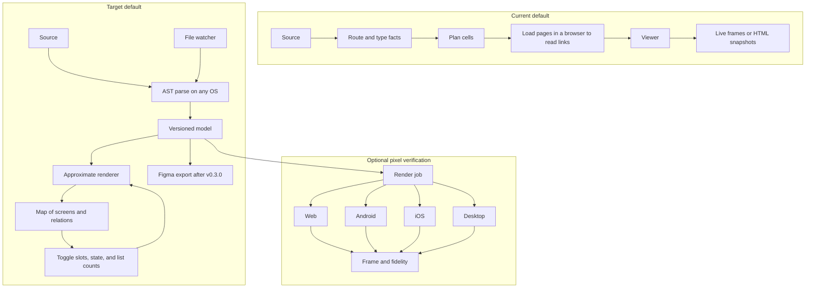

# dui roadmap · Reviewing an app as a UI map

English · [한국어](../ko/roadmap.md) · [简体中文](../zh-CN/roadmap.md)

## Goal

Today, the sources of truth for making a product are split across planning documents, Figma designs, and code. dui unifies development and UI work around one source: the code itself. The screen map and design view are generated from that code, and UI edits go back into the same code, so a separate design file cannot drift.

**What this means**

- Review and edit the UI against what the code actually renders.
- Changes made in the map land in the same codebase that ships.

**What this is not**

- A standalone design tool with its own file format.
- Support for every platform at once. The priority is the parse-and-approximate path needed for this goal; capture is optional verification.

<a id="never"></a>

**Never.** The default path for `dui map`, `dui open`, hot reload, and drawing cards must not launch Chromium or any other memory-heavy renderer: no headless browser, no live browser session, and no emulator or simulator. Heavy renderers are allowed only as explicit opt-in pixel verification (`--capture`, `dui run`, or a render machine). They are never a fallback that fills cards. This rule is also in [AGENTS.md](../../AGENTS.md#never) and [Architecture §3](architecture.md#never-default-path).

**Current focus.** Close the loop: generate the map from code, and write UI edits back into that code (the code-based canvas work planned for v0.3.0). Broader platform coverage and packaging can wait. The default path is source parsing (AST) to a versioned model to dui's own approximate renderer, with no browser or platform build required ([decision](architecture.md#4-finalized-decisions-2026-11-20)). Optional capture stays available for pixel verification.

dui maps the screens an app actually renders so a reviewer can follow a task from start to finish. Screens are the landmarks. Each screen opens into its states and viewport widths. A connection records the action that leads to another screen or state.

**A review should answer a concrete question.** After cancelling an order on a phone, where does the user land? The reviewer follows the path from order details through confirmation, opens the result at mobile width and records what feels unclear. An agent fixes the code. The reviewer returns to the same point on the map and compares the two worktrees.

Capture a pickup board with `dui map .`, inspect its dialog, compare a heading change and open the same run on the native desktop. [Run the Dispatch example](../../examples/dispatch/README.md)

## v0.0.1 · Capture baseline complete

Chromium renders the app with its project types and mock data. The local gallery shows captured states at each width, and the history viewer compares snapshots under `~/.dui/` by project, branch and worktree. The npmgraph example starts at one URL, discovers the search screen and produces four verified cells across two widths. [Reproduce the example](../../examples/npmgraph/README.md)

The M0 review screen passed at 375, 768 and 1280 px. Five states produced 15 verified cells and 15 distinct PNGs. The checks covered a local dialog state, the intercepted response body and the production client and server bundles. All 15 cell IDs remained in the report when Chromium disconnected.

A verified cell establishes that the observed state passed its checks. The reviewer judges whether the layout, wording and next action make sense. The roadmap below builds the map and the review workflow on that evidence.

## v0.0.2

**Open the map, then inspect a live state.** Start with one node per discovered screen. Expand a node to see its states and widths, then open the one that needs attention. On a screen with two menus, an agent can open one, check its contents and close it while the other menu keeps its state.

[Web viewer stack and interaction rules](design-v0.md#web-viewer) · [Web viewer architecture](web-viewer.md)

| Work | Acceptance evidence |
| --- | --- |
| [Screen map](https://github.com/de-novo/dui/issues/7) | On npmgraph, show two screens with two widths each. Preserve the selection when moving between overview and live inspection. Mark the discovered home link with its source. |
| [Typed element states](https://github.com/de-novo/dui/issues/1) | Test a boolean and an enum. CLI and MCP return the owner, instance, source, type, current value and editability. An ambiguous element or invalid value returns a reason and leaves state intact. |
| [Live rendering](https://github.com/de-novo/dui/issues/2) | Start the host and browser once. Set and reset a value in the running app. Check both the value read back and the visible DOM or accessibility result. |
| [Edit speed and capture](https://github.com/de-novo/dui/issues/3) | Measure 30 warm edits from request acceptance to a verified visible update. Report p50 and p95 in milliseconds, cold startup separately, and zero host rebuilds or browser restarts during the edits. Save a chosen state with its evidence under `~/.dui/`. |
| [Domain model](https://github.com/de-novo/dui/issues/9) | Document each entity's ID, fields and mutability with a diagram. Core types live in `dui-core` with no storage dependency and cover the map, saved captures, cache and comments. |
| [SQLite storage](https://github.com/de-novo/dui/issues/10) | Store metadata in SQLite through Drizzle migrations, keep images as content-addressed files and import existing `~/.dui/` history without loss. Keep the schema portable to a future remote Postgres server; sync through the API. |
| [Locale capture](https://github.com/de-novo/dui/issues/12) | Capture each screen in every supported language and flag missing translations and overflowing text. |
| [M1 coverage](https://github.com/de-novo/dui/issues/4) | Run the existing deterministic planning and coverage gates. Compare CLI and MCP results and report missing evidence for each unverified cell. [M1 gates](architecture.md#7-m0-and-m1-gates) |

The first benchmark establishes the latency baseline on a recorded machine and fixture. A cross-project latency target remains open.

## v0.0.3

**Native screens on the map.** Render one real GPUI screen at a known width with two typed states. Reuse the same inspect, set, read-back and reset contract. Record the OS, renderer and toolchain with the images. A matching value and independent semantic evidence are required for verification. Missing semantic evidence leaves the cell unverified. A missing render environment produces an unrenderable cell with its reason.

Baseline verified on `fixtures/gpui-kit` (`gpui-kit 0.10.0`, `gpui-pre 0.3.12`, `rustc 1.100.0`, macOS Metal offscreen renderer at 480 px, `elementTreeAvailable: true` via AccessKit / `TestQueryExt`; missing-render-env path reports `unrenderable` with `no-render-env`). Reproduce with `npm run check:gpui`. Live native session round-trip verified through the shared `dui live` / MCP `live` contract across 30 warm edits (**3.65 ms p50 / 4.23 ms p95**, 0 host rebuilds, 0 native restarts, independent second view instance state preserved, missing semantic evidence reported as `unverified` with `missing-semantic-evidence`). Reproduce with `npm run check:gpui-live`.

Implementation · [#5](https://github.com/de-novo/dui/issues/5) · [#6](https://github.com/de-novo/dui/issues/6)

**Render only what changed.** Reuse cells whose inputs are unchanged and store each image once ([cache](https://github.com/de-novo/dui/issues/8)). Compare two captures by listing only the changed cells ([diff](https://github.com/de-novo/dui/issues/11)).

## Later milestones

Existing paths include local web URLs, native route discovery and captures on selected runtimes. The [capability table](supported-frameworks.md) records their scope. Additional platforms and packaging follow the goal above. Prebuilt binaries and Homebrew ([#176](https://github.com/de-novo/dui/issues/176)) wait until the product is stable. The next step that does serve the goal is writing UI edits back into the code (v0.3.0).

| Version | Outcome |
| --- | --- |
| v0.0.4 | Follow an action from one screen or state to the next. Each edge shows whether it was extracted from code, inferred, or verified by replay. Replay from the initial state and check the destination before marking the edge verified ([#31](https://github.com/de-novo/dui/issues/31), `dui transitions` / MCP `transitions`, `npm run check:transitions`). |
| v0.0.5 | Open the project map in the GPUI and gpui-kit desktop viewer (`apps/desktop`, `dui desktop`, [#40](https://github.com/de-novo/dui/issues/40), `npm run check:desktop`). Attach a comment to a screen, state, width or transition. An agent reads the location through MCP. The reviewer reopens it on the updated worktree and compares before and after ([#38](https://github.com/de-novo/dui/issues/38), `dui comment` / MCP `comment_*` / viewer `/api/comments`, `npm run check:comments`). |
| v0.0.6 | Audit the map on the reference screens against the 99% coverage goal. Publish verified and renderable cell counts, missing branches and reasons for gaps. Keep unresolved review comments visible alongside the evidence ([#44](https://github.com/de-novo/dui/issues/44), `dui audit` / MCP `audit` / viewer `/api/audit`, `npm run check:audit`). |
| v0.0.7 | Priority 2 declarative rule packs (Zustand 5, Redux Toolkit 2, Jotai 3, XState 5, React Hook Form 7, valibot 1, React Router 8, TanStack Start 1), optional `hybrid`/`live` real-API mode with read-only mutation guard, branch-name diff (`dui diff --base main`), loop-free multi-hop BFS with dynamic ID collapsing (`/orders/:id`), greedy pairwise covering array, `<select>` real option discovery, visual-change witness verification, 2D canvas inline diff (`Elements` render-tree diff with lazy `Pixel` fallback), and `linksTo` edges on all captures ([#56](https://github.com/de-novo/dui/issues/56), [#63](https://github.com/de-novo/dui/issues/63), [#66](https://github.com/de-novo/dui/issues/66), [#70](https://github.com/de-novo/dui/issues/70), [#74](https://github.com/de-novo/dui/issues/74), [#76](https://github.com/de-novo/dui/issues/76), [#80](https://github.com/de-novo/dui/issues/80), [#82](https://github.com/de-novo/dui/issues/82), [#84](https://github.com/de-novo/dui/issues/84), [#86](https://github.com/de-novo/dui/issues/86), [#88](https://github.com/de-novo/dui/issues/88)). |
| v0.0.8 | **Multi-surface platform architecture & Universal Web + TUI.** Formalize `SurfaceRegistry`, `NoopOracle`, and the unified `RenderNodeSnapshot` IR so every surface shares one `CaptureEngine` pipeline without duplicating caching, SQLite, diffing, or canvas review ([#99](https://github.com/de-novo/dui/issues/99)). Ship the Universal Web Host (`static` / `url` / `command`, [#100](https://github.com/de-novo/dui/issues/100)) for any HTML/JS app and the Universal TUI Adapter (`pty` + VT100 cell grid -> `RenderNodeSnapshot` + monospace PNG, [#101](https://github.com/de-novo/dui/issues/101)). |
| v0.0.9 | **Android, Desktop, Design-Defect Detection & DevTools Element Inspector.** Add the Android adapter (`adb screencap` + `uiautomator`/Semantics -> `RenderNodeSnapshot`, [#102](https://github.com/de-novo/dui/issues/102)), Electron 45 host + GPUI AccessKit render-tree diff ([#103](https://github.com/de-novo/dui/issues/103)), Radix UI / shadcn rule packs + Next.js 16 host ([#104](https://github.com/de-novo/dui/issues/104)), multi-tab parallel capture + automatic design-defect & a11y lint over `renderTree` (overflow, overlap, clipping, contrast, touch target size, spacing/alignment drift — shown visually on the canvas for humans and as structured JSON via CLI/MCP for AI, [#105](https://github.com/de-novo/dui/issues/105)), and the DevTools-style element inspector with box-model measurements (width, height, margin, padding, gap, spacing redlines, [#106](https://github.com/de-novo/dui/issues/106)). |
| v0.1.0 | **Cross-platform Mobile Capture & Compiler-Oracle Foundations.** Add iOS Simulator (`xcrun simctl` + XCUI) capture, universal authenticated sessions (`storageState.json` / `POST authFlow`), PR Markdown diff output, React Native / Expo Router / Ink `tsc` rule packs, shared compiler-oracle IR, and `dui toolchains` probing 6 official compilers (`tsc`, `rustc`, `go`, `swiftc`, `kotlinc`, `dart`). |
| v0.2.0 | **Universal Routing Tree, Full-Page True-Aspect Nodes, Modal Auto-Capture & Fact-Only Core.** Capture full-page screen heights (including nested app-shell scroll containers) and size canvas/desktop nodes to each screen's real aspect ratio without cropping or overlap ([#147](https://github.com/de-novo/dui/issues/147)), discover framework-agnostic navigation trees via WAI-ARIA disclosure expansion + official compiler route registries with zero-config `dui scan` & multi-host `dui map` ([#149](https://github.com/de-novo/dui/issues/149), [#153](https://github.com/de-novo/dui/issues/153)), align GPUI desktop UX with native macOS `TitleBar` and obstacle-free gutter edge routing ([#155](https://github.com/de-novo/dui/issues/155), [#159](https://github.com/de-novo/dui/issues/159)), auto-discover and capture modals/dialogs/drawers via WAI-ARIA as child overlay nodes ([#157](https://github.com/de-novo/dui/issues/157)), and remove hardcoded global design-defect heuristics and premature iframe live-mount so `dui` reports strictly objective rendering evidence ([#163](https://github.com/de-novo/dui/issues/163), [#169](https://github.com/de-novo/dui/issues/169)). |
| v0.3.0 | **Pluggable Design-System Conformance (`DESIGN.md` / Plugins) & Code-Based Canvas Rendering.** Keep `dui-core` strictly fact-only while adding an opt-in plugin architecture in `dui.json` so projects can attach their own `DESIGN.md`, W3C Design Tokens, or custom checker plugins ([#167](https://github.com/de-novo/dui/issues/167)). The default picture of the canvas is dui's approximate renderer of the versioned model, not a bitmap capture. That renderer is a minimal TypeScript/DOM implementation behind a small interface, so it can be replaced. |

<a id="default-pipeline"></a>

**Default pipeline (decided 2026-11-27).** The goal is a map of screens and their relations, not a live demo of business logic. The default path must run on any OS and must not depend on a particular render engine. Source is parsed into an abstract syntax tree, reassembled into a versioned JSON model, and drawn by dui's own approximate renderer. The model holds screens, components and their props, navigation edges, code locations, data slots, declared state and the UI branches that depend on it, item schemas, field-to-UI bindings, neutral style properties, and a token layer that keeps token names (for later Figma variables). Values that are only known at runtime stay placeholders. The reviewer can change slot, state, and list-count values in the UI without running handlers or talking to a network. Saved value sets can later become Figma variants.

A new language needs one adapter that maps that language onto this model: layout elements, declared state and data, navigation, and style syntax. The model, the approximate renderer, hot reload, and Figma export are reused.

**Approximate, not exact.** The renderer's goal is a recognizable picture of each screen and the relations between screens, not pixel or CSS parity with a browser. Style extraction covers layout, spacing, color, typography and tokens ([#360](https://github.com/de-novo/dui/issues/360)). Anything else stays `unresolved` with its source, and the card says so. Broader web CSS compatibility is a separate research track ([#393](https://github.com/de-novo/dui/issues/393)). It lives in a separate crate or behind an experimental flag, stays out of the default map and the v1 schema, and comes after the TSX-model map ([#405](https://github.com/de-novo/dui/issues/405)). It may move to `ee/` with the render machine. Its first item is replacing the hand-written cascade with a library ([#404](https://github.com/de-novo/dui/issues/404)). Pixel accuracy is checked only by the opt-in render machine.

<a id="swappable-renderers"></a>

**Renderers are swappable.** The durable asset is the AST extraction and the versioned model. A renderer only reads that model and contains no model or business logic, so it can be replaced without changing the extractors or the schema.

**Style and design tokens.** Neutral style properties are spacing, color, typography, radius, size, and layout. Each adapter maps its own style syntax onto them and keeps token names in the token layer.

- Easy: Tailwind classes, SwiftUI modifiers, Compose Modifier, and inline styles map directly.
- Medium: themes, design tokens, and CSS variables are resolved from their definition files.
- Hard: CSS files and CSS Modules need cascade, specificity, and media queries. A lightweight, browserless CSS resolver approximates these. Runtime CSS-in-JS values are treated like slots: the declaration is recorded, and the reviewer can set a value in the UI without running the code.

Unresolved styles stay placeholders. They must not be filled by launching a browser.

Capture, HTML snapshots, live browser sessions, and simulator or emulator recordings are kept as optional pixel verification. They are no longer the default map, a fallback that fills cards, or the intermediate for Figma export or code edits. The first language is TypeScript/TSX, then Swift with syntax only (any OS). A compiler index or type checker is an optional accuracy upgrade, not a requirement for a card to appear.



**Phases toward the default pipeline.**

| Phase | When | Goal | Exit criterion |
| --- | --- | --- | --- |
| 1. Schema | v0.2.x | Freeze a versioned JSON model for screens, components, edges, code locations, slots, declared state and branches, item schemas, field-to-UI bindings, neutral style properties (spacing, color, typography, radius, size, layout), and a token layer that keeps token names. | One example validates against the schema, including style properties and token names. Done: [source model, schema version 1](source-model.md). |
| 2. Browserless default map | v0.2.x | `dui map` and `dui open` no longer start a browser by default. `--capture` and `dui run` stay for verification. | A browserless CI run shows screens and edges, and existing capture checks still pass. On the same example, measure end-to-end map time for the capture path and the AST path, both cold and incremental, and record the numbers. The AST default must be clearly faster. Do not publish target times before that measurement. |
| 3. AST extractors | v0.2.x–v0.3.0 | Extract the model from source. First TypeScript/TSX, then Swift syntax only, on any OS. A type checker or compiler index is optional. Each adapter maps layout, state, navigation, and style syntax onto the model. | On Linux, with no browser and no Xcode, a TSX fixture and a Swift fixture emit the model, including easy style mappings. |
| 4. Approximate renderer | v0.3.0 | Draw cards from the model only, including its style properties, with a minimal TypeScript/DOM renderer behind a small renderer interface. Label them as approximate. Put no model or business logic in the renderer. | Cards are not empty; text, stacks, and styles match the model; no browser is started; the renderer reads only the frozen model and can be replaced without changing extractors or the schema. |
| 5. Hot reload | v0.3.0 | Watch files (in the same spirit as Vite), re-parse only what changed, patch only affected model nodes, and redraw with the approximate renderer. Track the import graph so screens that depend on a changed file update too. No app rebuild and no browser. | On the same example, measure edit-to-update latency and record it. Changing a file updates the dependent cards without rebuilding the app or starting a browser. |
| 6. Slots, state, and lists | v0.3.0 | Toggle slot values, declared state, and list counts (0, 1, many) in the UI. Auto-generate mock items from the item schema. Hidden or unknown types stay placeholders. | Toggling `isOpen` or list count changes the picture with no network and no handlers. Saved value sets persist. |
| 7. Optional render machine | v0.3.x | A common verification job: surface, cell, state, size in; frame, render tree, and fidelity out. Issues about a long-lived render server and concurrent browser work ([#343](https://github.com/de-novo/dui/issues/343), [#344](https://github.com/de-novo/dui/issues/344)) belong on this track, not the default map. | Fidelity is recorded when a job runs. Default map CI stays browserless. |
| 8. Figma export | after v0.3.0 | Build frames and variants from the model only. Token names map to Figma variables when possible. | A read-only export needs no snapshot. |
| 9. GPUI canvas | from v1.0.0 | Try one Rust/GPUI canvas renderer, native on desktop and as WASM in the web app's canvas (WebGPU with WebGL2 fallback). The React shell (lists, settings, forms) stays outside the canvas. Use GPUI Kit for base components. | Preconditions: a stable official `gpui` crate that includes the web backend; Korean IME and text selection verified. Plan for web-only gaps: a DOM overlay for accessibility, text selection, and find; bundled fonts; nightly Rust for the default web build unless an upstream stable opt-out lands; a single canvas window. Measure bundle size and tab memory against the TypeScript renderer and record the numbers (a published reference is Zed's Delta web bundle, about 23MB). Keep the GPUI canvas opt-in until it wins on those measurements. Until then, the default screen renderer stays the minimal TypeScript/DOM renderer. |

**Phase 2 measurement (2026-11-27).** `dui map --build-dir` on one laptop, release build, end to end, each run twice in the same home ([#368](https://github.com/de-novo/dui/issues/368)). A second run of an explicit target renders every cell again, so the capture path gains nothing from it. True incremental updates after a file change belong to phase 5.

| Example | Browserless default, first / second run | `--capture`, first / second run |
| --- | --- | --- |
| Synthetic static site, 301 pages, 602 cells | 2.3 s / 2.4 s | 312 s / 325 s |
| dui's site, 4 pages, 8 cells | 0.23 s / 0.19 s | 11.3 s / 9.9 s |

**TSX source maps ([#405](https://github.com/de-novo/dui/issues/405)).** End-to-end milliseconds, fresh / reused dui home, debug build on Apple M1 Pro. OS caches were retained. The fixture row gives medians of seven runs per condition. The other rows give one run per condition.

| Project | AST (ms) | HTML (ms) | `--capture` (ms) | Screens / directed relations in AST, HTML and capture order |
| --- | ---: | ---: | ---: | --- |
| Runnable source-model fixture | 28.7 / 21.1 | 37.7 / 26.7 | 6312 / 434 | 2/2 · 1/0 · 2/2 |
| dui canvas | 144 / 112 | 72 / 57 | 4219 / 2822 | 0/0 · 1/0 · 1/0 |
| Synthetic 33-route app | 421 / 402 | 305 / 302 | 48297 / 44951 | 33/1089 · 33/1056 · 33/1056 |

The fixture adds a Vite runtime and static orders. Its built HTML contains only the SPA shell. Warm capture restored four cached cells. After a TSX text edit the cache also returned stale evidence, so this measures unchanged-input retrieval. The canvas AST read 35 files and 37 components but could not resolve its conditional root. The synthetic build exposes every route through static links. Its shared navigation produces 33 self-links that only the AST graph retains. Explicit build-directory capture rendered all cells again on the warm runs (2 canvas, 66 synthetic).

**Out of scope for the default path.** Running business logic, calling APIs, or reproducing exact native or web pixels. Those stay on the verification track.

**Pixel verification and the render server (optional, v0.3.x).** A long-lived official-engine render server is optional pixel verification, not the default map ([decision](architecture.md#4-finalized-decisions-2026-11-20)). The default `dui map` and `dui open` do not start a browser. When used, the server is a job dispatcher for `--capture`, `dui run`, and later other surfaces. Work described in [#343](https://github.com/de-novo/dui/issues/343) and [#344](https://github.com/de-novo/dui/issues/344) belongs on this track. It can still grow out of the shared live session owner ([#333](https://github.com/de-novo/dui/issues/333)), but only behind an explicit opt-in.

**dui approximate renderer (v0.3.0).** The default picture of the code-based canvas is dui's approximate renderer of the versioned model, including style properties. It is a minimal TypeScript/DOM implementation that only reads the frozen model, with no model or business logic inside the renderer, and it sits behind a small renderer interface so it can be replaced. It needs no browser and no platform build. Frames are labeled as approximate. Matching official-engine frames for optional fidelity remains research on the verification track; until then, those frames are verification evidence, not the default card.

**Figma export (after v0.3.0).** After the code-based canvas loop is in place, export the screen map into Figma as a read-only view generated from the code. The code stays the single source of truth. Edits made in Figma are not written back; syncing those edits into the code would split the source again and is not a goal for now.

1. **Screens as frames.** Export screens from a `dui map` run into Figma: turn the versioned model (layout, text, and style properties) into editable layers, one frame per screen, so the map is immediately visible in Figma. Token names in the model map to Figma variables when possible.
2. **Components and variants.** Read component information from the code (for example a React component and its props), render the relevant prop combinations, and create Figma component sets with those props mapped to variant properties. Place the matching elements on each screen as instances of those components.

Open questions include which prop combinations to render when the set grows large, how to capture states such as hover, disabled, and focus, and whether colors and typography should map to Figma variables or styles.

The first proof of concept uses a few obora design-system components (Button, Input, Badge) and a couple of obora screens.

**GPUI canvas (from v1.0.0).** After the default approximate renderer is in place, try one Rust/GPUI canvas renderer as an optimization: the same code runs natively on desktop and as WASM in the web app's canvas (WebGPU, with WebGL2 fallback). The React shell (lists, settings, forms) stays outside the canvas. Base components come from GPUI Kit. This is a renderer running in the app, not a headless browser, and it does not change the [Never](#never) rule for the default map path.

The GPUI Kit web path is a component showcase, not a validated production web-app path, so this remains a trial. Work does not start until the official `gpui` crate is stable and includes the web backend, and until Korean IME and text selection have been verified on that backend. Web-only gaps to plan for: the browser backend has no accessibility tree (desktop uses AccessKit), so a DOM overlay covers accessibility, text selection, and find; there is no system font lookup, so fonts must be bundled; the default web build needs nightly Rust, unless an upstream stable opt-out lands; the web backend uses a single canvas window. In-app search, selection, and shortcuts are built once in GPUI and shared by desktop and web. Bundle size and tab memory must be measured against the TypeScript renderer and recorded. A published reference is Zed's Delta web bundle, about 23MB; that figure is not a dui measurement or a target. The GPUI canvas stays opt-in until it wins those measurements. Until then, the default screen renderer is the minimal TypeScript/DOM renderer.

**Hosting direction.** A Sentry-like model is under consideration: the core CLI (`dui map`, diff, local rendering, and JSON export) would stay open source, while a later hosted service could store CI uploads with code-location mapping, show screen comparisons on each pull request, sync with the Figma plugin, and link design comments back to the code, with team access. This is a direction to explore, not a commitment.

**Portable source preview (experimental).** From a checkout with Node 26 and Swift 6 or Kotlin 2/JDK, run one of the commands below on trusted local source. The exporter compiles and runs the selected entry against portable layout, text and Boolean-switch primitives. The standalone HTML replays the observed transitions offline. It labels the result as a source preview. Native appearance, platform services and runtime verification require a separate native run.

The prototype takes one self-contained file and a parameterless entry. State must be deterministic, Boolean and declared in a stable order. It explores up to 32 reachable states and 16 switches per state. Unsupported APIs or exceeded limits fail the export. The standalone HTML opens in a browser. Project-declared entries also open in the [screen map](web-viewer.md#portable-source-map).

```sh
node scripts/source-preview.mts fixtures/source-preview/Settings.swift Settings swift.html
node scripts/source-preview.mts fixtures/source-preview/Settings.kt example.Settings compose.html
```

<a id="swiftui-screen-discovery"></a>
**SwiftUI screen discovery (experimental).** The default path finds SwiftUI screens from syntax alone and runs on any OS ([decision](architecture.md#4-finalized-decisions-2026-11-20)). Joining a compiler index from an official macOS build remains an optional accuracy upgrade; it is not required for a card to appear. Rules: an `App` scene root (`WindowGroup`, `DocumentGroup`) is the entry; `NavigationLink`, `.navigationDestination` (matched by value type) and `TabView` children are screens; `.sheet`, `.fullScreenCover` and `.popover` content are overlays. A SwiftUI view that UIKit shows through `UIHostingController(rootView:)` is a screen. `NavigationStack`, `NavigationView` and `Group` wrappers are looked through, and so are modifier chains and `#if` postfix blocks. A view type at a `NavigationStack` or `NavigationView` root is a screen. A reference to a project property or function (`root`, `view(for:)`) is followed into its body with the same rules. A destination chosen at runtime is marked dynamic with its condition or reported as a limitation. A card's path is `Target/File.swift#TypeName`. UIKit `UIViewController` subclasses are listed without edges in v1. Set `"scheme"` in `dui.json` when the project has more than one scheme. Check: `npm run check:swift-map`. Native images come from simulator recordings through `dui map attach` and stay unverified. Linux and Windows use the syntax-only default. The upstream fixture is [home-assistant/iOS](https://github.com/home-assistant/iOS) (Apache-2.0), pinned to a commit; [NetNewsWire](https://github.com/Ranchero-Software/NetNewsWire) (MIT) follows for UIKit edges.

## Multi-surface architecture & evolution

dui targets four surfaces—**Web**, **Desktop App**, **Mobile App (Android & iOS)**, and **TUI**—using one shared architecture designed to be equally effortless for **both humans and AI agents**, built on **objective rendering evidence** with pluggable design-system conformance:

1. **Three ports (`TypeOracle`, `Host`, `Renderer`)**: official compiler analysis when available (Level 2), or `NoopOracle` for universal capture on any app (Level 1).
2. **Unified `RenderNodeSnapshot` IR**: DOM, AccessKit, VT100 terminal cells, Android `uiautomator`/Semantics, and iOS `XCUI` trees all normalize into one platform-neutral scene graph carrying geometry, box model (`margin`, `padding`, `border`, `gap`), typography, colors, and attributes.
3. **Single template-method `CaptureEngine`**: caching, SQLite persistence, render-level diff, lazy pixel diff, visual-change witness verification, coverage audit, and CLI/MCP parity live once in the shared core/shell.
4. **Dual human + AI ergonomics**: humans scan the 2D canvas with instant visual highlights, box-model measurements, and diffs; AI reads the exact same `renderTree`, box metrics, diffs, and comment anchors as structured JSON via CLI/MCP without guessing from raw screenshots.
5. **Fact-only core → Pluggable design-system specs & code-based rendering**: `dui-core` never imposes hardcoded aesthetic opinions; teams opt into conformance checks against their own `DESIGN.md`, token definitions, or custom audit plugins (`v0.3.0`, [#167](https://github.com/de-novo/dui/issues/167)), while future canvas milestones move from bitmap screenshots to direct code-based rendering.

[GitHub milestones](https://github.com/de-novo/dui/milestones) · [Changelog](../../CHANGELOG.md)

The [Compose fixture](../../fixtures/android-compose) mounts two independent instances of the same settings row. The [emulator check](../../scripts/check-compose.mts) reads their names, bounds and checked states from fresh dui captures at 720 and 1080 px. It taps one row, checks its sibling, then taps again to verify reset. To reproduce, build dui, install the fixture debug APK on a disposable emulator, set `ANDROID_SERIAL`, and run `node scripts/check-compose.mts`. The [CI workflow](../../.github/workflows/android-compose.yml) includes the build and emulator commands.
