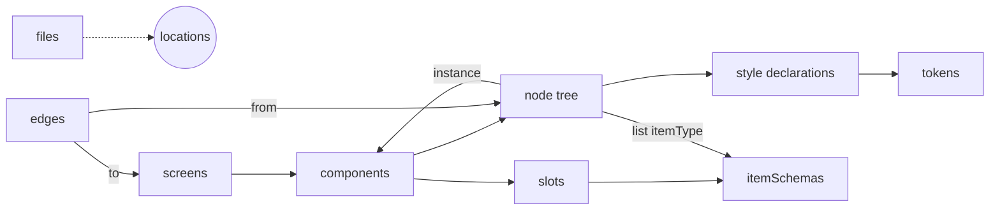

# dui source model

English | [简体中文](../zh-CN/source-model.md) | [한국어](../ko/source-model.md)

> Status: schema version 1, decided 2026-11-27 ([#353](https://github.com/de-novo/dui/issues/353)). Phase 1 of the [default pipeline](roadmap.md#default-pipeline). Related: [Architecture](architecture.md) · [Domain model](domain-model.md) · [Roadmap](roadmap.md).

The source model is what source code declares about its UI. Language adapters write it from syntax, and an official compiler may refine it. The approximate renderer, hot reload, slot and state toggles, and later exports read only this model, so a new language needs only an adapter that writes it.

| Part | File |
| --- | --- |
| JSON Schema | [`schemas/source-model.v1.schema.json`](../../schemas/source-model.v1.schema.json) |
| Rust types and reader | [`crates/dui-core/src/source_model/`](../../crates/dui-core/src/source_model/mod.rs) |
| Reference example | [`fixtures/source-model/model.json`](../../fixtures/source-model/model.json) for the TSX sources in [`fixtures/source-model/src/`](../../fixtures/source-model/src/) |
| Check | `npm run check:source-model` |

Run `dui model PROJECT ENTRY.tsx` to print schema-v1 JSON from a TSX entry and its relative imports. Try `dui model fixtures/source-model src/App.tsx`. The adapter reads named function and arrow components, destructured props, local state, declared call return types, JSX branches and list templates, React Router routes and links, inline styles, and common utilities in projects that import Tailwind CSS. CSS Modules, unsupported classes and dynamic expressions retain their source. The command requires no project install, type checker or browser.

## 1. Principles

1. **Declared, not observed.** The model holds what the code says. It runs no handlers, calls no APIs and starts no browser. Capture results stay in the [capture context](domain-model.md#2-entities-value-objects-and-identities).
2. **Nothing is invented.** A value known only at runtime is an `opaque` expression. A type the adapter cannot read is `unknown`. Syntax it cannot map is a `placeholder` node. A style it cannot resolve is an `unresolved` value or an `unresolvedStyle` entry. Each one keeps its source text or a reason.
3. **Every fact has a place.** Screens, components, slots, nodes, styles, tokens, item schemas and edges carry a source location. Facts that may come from different sources carry an `origin`: `syntax`, `compiler` or `inferred`. `inferred` marks a gap filled by AI or a heuristic.
4. **Deterministic.** The same source gives the same bytes. The model has no timestamps and no absolute paths. Top-level lists are sorted by identifier. Children keep source order. Writers omit absent optional fields, `false` flags and empty lists and maps.
5. **Language-neutral.** Layout, state, navigation and style use neutral terms. Each adapter maps its syntax onto them.

## 2. Document

| Field | Content |
| --- | --- |
| `schemaVersion` | `1` |
| `extractor` | `name` and `version` of the adapter that wrote the model |
| `files` | Project-relative `path` (`/` separators), `language` (`typescript`, `swift`, `kotlin`, `dart`, `css`), `sha256` of the bytes read, and the project files it `imports`. Hot reload uses the digests and the import graph |
| `screens` | `id`, `name`, `route` when a router declares it, the root `component`, `origin`, `location` |
| `components` | `id`, `name`, `location`, `slots`, and one `root` node |
| `itemSchemas` | Shapes of collection items: `id`, `name`, `fields` (`name`, `type`, `optional`), `origin`, `location` |
| `tokens` | Design tokens: `id`, `name` as written, `group`, `value`, optional `modes`, `syntax`, and a `location` or a `package` |
| `edges` | Navigation: `id`, the trigger node `from`, `kind`, `to`, `origin`, `location` |
| `diagnostics` | `code`, `message` and an optional `location` for anything else the adapter wants to report |

A **location** is `file`, 1-based `line` and `column` (column counts Unicode scalar values), and 0-based UTF-8 byte offsets `start` and `end` (`end` exclusive).

## 3. Identifiers

Identifiers are opaque strings. Only adapters create them, and they must stay the same while a declaration's file, name and position in its tree stay the same, so hot reload can patch only what changed. The reference uses this pattern. Other adapters should follow it.

| Entity | Pattern | Example |
| --- | --- | --- |
| Component | `<file>#<name>` | `src/Orders.tsx#Orders` |
| Slot | `<component>.<name>` | `src/Orders.tsx#Orders.filter` |
| Node | `<component>@<path>`: child indexes from the root, with branch arms counted as one level | `src/Orders.tsx#Orders@0.2.1.0` |
| Screen | `route:<path>`, or the component ID for a root view | `route:/settings` |
| Item schema, token | `<file>#<name>`, or `<package>#<name>` for framework defaults | `tailwindcss#--text-2xl` |
| Edge | `<trigger node>:<kind>` | `src/Orders.tsx#Orders@0.3:link` |

A screen with a `route` maps to the capture context's `ScreenId` through its path, so optional capture evidence can be shown next to the model.

## 4. Slots and expressions

A **slot** is a value a component reads that a reviewer may set: a `prop`, declared `local` state, or data from a `store`, `context`, `route`, `query` or other `external` call. This is the [state slot](../i18n.md#glossary) of the glossary. A slot has a `type`, an optional `initial` value (a local state's initial value or a prop's default), `optional` for props, and the `source` text of the read for non-local data.

| Type `kind` | Meaning |
| --- | --- |
| `boolean`, `string`, `number` | Primitive values |
| `enum` | A closed set of literal `values` |
| `array` | A list of `item` |
| `object` | An object described by the item schema `schema` |
| `node` | UI content passed in (children, `ReactNode`, `@ViewBuilder`) |
| `function` | A callback |
| `unknown` | Not readable; optional source `text` |

An **expression** says where a value comes from.

| Expression `kind` | Meaning |
| --- | --- |
| `literal` | A JSON `value` written in the source |
| `slot` | A read of a slot of the same component, with an optional field `path` such as `["length"]` |
| `item` | A read of the current item of an enclosing `list` node, with a field `path`. These are the field-to-UI bindings |
| `opaque` | Code the model does not evaluate: its `text` and the slot and item `reads` in it |

## 5. Nodes

| Node `kind` | Fields | Meaning |
| --- | --- | --- |
| `element` | `tag`, `module`, `props`, `style`, `unresolvedStyle`, `children` | A platform element, or a component from a package (`module`) the model does not describe. Attributes that became style are not repeated in `props` |
| `instance` | `component`, `props`, `children` | A use of a model component. Prop names match the target's `prop` slots |
| `text` | `parts` | Text made of literal and bound parts |
| `branch` | `on`, `arms` | UI that depends on a value: `if`, `&&`, ternaries and `switch`. Each arm has `when` and `children` |
| `list` | `source`, `item`, `itemType`, `key`, `children` | UI repeated for each item. `children` is the per-item template |
| `outlet` | `slot` | Draws the UI content held by a `node` slot |
| `placeholder` | `reason` | Source the adapter could not map |

Every node has `id` and `location`. A branch arm's `when` is `{"equals": <value>}`, `{"truthy": true|false}` or `"otherwise"`. `otherwise` comes last. A reviewer can pick a value of `on` or an arm directly, so toggling `isOpen` or a list count changes the picture without running code.

## 6. Style

An element's `style` is a list of declarations. Each has a `property`, a `value`, an optional `when` condition and `from`, the source of the declaration: `syntax` (`class`, `inline`, `modifier`, `stylesheet`, `theme`), its `text` (one class, one inline entry, one modifier) and its `location`. Declarations apply in order. Among those whose conditions hold, the later one wins.

| Group | Properties | Values |
| --- | --- | --- |
| Layout | `direction` | `row`, `column`, `overlay` |
| | `alignItems` | `start`, `center`, `end`, `stretch`, `baseline` |
| | `justifyContent` | `start`, `center`, `end`, `spaceBetween`, `spaceAround`, `spaceEvenly` |
| | `wrap` | `wrap`, `nowrap` |
| | `grow` | number |
| Spacing | `gap`, `paddingTop`, `paddingBottom`, `paddingStart`, `paddingEnd` | length |
| | `marginTop`, `marginBottom`, `marginStart`, `marginEnd` | length, `auto` |
| Size | `width`, `height`, `minWidth`, `maxWidth`, `minHeight`, `maxHeight` | length, `auto`, `fill`, `fit` |
| Color | `color`, `background`, `borderColor` | color |
| | `opacity` | number |
| Typography | `fontFamily` | any keyword |
| | `fontSize`, `letterSpacing` | length |
| | `fontWeight` | number |
| | `fontStyle` | `normal`, `italic` |
| | `lineHeight` | length or number |
| | `textAlign` | `start`, `center`, `end`, `justify` |
| Radius and border | `borderRadius`, `borderWidth` | length |

`Start` and `end` are the leading and trailing sides in the writing direction.

| Value `kind` | Fields |
| --- | --- |
| `length` | `value` and `unit`: `px`, `rem`, `em`, `percent`, `pt`, `dp` |
| `color` | `value`: lowercase sRGB `#rrggbb` or `#rrggbbaa` |
| `number` | `value` |
| `keyword` | `value` from the property's list |
| `token` | `token` ID and, when resolved, the final value as `resolved` |
| `unresolved` | Source `text` and a `reason`. Accepted for every property |

A condition holds when all its fields hold: `minWidth` and `maxWidth` (lengths), `interaction` (`hover`, `focus`, `pressed`, `disabled`), `colorScheme` (`light`, `dark`), and `expr`, an expression that must be truthy. Style the adapter saw but could not map onto a property, such as a CSS Module class, goes into `unresolvedStyle` with its `syntax`, `text`, `reason` and `location`. A browser never fills it.

The reference maps easy syntax: Tailwind classes and inline styles. Tailwind spacing steps are recorded as their resolved lengths. Medium and hard syntax ([style and design tokens](roadmap.md#default-pipeline)) uses the same declarations once its adapters exist.

For a default import from `.module.css`, `className={styles.card}` reads matching `.card` and `tag.card` rules. The adapter orders declarations by selector specificity and source order, applies inline styles last, and records simple `min-width` or `max-width` media conditions. Each declaration points to its CSS source. Unsupported values and properties retain their source. When a module uses selectors or at-rules outside this subset, composition, or `!important`, its class reference stays unresolved.

Stylesheet `padding-inline-start: 12px` and inline `paddingInlineStart: 12` both emit `paddingStart` with a length of `12px`. Logical start and end are preserved for either writing direction. Margins also accept negative lengths and `auto`.

## 7. Tokens

A token keeps the name the source uses (`--color-brand`, `--text-2xl`) so it can later become a design variable. `group` is `color`, `spacing`, `typography`, `radius`, `size` or `other`. `value` is a final value, or a `token` value that aliases another token. Aliases must not form a cycle. `modes` holds values per mode, such as `dark`. A project token has a `location`. A framework default has a `package` (`tailwindcss`) and no location.

Within one imported theme stylesheet, a color or radius token can refer to another token of the same group with `var(--name)`. The model keeps the immediate reference and resolved value. Cycles, missing definitions and fallback expressions retain their source as unresolved values.

## 8. Edges

`kind` is `link` (a declarative link such as `<Link>` or `NavigationLink`), `navigate` (an imperative call) or `present` (a sheet or dialog over the current screen). `to` is a `screen`, a `route` path that matches no screen in the model, or an `opaque` expression. An edge starts at the node that triggers it. Its screens follow from the screens that draw that node, including through component instances (`SourceModel::screen_edges`).

## 9. Validation and versions

The JSON Schema checks shapes, enums, patterns and required fields. The Rust reader (`SourceModel::from_json`) also checks the rules a schema cannot express:

- sorted, unique identifiers, and slot names unique within a component;
- every location and import names a listed file;
- every reference resolves: screen and instance components, instance props, slot reads within the same component, item reads inside their list, item schemas, tokens, and edge nodes and screens;
- style values fit their property, token aliases do not loop, and `otherwise` arms come last.

`npm run check:source-model` validates the reference against the schema, checks that bad shapes are rejected, and runs the reader's tests. Those tests also check that every reference location points at the fixture source and that the file digests match.

Version 1 is frozen. Any change to fields, kinds or meaning creates `schemaVersion` 2 with a new schema file. The version 1 file and reader do not change. Readers reject versions they do not know.

## 10. Drawing the model

A renderer reads `SourceModel` from `dui-core`, which has no I/O and builds for `wasm32-unknown-unknown`, so the desktop viewer and a web canvas share one reader. Every property maps onto a flexbox engine. [GPUI](roadmap.md#default-pipeline), the reference target, maps them as follows. Cards drawn this way are labeled approximate.

| Model | GPUI |
| --- | --- |
| `direction` `row`, `column` | `flex_row`, `flex_col` |
| `direction` `overlay` | Children positioned `absolute` over each other |
| `alignItems`, `justifyContent`, `wrap`, `grow` | The Taffy flexbox values of the same names |
| Spacing and size properties | Padding, margin, gap and size of the same names. `start` and `end` map to left and right, because GPUI lays out left to right |
| `fill`, `fit`, `auto` | `relative(1.)`, content size, `auto` |
| `px`, `rem`, `percent` | `px`, `rems`, `relative` |
| `pt`, `dp` | `px`. All three are logical pixels |
| `em` | `px`, multiplied by the element's font size |
| `color` | `rgba` |
| `lineHeight` number | `line_height(relative(n))` |
| `textAlign` `justify` | `start`. GPUI has left, center and right only |
| `when` with `minWidth` or `maxWidth` | Resolved against the cell width before layout |
| `when` with `interaction`, `colorScheme` or `expr` | Applied when the reviewer selects that state |
| `token` | Its `resolved` value. A token without one is drawn like `unresolved` |
| `unresolved`, `unresolvedStyle`, `placeholder`, `opaque` text | A labeled placeholder. Never filled by a browser |
