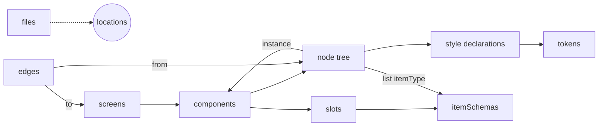

# dui source model

English | [简体中文](../zh-CN/source-model.md) | [한국어](../ko/source-model.md)

> Status: schema version 1, decided 2026-11-27 ([#353](https://github.com/de-novo/dui/issues/353)). Phase 1 of the [default pipeline](roadmap.md#default-pipeline). Related: [Architecture](architecture.md) · [Domain model](domain-model.md) · [Roadmap](roadmap.md).

The source model is what source code declares about its UI. Language adapters write it from syntax, and an official compiler may refine it. The approximate renderer, hot reload, slot and state toggles, and later exports read only this model, so a new language needs only an adapter that writes it.

| Part | File |
| --- | --- |
| JSON Schema | [`schemas/source-model.v1.schema.json`](../../schemas/source-model.v1.schema.json) |
| Rust types and reader | [`crates/dui-core/src/source_model/`](../../crates/dui-core/src/source_model/mod.rs) |
| Reference example | [`fixtures/source-model/model.json`](../../fixtures/source-model/model.json) for the TSX sources in [`fixtures/source-model/src/`](../../fixtures/source-model/src/) |
| Check | `npm run check:source-model` |

Run `dui model PROJECT ENTRY.tsx` to print schema-v1 JSON from a TSX entry and its relative imports. Try `dui model fixtures/source-model src/App.tsx`. The adapter reads named function and arrow components, destructured props, local state, declared call return types, JSX branches and list templates, React Router routes and links, inline styles, and common utilities in projects that import Tailwind CSS. CSS Modules, unsupported classes and dynamic expressions retain their source. The command requires no project install, type checker or browser.

Literal URL query selection is also source evidence. When a strict `URLSearchParams` equality controls a branch that resolves to one component, the adapter records the `/` or `/?name=value` screen. Literal dynamic imports that select those components are read as source. Query-only links such as `?name=value` or `?` resolve only when their source screen is a root query screen and the destination exists; runtime gates and `history` writes stay opaque or unresolved.

For React class components the adapter reads the instance `render()` method. It preserves a conditional child assigned once inside an `if` block and used in the returned JSX. An initialized literal `Router({...})` table in `componentDidMount()` can identify hash views when its paths also occur as literal hash links reachable from the class screen. Locations point to the route key and the link, and a conditional link remains conditional in the model.

Pass `--built-css FILE` to read a single bundled stylesheet inside the project. For static HTML elements, the adapter resolves flex direction, wrapping, growth and alignment, gap, padding, margins, dimensions and their limits, foreground and background color, opacity, border width, color and radius, font size, line height and letter spacing. It applies supported rules by layer, selector specificity and declaration order, and records the winning declaration’s byte range. A potentially winning rule with an unknown condition or unsupported value stays unresolved. The model records declarations on the element; inherited or browser-default computed values are outside this extraction.

The same stylesheet read can add optional top-level `documentStyle` context with `root` and `body` typography declarations. Only document-anchored selectors participate: `html`, `body`, `:root`, their supported compound selectors, and a direct child or descendant of `html`. Importance, layers, specificity, source order and the supplied root attribute decide the winner. When a selector, at-rule or cascade result cannot be proven, the declaration is explicit `unresolved` rather than a guess. Bare class or ID selectors that give no document anchor do not participate.

`documentStyle.externalStylesheets` records external stylesheet URLs declared by the document HTML, such as font stylesheet links. `documentStyle.fontFaces` records `@font-face` facts. A local font source is bounded, content-hashed and named as an archive `asset-<sha256>.<extension>`; a remote source is evidence with its declared URL. Font extraction never executes the document and never guesses a missing file.

Remote font evidence is not font bytes. The default renderer never follows a remote stylesheet or font URL, so a family available only remotely cannot be pixel-matched on the default path; the resolved family cascade falls back to the first locally available face. Runtime effects that later add a font class or stylesheet are application behavior, not source-proven document typography. Exact offline use of a remote-only family would require explicitly supplied local bytes matched to that source URL, with provenance and license recorded; no such product contract exists in schema v1.

Add `--viewport-width PX` to evaluate a single pixel-based width media condition at the specified viewport. Supported forms include `min-width`, `max-width`, and comparisons such as `(width < 768px)`. Other media conditions stay unresolved.

For a direct child or descendant selector with two simple parts, the TSX adapter checks intrinsic JSX ancestors up to the component boundary. To inspect a model, run `dui serve`, choose **Open source model** in the workspace picker and select the exported JSON. The viewer draws the selected component from schema v1 and lists unresolved styles.

When the project selects its theme with a root data attribute, supply the same value during extraction, for example `--root-attribute data-theme=dark`. The adapter resolves simple matching root variable declarations from the bundle. Without that context, conflicting definitions stay unresolved.

Root-scoped `.dark` and `.light` rules, simple `[data-theme=light|dark]` selectors, and exact `(prefers-color-scheme: light|dark)` media rules are compiled as selectable `colorScheme` states when their class, attribute, or media syntax is explicit. Theme-dependent custom properties are overlaid on the unconditional `:root` values for that state. Selectors or cascade results that remain uncertain retain their source text and the best proven typed refinement rather than being guessed. The canvas applies the state matching its explicit color scheme; without that explicit context it does not infer a theme.

The built CSS reader maps display mode, horizontal overflow and auto-fit grids with a minimum column width into model properties. A single flexible track is also supported. A literal body root preserves document colors. Scoped theme overrides stay uncertain when the ancestor chain cannot be established.

The bundled CSS reader resolves independent row and column gaps and common flex shorthands into growth, shrinkage and basis.

The reader expands block spacing in horizontal layouts and preserves font-family fallback lists, including resolvable var() references. Built text-decoration lines, viewport minimums in spacing and ID selectors remain unresolved.

Built CSS preserves physical edge border widths, colors and styles, table border collapse, keyword vertical and text alignment, text case and whitespace. The adapter resolves a single backdrop blur and sRGB, oklab, or oklch mixes of a supported color with transparent at an explicit percentage. Other filter chains and color interpolation spaces stay unresolved.

Intrinsic JSX fragments preserve their children without a layout box. Built CSS supports positioning, stacking order, physical offsets and circular corner radii. Dot backgrounds with equal hard stops and two explicit tile dimensions are represented as model colors and lengths. A complete CSS `box-shadow` list is represented as `boxShadow`, a canonical serialized list after custom-property resolution; unsupported grammar or an unknown winning value remains unresolved rather than dropping layers.

## 1. Principles

1. **Declared, not observed.** The model holds what the code says. It runs no handlers, calls no APIs and starts no browser. Capture results stay in the [capture context](domain-model.md#2-entities-value-objects-and-identities).
2. **Nothing is invented.** A value known only at runtime is an `opaque` expression. A type the adapter cannot read is `unknown`. Syntax it cannot map is a `placeholder` node. A style it cannot resolve is an `unresolved` value or an `unresolvedStyle` entry. Each one keeps its source text or a reason.
3. **Every fact has a place.** Screens, components, slots, nodes, styles, tokens, item schemas and edges carry a source location. Facts that may come from different sources carry an `origin`: `syntax`, `compiler` or `inferred`. `inferred` marks a gap filled by AI or a heuristic.
4. **Deterministic.** The same source gives the same bytes. The model has no timestamps and no absolute paths. Top-level lists are sorted by identifier. Children keep source order. Writers omit absent optional fields, `false` flags and empty lists and maps.
5. **Language-neutral.** Layout, state, navigation and style use neutral terms. Each adapter maps its syntax onto them.

## 2. Document

| Field | Content |
| --- | --- |
| `schemaVersion` | `1` |
| `extractor` | `name` and `version` of the adapter that wrote the model |
| `files` | Project-relative `path` (`/` separators), `language` (`typescript`, `swift`, `kotlin`, `dart`, `css`), `sha256` of the bytes read, and the project files it `imports`. Hot reload uses the digests and the import graph |
| `screens` | `id`, `name`, `route` when a router declares it, the root `component`, `origin`, `location` |
| `components` | `id`, `name`, `location`, `slots`, and one `root` node |
| `itemSchemas` | Shapes of collection items: `id`, `name`, `fields` (`name`, `type`, `optional`), `origin`, `location` |
| `tokens` | Design tokens: `id`, `name` as written, `group`, `value`, optional `modes`, `syntax`, and a `location` or a `package` |
| `edges` | Navigation: `id`, the trigger node `from`, `kind`, `to`, `origin`, `location` |
| `diagnostics` | `code`, `message` and an optional `location` for anything else the adapter wants to report |

A **location** is `file`, 1-based `line` and `column` (column counts Unicode scalar values), and 0-based UTF-8 byte offsets `start` and `end` (`end` exclusive).

## 3. Identifiers

Identifiers are opaque strings. Only adapters create them, and they must stay the same while a declaration's file, name and position in its tree stay the same, so hot reload can patch only what changed. The reference uses this pattern. Other adapters should follow it.

| Entity | Pattern | Example |
| --- | --- | --- |
| Component | `<file>#<name>` | `src/Orders.tsx#Orders` |
| Slot | `<component>.<name>` | `src/Orders.tsx#Orders.filter` |
| Node | `<component>@<path>`: child indexes from the root, with branch arms counted as one level | `src/Orders.tsx#Orders@0.2.1.0` |
| Screen | `route:<path>`, or the component ID for a root view | `route:/settings` |
| Item schema, token | `<file>#<name>`, or `<package>#<name>` for framework defaults | `tailwindcss#--text-2xl` |
| Edge | `<trigger node>:<kind>` | `src/Orders.tsx#Orders@0.3:link` |

A screen with a `route` maps to the capture context's `ScreenId` through its path, so optional capture evidence can be shown next to the model.

## 4. Slots and expressions

A **slot** is a value a component reads that a reviewer may set: a `prop`, declared `local` state, or data from a `store`, `context`, `route`, `query` or other `external` call. This is the [state slot](../i18n.md#glossary) of the glossary. A slot has a `type`, an optional `initial` value (a local state's initial value or a prop's default), `optional` for props, and the `source` text of the read for non-local data.

| Type `kind` | Meaning |
| --- | --- |
| `boolean`, `string`, `number` | Primitive values |
| `enum` | A closed set of literal `values` |
| `array` | A list of `item` |
| `object` | An object described by the item schema `schema` |
| `node` | UI content passed in (children, `ReactNode`, `@ViewBuilder`) |
| `function` | A callback |
| `unknown` | Not readable; optional source `text` |

An **expression** says where a value comes from.

| Expression `kind` | Meaning |
| --- | --- |
| `literal` | A JSON `value` written in the source |
| `slot` | A read of a slot of the same component, with an optional field `path` such as `["length"]` |
| `item` | A read of the current item of an enclosing `list` node, with a field `path`. These are the field-to-UI bindings |
| `opaque` | Code the model does not evaluate: its `text` and the slot and item `reads` in it |

## 5. Nodes

| Node `kind` | Fields | Meaning |
| --- | --- | --- |
| `element` | `tag`, `module`, `props`, `style`, `unresolvedStyle`, `children` | A platform element, or a component from a package (`module`) the model does not describe. Attributes that became style are not repeated in `props` |
| `instance` | `component`, `props`, `children` | A use of a model component. Prop names match the target's `prop` slots |
| `text` | `parts` | Text made of literal and bound parts |
| `branch` | `on`, `arms` | UI that depends on a value: `if`, `&&`, ternaries and `switch`. Each arm has `when` and `children` |
| `list` | `source`, `item`, `itemType`, `key`, `children` | UI repeated for each item. `children` is the per-item template |
| `outlet` | `slot` | Draws the UI content held by a `node` slot |
| `placeholder` | `reason` | Source the adapter could not map |

Every node has `id` and `location`. A branch arm's `when` is `{"equals": <value>}`, `{"truthy": true|false}` or `"otherwise"`. `otherwise` comes last. A reviewer can pick a value of `on` or an arm directly, so toggling `isOpen` or a list count changes the picture without running code.

## 6. Style

The model has one `gap`. Both CSS and inline TSX can express it as `1.5rem 1.5rem`. Unequal values and individual `row-gap` or `column-gap` declarations retain their unresolved source.

An element's `style` is a list of declarations. Each has a `property`, a `value`, an optional `when` condition and `from`, the source of the declaration: `syntax` (`class`, `inline`, `modifier`, `stylesheet`, `theme`), its `text` (one class, one inline entry, one modifier) and its `location`. Declarations apply in order. Among those whose conditions hold, the later one wins.

| Group | Properties | Values |
| --- | --- | --- |
| Layout | `direction` | `row`, `column`, `overlay` |
| | `alignItems` | `start`, `center`, `end`, `stretch`, `baseline` |
| | `justifyContent` | `start`, `center`, `end`, `spaceBetween`, `spaceAround`, `spaceEvenly` |
| | `wrap` | `wrap`, `nowrap` |
| | `grow` | number |
| Spacing | `gap`, `paddingTop`, `paddingBottom`, `paddingStart`, `paddingEnd` | length |
| | `marginTop`, `marginBottom`, `marginStart`, `marginEnd` | length, `auto` |
| Size | `width`, `height`, `minWidth`, `maxWidth`, `minHeight`, `maxHeight` | length, `auto`, `fill`, `fit` |
| Color | `color`, `background`, `borderColor` | color |
| | `opacity` | number |
| Typography | `fontFamily` | any keyword |
| | `fontSize`, `letterSpacing` | length |
| | `fontWeight` | number |
| | `fontStyle` | `normal`, `italic` |
| | `lineHeight` | length or number |
| | `textAlign` | `start`, `center`, `end`, `justify` |
| Radius and border | `borderRadius`, `borderWidth` | length |

`Start` and `end` are the leading and trailing sides in the writing direction.

| Value `kind` | Fields |
| --- | --- |
| `length` | `value` and `unit`: `px`, `rem`, `em`, `percent`, `pt`, `dp`, `vw`, `vh`, `svw`, `svh`, `lvw`, `lvh`, `dvw`, `dvh`, `vmin`, `vmax` |
| `clamp` | literal length operands `min`, `preferred` and `max` |
| `color` | `value`: lowercase sRGB `#rrggbb` or `#rrggbbaa` |
| `number` | `value` |
| `keyword` | `value` from the property's list |
| `token` | `token` ID and, when resolved, the final value as `resolved` |
| `unresolved` | Source `text` and a `reason`, plus optional typed `refinement`. Accepted for every property |

Viewport lengths and bounded literal `clamp()` expressions are exported in the existing `unresolved` envelope with typed numeric `refinement`, so a v1 consumer that does not know the refinement retains its prior fallback. Arbitrary calc expressions, unbounded or non-literal clamps and unsupported units remain unresolved without a refinement.

A condition holds when all its fields hold: `minWidth` and `maxWidth` (lengths), `interaction` (`hover`, `focus`, `pressed`, `disabled`), `colorScheme` (`light`, `dark`), and `expr`, an expression that must be truthy. Style the adapter saw but could not map onto a property, such as a CSS Module class, goes into `unresolvedStyle` with its `syntax`, `text`, `reason` and `location`. A browser never fills it.

The reference maps easy syntax: Tailwind classes and inline styles. Tailwind spacing steps are recorded as their resolved lengths. Medium and hard syntax ([style and design tokens](roadmap.md#default-pipeline)) uses the same declarations once its adapters exist.

For a default import from `.module.css`, `className={styles.card}` reads matching `.card` and `tag.card` rules. The adapter orders declarations by selector specificity and source order, applies inline styles last, and records simple `min-width` or `max-width` media conditions. Each declaration points to its CSS source. Unsupported values and properties retain their source. When a module uses selectors or at-rules outside this subset, composition, or `!important`, its class reference stays unresolved.

Stylesheet `padding-inline-start: 12px` and inline `paddingInlineStart: 12` both emit `paddingStart` with a length of `12px`. Logical start and end are preserved for either writing direction. Margins also accept negative lengths and `auto`.

For example, `padding-inline: 2px 5%` and `paddingInline: "2px 5%"` emit `paddingStart` of `2px` and `paddingEnd` of `5%`.

## 7. Tokens

A token keeps the name the source uses (`--color-brand`, `--text-2xl`) so it can later become a design variable. `group` is `color`, `spacing`, `typography`, `radius`, `size` or `other`. `value` is a final value, or a `token` value that aliases another token. Aliases must not form a cycle. `modes` holds values per mode, such as `dark`. A project token has a `location`. A framework default has a `package` (`tailwindcss`) and no location.

Within one imported theme stylesheet, a color or radius token can refer to another token of the same group with `var(--name)`. The model keeps the immediate reference and resolved value. Cycles, missing definitions and fallback expressions retain their source as unresolved values.

## 8. Edges

`kind` is `link` (a declarative link such as `<Link>` or `NavigationLink`), `navigate` (an imperative call) or `present` (a sheet or dialog over the current screen). `to` is a `screen`, a `route` path that matches no screen in the model, or an `opaque` expression. An edge starts at the node that triggers it. Its screens follow from the screens that draw that node, including through component instances (`SourceModel::screen_edges`).

## 9. Validation and versions

The JSON Schema checks shapes, enums, patterns and required fields. The Rust reader (`SourceModel::from_json`) also checks the rules a schema cannot express:

- sorted, unique identifiers, and slot names unique within a component;
- every location and import names a listed file;
- every reference resolves: screen and instance components, instance props, slot reads within the same component, item reads inside their list, item schemas, tokens, and edge nodes and screens;
- style values fit their property, token aliases do not loop, and `otherwise` arms come last.

`npm run check:source-model` validates the reference against the schema, checks that bad shapes are rejected, and runs the reader's tests. Those tests also check that every reference location points at the fixture source and that the file digests match.

Version 1 changes only by addition. A new optional field, a new style property, a new enum value or a new node kind that older readers can ignore stays in version 1. Removing or renaming a field, enum value or kind, making an optional field required, or changing what an existing value means creates `schemaVersion` 2 with a new schema file; the version 1 file and reader then stop changing. `npm run check:source-model-additive` compares the version 1 schema with the pull request's base and fails on any removal or rename. Readers reject versions they do not know.

## 10. Drawing the model

A renderer reads `SourceModel` from `dui-core`, which has no I/O and builds for `wasm32-unknown-unknown`, so the desktop viewer and a web canvas share one reader. Every property maps onto a flexbox engine. [GPUI](roadmap.md#default-pipeline), the reference target, maps them as follows. Cards drawn this way are labeled approximate.

| Model | GPUI |
| --- | --- |
| `direction` `row`, `column` | `flex_row`, `flex_col` |
| `direction` `overlay` | Children positioned `absolute` over each other |
| `alignItems`, `justifyContent`, `wrap`, `grow` | The Taffy flexbox values of the same names |
| Spacing and size properties | Padding, margin, gap and size of the same names. `start` and `end` map to left and right, because GPUI lays out left to right |
| `fill`, `fit`, `auto` | `relative(1.)`, content size, `auto` |
| `px`, `rem`, `percent` | `px`, `rems`, `relative` |
| `pt`, `dp` | `px`. All three are logical pixels |
| `em` | `px`, multiplied by the element's font size |
| `color` | `rgba` |
| `lineHeight` number | `line_height(relative(n))` |
| `textAlign` `justify` | `start`. GPUI has left, center and right only |
| `when` with `minWidth` or `maxWidth` | Relative units use the initial user-agent font size for the logical viewport, independently of the modeled root and parent fonts, then resolve against the cell width before layout |
| `when` with `interaction`, `colorScheme` or `expr` | Applied when the reviewer selects that state |
| `token` | Its `resolved` value. A token without one is drawn like `unresolved` |
| `unresolved`, `unresolvedStyle`, `placeholder`, `opaque` text | A labeled placeholder. Never filled by a browser |

For the web canvas's TypeScript/DOM model preview, `documentStyle` root typography is applied to the isolated model document or shadow host, and body typography is applied to the body or document-body wrapper. Ordinary `em` remains a CSS length so it resolves in its property context. In a shadow-root card, `rem` resolves against the modeled root font and viewport lengths resolve against the logical card viewport; both are emitted as pixels so they cannot use the viewer document or outer viewport. A typed clamp keeps the same base resolution operand by operand and remains a bounded CSS clamp.
