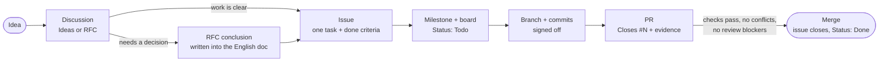
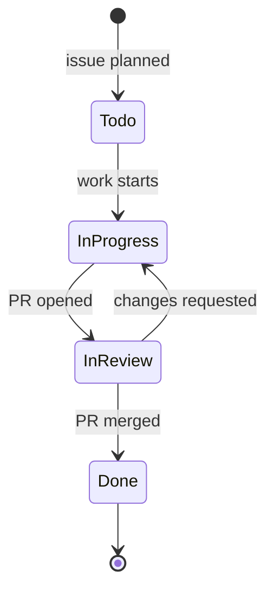
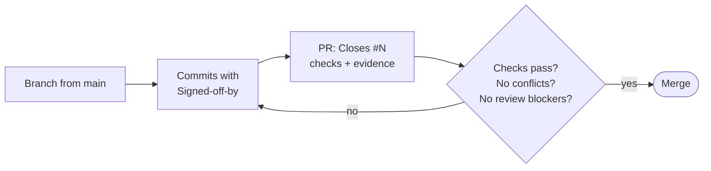

# dui workflow

English | [简体中文](../zh-CN/workflow.md) | [한국어](../ko/workflow.md)

> Status: decided 2026-11-20 · source of truth for how work moves through GitHub in `de-novo/dui`. Code structure: [Architecture](architecture.md). Product design: [Design v0](design-v0.md).

This document defines how dui uses GitHub Discussions, Issues, Labels, Milestones, the Projects board, and pull requests. Each tool owns one kind of information. Other places link to it instead of copying it.

## 1. Who owns what

| Information | Source of truth | Everywhere else |
|---|---|---|
| Product definition, specs, principles | Docs: [Design v0](design-v0.md), [Architecture](architecture.md), [Supported frameworks](supported-frameworks.md) | Link only |
| Terms and translations | [Glossary](../i18n.md) | Use the term; do not redefine it |
| Decisions | The English doc section that records the decision, marked "decided YYYY-MM-DD" | Link only |
| Open questions and proposals | Discussions | Link from the doc or issue; close when done |
| A unit of work and its done criteria | Issue | PR body says `Closes #N` |
| Version scope and goal | Milestone (1–3 line goal + link to the goal doc section) | The issue's milestone field only |
| Progress state | Projects board `Status` field | Never in labels or issue bodies |
| Classification | Labels | Not copied into text |
| What changed and the evidence | PR body | The issue links the PR only |
| Release history | CHANGELOG and GitHub Releases | Never rewritten |

Chat messages and bot notes are not a source of truth. Within 24 hours, move anything that matters into a doc, a Discussion, or an issue. When a decision was approved in chat, quote the approval and its date in the PR body.

## 2. Lifecycle

1. **Idea or question.** Open a Discussion in `Ideas`.
2. **Needs a decision.** Move it to `RFC`, or open the RFC directly. The RFC lists options and a recommendation.
3. **Decided.** Write the conclusion into the English doc that owns the topic (and the zh-CN and ko files in the same PR, see §7). Link the PR in the Discussion and close it.
4. **Work is clear.** Open an issue with done criteria. Link the Discussion and the doc section. Do not copy the spec into the issue.
5. **Planned.** Give the issue its labels (§4), a milestone (§5), and add it to the board (§6).
6. **Built.** One branch, one PR, one purpose. The PR closes the issue.
7. **Merged.** The issue closes; the board moves to `Done`.

Small changes that need no decision skip Discussions: issue → PR.

## 3. Discussions

Only two categories. GitHub's default categories (Announcements, General, Q&A, Show and tell, Polls) are not used.

| Category | Use for | When it ends |
|---|---|---|
| `Ideas` | Proposals not yet decided as work, open questions, questions about using dui | Work becomes clear → open an issue, link both ways, close. A decision is needed → move to `RFC` |
| `RFC` | A topic that needs a decision: design, architecture, supported stacks, policy | Write the conclusion into the owning doc in a PR, link the PR, close |

| Template | Fields | Required |
|---|---|---|
| `Ideas` | One-line summary | yes |
| | What you want to do | yes |
| | Related doc links | if any |
| `RFC` | Background | yes |
| | Options (one line of pros and cons each) | yes |
| | Recommendation and why | yes |
| | Related doc links | if any |

- The RFC template has no "conclusion" field. Conclusions live only in docs. Do not rewrite the Discussion body into a conclusion.
- Discussions are not used for progress tracking, task lists, spec text, or announcements.
- Discussions may be written in English, Simplified Chinese, or Korean. Conclusions are written in English first.

## 4. Issues and labels

### 4.1 Issues

One issue = one task + done criteria.

| Rule | Detail |
|---|---|
| Body | Done criteria as a checklist, and links to the doc sections it implements |
| Not issues | Ideas and open questions (→ Discussions), status notes (→ board), QA, meta, or epic issues without done criteria |
| Required | Exactly 1 type, 1 priority, 1 area label; a milestone; on the board |
| Parent / sub-issues | Only when one task needs several PRs. The parent has its own done criteria. One level deep. Parent and subs close within one milestone |
| Language | English, so every contributor can read it |
| Closing | Use GitHub close reasons (completed, not planned, duplicate) instead of `duplicate` / `wontfix` labels. "Not planned" leaves a reason or a link |
| Blocked | Do not guess. Add `needs-decision` with the question and a recommendation in the issue |

### 4.2 Labels

Labels classify only. State and releases are never labels.

| Group | Values | Per issue |
|---|---|---|
| type | `bug` `feature` `refactor` `chore` `docs` | 1 |
| priority | `P0` `P1` `P2` | 1 |
| area | 8 values below | 1 |
| helper | `needs-decision` `blocked` | 0–1, removed when resolved |

**type** — if several apply, pick the first in this order:

| Label | Meaning |
|---|---|
| `bug` | Behaves differently from the docs |
| `feature` | Adds or changes behavior a user (human or AI agent) can see, including CLI / MCP output, defaults, and wording |
| `refactor` | Same behavior; structure or names change |
| `chore` | Outside product code: build, CI, dependencies, release, repo upkeep, tests only |
| `docs` | Docs only. A PR that changes code and docs takes the code's type |

**priority**

| Label | Meaning |
|---|---|
| `P0` | Stop other work: `main` broken, security or secret leak, the open milestone blocked. Set by the maintainer only; others may suggest it |
| `P1` | Needed for the current milestone's done criteria |
| `P2` | Everything else |

Size and difficulty are not priority.

**area** — one per issue, mapped to a unit in [Architecture §5](architecture.md#5-monorepo-layout). At most 8. Adding or changing an area is a decision (RFC).

| Label | Covers |
|---|---|
| `area:core` | `dui-core`: model, pipeline, rules engine, session (Decider), hashing |
| `area:ports` | `dui-ports`: the `TypeOracle`, `Host`, `Renderer` contracts |
| `area:adapters` | `crates/adapters/*` and `packages/ts-sidecar`: language, host, and renderer adapters |
| `area:app` | `dui-app` and `dui-cli`: effect interpreter, cache, CLI, MCP server, canvas server |
| `area:rules` | `rules/` packs and schema, `stacks.toml`, `fixtures/` |
| `area:canvas` | `apps/canvas` and `packages/schemas` |
| `area:docs` | `docs/`, READMEs, `CONTRIBUTING.md`, `AGENTS.md` |
| `area:tooling` | `xtask`, CI workflows, license and dependency checks, Renovate config |

Other labels are not used, including GitHub's defaults such as `documentation`, `enhancement`, `question`, `duplicate`, `wontfix`, and `invalid`. Deleting old labels is irreversible and needs maintainer approval (§8).

## 5. Milestones and versions

One milestone = one version. Names are `vX.Y.Z` only. The description gives the goal in 1–3 lines and links the goal section in the docs.

| Milestone | Version | Goal (from [Design v0 §13](design-v0.md#13-mvp-scope-and-milestones)) |
|---|---|---|
| M0 spike | `v0.0.1` | Real render path with hand-picked states ([Architecture §7](architecture.md#7-m0-and-m1-gates)) |
| M1 automatic states | `v0.0.2` | States and coverage computed automatically ([Architecture §7](architecture.md#7-m0-and-m1-gates)) |
| M2 GPUI spike | `v0.0.3` | One pippip screen rendered |
| M3 sequence states | `v0.0.4` | Sequence states verified by replay |
| M4 canvas | `v0.0.5` | Canvas opened by the AI agent |
| M5 obora 99% attempt | `v0.0.6` | Coverage report per screen |

| Rule | Detail |
|---|---|
| Open milestones | At most 2: current and next |
| Due dates | Only when the maintainer sets one. If a due date passes, move the remaining issues to the next milestone and close it |
| Versioning | The initial M0–M5 milestones use `v0.0.1` through `v0.0.6`. After this series, significant changes in scope, usage or compatibility increment the minor version during `0.x`. Other changes increment the patch version. |
| Channels | nightly `vX.Y.Z-nightly.YYYYMMDD.N` → release candidate `vX.Y.Z-rc.N` → release `vX.Y.Z` |
| Tags | Nightly tags need no approval. Release candidate and release tags need maintainer approval |
| Release notes | Built from the PRs merged in that milestone. Past CHANGELOG entries and Releases are never edited |

The website and source installer use the highest published stable tag, or `main` when there are no stable tags. An exact release tag must match the Cargo workspace version. An untagged checkout reports `X.Y.Z-dev+<commit>` and a null `tag`; a source archive reports `X.Y.Z-dev`. Update checks compare against stable tags and offer the matching stable version for a development build. Keep pending notes under `## [Unreleased] — vX.Y.Z` in all three changelogs. When the approved tag is published, move those notes to its dated release heading and update the Unreleased comparison link.

## 6. Projects board

One board for the repo. Progress state lives only in its `Status` field.

| Rule | Detail |
|---|---|
| Status values | `Todo`, `In progress`, `In review`, `Done`. Being blocked is the `blocked` label, not a status |
| Views | By milestone, by area, `needs-decision`. More views are fine; more boards are not |
| Extra fields | None |
| Issues | Every open issue is on the board. Issue bodies do not carry status |

## 7. Pull requests

**Branches and commits**

| Rule | Detail |
|---|---|
| Branch | `feat/`, `fix/`, `refactor/`, `chore/`, `docs/` + a short name. Target `main` |
| Commits | Conventional Commits (`feat:`, `fix:`, `docs:` …), each signed off with `git commit -s` ([DCO](../../CONTRIBUTING.md#1-sign-off-every-commit-dco)). Unsigned commits cannot be merged |
| Merge method | Merge commit (not squash), so every original commit keeps its sign-off |

**PR body**

| Field | Content |
|---|---|
| Summary | What changed and why, 1–3 lines |
| Links | `Closes #N`; the doc sections or RFC it follows |
| Checks | The checks that apply (below) and their results |
| Evidence | Rendered images or CLI / MCP output for behavior changes |
| Docs | Docs changed, or "no doc change" and why |
| Approval | For an irreversible step, the maintainer's approval quoted with its date |

**Checks that apply** — the CI checks in [Architecture §6.2](architecture.md#62-automated-checks-ci-fails-on-any-violation): workspace lints, core purity, `cargo xtask check-deps`, `cargo xtask check-licenses`, `cargo xtask gen` freshness, and fixtures. A PR that touches a crate also runs that crate's tests and `insta` snapshots. Docs-only PRs need no CI; the author checks that links resolve and that the three languages keep the same structure (below). A failing check is fixed in the code, never by loosening the check.

**Three-language docs rule** — every doc change follows the [translation rules](../i18n.md#rules):

- Change the English file first. In the same PR, update `zh-CN` and `ko`, or add the "outdated" banner to each file not updated.
- Numbers, links, code, tables, and diagrams stay identical. All three files keep the same headings, tables, and code blocks.
- Code that changes a spec or a term ships with the doc change, in the same PR or after a docs PR is merged.

**Merge conditions** — a PR is merged when all three hold:

1. All required checks pass.
2. No merge conflicts with `main`.
3. No unresolved review blockers.

Then the lead (the maintainer, or an agent assigned to the repo) may merge without further approval. One PR, one purpose.

## 8. Approvals

Reversible work is done directly and reported in a batch. Irreversible work waits for the maintainer.

| Done directly, then reported | Needs the maintainer's explicit approval |
|---|---|
| Adding or changing labels, milestone and board assignment | Making the repository or any artifact public |
| Rewriting issues, closing finished or duplicate issues | Release candidate and release tag pushes, publishing packages |
| Merging PRs that meet §7 | Force-push, rewriting `main` history, skipping checks (`--no-verify`) |
| Doc cleanup, branch cleanup | Deleting labels, milestones, Discussions, or other GitHub objects |
| Nightly tags | Spending money, adding paid services |

An agent's agreement is not approval. Ask for several irreversible items in one batch. If the maintainer does not answer within 24 hours, do only the reversible part of the recommendation and keep waiting for the rest.

Never put secrets, tokens, one-time codes, or private data in the repo, issues, PRs, or Discussions.
