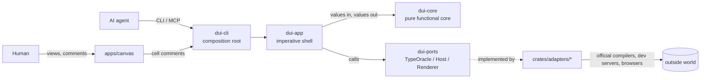
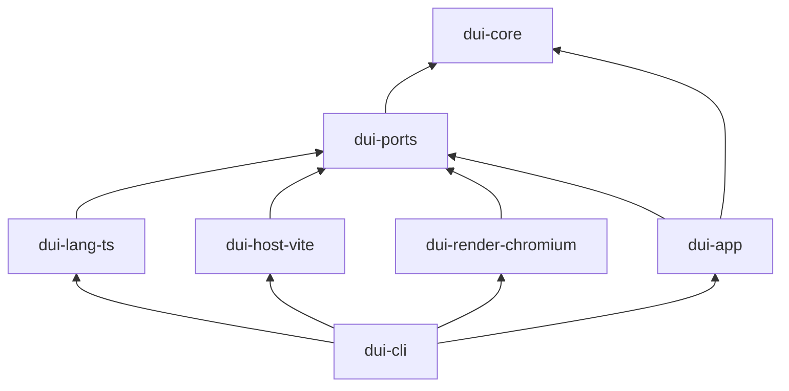

# dui 아키텍처

[English](../en/architecture.md) | [简体中文](../zh-CN/architecture.md) | 한국어

> 이 문서는 [영어 원문](../en/architecture.md)의 한국어 번역이다. 내용이 다르면 영어가 기준이다.

> 상태: 2026-11-20 결정 · 코드 구조의 기준 문서. 설계 배경: [설계 v0](design-v0.md). 도메인 엔티티와 스토리지 포트: [도메인 모델](domain-model.md). 지원 스택: [지원 프레임워크](supported-frameworks.md).

이 문서는 dui Rust 코드의 모양을 정한다: 아키텍처 스타일, 쓰는 패턴과 금지하는 패턴, 모듈·crate 경계, M0와 M1의 완료 조건. [설계 v0](design-v0.md)와 겹치면 코드 구조는 이 문서를 따른다.

## 1. 스타일: 함수형 코어 + 명령형 셸

dui는 Rust 바이너리 하나다. 상태를 찾고, 조합하고, 판정하는 일은 **불변 데이터를 다루는 순수 함수**가 한다(함수형 코어). 공식 컴파일러에 묻고, 개발 빌드를 띄우고, 브라우저를 구동하고, 파일을 읽고, CLI / MCP로 AI와 주고받는 일은 **가장자리의 얇은 코드**가 한다(명령형 셸).

코어(`dui-core`)의 규칙:

- **I/O 0**: 파일 시스템, 네트워크, 프로세스, 환경 변수, 시계, 난수를 쓰지 않는다.
- **async 0**: API에 `async fn`, 런타임, future가 없다.
- **같은 입력, 같은 출력**: 모든 함수는 결정적이다. 바깥 세계에서 오는 입력(소스 스냅샷, 컴파일러 답, 렌더 관측값, AI가 추정한 사실)은 값으로 넘겨받는다.

효과는 가장자리로 밀어낸다: 셸(`dui-app`)이 포트 트레이트로 실행하고, 결과를 평범한 값으로 코어에 돌려준다.



같은 플랫폼에서 렌더링과 측정 경로를 공유한다. Chromium에서 실행되는 웹 앱은 화면 이동, 캡처, 레이아웃 측정에 같은 브라우저 경로를 사용한다. 브라우저가 관측할 수 없는 사실을 소스 선언에서 얻을 때 라우터나 컴파일러 규칙을 추가한다. 어댑터는 공통 화면 그래프를 생성하며 카드, 저장 형식, 검증률은 프레임워크 전체에서 같은 의미를 갖는다.

## 2. 쓰는 패턴

### 2.1 함수형 코어 + 명령형 셸

| 역할 | Rust 형태 |
|---|---|
| 모든 로직을 컴파일러나 브라우저 없이 테스트 가능하게 | `dui-core`에는 소유 / 빌린 데이터를 다루는 순수 `fn`만 있다. 셸이 입력을 모으고, 코어를 부르고, 돌려받은 효과를 실행한다 |
| 효과를 눈에 보이게 | 효과는 값이다(`Effect` enum, §2.6). 분석 안에 숨은 호출로 두지 않는다 |

### 2.2 포트와 어댑터

**포트 트레이트는 정확히 3개**이고, 모두 `dui-ports`에 있으며, 진짜 I/O 경계에만 둔다:

```rust
pub trait TypeOracle {
    async fn query(&mut self, snapshot: &SourceSnapshot, queries: &[TypeQuery])
        -> PortResult<CompilerAnswers>;
}
pub trait Host {
    async fn start(&mut self, build: &DevBuild) -> PortResult<Target>;
    async fn stop(&mut self, target: Target) -> PortResult<()>;
}
pub trait Renderer {
    async fn open(&mut self, target: &Target, job: &RenderJob) -> PortResult<Session>;
    async fn capture(&mut self, session: &mut Session) -> PortResult<Observation>;
    async fn close(&mut self, session: Session) -> PortResult<()>;
}
```

- **`TypeOracle`**은 프로젝트 자신의 공식 컴파일러(정확히 같은 버전)에 심볼과 타입을 묻는다. 답마다 질의 ID와 `Known | Unknown(reason)`이 붙는다. AST는 후보를 찾고, 컴파일러가 타입을 판정한다. AI는 빈 곳만 채우고 `Inferred`로 기록된다.
- **`Host`**는 주입된 개발 빌드를 띄우고 `Target`(웹 URL 또는 네이티브 진입점)을 돌려준다. 소스 변환은 언어 어댑터 몫이다.
- **`Renderer`**는 `Target`에서 칸 하나를 열고, 값·이미지·의미 트리·실행된 분기를 모은다.
- **`Store` 포트**([도메인 모델 §5](domain-model.md#5-스토리지-포트))는 순수 `dui-core::model` 애그리게잇·값 객체 위에 `dui-core::storage`가 바운디드 컨텍스트별로 나눈 영속성 인터페이스(`WorkspaceRepository`, `RunRepository`, `ArtifactStore`, `CacheRepository`, `CommentRepository`, 조합 슈퍼트레이트 `Store`)다. 구체 스토리지 백엔드(로컬 파일 아카이브, `rusqlite` / Drizzle 기반 SQLite, 향후 원격 API)는 이 포트 뒤의 어댑터로 두며, `dui-core`에는 스토리지 의존성이 없다.
- 어댑터는 프로세스·브라우저와 대화하므로 포트 트레이트는 `async`일 수 있다. async는 `dui-ports`에서 멈추고, `dui-core`는 절대 보지 않는다.
- 프레임워크 지식은 **절대** 코어의 코드가 아니다: `if framework == …`도, 스택별 플러그인 계층도 없다. 규칙 팩(§2.5)이나 어댑터 crate 하나에 둔다.

대응 예: React와 TanStack Query는 규칙 팩, Vite는 `Host`, CDP를 쓰는 Chromium은 `Renderer`, TypeScript는 `TypeOracle` + 주입 변환이다. Rust 웹 앱도 같은 Chromium 렌더러를 쓴다.

### 2.3 불변 데이터와 단계별 타입 파이프라인

단계마다 자기 타입이 있어서, 뒤 단계가 앞 단계 데이터를 실수로 받을 수 없다:

```rust
queries(&SourceSnapshot) -> Vec<TypeQuery>
facts(&SourceSnapshot, &CompilerAnswers, &[InferredFact]) -> Facts
model(&Facts, &[RulePack]) -> StateModel
plan(&StateModel, &PlanBudget, &BranchFeedback) -> Plan
jobs(&Plan, &[Width]) -> Vec<RenderJob>
verify(&[RenderJob], &OutcomesByCellId) -> Vec<Verification>
coverage(&[Verification]) -> Coverage
```

- ID와 단위는 **newtype**: `CellId`, `SymbolId`, `StateId`, `Width(u32)`.
- **스마트 생성자**: 바깥 입력은 경계에서 `TryFrom` / `Result`로 한 번만 파싱한다(검증 말고 파싱). private 필드로 잘못된 값은 만들 수 없게 한다.
- 상태는 **대수적 데이터 타입**: `Evidence = Extracted | Inferred`, `CellStatus = Verified | Unverified(reason) | Unrenderable(reason)`, 프로젝트 수준 `Support = Supported | Unsupported(reason)`. 우리 enum에 대한 모든 `match`는 빠짐없이 쓴다.
- **workspace lint**(루트 `Cargo.toml`의 `[workspace.lints.clippy]`): `unwrap_used = "deny"`, `wildcard_enum_match_arm = "deny"`. 와일드카드 lint는 우리 내부 enum을 지킨다. 포트 경계에서 외부 `#[non_exhaustive]` enum을 매칭할 때만 그 자리에 `#[expect(clippy::wildcard_enum_match_arm, reason = "…")]`를 쓸 수 있다.

### 2.4 결정적 변환

- ID는 **정규화한 데이터의 내용 해시**다. 카운터나 주소는 쓰지 않는다.
- 출력은 `BTreeMap` / `BTreeSet` 또는 명시적 정렬을 쓴다. `dui-core`에서는 clippy `iter_over_hash_type`을 금지한다.
- 사실·계획·ID·판정 안에 시각, 난수, 병렬 완료 순서가 들어가지 않는다. 실행 메타데이터(시각, 도구 버전, OS)는 결과 안이 아니라 옆에 기록한다.
- 보고서는 칸들을 `fold`한 값이다.

### 2.5 실행과 분리된 선언적 `RulePack` 데이터

- 규칙 팩은 해석된 심볼이 무슨 뜻인지 적는다: **패키지 + 원래 심볼 + 타입 조건 → 슬롯, 상태, 대표값 힌트**. 별칭과 re-export는 컴파일러가 이미 풀었으므로 같은 원래 심볼로 매칭된다.
- 형식: **버전을 붙인 작은 JSON 스키마**(`rules/schema/rule-pack.v1.schema.json`). **ast-grep YAML 문법 층은 없다**: 매칭 기준은 문법 모양이 아니라 컴파일러가 해석한 심볼이다.
- 팩을 읽을 때 타입 있는 `RulePack`으로 파싱한다(검증 말고 파싱). 잘못된 팩은 읽는 순간 분명한 에러로 실패한다.
- 팩에는 **스크립트, 반복문, 셸 명령이 없다**. 여러 스택에 필요한 새 연산은 테스트 있는 순수 Rust 함수로 `dui-core::rules`에 추가한다.
- `RenderJob`도 평범한 데이터다: 무엇을 주입하고, 무엇을 가로채고, 무엇을 단언할지.

### 2.6 Decider 패턴 + `Effect` enum

분석은 순수 파이프라인(§2.3)으로 둔다. **실행 오케스트레이션과 대화형 캔버스 세션**(실행 시작 → 칸 캡처 완료 → 판정 → 사람 하이라이트 / 코멘트 → AI 다시 그리기 → 파일 변경 무효화)에는 Decider 패턴을 쓴다:

```rust
pub fn decide(cmd: &Command, state: &SessionState) -> (Vec<Event>, Vec<Effect>);
pub fn evolve(state: SessionState, event: &Event) -> SessionState;
```

- `Command`, `Event`, `Effect`, `SessionState`는 `dui-core::session`의 enum / struct다. 라이브러리는 필요 없다.
- `Effect`는 부수효과를 값으로 표현한다. 예: `QueryTypes`, `StartHost`, `RenderCell`, `StopHost`, `PersistSnapshot`, `PublishCanvas`, `NotifyAgent`. 코어는 이를 직접 실행하지 않는다.
- `dui-app`은 **effect 해석기**다: 각 `Effect`를 포트나 저장소로 실행하고, 결과를 다음 `Command`로 바꾼다.
- 테스트는 given-when-then: 이벤트가 주어지고, 명령을 넣으면, 기대한 이벤트와 효과가 나온다. 세션은 이벤트 로그로 다시 재생할 수 있다.

### 2.7 Typestate

순서 실수는 컴파일 에러가 된다:

- `Host<Stopped>::start(self, …) -> PortResult<Host<Running>>`, `Host<Running>::stop(self) -> PortResult<Host<Stopped>>`. `Target`은 `Host<Running>`만 내준다.
- `Cell<Planned>::capture(self, …) -> Cell<Captured>`, `Cell<Captured>::judge(self, …) -> Judged`. `Judged`는 `Cell<Verified>` 또는 다른 상태를 담는 enum이다. `Cell<Planned>`는 바로 `Unrenderable`이 될 수도 있다.
- 커버리지는 판정된 칸만 받으므로, 판정 전 칸으로는 계산할 수 없다.
- typestate 래퍼는 상태가 사는 곳에 둔다: 칸 상태는 `dui-core::model`, host / 세션 핸들은 `dui-app`. 포트 트레이트는 단순하게 둔다.

### 2.8 RAII 가드 + 명시적 `close(self)`

- 개발 서버 프로세스, Chromium 세션 / 탭, 임시 주입 디렉터리는 가드 타입이 소유한다.
- 정상 경로는 **명시적이고 실패할 수 있는** `close(self) -> PortResult<()>` / `stop(self)`이며 에러를 보고한다.
- `Drop`은 panic과 취소 때의 **안전망**이다: 최선을 다해 정리하고, `Drop` 안에서 panic하지 않으며, 경고를 기록한다. `Drop`만으로 정리하는 경로는 없다.
- 셸은 실패 경로에서도 자기가 띄운 host와 세션을 정리한다.

## 3. 금지하는 안티패턴

| 금지 | 이유 | 대신 |
|---|---|---|
| 분석 안의 숨은 I/O(코어에서 컴파일러 호출, 파일 읽기) | 캐시·스냅샷 테스트·재생이 안 된다 | 셸이 입력을 모은다, `Effect` 값 |
| `dui-core` 안의 `async`나 런타임 타입 | 로직이 런타임에 묶인다 | async는 포트 / 어댑터 / 셸에만 |
| 코어의 `if framework == …`나 버전 분기(`if react_18`) | 스택마다 커진다. 옛 메이저는 어차피 미지원 | 규칙 팩, 어댑터 crate 하나 |
| 문자열 상태(`"loading"`) | 빠짐없는 검사가 안 된다 | enum과 newtype |
| 테스트 외 코드의 `unwrap()`, 우리 enum의 `_ =>` | 실패와 새 변형을 숨긴다 | `Result` + `?`, 빠짐없는 `match`(lint로 둘 다 금지) |
| 해시 맵을 순회해 출력 만들기 | 스냅샷이 흔들린다 | `BTreeMap`, 정렬 |
| 언어로 자라나는 규칙 형식 | 데이터 안의 로직은 테스트가 안 된다 | 순수 Rust 함수 + 테스트 |
| 깊은 trait object 플러그인 계층 | 따라가기도 고치기도 어렵다 | 평범한 데이터 + 자유 함수, 트레이트는 포트 3개에만 |
| 어댑터가 다른 어댑터에 의존 | 스택 사이의 숨은 결합 | 공유 코드는 `dui-core`나 `dui-ports`로 |
| `dui-app` 안의 구체 어댑터 | 셸이 스택을 알게 된다 | 어댑터 연결은 `dui-cli`에서만 |
| CI에서 스냅샷 무조건 수락 | 조용한 회귀 | 검토한 스냅샷 diff |
| 픽스처 없는 어댑터나 규칙 팩 | 테스트 안 된 지원 | 픽스처 없으면 머지 없음 |
| 다른 프로젝트 코드 복사, 허용 라이선스가 아닌 의존성 | 라이선스·클린룸 규칙 | 아이디어만 참고, 허용 목록(§6.2) |

## 4. 확정된 결정 (2026-11-20)

| 주제 | 결정 | 이유 |
|---|---|---|
| 규칙 팩 | 버전을 붙인 작은 JSON 스키마. ast-grep YAML 문법 층 없음 | 매칭 기준이 문법 모양이 아니라 컴파일러가 해석한 심볼·타입이다 |
| WASM 플러그인 | M0 / M1 이후로 미룬다. 먼저 같은 프로세스 Rust crate + 타입 있는 JSON 컴파일러 사이드카. 외부 기여자가 규칙 팩 데이터로 표현 못 하는 코드를 내놓아야 할 때만 다시 본다 | 지금 경계는 내장 어댑터와 데이터 팩으로 충족된다. 컴파일러와 브라우저는 어차피 프로세스다 |
| 버전 추적 봇 | Renovate를 **외부 서비스로만** 쓴다. 의존성 카탈로그(npm 픽스처의 정확한 버전)과 lockfile을 같은 PR로 갱신한다. dui에 절대 포함하지 않는다. 지원 기준선 상향은 여전히 dui 메이저 릴리스에서만 한다 | `stacks.toml` 같은 사용자 정의 파일도 추적할 수 있다. Renovate는 AGPL-3.0이므로 그 코드는 dui와 함께 배포되지 않는다 |
| 골든 렌더용 Chromium | 골든 CI는 **정확한 안정판 빌드**로 고정한다. 일반 실행은 쓴 Chromium 버전을 기록한다 | 브라우저 변화와 앱 변화를 구분한다. 골든 실행은 OS, 폰트, 시계, 난수, 애니메이션도 고정하고, 갱신 PR에서 차이를 검토한다 |
| salsa | 변경과 무관한 재계산이 주 병목이라는 게 프로파일링으로 드러날 때까지(예: MCP 편집 반복) 미룬다. 먼저 단계 입력 + 도구·팩 버전을 키로 하는 내용 해시 캐시를 쓴다 | 코어가 순수하므로 나중에 다시 쓰지 않고 증분 질의를 붙일 수 있다 |
| SwiftUI 화면 탐색 (2026-11-25 결정) | `adapters/native-map/swift`의 Swift 패키지(Dart 도구처럼 캐시)가 공식 빌드의 **인덱스 스토어**와 **swift-syntax** 호출 구조를 소스 위치로 결합한다. dui는 선택한 스킴을 자체 DerivedData에 `COMPILER_INDEX_STORE_ENABLE=YES`로 iOS 시뮬레이터용 빌드하며 프로젝트를 수정하지 않는다. 캡처가 아닌 선언을 [로드맵 규칙](roadmap.md#swiftui-screen-discovery)에 따라 낸다 | 타입과 호출 대상은 컴파일러가, 연결은 코드 자체의 구조가 정한다. swift-syntax만으로는 타입을 추측하게 되고, 인덱스만으로는 이동 대상과 라벨을 구분할 수 없으며, 호출 지점별 SourceKit 요청은 일괄 처리에 느리고 불안정하다. 두 라이브러리 모두 Apache-2.0 |

## 5. 모노레포 구조

목표 구조는 **여러 언어 모노레포**다: Rust는 Cargo workspace, TypeScript 부분은 pnpm workspace, 그리고 데이터·픽스처·문서·도구. 이 구조안에서 `stacks.toml`은 어댑터와 규칙 팩의 대응 관계를 기술할 예정이다. [현재 지원 범위 표](supported-frameworks.md)에서 저장소의 구현과 검사를 확인할 수 있다.

현재 npm 패키지의 버전은 [dependency-catalog.json](../../dependency-catalog.json)에서 수정하고 `npm run deps:sync`로 반영한다. CI는 `npm run deps:check`로 매니페스트와 잠금 파일을 검사한다. Rust 크레이트는 루트의 `[workspace.dependencies]`에서 버전 조건을 상속한다. 카탈로그는 dui 자체와 픽스처의 의존성을 관리한다. 지원 기준선은 릴리스에서 별도로 결정한다.

```text
dui/
├── Cargo.toml                 # Cargo workspace root: members, [workspace.lints], shared versions
├── clippy.toml                # disallowed methods / types for the core (§6.2)
├── dependency-catalog.json    # exact npm versions for tooling, apps and fixtures
├── pnpm-workspace.yaml        # JS workspace: packages/*, apps/*
├── package.json
├── stacks.toml                # single source of truth: supported stacks, baselines, adapter + pack mapping
├── renovate.json              # config for the external Renovate service
├── crates/
│   ├── dui-core/              # pure functional core
│   │   └── src/
│   │       ├── model/         # immutable IR, newtypes, ADTs, typestate cells
│   │       ├── pipeline/      # queries → facts → model → plan → jobs → verify → coverage
│   │       ├── rules/         # RulePack parsing (TryFrom) + symbol matching
│   │       ├── session/       # Decider: Command, Event, Effect, SessionState, decide, evolve
│   │       └── hash.rs        # canonical content hashing, ordering helpers
│   ├── dui-ports/             # TypeOracle, Host, Renderer + typed request / response contracts
│   ├── dui-app/               # imperative shell: Effect interpreter, content-hash cache, store, shared CLI / MCP use cases
│   ├── dui-cli/               # the only binary `dui`: composition root, CLI, MCP server, embedded canvas server
│   └── adapters/
│       ├── dui-lang-ts/       # TS 7 TypeOracle (talks to packages/ts-sidecar) + oxc parsing / injection
│       ├── dui-host-vite/     # Vite dev-server Host
│       └── dui-render-chromium/ # Chromium over CDP Renderer (chromiumoxide)
├── packages/
│   ├── ts-sidecar/            # Node sidecar on the project's own TS 7 (typed JSON over stdio)
│   └── schemas/               # shared JSON Schemas (IR, results, sidecar protocol) for Rust and TS
├── apps/
│   └── canvas/                # React + React Flow canvas UI; built assets embedded in `dui`
├── rules/
│   ├── schema/rule-pack.v1.schema.json
│   └── packs/                 # react.json, tanstack-query.json, zod.json, …
├── fixtures/                  # one golden fixture per stack + insta snapshots
├── docs/                      # en (source of truth) / zh-CN / ko
└── xtask/                     # repo tooling (Rust): generation and boundary checks (§6.2)
```

| 단위 | 책임 | 의존해도 되는 것(workspace 안) |
|---|---|---|
| `dui-core` | 순수 함수형 코어: `model`, `pipeline`, `rules`, `session`, `hash` | 없음 |
| `dui-ports` | 포트 트레이트 3개 + 타입 있는 계약(`TypeQuery`, `CompilerAnswers`, `DevBuild`, `Target`, `RenderJob`, `Observation`, `PortResult`) | `dui-core` |
| `crates/adapters/*` | 각각 구체 포트 구현 하나 | `dui-ports`, `dui-core`(타입) — **다른 어댑터는 절대 안 됨** |
| `dui-app` | Effect 해석기, 캐시, 저장소, CLI와 MCP가 함께 쓰는 유스케이스. 포트 트레이트만 보고 일한다 | `dui-core`, `dui-ports` — **구체 어댑터 없음** |
| `dui-cli` | 유일한 바이너리 `dui`. 구체 어댑터를 연결(composition root), CLI(JSON 출력, 고정 종료 코드, 질문 없음), MCP 서버, 내장 캔버스 서버 | 위 전부 |
| `xtask` | `stacks.toml`에서 세 언어 프레임워크 표와 CI 행렬을 생성. 의존 경계와 라이선스 허용 목록을 강제 | `dui`에 링크하지 않음 |
| `packages/ts-sidecar` | 프로젝트의 공식 `typescript` 7로 타입 질의에 답한다 | `packages/schemas` |
| `apps/canvas` | 사람이 보는 캔버스. 칸 코멘트는 MCP로 AI에게 돌아간다 | `packages/schemas` |

새 스택도 같은 모양을 따른다: 새 언어는 `crates/adapters/dui-lang-<x>`, 새 dev 서버는 `dui-host-<x>`, 새 렌더러는 `dui-render-<x>`를 추가한다. 프레임워크·라이브러리 대부분은 `rules/packs/<x>.json` + 픽스처 하나 + `stacks.toml` 항목 하나만 추가한다.

## 6. 의존 방향과 강제

### 6.1 방향



화살표는 쓰는 쪽에서 제공하는 쪽으로 간다. 어댑터 사이에는 화살표가 없다. 구체 어댑터를 아는 건 `dui-cli`뿐이다.

### 6.2 자동 검사 (위반하면 CI 실패)

1. **workspace lint**: `unwrap_used`, `wildcard_enum_match_arm`은 모든 곳에서 금지, `iter_over_hash_type`은 `dui-core`에서 금지.
2. **코어 순수성**: `clippy.toml`의 `disallowed-methods` / `disallowed-types`로 `dui-core`에서 `std::fs`, `std::net`, `std::process`, `std::env`, `SystemTime::now`, `Instant::now` 등을 막는다.
3. **의존 그래프**(`cargo xtask check-deps`, `cargo metadata`를 읽음):
   - `dui-core`에는 workspace 의존성이 없고 async / I/O crate(비동기 런타임, HTTP, 프로세스, 파일 감시 crate 등)도 없다 — 순수 crate 허용 목록으로 검사;
   - `dui-ports`는 workspace 안에서 `dui-core`에만 의존;
   - 각 어댑터는 workspace 안에서 `dui-ports` / `dui-core`에만 의존;
   - `dui-app`은 어떤 어댑터에도 의존하지 않음;
   - 바이너리를 만드는 건 `dui-cli`뿐.
4. **라이선스**(`cargo xtask check-licenses`, Rust는 `cargo-deny`, pnpm workspace는 같은 수준의 검사): 직접·전이 의존성은 MIT, Apache-2.0, BSD-2-Clause / BSD-3-Clause, ISC, Zlib이어야 한다. 빌드 전용 예외로, Vite와 Tailwind가 CSS 처리를 위해 간접 설치하는 원본 `lightningcss`(MPL-2.0)와 공식 플랫폼 바이너리를 허용한다. 빌드 도구가 선택적으로 가져오는 개발 전용 간접 의존성 `tslib`(0BSD)도 원본에 한해 허용한다. 해당 코드와 바이너리는 브라우저 자산, Rust 실행 파일, 릴리스 압축 파일에 포함할 수 없다. 다른 의존성에는 기존 허용 목록을 적용한다.
5. **생성 파일이 최신**: `cargo xtask gen` 출력(세 언어 프레임워크 표, CI 행렬)이 커밋된 파일과 같아야 한다.
6. **픽스처**: `stacks.toml`의 모든 항목에 픽스처와 검토된 스냅샷이 있다.
7. **웹과 개발 도구 소스**: Oxlint로 TypeScript, React 훅, JSX 접근성을 검사하고 Oxfmt로 TypeScript와 CSS 서식을 검사한다. 로컬과 PR 모두 `npm run check:style`을 실행한다. 서식은 `npm run format`으로 적용한다.

### 6.3 프로젝트 디자인 검사

호출자가 `dui audit RUN_DIR --design MANIFEST`로 신뢰하는 설정 파일을 지정할 때 CLI가 프로젝트 코드를 실행한다. 캡처 설정에 다음 필드를 추가한다.

```json
{ "designSpec": "./tokens.json", "plugins": ["./token-check.mjs"] }
```

경로는 설정 파일이 있는 디렉터리 안에서 해석한다. CLI는 비어 있지 않은 렌더 트리가 있는 검증된 셀마다 설정 순서대로 플러그인을 호출한다. Node.js로 `.mjs` 파일을 실행하고 다른 실행 파일은 직접 호출한다. 플러그인은 호출자의 로컬 권한으로 실행되며, 표준 입력으로 JSON 객체 하나를 받고 표준 출력에 JSON 객체 하나를 쓴다.

- 입력 필드는 `version`(1), `index`(0부터 시작하는 셀 순번), `path`, `width`, `state`, `locale`, `scenario`, `renderTree`, `keyboard`, `dismissal`, `designSpec`이다. `keyboard`는 웹 화면의 Tab 순회 기록으로, 포커스 정지마다 브라우저 왕복이 들어 매니페스트의 `"keyboardEvidence": true`나 `DUI_KEYBOARD_EVIDENCE=1`일 때만 기록하며, 키보드 대상, 각 포커스 정지 위치와 포커스 표시가 그려졌는지, 순회가 시작점으로 돌아왔는지를 담는다. `dismissal`은 실제 Escape 입력이 오버레이를 닫고 포커스를 트리거로 되돌렸는지 기록한다. 라벨과 사각형이 같은 헤더 트리거는 한 실행에서 캡처 브라우저마다 너비별로 한 번만 연다. 이후 화면은 그 오버레이를 `dismissal`까지 그대로 재사용하고 `"probe": "reused"`로 표시한다. Vite 프로젝트에서는 컴파일러가 다이얼로그를 찾으므로 아무것도 누르지 않는다. Radix `Dialog`/`AlertDialog`/`Popover` 루트, React Native `Modal`, 네이티브 `<dialog open={…}>`, `open`/`isOpen` prop이 있는 컴포넌트는 `overlay` 사실이 된다. 호스트가 그 prop을 프로브를 거쳐 전달하므로 캡처할 때 다이얼로그를 열린 상태로 설정할 수 있다. 첫 화면이 렌더링한 각 다이얼로그는 실행마다 열린 상태 하나를 얻는다. 그 캡처는 사실의 소스 위치와 `overlay.method: "compiler"`를 담은 `<path>#overlay:<slug>` 노드가 된다. 런타임 트리거 탐색은 컴파일러 사실이 없는 프로젝트(`static`, `url`, `command` 호스트)에서만 쓴다. 리포트의 `overlayDiscovery`는 어떤 방식을 썼는지와 선언·렌더링·캡처된 다이얼로그 수를 알려 준다. 해당 증거가 없으면 `null`이다. 명세에는 설정한 `path`와 `content`가 있다. `.json`은 JSON으로 파싱하고 `DESIGN.md` 등은 UTF-8 텍스트로 읽는다.
- 출력에는 `findings`와 선택적인 사유 목록 `unverified`가 있다. 각 발견 항목은 `rule`, `severity`(`info`, `warning`, `error`), `nodeId`, `rect`, `summary`, `measured`, `expected`, 선택적인 `specRef`를 담는다. 노드 ID와 사각형은 캡처된 동일 노드와 일치해야 한다.
- 커버리지 보고서의 `designAudit`에 셀 위치와 플러그인 경로가 기록된다. 통과하면 종료 코드 0, 발견 항목이 있거나 근거가 부족하면 5, 설정이 잘못되면 2, 플러그인 실패·응답 오류·30초 시간 초과는 3이다.

[예제 검사기](../../examples/design-audit/token-check.mjs)는 [프로젝트 명세](../../examples/design-audit/tokens.json)에서 태그, 계산된 스타일 속성, 토큰을 읽는다. 계산된 스타일 문자열과 여섯 자리 sRGB 16진수 색상을 지원한다.

```sh
dui run examples/design-audit examples/design-audit/dui.json ./capture
dui audit ./capture --design examples/design-audit/dui.json
```

## 7. M0와 M1 완료 조건

**M0 — 손으로 고른 상태로 실제 렌더 경로를 증명한다.** obora가 TS 7 기준선을 맞춘 뒤 obora-web 검수 화면 하나로 한다.

1. 단일 `dui` 바이너리가 손으로 고른 상태 5개를 3폭으로 렌더한다: 서로 다른 칸 ID 15개와 이미지 15장.
2. oxc로 로컬 상태를 하나 이상 바깥에서 주입하고, 실제 값을 다시 읽어 일치를 확인한다. 고른 요청에 CDP Fetch가 목 응답을 돌려준 것을 확인한다.
3. 주입된 개발 빌드는 프로젝트의 공식 `tsc` 검사를 통과하고, 프로덕션 빌드에서 `__dui`는 0건이다. 실패를 넣은 테스트에서도 계획한 칸 ID는 하나도 사라지지 않는다.

**M1 — 같은 화면의 상태와 커버리지를 자동으로 계산한다.**

1. React, TanStack Router, TanStack Query, zod 픽스처에서 화면, 슬롯, 대표값, 목표 분기를 자동으로 뽑는다. 원래 import, 별칭, re-export가 같은 사실을 내야 한다. 공식 안정판 TS에서 실제 타입 답을 얻는 사례가 하나 이상 있어야 한다. beta API나 AI 추정만으로는 이 조건을 통과할 수 없다.
2. 같은 스냅샷, 컴파일러 답, 팩, 추정 입력, 예산이면 실행 순서가 바뀌어도 사실, IR, 계획, 칸 ID가 같다. `insta` 스냅샷으로 확인하고, `proptest`로 예산 준수와 덮지 못한 유효 값 쌍의 보고를 확인한다.
3. 검수 화면에 대해 JSON 출력이 **실행된 목표 분기 / 전체 목표 분기**와 **검증된 칸 / 렌더 가능 칸**을 따로 내고, 런타임에서 찾은 분모 밖 분기, 미검증 목록, 렌더 불가 이유도 함께 낸다. 보충 반복은 개선이 없거나 설정 한도에 닿으면 멈춘다.
4. 같은 입력에 CLI와 MCP가 같은 계획과 판정을 돌려준다.

재현 가능한 M1 게이트 입력, 실행 명령, 검증된 출력은 [M1 게이트](m1-gates.md)(`npm run check:m1`)에 기록한다.

릴리스 순서는 [로드맵](roadmap.md)을 따르고 v0.0.2 구현은 [웹 뷰어 아키텍처](web-viewer.md)를 따른다.

## 8. 남은 위험

1. TS 7 안정판이 구조화된 타입 정보를 어디까지 주는지는 `미확인`이다. M0에서 픽스처로 심볼 / 타입 질의를 시험하고, 답 못 한 질의는 `Unknown`으로 남긴다.
2. 분석기가 놓친 분기는 칸 커버리지에서도 빠질 수 있다. M1부터 런타임 분기 목록과 대조하고, 분모 밖 분기는 따로 보고한다.
3. GPUI 캡처와 의미 트리 접근은 `미확인`이다. M2에서 pippip 화면으로 둘 다 시험하고, 캡처는 됐지만 의미 단언을 확인할 수 없는 칸은 `미검증`으로 남긴다.
