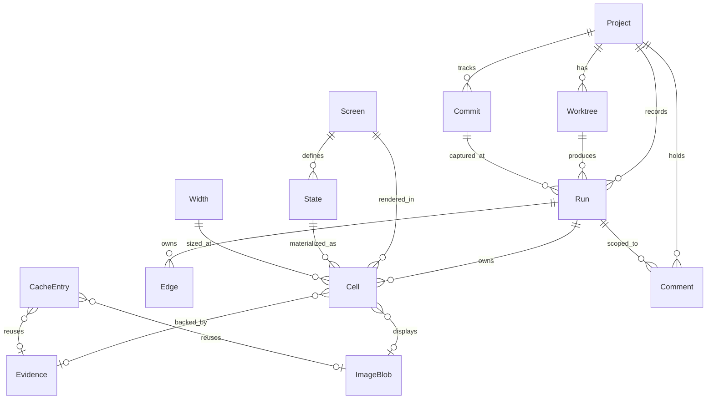

# dui 도메인 모델

[English](../en/domain-model.md) | [简体中文](../zh-CN/domain-model.md) | 한국어

> 이 문서는 [영어 원문](../en/domain-model.md)의 한국어 번역이다. 내용이 다르면 영어가 기준이다.

> 상태: 2026-11-21 결정 · `dui-core`, 스토리지 어댑터, 화면 지도, 캐시, diff, 리뷰 코멘트의 기준 DDD 모델. 관련 문서: [아키텍처](architecture.md) · [웹 뷰어](web-viewer.md) · [로드맵](roadmap.md#v002).

이 문서는 `dui-core::model`과 `dui-core::storage`의 4개 바운디드 컨텍스트, 애그리게잇 루트, 엔티티, 불변 값 객체, 도메인 불변식, 그리고 컨텍스트별 리포지토리 포트를 정의한다. 모든 타입은 private 필드와 스마트 생성자를 갖춘 순수 Rust 값이며 데이터베이스·파일 시스템·async 의존성이 없다.

## 1. 바운디드 컨텍스트와 엔티티 관계



| 바운디드 컨텍스트 | 모듈 | 애그리게잇 루트 · 엔티티 | 값 객체 | 리포지토리 포트 |
|---|---|---|---|---|
| **Workspace** | `dui_core::model::workspace` | `Project`, `Worktree` | `Commit` | `WorkspaceRepository` |
| **Capture / Map** | `dui_core::model::capture` | `RunAggregate` (`Run`, `Cell`, `Edge`를 소유하는 루트) | `Screen`, `State`, `Width`, `Evidence`, `ImageBlob`, `CellStatus`, `EdgeSource`, `CoverageSummary` | `RunRepository`, `ArtifactStore` |
| **Build Cache** | `dui_core::model::cache` | `CacheEntry` | `CacheInputs`, `CacheOutcome`, `CacheInputKind` | `CacheRepository` |
| **Review** | `dui_core::model::review` | `Comment` | `CommentTarget`, `CommentStatus` | `CommentRepository` |

### 소유권과 가변성

- **공유 불변 값 객체:** `Commit`, `Screen`, `State`, `Width`, `Evidence`, `ImageBlob`은 내용 주소 지정(content-addressed) 값이다. 동일한 이미지와 런타임 관측 근거는 한 번만 저장되고 여러 실행·브랜치·워크트리에서 참조한다.
- **실행 소유 불변 애그리게잇:** `RunAggregate`는 게시된 실행의 애그리게잇 루트이며 생성 시점(`RunAggregate::publish`)에 `Run`, `Screen`, `State`, `Cell`, `Edge` 간 참조 정합성을 강제한다. 한 번 게시된 실행은 바뀌지 않으며, 라이브 편집을 저장하면(#3) 새 `Run`(`RunKind::LiveSave`)이 게시된다.
- **행위 메서드를 가진 가변 애그리게잇 루트:** `Project::rename`, `Worktree::checkout`, `Comment::{edit, resolve, reopen}`, `CacheEntry::record_hit`가 불변식(비어 있지 않은 텍스트, 유효한 상태 전이, 단조 증가 시각)을 강제한다. 어떤 `Cell`이나 `CacheEntry`도 참조하지 않는 `ImageBlob`만 정리(prune)할 수 있다.

## 2. 엔티티, 값 객체와 식별자

모든 해시 ID는 검증된 64자리 소문자 16진수 SHA-256 다이제스트(`ContentHash`)다. 파생 ID는 결정적 순서(`BTreeMap` / `BTreeSet`)의 정규화 `[tag, payload]` 튜플을 해시한다. SQLite와 향후 Postgres 스키마 이식성을 위해 식별자는 텍스트, 시각은 정수 Unix epoch 밀리초(`i64`)로 저장한다.

| 타입 | DDD 역할 및 컨텍스트 | ID 타입 및 파생 규칙 | 필드 | 가변성 및 불변식 |
|---|---|---|---|---|
| **Project** | 애그리게잇 루트 (`workspace`) | `ProjectId` — `sha256(primary_root_bytes)` (`~/.dui/projects/<id>`와 호환) | `id`, `display_name`, `primary_root` | `rename`으로 변경; 루트·표시 이름 비어 있을 수 없음 |
| **Worktree** | 애그리게잇 루트 (`workspace`) | `WorktreeId` — `sha256(["dui:worktree:v1", project_id, path, app_relative])` | `id`, `project_id`, `path`, `app_relative`, `branch` | `checkout`으로 `branch` 갱신; 경로 비어 있을 수 없음 |
| **Commit** | 값 객체 (`workspace`) | `CommitId` — `sha256(["dui:commit:v1", project_id, git_sha, dirty, tree_digest])` | `id`, `project_id`, `git_sha`, `dirty`, `tree_digest` | 불변 |
| **Run** | `RunAggregate` 루트 헤더 (`capture`) | `RunId` — 비어 있지 않은 이식 가능 실행 ID(기존 `~/.dui` 스냅샷 ID 지원) | `id`, `project_id`, `worktree_id`, `commit_id`, `kind`, `created_at_ms`, `environment`, `source_files` | `RunAggregate::publish` 이후 불변 |
| **Screen** | 값 객체 (`capture`) | `ScreenId` — `sha256(["dui:screen:v1", path])` | `id`, `path`, `origin` (`Entry` \| `Router` \| `Anchor`) | 불변; 경로 비어 있을 수 없음 |
| **State** | 값 객체 (`capture`) | `StateId` — `sha256(["dui:state:v1", screen_id, scenario, locale, inputs])` | `id`, `screen_id`, `scenario`, `locale`, `inputs`, `plan_index` | 불변; 시나리오 비어 있을 수 없음 |
| **Width** | 값 객체 (`capture`) | `Width(NonZeroU32)` — 양의 CSS 픽셀 | `pixels` | 불변; 반드시 `> 0` |
| **Cell** | `RunAggregate` 소유 엔티티 (`capture`) | `CellId` — `sha256(["dui:cell:v1", run_id, screen_id, state_id, width, locale])` | `id`, `run_id`, `screen_id`, `state_id`, `width`, `locale`, `status`, `image_blob`, `evidence_id`, `cache` | 불변; `Unrenderable` 칸은 `image_blob`을 가질 수 없음 |
| **Evidence** | 값 객체 (`capture`) | `EvidenceId` — `sha256(["dui:evidence:v1", canonical_observation])` | `id`, `observed_path`, `observed_width`, `ready`, `settled`, `slots`, `instances`, `hits`, `links`, `responses`, `assertions`, `live_edits` | 내용 주소 지정 불변 산출물 |
| **ImageBlob** | 값 객체 (`capture`) | `BlobId` — `sha256(image_bytes)` | `id`, `media_type`, `byte_len`, `width_px`, `height_px` | 디스크 불변 블롭; 미참조 시에만 정리 가능 |
| **Edge** | `RunAggregate` 소유 엔티티 (`capture`) | `EdgeId` — `sha256(["dui:edge:v1", run_id, from, to, source, trigger])` | `id`, `run_id`, `from`, `to`, `source`, `trigger`, `selector`, `observed_widths` | 실행별 불변; `Verified`는 확인 폭이 있는 `confirm_by_replay`로만 생성 |
| **Comment** | 애그리게잇 루트 (`review`) | `CommentId` — `sha256(["dui:comment:v1", run_id, target, author, created_at_ms, initial_body])` | `id`, `project_id`, `run_id`, `target`, `author`, `body`, `status`, `created_at_ms`, `updated_at_ms` | `edit` / `resolve` / `reopen`으로 전이; 단조 증가 시각, 본문 필수 |
| **CacheEntry** | 애그리게잇 루트 (`cache`) | `CacheKey` — `sha256(["dui:cache:v1", cache_inputs])` | `key`, `inputs`, `status`, `image_blob`, `evidence_id`, `created_at_ms`, `last_hit_at_ms` | `record_hit`으로 갱신; `Unrenderable`은 `image_blob` 금지 |

## 3. 순수 도메인 규칙 (ADT)

스토리지 코드 없이 `crates/dui-core/src/model/`에 private 필드와 빠짐없는 매칭으로 정의한다.

- **`CellStatus`** — `Verified | Unverified { reason: NonEmptyText } | Unrenderable { reason: NonEmptyText }`. 미검증(`Unverified`)과 렌더 불가(`Unrenderable`)는 별개 변형이며 둘 다 비어 있지 않은 사유가 필수다. `Cell::new`는 `Unrenderable` 칸에 `image_blob`이 들어오는 것을 거부한다. `CoverageSummary::from_cells`는 `Unrenderable` 칸을 `renderable` 분모에서 제외하고 따로 집계한다.
- **`EdgeSource`** — `Extracted | Inferred | Verified`. `Edge::discovered`는 항상 `Extracted`, `Edge::inferred`는 항상 `Inferred`를 만들며, 확인 폭이 하나 이상인 `Edge::confirm_by_replay`만이 `Verified`를 생성한다.
- **`CacheOutcome`** — `Hit { key } | Miss { key, changed: BTreeSet<CacheInputKind> }`. `evaluate_cache`는 `CacheInputs`(`source_files`, `types_digest`, `mocks_digest`, `state_id`, `width`, `locale`, `dui_version`, `rule_pack_digest`, `renderer_env_digest`)를 비교해 미스 시 정확히 어떤 입력이 바뀌었는지 돌려준다(강제 재렌더 시 `Forced`, 이전 항목 부재 시 `Missing`).
- **`RunAggregate::publish`** — 모든 `Cell`과 `Edge`가 `run.id()`에 속하는지, 참조한 `Screen`·`State`가 애그리게잇 안에 존재하는지, `Cell`의 `State`가 같은 `Screen` 소속인지, 중복 `CellId`가 없는지 검증한다.

## 4. 새 엔티티 없는 기능 포괄 범위

| 기능 | 모델 표현 방식 |
|---|---|
| 화면 지도 ([#7](https://github.com/de-novo/dui/issues/7)) | `RunAggregate` → `Screen`(`origin`), `State`, `Width`, `Cell`(`CellStatus`, `ImageBlob`, `Evidence`), `Edge::discovered`(`EdgeSource::Extracted`, `selector`, `observed_widths`). |
| 라이브 캡처 저장 ([#3](https://github.com/de-novo/dui/issues/3)) | `RunKind::LiveSave { source_run, source_state, source_width, revision }`을 가진 새 불변 `RunAggregate`, `Cell` 1개, `ImageBlob`, 그리고 `live_edits`와 단언이 담긴 `Evidence`. |
| 내용 주소 지정 캐시 ([#8](https://github.com/de-novo/dui/issues/8)) | `CacheEntry`가 `CacheKey`(`CacheInputs`)를 기존 `ImageBlob` + `Evidence` + `CellStatus`에 매핑하고, `Cell.cache()`가 `Hit` 또는 `Miss(changed)`를 기록. |
| SQLite + Drizzle 저장소 ([#10](https://github.com/de-novo/dui/issues/10)) | 5개 리포지토리 포트 뒤에 애그리게잇/산출물별 SQL 테이블을 둔다. 텍스트 ID/해시, 정수 epoch ms 시각, JSON 페이로드로 Postgres 이식성을 유지한다. 큰 PNG 바이트는 `BlobId` 키의 파일로 디스크에 저장한다. |
| 캡처 diff ([#11](https://github.com/de-novo/dui/issues/11)) | 두 `RunAggregate`를 `Cell::diff_key()`(`screen_id`, `state_id`, `width`, `locale`)로 비교한다. `(status, image_blob, evidence_id)`가 같으면 변경 없음으로 판정한다. |
| 다국어 캡처 ([#12](https://github.com/de-novo/dui/issues/12)) | `State.locale()`, `Cell.locale()`, `CacheInputs.locale`로 로케일 차원을 ID와 캐시 키에 포함한다. |
| 리뷰 코멘트 (v0.0.5) | `Comment`가 `Project`/`Run`의 `CommentTarget::{Screen, State, Cell, Edge}`에 붙어 `edit`·`resolve`·`reopen` 전이를 추적한다. |

## 5. 스토리지 포트

`crates/dui-core/src/storage.rs`는 5개의 컨텍스트별 리포지토리·산출물 포트(조합 슈퍼트레이트 `Store`)와 테스트용 결정적 `BTreeMap` 기반 `MemoryStore`를 정의한다.

```rust
pub trait WorkspaceRepository {
    fn upsert_project(&mut self, project: &Project) -> StoreResult<()>;
    fn get_project(&self, id: &ProjectId) -> StoreResult<Option<Project>>;
    fn upsert_worktree(&mut self, worktree: &Worktree) -> StoreResult<()>;
    fn get_worktree(&self, id: &WorktreeId) -> StoreResult<Option<Worktree>>;
    fn put_commit(&mut self, commit: &Commit) -> StoreResult<()>;
    fn get_commit(&self, id: &CommitId) -> StoreResult<Option<Commit>>;
}
pub trait RunRepository {
    fn save_run(&mut self, aggregate: &RunAggregate) -> StoreResult<()>;
    fn load_run(&self, id: &RunId) -> StoreResult<Option<RunAggregate>>;
    fn list_runs(&self, filter: &RunFilter) -> StoreResult<Vec<RunSummary>>;
}
pub trait ArtifactStore {
    fn put_blob(&mut self, blob: &ImageBlob, bytes: &[u8]) -> StoreResult<()>;
    fn get_blob(&self, id: &BlobId) -> StoreResult<Option<(ImageBlob, Vec<u8>)>>;
    fn put_evidence(&mut self, evidence: &Evidence) -> StoreResult<()>;
    fn get_evidence(&self, id: &EvidenceId) -> StoreResult<Option<Evidence>>;
    fn unreferenced_blobs(&self) -> StoreResult<Vec<BlobId>>;
    fn delete_blob(&mut self, id: &BlobId) -> StoreResult<()>;
}
pub trait CacheRepository {
    fn get_cache(&self, key: &CacheKey) -> StoreResult<Option<CacheEntry>>;
    fn put_cache(&mut self, entry: &CacheEntry) -> StoreResult<()>;
}
pub trait CommentRepository {
    fn upsert_comment(&mut self, comment: &Comment) -> StoreResult<()>;
    fn get_comment(&self, id: &CommentId) -> StoreResult<Option<Comment>>;
    fn list_comments(&self, run_id: &RunId) -> StoreResult<Vec<Comment>>;
}
```

구체 스토리지 백엔드는 `dui-core` 바깥의 어댑터 계층에서 이 포트들을 구현한다.

- **로컬 SQLite + Drizzle 어댑터 ([#10](https://github.com/de-novo/dui/issues/10)):** `crates/dui/src/sqlite_store.rs`(번들 SQLite WAL 모드의 `rusqlite`)와 `packages/db/`(`drizzle-orm` `1.0.0-rc.5` SQLite 방언)가 동일한 전방 전용 SQL 마이그레이션(`packages/db/migrations/`)을 공유한다. 메타데이터는 `~/.dui/dui.db`에, 내용 주소 지정 이미지는 `~/.dui/blobs/<sha256>.png`에 저장한다. `~/.dui/projects/`의 기존 실행은 자동으로 가져오며 DB 파일을 삭제해도 디스크 파일에서 무손실로 복원할 수 있다.
- **인메모리 테스트 어댑터:** `dui_core::storage::MemoryStore`(`BTreeMap` 기반, I/O 0).
- **향후 원격 Postgres 동기화:** SQLite 파일을 공유하지 않고 동일한 텍스트 ID·epoch 밀리초 시각·JSON 컬럼 구조로 API를 통해 동기화한다.
