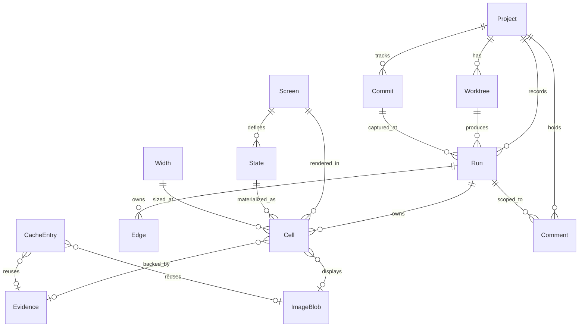

# dui 도메인 모델

[English](../en/domain-model.md) | [简体中文](../zh-CN/domain-model.md) | 한국어

> 이 문서는 [영어 원문](../en/domain-model.md)의 한국어 번역이다. 내용이 다르면 영어가 기준이다.

> 상태: 2026-11-21 결정 · `dui-core`, 스토리지 어댑터, 화면 지도, 캐시, diff, 리뷰 코멘트의 기준 엔티티 모델. 관련 문서: [아키텍처](architecture.md) · [웹 뷰어](web-viewer.md) · [로드맵](roadmap.md#v002).

이 문서는 `dui-core::model`의 13개 도메인 엔티티, 결정적 식별자, 가변성 규칙, 대수적 상태 타입, 그리고 `dui-core::storage`의 얇은 `Store` 포트를 정의한다. 모든 타입은 데이터베이스·파일 시스템·async 의존성이 없는 순수 Rust 값이다.

## 1. 엔티티 관계



### 소유권과 가변성

- **공유 불변 산출물:** `Commit`, `Screen`, `State`, `Width`, `Evidence`, `ImageBlob`은 내용 주소 지정(content-addressed) 값이다. 동일한 이미지와 런타임 관측 근거는 한 번만 저장되고 여러 실행·브랜치·워크트리에서 참조한다.
- **실행 소유 불변 레코드:** `Run`은 자신의 `Cell` 행과 실행 범위 `Edge` 전환을 소유한다. 한 번 게시된 실행과 칸은 바뀌지 않는다. 라이브 편집을 저장하면(#3) 새 `Run`(`RunKind::LiveSave`)이 게시된다.
- **가변 포인터와 리뷰 레코드:** `Project`(`display_name`), `Worktree`(체크아웃 시 `branch`), `Comment`(`body`, `status`, `updated_at_ms`), `CacheEntry`(`last_hit_at_ms`, 정리/교체)만 제자리에서 바뀐다. 어떤 `Cell`이나 `CacheEntry`도 가리키지 않는 `ImageBlob`만 정리(prune)할 수 있다.

## 2. 엔티티와 식별자

모든 해시 ID는 검증된 64자리 소문자 16진수 SHA-256 다이제스트(`ContentHash`)다. 파생 ID는 결정적 순서(`BTreeMap` / `BTreeSet`)의 정규화 `[tag, payload]` 튜플을 해시한다. SQLite와 향후 Postgres 스키마 이식성을 위해 식별자는 텍스트, 시각은 정수 Unix epoch 밀리초(`i64`)로 저장한다.

| 엔티티 | ID 타입 및 파생 규칙 | 필드 | 소유권 | 가변성 및 수명 |
|---|---|---|---|---|
| **Project** | `ProjectId` — `sha256(primary_root_bytes)` (`~/.dui/projects/<id>`와 호환) | `id`, `display_name`, `primary_root` | 실행 간 공유 | `display_name` 가변(첫 캡처에 고정); 프로젝트 이력이 있는 동안 유지 |
| **Worktree** | `WorktreeId` — `sha256(["dui:worktree:v1", project_id, path, app_relative])` | `id`, `project_id`, `path`, `app_relative`, `branch` | 실행 간 공유 | `branch` 가변; 체크아웃 시 갱신 |
| **Commit** | `CommitId` — `sha256(["dui:commit:v1", project_id, git_sha, dirty, tree_digest])` | `id`, `project_id`, `git_sha`, `dirty`, `tree_digest` | 실행 간 공유 | 불변 |
| **Run** | `RunId` — 비어 있지 않은 이식 가능 실행 ID(기존 `~/.dui` 스냅샷 ID 지원) | `id`, `project_id`, `worktree_id`, `commit_id`, `kind`, `created_at_ms`, `environment`, `source_files` | `Cell`과 실행 `Edge` 소유 | 게시 후 불변 |
| **Screen** | `ScreenId` — `sha256(["dui:screen:v1", path])` | `id`, `path`, `origin` (`Entry` \| `Router` \| `Anchor`) | 경로별 공유 | 불변 값 |
| **State** | `StateId` — `sha256(["dui:state:v1", screen_id, scenario, locale, inputs])` | `id`, `screen_id`, `scenario`, `locale`, `inputs`, `plan_index` | 칸 입력별 공유 | 불변 값 |
| **Width** | `Width(NonZeroU32)` — 양의 CSS 픽셀 | `pixels` | 값 객체 | 불변 |
| **Cell** | `CellId` — `sha256(["dui:cell:v1", run_id, screen_id, state_id, width, locale])` | `id`, `run_id`, `screen_id`, `state_id`, `width`, `locale`, `status`, `image_blob`, `evidence_id`, `cache` | 단일 `Run` 소유 | `Run` 게시 후 불변 |
| **Evidence** | `EvidenceId` — `sha256(["dui:evidence:v1", canonical_observation])` | `id`, `observed_path`, `observed_width`, `ready`, `settled`, `slots`, `instances`, `hits`, `links`, `responses`, `assertions`, `live_edits` | 내용 주소 지정 공유 산출물 | 불변 |
| **ImageBlob** | `BlobId` — `sha256(image_bytes)` | `id`, `media_type`, `byte_len`, `width_px`, `height_px` | 디스크 공유 블롭(메타데이터는 스토어) | 불변; 미참조 시에만 정리 가능 |
| **Edge** | `EdgeId` — `sha256(["dui:edge:v1", run_id, from, to, source, trigger])` | `id`, `run_id`, `from`, `to`, `source`, `trigger`, `selector`, `observed_widths` | `Run` 소유 | 실행별 불변(재생 검증 시 `Verified` 엣지 게시) |
| **Comment** | `CommentId` — `sha256(["dui:comment:v1", run_id, target, author, created_at_ms, initial_body])` | `id`, `project_id`, `run_id`, `target`, `author`, `body`, `status`, `created_at_ms`, `updated_at_ms` | `Project`·`Run` 대상 범위 | 가변 (`body`, `status`, `updated_at_ms`) |
| **CacheEntry** | `CacheKey` — `sha256(["dui:cache:v1", cache_inputs])` | `key`, `inputs`, `status`, `image_blob`, `evidence_id`, `created_at_ms`, `last_hit_at_ms` | 실행·워크트리 간 공유 | 가변 포인터 (`last_hit_at_ms`, 정리 시 제거 가능) |

## 3. 순수 도메인 규칙 (ADT)

스토리지 코드 없이 `crates/dui-core/src/model.rs`에 빠짐없는 매칭으로 정의한다.

- **`CellStatus`** — `Verified | Unverified { reason } | Unrenderable { reason }`. 미검증(`Unverified`)과 렌더 불가(`Unrenderable`)는 별개 변형이며 둘 다 비어 있지 않은 사유가 필수다. 커버리지(`CoverageSummary::from_cells`)는 `Unrenderable` 칸을 `renderable` 분모에서 제외하고 따로 집계한다.
- **`EdgeSource`** — `Extracted | Inferred | Verified`. DOM 앵커 발견은 `Extracted`(추출됨), AI 추정은 `Inferred`(추정됨)로 기록하며, 재생 확인을 통과한 경우에만 `Verified`(검증됨)를 만든다.
- **`CacheOutcome`** — `Hit { key } | Miss { key, changed: BTreeSet<CacheInputKind> }`. `evaluate_cache`는 `CacheInputs`(`source_files`, `types_digest`, `mocks_digest`, `state_id`, `width`, `locale`, `dui_version`, `rule_pack_digest`, `renderer_env_digest`)를 비교해 미스 시 정확히 어떤 입력이 바뀌었는지 돌려준다(강제 재렌더 시 `Forced`, 이전 항목 부재 시 `Missing`).

## 4. 새 엔티티 없는 기능 포괄 범위

| 기능 | 13개 엔티티로의 표현 방식 |
|---|---|
| 화면 지도 ([#7](https://github.com/de-novo/dui/issues/7)) | `Run` → `Screen`(`origin`), `State`, `Width`, `Cell`(`CellStatus`, `ImageBlob`, `Evidence`), `Edge`(`EdgeSource::Extracted`, `selector`, `observed_widths`). |
| 라이브 캡처 저장 ([#3](https://github.com/de-novo/dui/issues/3)) | `RunKind::LiveSave { source_run, source_state, source_width, revision }`을 가진 새 불변 `Run`, `Cell` 1개, `ImageBlob`, 그리고 `live_edits`와 단언이 담긴 `Evidence`. |
| 내용 주소 지정 캐시 ([#8](https://github.com/de-novo/dui/issues/8)) | `CacheEntry`가 `CacheKey`(`CacheInputs`)를 기존 `ImageBlob` + `Evidence` + `CellStatus`에 매핑하고, `Cell.cache`가 `Hit` 또는 `Miss(changed)`를 기록. |
| SQLite + Drizzle 저장소 ([#10](https://github.com/de-novo/dui/issues/10)) | `Store` 포트 뒤에 엔티티별 SQL 테이블을 둔다. 텍스트 ID/해시, 정수 epoch ms 시각, JSON 페이로드로 Postgres 이식성을 유지한다. 큰 PNG 바이트는 `BlobId` 키의 파일로 디스크에 저장한다. |
| 캡처 diff ([#11](https://github.com/de-novo/dui/issues/11)) | 두 `Run`을 `Cell::diff_key()`(`screen_id`, `state_id`, `width`, `locale`)로 비교한다. `(status, image_blob, evidence_id)`가 같으면 변경 없음으로 판정한다. |
| 다국어 캡처 ([#12](https://github.com/de-novo/dui/issues/12)) | `State.locale`, `Cell.locale`, `CacheInputs.locale`로 로케일 차원을 ID와 캐시 키에 포함한다. |
| 리뷰 코멘트 (v0.0.5) | `Comment`가 `Project`/`Run`의 `CommentTarget::{Screen, State, Cell, Edge}`에 붙어 `Open` / `Resolved` 상태를 추적한다. |

## 5. 스토리지 포트

`crates/dui-core/src/storage.rs`는 동기식·저장소 중립 `Store` 트레이트와 `RunBundle` / `RunFilter` / `RunSummary` 값 타입, 그리고 테스트용 순수 `BTreeMap` 기반 `MemoryStore`를 정의한다.

```rust
pub trait Store {
    fn upsert_project(&mut self, project: &Project) -> StoreResult<()>;
    fn upsert_worktree(&mut self, worktree: &Worktree) -> StoreResult<()>;
    fn put_commit(&mut self, commit: &Commit) -> StoreResult<()>;
    fn put_blob(&mut self, blob: &ImageBlob, bytes: &[u8]) -> StoreResult<()>;
    fn get_blob(&self, id: &BlobId) -> StoreResult<Option<(ImageBlob, Vec<u8>)>>;
    fn put_evidence(&mut self, evidence: &Evidence) -> StoreResult<()>;
    fn get_evidence(&self, id: &EvidenceId) -> StoreResult<Option<Evidence>>;
    fn save_run(&mut self, bundle: &RunBundle) -> StoreResult<()>;
    fn load_run(&self, id: &RunId) -> StoreResult<Option<RunBundle>>;
    fn list_runs(&self, filter: &RunFilter) -> StoreResult<Vec<RunSummary>>;
    fn get_cache(&self, key: &CacheKey) -> StoreResult<Option<CacheEntry>>;
    fn put_cache(&mut self, entry: &CacheEntry) -> StoreResult<()>;
    fn upsert_comment(&mut self, comment: &Comment) -> StoreResult<()>;
    fn list_comments(&self, run_id: &RunId) -> StoreResult<Vec<Comment>>;
    fn unreferenced_blobs(&self) -> StoreResult<Vec<BlobId>>;
    fn delete_blob(&mut self, id: &BlobId) -> StoreResult<()>;
}
```

구체 스토리지 백엔드(파일 아카이브, #10의 `rusqlite` / Drizzle 기반 SQLite, 향후 원격 HTTP 동기화)는 `dui-core` 바깥의 어댑터 계층에서 `Store`를 구현한다.
