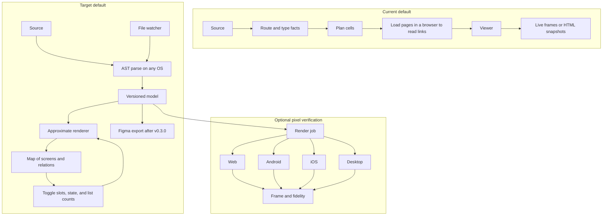

# dui 로드맵 · UI 지도로 앱 리뷰하기

[English](../en/roadmap.md) · 한국어 · [简体中文](../zh-CN/roadmap.md)

## 목표

지금은 제품을 만드는 원천이 기획 문서, 피그마 디자인, 코드로 나뉘어 있다. dui는 개발과 UI 작업의 원천을 하나로 합친다. 그 원천은 코드 자체다. 화면 지도와 디자인 뷰는 코드에서 만들어지고, UI를 고치면 같은 코드로 돌아간다. 따로 있는 디자인 파일이 어긋날 일이 없다.

**이것이 의미하는 것**

- 코드가 실제로 그리는 화면을 보고 리뷰하고 수정한다.
- 지도에서 고친 내용은 출시되는 같은 코드베이스에 반영된다.

**목표가 아닌 것**

- 자체 파일 형식을 가진 독립 디자인 도구가 되는 것.
- 모든 플랫폼을 한꺼번에 지원하는 것. 이 목표에 필요한 파싱과 근사 렌더를 우선하고, 캡처는 선택적 검증으로 둔다.

<a id="never"></a>

**절대 하지 않는 것.** `dui map`, `dui open`, 핫리로드, 카드 그리기의 기본 경로는 Chromium이나 그 밖에 메모리를 많이 쓰는 렌더러를 실행하면 안 된다. 헤드리스 브라우저, 라이브 브라우저 세션, 에뮬레이터, 시뮬레이터도 안 된다. 무거운 렌더러는 픽셀 검증을 위한 명시적 선택 옵션(`--capture`, `dui run`, 렌더 머신)으로만 허용한다. 카드를 채우는 폴백으로 쓰면 안 된다. 이 규칙은 [AGENTS.md](../../AGENTS.md#never)와 [아키텍처 §3](architecture.md#never-default-path)에도 있다.

**지금 집중할 일.** 코드를 기준으로 지도를 만들고, UI를 고친 결과를 같은 코드로 되돌리는 루프를 닫는다(v0.3.0에서 계획한 코드 기반 캔버스). 더 넓은 플랫폼 지원과 패키징은 그다음에 한다. 기본 경로는 소스를 AST로 파싱하고, 버전 있는 모델로 재조립한 뒤, dui 근사 렌더러로 그리는 것이다. 브라우저나 플랫폼 빌드는 필요 없다([결정](architecture.md#4-확정된-결정-2026-11-20)). 픽셀 검증이 필요할 때만 캡처를 쓴다.

dui는 실제 앱의 화면을 한 장의 지도로 펼쳐, 사용자가 일을 시작해서 마칠 때까지의 흐름을 리뷰하는 도구다. 지도의 노드는 화면이다. 노드를 펼치면 상태와 화면 폭이 보이고, 연결선을 따라가면 어떤 행동이 다음 화면이나 상태로 이어지는지 알 수 있다.

**“모바일에서 주문을 취소하면 어디로 돌아가는가?”** 리뷰어는 주문 상세에서 취소 확인을 거쳐 도착 화면까지 따라간다. 모바일 폭에서 완료 문구와 다음 행동이 어색하면 그 자리에 의견을 남긴다. AI가 코드를 수정하면 지도의 같은 지점에서 두 워크트리를 비교한다. 이것이 dui가 완성하려는 리뷰 흐름이다.

`dui map .`으로 픽업 보드를 캡처하고 대화상자를 검사한 뒤, 제목 변경을 비교하고 같은 실행을 데스크톱에서 여세요. [Dispatch 예제 실행하기](../../examples/dispatch/README.ko.md)

## v0.0.1 · 캡처 기준 달성

Chromium에서 실제 앱을 목데이터와 함께 렌더링하고 상태와 폭별로 캡처한다. 갤러리에서 결과를 보고, `~/.dui/`에 쌓인 기록을 프로젝트·브랜치·워크트리별로 비교할 수 있다. npmgraph 예제는 시작 주소 하나에서 검색 화면을 발견하고, 두 화면을 두 가지 폭으로 캡처해 4칸을 검증한다. [예제 실행하기](../../examples/npmgraph/README.md)

M0 검수 화면의 다섯 상태를 375·768·1280px에서 검증해 서로 다른 PNG 15장을 얻었다. 대화상자의 실제 열림 값과 가로챈 응답 본문을 확인했고, 프로덕션 클라이언트·서버 빌드 전체에서 주입 코드 표식을 검사했다. Chromium 연결이 끊겨도 보고서에 15개 칸 ID가 모두 남았다.

‘검증됨’은 의도한 상태가 관측됐고 해당 검사를 통과했다는 뜻이다. 화면 배치와 문구가 자연스러운지, 다음 행동이 분명한지는 리뷰어가 판단한다. 다음 단계에서는 그 판단에 필요한 화면과 근거를 지도 위에 모은다.

## v0.0.2

**지도에서 화면을 고르고, 그 자리에서 상태를 확인한다.** 발견한 화면마다 노드 하나를 두고, 노드를 펼쳐 상태와 폭을 선택하면 실행 중인 웹 화면이 열린다. 같은 화면에 메뉴가 두 개 있다면 AI가 하나만 열어 내용을 확인하고 다시 닫을 수 있어야 한다. 그동안 다른 메뉴의 상태는 유지돼야 한다.

[웹 뷰어 스택과 조작 규칙](design-v0.md#web-viewer) · [웹 뷰어 아키텍처](web-viewer.md)

| 작업 | 완료 기준 |
| --- | --- |
| [화면 지도](https://github.com/de-novo/dui/issues/7) | npmgraph의 두 화면을 노드로 표시하고 각각 두 가지 폭을 펼쳐 본다. 라이브 화면에서 지도로 돌아와도 선택한 화면이 유지된다. 홈 링크에는 발견 근거를 표시한다. |
| [요소 상태 조회](https://github.com/de-novo/dui/issues/1) | 참·거짓 값과 열거형으로 검증한다. CLI와 MCP가 소유 컴포넌트, 인스턴스, 소스 위치, 타입, 현재 값, 수정 가능 여부를 돌려준다. 대상을 구분할 수 없거나 값이 유효하지 않으면 이유를 반환하고 상태를 유지한다. |
| [라이브 렌더링](https://github.com/de-novo/dui/issues/2) | 호스트와 브라우저를 한 번 띄운다. 실행 중 값을 바꾸고 복원할 때마다 실제 값과 DOM 또는 접근성 트리의 변화가 모두 의도와 맞는지 확인한다. |
| [조작 속도와 캡처](https://github.com/de-novo/dui/issues/3) | 같은 세션에서 30회 변경한다. 요청을 받은 시점부터 화면 반영을 확인할 때까지의 중앙값과 95백분위 시간을 밀리초로 기록한다. 첫 실행 시간은 따로 잰다. 변경 중 호스트 재빌드와 브라우저 재시작은 각각 0회여야 한다. 선택한 상태는 검증 근거와 함께 `~/.dui/`에 저장한다. |
| [도메인 모델](https://github.com/de-novo/dui/issues/9) | 엔티티별 ID·필드·변경 가능 여부를 다이어그램과 함께 문서화한다. 핵심 타입은 저장소 의존 없이 `dui-core`에 두고 지도·저장 캡처·캐시·의견을 모두 표현한다. |
| [SQLite 저장소](https://github.com/de-novo/dui/issues/10) | 메타데이터는 Drizzle 마이그레이션으로 SQLite에 저장하고, 이미지는 내용 해시 파일로 둔다. 기존 `~/.dui/` 기록을 잃지 않고 가져온다. 스키마는 이후 원격 Postgres 서버에서도 쓸 수 있게 두고, 동기화는 API로 한다. |
| [언어별 캡처](https://github.com/de-novo/dui/issues/12) | 앱이 지원하는 언어마다 화면을 캡처하고 빠진 번역과 넘치는 글자를 표시한다. |
| [M1 커버리지](https://github.com/de-novo/dui/issues/4) | 기존의 결정적 조합과 검증률 기준을 통과한다. CLI와 MCP 결과를 대조하고 미검증 칸마다 부족한 근거를 기록한다. [M1 완료 기준](architecture.md) |

첫 벤치마크에서는 측정 기기와 예제를 기록해 기준값을 얻는다. 모든 프로젝트에 적용할 지연 시간 목표는 측정 후 정한다.

## v0.0.3

**지도에서 네이티브 화면을 리뷰한다.** 실제 GPUI 화면 하나를 지정한 폭에서 두 가지 상태로 그린다. 웹에서 정한 조회·변경·값 확인·복원 방식을 그대로 적용한다. 이미지와 함께 OS·렌더러·툴체인을 기록한다. 값을 다시 읽고 화면의 의미 변화까지 독립적으로 확인해야 검증됨으로 처리한다. 의미를 확인할 수 없으면 미검증, 렌더 환경이 없으면 이유와 함께 렌더 불가로 남긴다.

`fixtures/gpui-kit`(`gpui-kit 0.10.0`, `gpui-pre 0.3.12`, `rustc 1.100.0`, macOS Metal 오프스크린 렌더러 480 px, AccessKit / `TestQueryExt` 기반 `elementTreeAvailable: true`, 렌더 환경 부재 시 `unrenderable` / `no-render-env` 보고)에서 기준선을 검증했다. `npm run check:gpui`로 재현한다. 공유 `dui live` / MCP `live` 계약으로 네이티브 라이브 세션 왕복 편집 30회(**p50 3.65 ms / p95 4.23 ms**, 호스트 재빌드 0회, 네이티브 재시작 0회, 두 번째 뷰 인스턴스 독립 상태 유지, 의미 근거 누락 시 `unverified` / `missing-semantic-evidence` 보고)도 검증했다. `npm run check:gpui-live`로 재현한다.

구현 이슈 · [#5](https://github.com/de-novo/dui/issues/5) · [#6](https://github.com/de-novo/dui/issues/6)

**바뀐 것만 다시 그린다.** 입력이 같은 칸은 저장된 결과를 다시 쓰고 이미지는 한 번만 저장한다([캐시](https://github.com/de-novo/dui/issues/8)). 두 캡처를 비교할 때는 바뀐 칸만 보여준다([diff](https://github.com/de-novo/dui/issues/11)).

## 이후 단계

현재 로컬 웹 URL 캡처, 네이티브 화면 선언 탐색, 일부 런타임에서의 실제 캡처를 제공한다. 각각의 범위는 [지원 범위 표](supported-frameworks.md)에 정리한다. 추가 플랫폼과 패키징은 위 목표에 따라 우선순위를 정한다. 미리 빌드한 바이너리와 Homebrew([#176](https://github.com/de-novo/dui/issues/176))는 제품이 안정된 뒤에 한다. 목표에 해당하는 다음 단계는 UI 수정을 코드로 되돌리는 일(v0.3.0)이다.

| 버전 | 목표 |
| --- | --- |
| v0.0.4 | 화면이나 상태 사이의 연결선에 행동과 근거를 표시한다. 코드에서 추출한 전환, 추정한 전환, 재생으로 검증한 전환을 구분한다. 초기 상태부터 행동을 재생해 도착 상태까지 확인하면 해당 선을 ‘검증됨’으로 표시한다([#31](https://github.com/de-novo/dui/issues/31), `dui transitions` / MCP `transitions`, `npm run check:transitions`). |
| v0.0.5 | GPUI와 gpui-kit 데스크톱 뷰어(`apps/desktop`, `dui desktop`, [#40](https://github.com/de-novo/dui/issues/40), `npm run check:desktop`)에서 프로젝트 지도를 연다. 리뷰어가 화면·상태·폭·전환에 의견을 남기면 AI가 MCP로 그 위치를 읽는다. 수정된 워크트리에서 같은 지점을 열어 전후를 비교한다([#38](https://github.com/de-novo/dui/issues/38), `dui comment` / MCP `comment_*` / 뷰어 `/api/comments`, `npm run check:comments`). |
| v0.0.6 | 기준 화면에서 99% 커버리지 목표를 측정한다. 검증된 칸 수와 렌더 가능한 칸 수, 누락 분기와 사유를 공개한다. 아직 해결되지 않은 리뷰 의견도 해당 화면에 함께 표시한다([#44](https://github.com/de-novo/dui/issues/44), `dui audit` / MCP `audit` / 뷰어 `/api/audit`, `npm run check:audit`). |
| v0.0.7 | Priority 2 선언형 룰팩(Zustand 5, Redux Toolkit 2, Jotai 3, XState 5, React Hook Form 7, valibot 1, React Router 8, TanStack Start 1), 선택형 `hybrid`/`live` 실서버 API 모드(읽기 전용 가드), 브랜치 비교(`dui diff --base main`), 동적 ID 축약(`/orders/:id`) 기반 무한루프 방지 다단계 BFS, Greedy Pairwise Covering Array, `<select>` 실옵션 자동 수집, 시각 변화 검증(`visualWitness`), 2D 캔버스 인라인 Diff(`요소` 렌더 트리 Diff + 지연 `픽셀` 폴백), 일반 실행 `linksTo` 연결선 완료([#56](https://github.com/de-novo/dui/issues/56), [#63](https://github.com/de-novo/dui/issues/63), [#66](https://github.com/de-novo/dui/issues/66), [#70](https://github.com/de-novo/dui/issues/70), [#74](https://github.com/de-novo/dui/issues/74), [#76](https://github.com/de-novo/dui/issues/76), [#80](https://github.com/de-novo/dui/issues/80), [#82](https://github.com/de-novo/dui/issues/82), [#84](https://github.com/de-novo/dui/issues/84), [#86](https://github.com/de-novo/dui/issues/86), [#88](https://github.com/de-novo/dui/issues/88)). |
| v0.0.8 | **멀티 서피스 추상화 기반 및 범용 Web · TUI.** `SurfaceRegistry`, `NoopOracle`, 통일된 `RenderNodeSnapshot` IR을 고정해 캐싱·SQLite·Diff·캔버스 중복 없이 새 플랫폼을 어댑터 1개로 추가할 수 있게 한다([#99](https://github.com/de-novo/dui/issues/99)). 모든 HTML/JS 웹 앱을 지원하는 Universal Web 호스트(`static` / `url` / `command`, [#100](https://github.com/de-novo/dui/issues/100))와 Universal TUI 어댑터(`pty` + VT100 셀 그리드 → `RenderNodeSnapshot` + 모노스페이스 PNG, [#101](https://github.com/de-novo/dui/issues/101))를 구현한다. |
| v0.0.9 | **Android · Desktop · 디자인 결함 탐지 및 개발자도구형 요소 인스펙터.** Android 어댑터(`adb screencap` + `uiautomator`/Semantics → `RenderNodeSnapshot`, [#102](https://github.com/de-novo/dui/issues/102)), Electron 45 호스트 + GPUI AccessKit 렌더 트리 Diff([#103](https://github.com/de-novo/dui/issues/103)), Radix UI / shadcn 룰팩 + Next.js 16 호스트([#104](https://github.com/de-novo/dui/issues/104)), 멀티 탭 병렬 캡처 + `renderTree` 기반 자동 디자인 결함·접근성 진단(넘침·겹침·텍스트 잘림·색상 대비·터치 타깃 크기·간격/정렬 불일치 — 사람은 캔버스에서 시각적으로, AI는 CLI/MCP 정형 JSON으로 즉시 확인, [#105](https://github.com/de-novo/dui/issues/105)), 그리고 각 요소의 속성·너비·높이·마진·패딩·간격 가이드를 확인하는 개발자도구형 요소 인스펙터와 박스 모델 측정 오버레이([#106](https://github.com/de-novo/dui/issues/106))를 구현한다. |
| v0.1.0 | **크로스플랫폼 모바일 캡처 및 컴파일러 오라클 기반.** iOS Simulator(`xcrun simctl` + XCUI) 캡처, 범용 인증 세션(`storageState.json` / `POST authFlow`), PR 마크다운 Diff 출력, React Native · Expo Router · Ink `tsc` 룰팩, 공용 컴파일러 오라클 IR 및 공식 6개 툴체인 진단(`dui toolchains`: `tsc`, `rustc`, `go`, `swiftc`, `kotlinc`, `dart`)을 추가한다. |
| v0.2.0 | **프레임워크 비종속 라우팅 트리, 풀페이지 실제 비율 노드, 모달 자동 캡처 및 사실 중심 코어.** 중첩 스크롤 셸을 포함한 화면 전체 높이를 캡처해 실제 비율대로 배치하고([#147](https://github.com/de-novo/dui/issues/147)), WAI-ARIA 메뉴 펼침 + 공식 컴파일러 라우트 레지스트리 기반 프레임워크 비종속 라우팅 트리·zero-config `dui scan` 및 멀티 호스트 `dui map`([#149](https://github.com/de-novo/dui/issues/149), [#153](https://github.com/de-novo/dui/issues/153)), macOS 통합 `TitleBar`·장애물 회피 거터 연결선([#155](https://github.com/de-novo/dui/issues/155), [#159](https://github.com/de-novo/dui/issues/159)), WAI-ARIA 기반 모달/다이얼로그/드로어 자동 캡처 및 자식 오버레이 노드 표현을 제공한다([#157](https://github.com/de-novo/dui/issues/157)). 또한 하드코딩 전역 디자인 결함 휴리스틱과 임시 iframe 라이브 마운트를 제거해 순수 객관적 렌더 증거만 보고한다([#163](https://github.com/de-novo/dui/issues/163), [#169](https://github.com/de-novo/dui/issues/169)). |
| v0.3.0 | **플러그인 기반 디자인 시스템 정합성 검증 (`DESIGN.md` / 플러그인) 및 코드 기반 캔버스 렌더링.** `dui-core`는 순수 사실 중심으로 유지하고 `dui.json`에 프로젝트별 `DESIGN.md` · W3C Design Tokens · 커스텀 감사 플러그인을 연결해 디자인 시스템 불일치를 추출한다([#167](https://github.com/de-novo/dui/issues/167)). 캔버스의 기본 그림은 비트맵 캡처가 아니라, 버전 있는 모델을 dui 근사 렌더러로 그린 것이다. 그 렌더러는 작은 인터페이스 뒤에 둔 최소한의 TypeScript/DOM 구현이라, 나중에 교체할 수 있다. |

<a id="default-pipeline"></a>

**기본 파이프라인 (2026-11-27 결정).** 목표는 화면과 그 관계의 지도이지, 비즈니스 로직을 라이브로 시연하는 것이 아니다. 기본 경로는 어느 OS에서나 동작해야 하고, 특정 렌더 엔진에 의존하면 안 된다. 소스를 추상 구문 트리로 파싱하고, 버전 있는 JSON 모델로 재조립한 뒤, dui 근사 렌더러로 그린다. 모델에는 화면, 컴포넌트와 props, 이동, 코드 위치, 데이터 슬롯, 선언된 상태와 그에 의존하는 UI 분기, 아이템 스키마, 필드-UI 바인딩, 공통 스타일 속성, 토큰 이름을 남기는 토큰 층(나중에 Figma 변수로 씀)이 들어간다. 실행 중에만 알 수 있는 값은 placeholder로 둔다. 리뷰어는 핸들러를 실행하거나 네트워크를 쓰지 않고 UI에서 슬롯, 상태, 리스트 개수 값을 바꿀 수 있다. 저장한 값 세트는 나중에 Figma 베리언트가 될 수 있다.

새 언어는 그 언어를 이 모델로 옮기는 어댑터 하나만 있으면 된다. 레이아웃 요소, 선언된 상태와 데이터, 화면 이동, 스타일 문법을 매핑한다. 모델, 근사 렌더러, 핫리로드, Figma 내보내기는 그대로 재사용한다.

**정확함이 아니라 근사.** 렌더러의 목표는 각 화면과 화면 사이 관계를 알아볼 수 있게 그리는 것이지, 브라우저와 픽셀이나 CSS가 같아지는 것이 아니다. 스타일 추출은 레이아웃, 간격, 색, 글꼴, 토큰까지 다룬다([#360](https://github.com/de-novo/dui/issues/360)). 나머지는 출처와 함께 `unresolved`로 남고 카드에 그렇게 표시된다. 더 넓은 웹 CSS 호환은 별도 연구 트랙이다([#393](https://github.com/de-novo/dui/issues/393)). 별도 크레이트나 실험 플래그 뒤에 두고, 기본 map과 v1 스키마에는 넣지 않으며, TSX 모델 기반 map([#405](https://github.com/de-novo/dui/issues/405)) 다음 순위다. 렌더 머신과 함께 `ee/`로 옮길 수 있다. 첫 과제는 직접 짠 캐스케이드를 라이브러리로 바꾸는 것이다([#404](https://github.com/de-novo/dui/issues/404)). 픽셀 정확도는 명시적으로 켠 렌더 머신에서만 확인한다.

<a id="swappable-renderers"></a>

**렌더러는 교체할 수 있다.** 오래 남을 자산은 AST 추출과 버전 있는 모델이다. 렌더러는 그 모델만 읽고, 모델이나 비즈니스 로직을 넣지 않는다. 추출기와 스키마를 바꾸지 않고 렌더러만 교체할 수 있다.

**스타일과 디자인 토큰.** 공통 스타일 속성은 spacing, color, typography, radius, size, layout이다. 어댑터마다 자기 스타일 문법을 이 속성에 매핑하고, 토큰 이름은 토큰 층에 남긴다.

- 쉬움: Tailwind 클래스, SwiftUI modifier, Compose Modifier, 인라인 스타일은 바로 매핑한다.
- 보통: 테마, 디자인 토큰, CSS 변수는 정의 파일에서 해석한다.
- 어려움: CSS 파일과 CSS Modules는 캐스케이드, 우선순위, 미디어 쿼리가 필요하다. 브라우저 없는 가벼운 CSS 해석기가 이를 근사한다. 런타임 CSS-in-JS 값은 슬롯처럼 다룬다. 선언을 기록해 두고, 리뷰어가 코드를 실행하지 않고 UI에서 값을 넣을 수 있게 한다.

해석하지 못한 스타일은 placeholder로 남긴다. 브라우저를 띄워 채우면 안 된다.

캡처, HTML 스냅샷, 라이브 브라우저 세션, 시뮬레이터나 에뮬레이터 녹화는 선택적 픽셀 검증으로 남긴다. 더 이상 기본 지도도, 카드를 채우는 폴백도, Figma 내보내기나 코드 수정의 중간 형식도 아니다. 첫 언어는 TypeScript/TSX이고, 그다음은 어느 OS에서나 동작하는 Swift syntax only다. 컴파일러 인덱스나 타입 검사기는 정확도를 높이는 선택 사항이지, 카드가 나오기 위한 조건이 아니다.



**기본 파이프라인을 향한 단계.**

| 단계 | 시기 | 목표 | 완료 기준 |
| --- | --- | --- | --- |
| 1. Schema | v0.2.x | 화면, 컴포넌트, 이동, 코드 위치, 슬롯, 선언된 상태와 분기, 아이템 스키마, 필드-UI 바인딩, 공통 스타일 속성(spacing, color, typography, radius, size, layout), 토큰 이름을 남기는 토큰 층을 버전 있는 JSON 모델로 고정한다. | 스타일 속성과 토큰 이름을 포함한 예제 하나가 스키마 검증을 통과한다. 완료: [소스 모델, 스키마 버전 1](source-model.md). |
| 2. Browserless default map | v0.2.x | `dui map`과 `dui open`은 기본적으로 브라우저를 시작하지 않는다. `--capture`와 `dui run`은 검증용으로 남긴다. | 브라우저 없는 CI 실행에서 화면과 이동이 나오고, 기존 캡처 검사도 통과한다. 같은 예제에서 캡처 경로와 AST 경로의 처음부터 끝까지 지도 생성 시간을 콜드와 증분 모두 측정하고 숫자를 기록한다. AST 기본 경로가 분명히 더 빨라야 한다. 그 측정 전에 목표 시간을 공개하지 않는다. |
| 3. AST extractors | v0.2.x–v0.3.0 | 소스에서 모델을 추출한다. 먼저 TypeScript/TSX, 그다음 어느 OS에서나 동작하는 Swift syntax only. 타입 검사기나 컴파일러 인덱스는 선택이다. 어댑터마다 레이아웃, 상태, 이동, 스타일 문법을 모델에 매핑한다. | Linux에서 브라우저와 Xcode 없이, TSX 픽스처와 Swift 픽스처가 쉬운 스타일 매핑을 포함해 모델을 낸다. |
| 4. Approximate renderer | v0.3.0 | 스타일 속성을 포함해 모델만으로 카드를 그린다. TypeScript/DOM 근사 렌더러는 최소한으로 두고, 작은 렌더러 인터페이스 뒤에 둔다. 근사임을 표시한다. 렌더러에 모델이나 비즈니스 로직을 넣지 않는다. | 카드가 비어 있지 않고, 텍스트·스택·스타일이 모델과 맞으며, 브라우저를 시작하지 않는다. 렌더러는 고정된 모델만 읽고, 추출기나 스키마를 바꾸지 않고 교체할 수 있다. |
| 5. Hot reload | v0.3.0 | 파일 감시(Vite와 같은 취지)로 바뀐 파일만 다시 파싱하고, 영향받는 모델 노드만 패치한 뒤 근사 렌더러로 다시 그린다. import 그래프를 추적해 바뀐 파일에 의존하는 화면도 갱신한다. 앱 재빌드와 브라우저는 없다. | 같은 예제에서 수정부터 갱신까지 지연 시간을 측정하고 기록한다. 파일을 바꾸면 앱을 다시 빌드하거나 브라우저를 시작하지 않고 의존 카드가 갱신된다. |
| 6. Slots, state, and lists | v0.3.0 | UI에서 슬롯 값, 선언된 상태, 리스트 개수(0, 1, many)를 바꾼다. 아이템 스키마로 목 아이템을 자동 생성한다. 숨거나 알 수 없는 타입은 placeholder로 둔다. | `isOpen`이나 리스트 개수를 바꾸면 네트워크와 핸들러 없이 그림이 바뀐다. 저장한 값 세트는 유지된다. |
| 7. Optional render machine | v0.3.x | 검증용 공통 작업: surface, cell, state, size를 넣고 frame, render tree, fidelity를 받는다. 오래 떠 있는 렌더링 서버와 동시 브라우저 작업 이슈([#343](https://github.com/de-novo/dui/issues/343), [#344](https://github.com/de-novo/dui/issues/344))는 기본 지도가 아니라 이 트랙에 둔다. | 작업이 실행되면 충실도를 기록한다. 기본 지도 CI는 계속 브라우저 없이 돈다. |
| 8. Figma export | after v0.3.0 | 모델만으로 프레임과 베리언트를 만든다. 가능하면 토큰 이름을 Figma 변수에 대응한다. | 보기 전용 내보내기에 스냅샷이 필요 없다. |
| 9. GPUI canvas | from v1.0.0 | Rust/GPUI 캔버스 렌더러 하나를, 데스크탑에서는 네이티브로, 웹 앱 캔버스에서는 WASM으로 돌리는 시도를 한다(WebGPU, 실패 시 WebGL2). React 셸(목록, 설정, 폼)은 캔버스 밖에 둔다. 기본 컴포넌트는 GPUI Kit을 쓴다. | 전제: 웹 백엔드가 들어 있는 안정된 공식 `gpui` crate, 한국어 IME와 텍스트 선택이 검증된 것. 웹 전용으로 남을 간극을 계획한다: 접근성·텍스트 선택·찾기를 위한 DOM 오버레이, 번들로 넣는 폰트, 업스트림에서 안정판 제외 옵션이 나오기 전까지는 기본 웹 빌드에 nightly Rust, 캔버스 창은 하나. TypeScript 렌더러와 번들 크기·탭 메모리를 비교 측정하고 숫자를 기록한다(공개된 참고값은 Zed의 Delta 웹 번들, 약 23MB). 그 측정에서 이길 때까지 GPUI 캔버스는 선택 옵션으로 둔다. 그때까지 기본 화면 렌더러는 최소한의 TypeScript/DOM 렌더러다. |

**2단계 측정 (2026-11-27).** 노트북 한 대에서 릴리스 빌드로 `dui map --build-dir`를 처음부터 끝까지 실행했고, 같은 홈에서 두 번씩 돌렸다 ([#368](https://github.com/de-novo/dui/issues/368)). 명시한 대상을 두 번째로 실행하면 모든 셀을 다시 렌더링하므로 캡처 경로는 두 번째 실행에서 얻는 것이 없다. 파일 변경 뒤의 진짜 증분 갱신은 5단계에서 다룬다.

| 예제 | 브라우저 없는 기본, 첫 실행 / 두 번째 실행 | `--capture`, 첫 실행 / 두 번째 실행 |
| --- | --- | --- |
| 합성 정적 사이트, 301페이지, 602셀 | 2.3 s / 2.4 s | 312 s / 325 s |
| dui 사이트, 4페이지, 8셀 | 0.23 s / 0.19 s | 11.3 s / 9.9 s |

**TSX 소스 지도 ([#405](https://github.com/de-novo/dui/issues/405)).** Apple M1 Pro 디버그 빌드의 CLI 전체 실행 시간(ms)이다. 각 값은 빈 dui 홈 / 같은 홈 재사용 순서이며 OS 캐시는 유지했다. fixture는 조건별 7회 중앙값, 나머지는 조건별 1회 측정값이다.

| 프로젝트 | AST (ms) | HTML (ms) | `--capture` (ms) | 화면 / 방향이 있는 이동 관계 수. AST, HTML, 캡처 순서 |
| --- | ---: | ---: | ---: | --- |
| 실행 환경을 추가한 source-model fixture | 28.7 / 21.1 | 37.7 / 26.7 | 6312 / 434 | 2/2 · 1/0 · 2/2 |
| dui 캔버스 | 144 / 112 | 72 / 57 | 4219 / 2822 | 0/0 · 1/0 · 1/0 |
| 합성 앱, 경로 33개 | 421 / 402 | 305 / 302 | 48297 / 44951 | 33/1089 · 33/1056 · 33/1056 |

fixture에는 Vite 실행 환경과 고정 주문 데이터를 추가했다. 빌드된 HTML에는 SPA 셸만 있다. 두 번째 캡처는 캐시에서 4개 셀을 복원했다. TSX 문구를 수정한 뒤에도 이전 증거가 반환됐으므로 이 시간은 입력이 같을 때의 조회 비용이다. 캔버스 AST는 파일 35개와 컴포넌트 37개를 읽었지만 조건부 루트를 확정하지 못했다. 합성 앱은 모든 경로에 정적 링크를 제공한다. 공유 내비게이션의 자기 자신을 향한 링크 33개는 AST 그래프에만 남는다. 빌드 디렉터리를 명시한 캡처는 같은 홈에서도 모든 셀을 다시 그렸다(캔버스 2개, 합성 앱 66개).

**기본 경로의 범위 밖.** 비즈니스 로직 실행, API 호출, 네이티브나 웹 픽셀을 그대로 재현하는 것. 이런 일은 검증 트랙에 남긴다.

**픽셀 검증과 렌더링 서버 (옵션, v0.3.x).** 오래 떠 있는 공식 엔진 렌더링 서버는 선택적 픽셀 검증이지 기본 지도가 아니다([결정](architecture.md#4-확정된-결정-2026-11-20)). 기본 `dui map`과 `dui open`은 브라우저를 시작하지 않는다. 쓸 때는 `--capture`, `dui run`, 이후 다른 표면을 위한 작업 디스패처다. [#343](https://github.com/de-novo/dui/issues/343)과 [#344](https://github.com/de-novo/dui/issues/344)에 적힌 작업은 이 트랙에 둔다. 공유 라이브 세션 소유 프로세스([#333](https://github.com/de-novo/dui/issues/333))에서 키울 수는 있지만, 명시적 선택 옵션 뒤에서만 한다.

**dui 근사 렌더러 (v0.3.0).** 코드 기반 캔버스의 기본 그림은 스타일 속성을 포함한 버전 있는 모델을 dui 근사 렌더러로 그린 것이다. 고정된 모델만 읽는 최소한의 TypeScript/DOM 구현이고, 렌더러 안에 모델이나 비즈니스 로직을 넣지 않으며, 작은 렌더러 인터페이스 뒤에 두어 나중에 교체할 수 있다. 브라우저와 플랫폼 빌드는 필요 없다. 프레임에는 근사임을 표시한다. 선택적 충실도를 위해 공식 엔진 프레임과 맞추는 일은 검증 트랙의 연구로 남긴다. 그때까지 그 프레임은 검증 근거이지 기본 카드가 아니다.

**Figma 내보내기 (v0.3.0 이후).** 코드 기반 캔버스 루프가 자리 잡은 뒤에, 화면 지도를 코드에서 만든 보기 전용 사본으로 Figma에 내보낸다. 원천은 코드로 남는다. Figma에서 고친 내용은 코드로 되돌리지 않는다. 그렇게 하면 원천이 다시 둘로 갈라지므로, 지금은 목표가 아니다.

1. **화면을 프레임으로.** `dui map`으로 잡은 화면을 Figma로 보낸다. 버전 있는 모델(레이아웃, 텍스트, 스타일 속성)을 편집 가능한 레이어로 바꾸고, 화면마다 프레임 하나를 만들어 Figma에서 바로 볼 수 있게 한다. 모델의 토큰 이름은 가능하면 Figma 변수에 대응한다.
2. **컴포넌트와 베리언트.** 코드에서 컴포넌트 정보를 읽는다. 예를 들어 React 컴포넌트와 props를 읽고, 필요한 props 조합을 렌더링한 뒤 Figma 컴포넌트 세트로 묶고 props를 베리언트 속성에 대응시킨다. 화면에 올라간 같은 요소는 그 컴포넌트의 인스턴스로 넣는다.

아직 열어 둘 문제는, 조합이 많아질 때 어떤 조합을 그릴지, hover·disabled·focus 같은 상태를 어떻게 담을지, 색과 타이포그래피를 Figma 변수나 스타일로 옮길지다.

첫 검증은 obora 디자인 시스템의 컴포넌트 몇 개(Button, Input, Badge)와 obora 화면 두어 개로 한다.

**GPUI 캔버스 (v1.0.0부터).** 기본 근사 렌더러가 자리 잡은 뒤에, 최적화 관점에서 Rust/GPUI 캔버스 렌더러 하나를 시도한다. 같은 코드를 데스크탑에서는 네이티브로, 웹 앱 캔버스에서는 WASM으로 돌린다(WebGPU, 실패 시 WebGL2). React 셸(목록, 설정, 폼)은 캔버스 밖에 둔다. 기본 컴포넌트는 GPUI Kit을 쓴다. 앱 안에서 도는 렌더러이지 헤드리스 브라우저가 아니며, 기본 지도 경로의 [절대 하지 않는 것](#never) 규칙은 바뀌지 않는다.

GPUI Kit의 웹 경로는 컴포넌트 시연용이지, 실제 웹 앱 배포 경로로 검증된 것은 아니므로 이 작업은 시도로 남는다. 공식 `gpui` crate가 안정되고 웹 백엔드를 포함한 뒤, 그 백엔드에서 한국어 IME와 텍스트 선택이 검증된 다음에 시작한다. 웹에서만 따로 계획할 간극은 다음과 같다. 브라우저 백엔드에는 접근성 트리가 없으므로(데스크탑은 AccessKit을 씀) 접근성·텍스트 선택·찾기는 DOM 오버레이로 보완한다. 시스템 폰트를 읽지 못하므로 폰트는 직접 넣는다. 업스트림에서 안정판 제외 옵션이 나오기 전까지 기본 웹 빌드는 nightly Rust가 필요하다. 웹 백엔드는 캔버스 창을 하나만 쓴다. 앱 안 검색, 선택, 단축키는 GPUI에서 한 번 만들어 데스크탑과 웹이 같이 쓴다. TypeScript 렌더러와 번들 크기·탭 메모리를 비교 측정하고 숫자를 기록해야 한다. 공개된 참고값은 Zed의 Delta 웹 번들, 약 23MB다. 이 숫자는 dui의 측정값도, 목표도 아니다. 그 측정에서 이길 때까지 GPUI 캔버스는 선택 옵션으로 둔다. 그때까지 기본 화면 렌더러는 최소한의 TypeScript/DOM 렌더러다.

**호스팅 방향.** Sentry와 비슷한 모델도 검토 중이다. 핵심 CLI(`dui map`, diff, 로컬 렌더링, JSON 내보내기)는 오픈소스로 두고, 나중에 호스팅 서비스를 둘 수 있다. 그 서비스는 CI에서 올린 결과와 코드 위치 매핑을 보관하고, PR마다 화면 비교를 보여 주고, Figma 플러그인과 동기화하고, 디자인 코멘트를 코드 위치로 연결하며, 팀 권한을 다룬다. 지금은 방향만 적어 둔 것이고, 하기로 정한 것은 아니다.

**소스 미리보기(실험 단계).** Node 26과 Swift 6 또는 Kotlin 2/JDK가 있는 체크아웃에서 신뢰할 수 있는 로컬 소스에 아래 명령 중 하나를 실행합니다. 내보내기는 선택한 컴포넌트를 레이아웃·텍스트·불리언 스위치용 미리보기 구현과 함께 컴파일하고 실행합니다. 독립 HTML은 관측된 전이를 오프라인에서 재생하고 결과를 소스 미리보기로 표시합니다. 네이티브 외관, 플랫폼 서비스와 실행 검증은 별도의 네이티브 실행이 필요합니다.

입력은 자체 완결된 파일 하나와 인수가 없는 진입점입니다. 상태는 결정적인 불리언 값이어야 하고 선언 순서가 일정해야 합니다. 도달 가능한 상태는 최대 32개, 상태당 스위치는 최대 16개까지 탐색합니다. 지원하지 않는 API 또는 한도 초과 시 내보내기가 실패합니다. 독립 HTML은 브라우저에서 열 수 있고, 프로젝트에 선언한 진입점은 [화면 지도](web-viewer.md#portable-source-map)에서도 열 수 있습니다.

```sh
node scripts/source-preview.mts fixtures/source-preview/Settings.swift Settings swift.html
node scripts/source-preview.mts fixtures/source-preview/Settings.kt example.Settings compose.html
```

<a id="swiftui-screen-discovery"></a>
**SwiftUI 화면 탐색 (실험 단계).** 기본 경로는 syntax만으로 SwiftUI 화면을 찾으며 어느 OS에서나 동작한다([결정](architecture.md#4-확정된-결정-2026-11-20)). 공식 macOS 빌드의 컴파일러 인덱스를 결합하는 것은 정확도를 높이는 선택 사항이지, 카드가 나오기 위한 조건이 아니다. 규칙: `App`의 씬 루트(`WindowGroup`, `DocumentGroup`)가 진입 화면이다. `NavigationLink`, `.navigationDestination`(값 타입으로 대응), `TabView` 자식은 화면이고, `.sheet`, `.fullScreenCover`, `.popover` 내용은 오버레이다. UIKit이 `UIHostingController(rootView:)`로 보여 주는 SwiftUI 뷰도 화면이다. `NavigationStack`, `NavigationView`, `Group` 래퍼와 수정자 체인, `#if` 후위 블록은 걷어 내고 본다. `NavigationStack`이나 `NavigationView`의 루트에 있는 뷰 타입도 화면이다. 프로젝트의 프로퍼티나 함수 참조(`root`, `view(for:)`)는 그 본문까지 따라가 같은 규칙으로 읽는다. 실행 중에 정해지는 이동 대상은 조건과 함께 동적으로 표시하거나 제약으로 보고한다. 카드 경로는 `Target/File.swift#TypeName`이다. v1에서 UIKit `UIViewController` 하위 클래스는 연결 없이 목록에만 올린다. 스킴이 여러 개면 `dui.json`에 `"scheme"`을 지정한다. 검사: `npm run check:swift-map`. 실제 화면은 시뮬레이터 녹화를 `dui map attach`로 연결하며 미검증으로 남는다. Linux와 Windows는 syntax only 기본 경로를 쓴다. 업스트림 픽스처는 커밋으로 고정한 [home-assistant/iOS](https://github.com/home-assistant/iOS)(Apache-2.0)이며, UIKit 연결은 [NetNewsWire](https://github.com/Ranchero-Software/NetNewsWire)(MIT)로 이어 간다.

## 멀티 서피스 아키텍처와 진화 방향

dui는 **Web**, **Desktop App**, **Mobile App(Android · iOS)**, **TUI** 4대 영역을 하나의 공통 아키텍처로 지원하며, **객관적 렌더 증거**와 **플러그인 기반 디자인 시스템 검증**으로 사람과 AI 모두가 빠르게 리뷰할 수 있도록 설계한다:

1. **3-포트 구조(`TypeOracle` · `Host` · `Renderer`)**: 공식 컴파일러 타입 분석이 가능하면 Level 2 심층 분석을, 컴파일러 없이 실행만 가능하면 `NoopOracle` 기반 Level 1 범용 캡처를 수행한다.
2. **통일된 `RenderNodeSnapshot` IR**: DOM, AccessKit, VT100 터미널 셀, Android `uiautomator`/Semantics, iOS `XCUI` 트리를 모두 하나의 플랫폼 중립 씬 그래프로 정규화해 좌표·박스 모델(`margin`, `padding`, `border`, `gap`)·타이포그래피·색상·속성을 기록한다.
3. **단일 공통 파이프라인(`CaptureEngine`)**: 캐싱·SQLite 저장·렌더링 레벨 Diff·지연 픽셀 Diff·시각 변화 검증·커버리지 감사·CLI/MCP 일치를 공통 엔진 한 곳에 둔다.
4. **사람과 AI 양쪽의 가독성**: 사람은 2D 캔버스에서 시각 하이라이트·박스 모델 측정·Diff로 한눈에 파악하고, AI는 동일한 `renderTree`·박스 수치·Diff·코멘트 위치를 픽셀 추측 없이 CLI/MCP 정형 JSON으로 읽어 즉시 수정한다.
5. **사실 중심 코어 → 플러그인형 디자인 시스템 스펙 · 코드 기반 렌더링**: 코어는 획일적인 미적 판단을 강제하지 않으며, 팀이 원할 때 자체 `DESIGN.md`·토큰 스펙·커스텀 감사 플러그인을 연결하고(`v0.3.0`, [#167](https://github.com/de-novo/dui/issues/167)), 향후 마일스톤에서 비트맵 캡처를 넘어 실제 코드 기반 캔버스 렌더링으로 진화한다.

[GitHub 마일스톤](https://github.com/de-novo/dui/milestones) · [변경 이력](changelog.md)

[Compose 예제](../../fixtures/android-compose)는 같은 설정 행을 두 번 마운트합니다. [에뮬레이터 검사](../../scripts/check-compose.mts)는 720px와 1080px에서 dui가 새로 캡처한 두 행의 이름, 경계, 체크 상태를 읽습니다. 한 행을 누른 뒤 다른 행의 상태를 확인하고, 같은 행을 다시 눌러 초기 상태 복원을 검증합니다. 재현하려면 dui를 빌드하고 테스트 전용 에뮬레이터에 예제 디버그 APK를 설치한 뒤 `ANDROID_SERIAL`을 설정하고 `node scripts/check-compose.mts`를 실행합니다. 빌드와 에뮬레이터 실행 명령은 [CI 워크플로](../../.github/workflows/android-compose.yml)에 있습니다.
