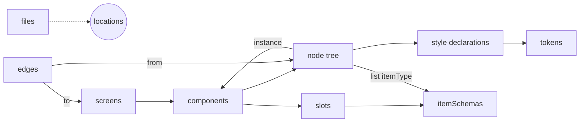

# dui 소스 모델

[English](../en/source-model.md) | [简体中文](../zh-CN/source-model.md) | 한국어

> 이 문서는 [영어 원문](../en/source-model.md)의 한국어 번역이다. 내용이 다르면 영어가 기준이다.

> 참고: 이 문서에는 아직 영어판의 `documentStyle.externalStylesheets` 및 `documentStyle.fontFaces` 추가 내용이 반영되어 있지 않다.

> 상태: 스키마 버전 1, 2026-11-27 결정 ([#353](https://github.com/de-novo/dui/issues/353)). [기본 파이프라인](roadmap.md#default-pipeline)의 1단계다. 관련 문서: [아키텍처](architecture.md) · [도메인 모델](domain-model.md) · [로드맵](roadmap.md).

소스 모델은 소스 코드가 UI에 대해 선언한 내용이다. 언어 어댑터가 문법에서 모델을 쓰고, 공식 컴파일러가 이를 보강할 수 있다. 근사 렌더러, 핫 리로드, 슬롯·상태 토글, 이후의 내보내기는 이 모델만 읽는다. 그래서 새 언어에는 이 모델을 쓰는 어댑터 하나만 있으면 된다.

| 구성 | 파일 |
| --- | --- |
| JSON Schema | [`schemas/source-model.v1.schema.json`](../../schemas/source-model.v1.schema.json) |
| Rust 타입과 리더 | [`crates/dui-core/src/source_model/`](../../crates/dui-core/src/source_model/mod.rs) |
| 참조 예제 | [`fixtures/source-model/src/`](../../fixtures/source-model/src/)의 TSX 소스에 대한 [`fixtures/source-model/model.json`](../../fixtures/source-model/model.json) |
| 검사 | `npm run check:source-model` |

`dui model PROJECT ENTRY.tsx`는 TSX 진입 파일과 상대 경로로 가져온 파일을 읽어 스키마 v1 JSON을 출력한다. 예제는 `dui model fixtures/source-model src/App.tsx`로 실행한다. 이름 있는 함수·화살표 컴포넌트, 구조 분해한 props, 로컬 상태, 선언된 호출 반환 타입, JSX 분기·목록 템플릿, React Router 경로·링크, 인라인 스타일, Tailwind CSS를 가져온 프로젝트의 기본 유틸리티 클래스를 읽는다. CSS Modules, 지원하지 않는 클래스, 동적 표현식은 원문을 보존한다. 프로젝트 의존성 설치, 타입 검사기, 브라우저 없이 실행할 수 있다.

리터럴 URL 쿼리 선택도 소스 증거이다. 엄격한 `URLSearchParams` 동등 비교가 하나의 컴포넌트로 해석되는 분기를 제어하면 어댑터는 `/` 또는 `/?name=value` 화면을 기록한다. 그 컴포넌트를 선택하는 리터럴 동적 import도 소스로 읽는다. `?name=value` 또는 `?` 같은 쿼리 전용 링크는 링크가 있는 화면이 루트 쿼리 화면이고 대상이 있을 때만 해석한다. 런타임 조건과 `history` 쓰기는 불투명하거나 미해결로 남는다.

React 클래스 컴포넌트에서는 인스턴스 `render()` 메서드를 읽는다. `if` 블록에서 한 번 할당되어 반환된 JSX에 사용되는 조건부 자식을 보존한다. `componentDidMount()`에서 초기화된 리터럴 `Router({...})` 표는 그 경로가 클래스 화면에서 도달 가능한 리터럴 해시 링크에도 있을 때 해시 뷰를 식별할 수 있다. 위치는 경로 키와 링크를 가리키며, 조건부 링크는 모델에서도 조건부로 남는다.

프로젝트 안의 단일 CSS 번들을 읽으려면 `--built-css FILE`을 지정한다. 정적 HTML 요소에서 플렉스 방향·줄바꿈·성장·정렬, 간격, 패딩과 마진, 크기와 상하한, 글자색과 배경색, 불투명도, 테두리 두께·색·반경, 글꼴 크기·줄 높이·자간을 추출한다. 지원하는 규칙은 레이어, 선택자 명시도, 선언 순서에 따라 적용하고 선택된 선언의 바이트 위치를 기록한다. 우선 적용될 수 있는 규칙의 조건이나 값을 해석할 수 없으면 미해결로 남긴다. 모델은 요소에 적용되는 선언을 기록하며, 상속값과 브라우저 기본 계산값은 이 추출 범위에서 제외한다.

같은 스타일시트 읽기는 `root`와 `body` 타이포그래피 선언을 담은 선택적 최상위 `documentStyle` 컨텍스트를 추가할 수 있다. 문서에 고정된 선택자만 참여한다: `html`, `body`, `:root`, 지원하는 복합 선택자, 그리고 `html`의 직접 자식 또는 하위 요소다. `!important`, 레이어, 명시도, 소스 순서, 제공된 루트 속성이 최종 선언을 결정한다. 선택자, at-rule 또는 캐스케이드 결과를 증명할 수 없으면 추측하지 않고 선언을 명시적으로 `unresolved`로 남긴다. 문서 고정점이 없는 단독 클래스나 ID 선택자는 참여하지 않는다.

`--viewport-width PX`를 추가하면 주어진 뷰포트에서 픽셀 단위의 단일 너비 미디어 조건을 평가한다. `min-width`, `max-width`, `(width < 768px)` 같은 비교를 지원한다. 다른 미디어 조건은 미해결로 남긴다.

두 단순 선택자를 자식 또는 자손 결합자로 연결하면 TSX 어댑터는 컴포넌트 경계까지 JSX 상위 요소를 확인한다. 모델을 보려면 `dui serve`를 실행한 후 워크스페이스 선택기에서 **소스 모델 열기**를 눌러 내보낸 JSON을 선택한다. 뷰어는 스키마 v1에서 선택한 컴포넌트를 그리고 미해결 스타일을 표시한다.

프로젝트가 루트 데이터 속성으로 테마를 선택하면 추출할 때 같은 값을 전달한다. 예를 들어 `--root-attribute data-theme=dark`를 사용하면 번들에서 해당 루트 변수 선언을 해석한다. 이 정보가 없으면 충돌하는 정의는 미해결로 남는다.

빌드 CSS에서 표시 방식, 가로 넘침, 최소 열 너비를 지정한 자동 맞춤 그리드와 단일 가변 열을 모델 속성으로 추출한다. body 루트는 문서 색상을 유지한다. 상위 요소를 확인할 수 없는 범위의 테마 재정의는 미해결로 남는다.

번들 CSS에서 행과 열의 간격을 개별적으로 추출하며 일반적인 flex 축약형을 성장 계수, 축소 계수, 기준 크기로 해석한다.

가로쓰기 레이아웃의 블록 간격을 펼치고, 해석 가능한 var() 참조를 포함한 글꼴 패밀리 대체 목록을 보존한다. 빌드 CSS의 텍스트 장식선, 간격의 뷰포트 최솟값과 ID 선택자는 미해결로 남긴다.

빌드 CSS에서 각 변의 테두리 두께·색·스타일, 표 테두리 병합, 세로 정렬과 텍스트 정렬 키워드, 대소문자와 공백 처리를 보존한다. 단일 배경 흐림과 지원하는 색상을 명시한 비율로 투명색과 혼합하는 sRGB, oklab 또는 oklch 표현을 해석한다. 다른 필터 조합과 색 보간 공간은 미해결로 남는다.

JSX 프래그먼트는 레이아웃 상자 없이 자식을 유지한다. 빌드 CSS의 위치 지정과 쌓임 순서, 물리적 오프셋, 원형 모서리 반경을 지원한다. 동일 위치에서 색이 바뀌는 점 배경과 두 축의 타일 크기는 모델의 색상과 길이로 표현한다. 완전한 CSS `box-shadow` 목록은 `boxShadow`로 표현하며, 사용자 지정 속성을 해석한 뒤의 정규 직렬화 목록이다. 지원하지 않는 문법이나 결정할 수 없는 최종 값은 그림자 레이어를 버리지 않고 미해결 상태로 유지한다.

## 1. 원칙

1. **관찰이 아니라 선언.** 모델은 코드가 말하는 것을 담는다. 핸들러를 실행하지 않고, API를 부르지 않고, 브라우저를 띄우지 않는다. 캡처 결과는 [캡처 컨텍스트](domain-model.md#2-엔티티-값-객체와-식별자)에 남는다.
2. **지어내지 않는다.** 런타임에만 알 수 있는 값은 `opaque` 표현식이다. 어댑터가 읽지 못한 타입은 `unknown`이다. 매핑하지 못한 문법은 `placeholder` 노드다. 해석하지 못한 스타일은 `unresolved` 값이나 `unresolvedStyle` 항목이다. 각각 소스 텍스트나 이유를 남긴다.
3. **모든 사실에는 위치가 있다.** 화면, 컴포넌트, 슬롯, 노드, 스타일, 토큰, 아이템 스키마, 엣지는 소스 위치를 가진다. 출처가 여러 가지일 수 있는 사실에는 `origin`이 붙는다: `syntax`, `compiler`, `inferred`. `inferred`는 AI나 휴리스틱이 채운 빈칸을 뜻한다.
4. **결정적이다.** 같은 소스는 같은 바이트를 낸다. 모델에는 타임스탬프도 절대 경로도 없다. 최상위 목록은 식별자 순으로 정렬한다. 자식은 소스 순서를 지킨다. 쓰는 쪽은 없는 선택 필드, `false` 플래그, 빈 목록과 맵을 생략한다.
5. **언어 중립.** 레이아웃, 상태, 이동, 스타일은 중립 용어를 쓴다. 각 어댑터가 자기 문법을 여기에 매핑한다.

## 2. 문서

| 필드 | 내용 |
| --- | --- |
| `schemaVersion` | `1` |
| `extractor` | 모델을 쓴 어댑터의 `name`과 `version` |
| `files` | 프로젝트 기준 `path`(`/` 구분자), `language`(`typescript`, `swift`, `kotlin`, `dart`, `css`), 읽은 바이트의 `sha256`, 이 파일이 `imports`하는 프로젝트 파일. 핫 리로드가 다이제스트와 import 그래프를 쓴다 |
| `screens` | `id`, `name`, 라우터가 선언하면 `route`, 루트 `component`, `origin`, `location` |
| `components` | `id`, `name`, `location`, `slots`, 루트 노드 하나 `root` |
| `itemSchemas` | 컬렉션 아이템의 모양: `id`, `name`, `fields`(`name`, `type`, `optional`), `origin`, `location` |
| `tokens` | 디자인 토큰: `id`, 쓰인 그대로의 `name`, `group`, `value`, 선택 `modes`, `syntax`, 그리고 `location` 또는 `package` |
| `edges` | 이동: `id`, 트리거 노드 `from`, `kind`, `to`, `origin`, `location` |
| `diagnostics` | 어댑터가 보고할 그 밖의 내용: `code`, `message`, 선택 `location` |

**위치**는 `file`, 1부터 세는 `line`과 `column`(column은 유니코드 스칼라 값 단위), 0부터 세는 UTF-8 바이트 오프셋 `start`와 `end`(`end`는 포함하지 않음)다.

## 3. 식별자

식별자는 불투명한 문자열이다. 어댑터만 식별자를 만들고, 선언의 파일·이름·트리 속 위치가 그대로면 식별자도 그대로여야 한다. 그래야 핫 리로드가 바뀐 것만 고칠 수 있다. 참조 예제는 아래 패턴을 쓴다. 다른 어댑터도 따른다.

| 엔티티 | 패턴 | 예 |
| --- | --- | --- |
| Component | `<file>#<name>` | `src/Orders.tsx#Orders` |
| Slot | `<component>.<name>` | `src/Orders.tsx#Orders.filter` |
| Node | `<component>@<path>`: 루트부터의 자식 인덱스, 분기 arm은 한 단계로 센다 | `src/Orders.tsx#Orders@0.2.1.0` |
| Screen | `route:<path>`, 루트 뷰는 컴포넌트 ID | `route:/settings` |
| Item schema, token | `<file>#<name>`, 프레임워크 기본값은 `<package>#<name>` | `tailwindcss#--text-2xl` |
| Edge | `<trigger node>:<kind>` | `src/Orders.tsx#Orders@0.3:link` |

`route`가 있는 화면은 경로를 통해 캡처 컨텍스트의 `ScreenId`와 연결된다. 그래서 선택적 캡처 근거를 모델 옆에 보여 줄 수 있다.

## 4. 슬롯과 표현식

**슬롯**은 컴포넌트가 읽고 리뷰어가 값을 정할 수 있는 값이다: `prop`, 선언된 `local` 상태, 또는 `store`, `context`, `route`, `query`, 기타 `external` 호출에서 오는 데이터. 용어집의 [상태 슬롯](../i18n.md#glossary)이다. 슬롯은 `type`, 선택 `initial` 값(local 상태의 초깃값이나 prop의 기본값), prop의 `optional`, local이 아닌 데이터의 읽기 `source` 텍스트를 가진다.

| 타입 `kind` | 뜻 |
| --- | --- |
| `boolean`, `string`, `number` | 원시 값 |
| `enum` | 리터럴 `values`의 닫힌 집합 |
| `array` | `item`의 목록 |
| `object` | 아이템 스키마 `schema`가 설명하는 객체 |
| `node` | 전달된 UI 내용(children, `ReactNode`, `@ViewBuilder`) |
| `function` | 콜백 |
| `unknown` | 읽을 수 없음. 선택 소스 `text` |

**표현식**은 값이 어디서 오는지 말한다.

| 표현식 `kind` | 뜻 |
| --- | --- |
| `literal` | 소스에 쓰인 JSON `value` |
| `slot` | 같은 컴포넌트의 슬롯 읽기, `["length"]` 같은 선택 필드 `path` |
| `item` | 둘러싼 `list` 노드의 현재 아이템 읽기와 필드 `path`. 이것이 필드-UI 바인딩이다 |
| `opaque` | 모델이 평가하지 않는 코드: 그 `text`와 안에 있는 슬롯·아이템 `reads` |

## 5. 노드

| 노드 `kind` | 필드 | 뜻 |
| --- | --- | --- |
| `element` | `tag`, `module`, `props`, `style`, `unresolvedStyle`, `children` | 플랫폼 요소, 또는 모델이 설명하지 않는 패키지(`module`)의 컴포넌트. 스타일이 된 속성은 `props`에 다시 쓰지 않는다 |
| `instance` | `component`, `props`, `children` | 모델 컴포넌트의 사용. prop 이름은 대상의 `prop` 슬롯과 같다 |
| `text` | `parts` | 리터럴과 바인딩 조각으로 된 텍스트 |
| `branch` | `on`, `arms` | 값에 따라 달라지는 UI: `if`, `&&`, 삼항, `switch`. 각 arm에는 `when`과 `children`이 있다 |
| `list` | `source`, `item`, `itemType`, `key`, `children` | 아이템마다 반복되는 UI. `children`은 아이템별 템플릿이다 |
| `outlet` | `slot` | `node` 슬롯이 담은 UI 내용을 그린다 |
| `placeholder` | `reason` | 어댑터가 매핑하지 못한 소스 |

모든 노드에는 `id`와 `location`이 있다. 분기 arm의 `when`은 `{"equals": <value>}`, `{"truthy": true|false}`, `"otherwise"` 중 하나다. `otherwise`는 마지막에 온다. 리뷰어가 `on`의 값이나 arm을 직접 고를 수 있으므로, `isOpen`이나 목록 개수를 바꾸면 코드를 실행하지 않고도 그림이 바뀐다.

## 6. 스타일

모델의 `gap`은 한 값이다. CSS와 인라인 TSX에서 `1.5rem 1.5rem`은 같은 간격으로 기록한다. 두 값이 다르거나 `row-gap` 또는 `column-gap`만 선언하면 원문을 미해결로 보존한다.

요소의 `style`은 선언 목록이다. 각 선언은 `property`, `value`, 선택 `when` 조건, 그리고 선언의 출처 `from`을 가진다. `from`은 `syntax`(`class`, `inline`, `modifier`, `stylesheet`, `theme`), 그 `text`(클래스 하나, 인라인 항목 하나, modifier 하나), `location`이다. 선언은 순서대로 적용된다. 조건을 만족하는 선언 중 뒤의 것이 이긴다.

| 그룹 | 속성 | 값 |
| --- | --- | --- |
| Layout | `direction` | `row`, `column`, `overlay` |
| | `alignItems` | `start`, `center`, `end`, `stretch`, `baseline` |
| | `justifyContent` | `start`, `center`, `end`, `spaceBetween`, `spaceAround`, `spaceEvenly` |
| | `wrap` | `wrap`, `nowrap` |
| | `grow` | number |
| Spacing | `gap`, `paddingTop`, `paddingBottom`, `paddingStart`, `paddingEnd` | length |
| | `marginTop`, `marginBottom`, `marginStart`, `marginEnd` | length, `auto` |
| Size | `width`, `height`, `minWidth`, `maxWidth`, `minHeight`, `maxHeight` | length, `auto`, `fill`, `fit` |
| Color | `color`, `background`, `borderColor` | color |
| | `opacity` | number |
| Typography | `fontFamily` | 아무 keyword |
| | `fontSize`, `letterSpacing` | length |
| | `fontWeight` | number |
| | `fontStyle` | `normal`, `italic` |
| | `lineHeight` | length 또는 number |
| | `textAlign` | `start`, `center`, `end`, `justify` |
| Radius and border | `borderRadius`, `borderWidth` | length |

`Start`와 `end`는 글 쓰는 방향의 앞쪽과 뒤쪽이다.

| 값 `kind` | 필드 |
| --- | --- |
| `length` | `value`와 `unit`: `px`, `rem`, `em`, `percent`, `pt`, `dp`, `vw`, `vh`, `svw`, `svh`, `lvw`, `lvh`, `dvw`, `dvh`, `vmin`, `vmax` |
| `clamp` | 리터럴 길이 피연산자 `min`, `preferred`, `max` |
| `color` | `value`: 소문자 sRGB `#rrggbb` 또는 `#rrggbbaa` |
| `number` | `value` |
| `keyword` | 속성 목록에 있는 `value` |
| `token` | `token` ID, 해석했다면 최종 값 `resolved` |
| `unresolved` | 소스 `text`와 `reason`, 그리고 선택적 타입화된 `refinement`. 모든 속성에 허용된다 |

뷰포트 길이와 경계가 있는 리터럴 `clamp()` 표현은 기존 `unresolved` 봉투 안에 타입화된 숫자 `refinement`와 함께 출력되므로, refinement를 모르는 v1 소비자도 기존 fallback을 유지한다. 임의 calc 표현, 경계가 없거나 리터럴이 아닌 clamp, 지원하지 않는 단위는 refinement 없이 미해결로 남는다.

조건은 모든 필드가 성립할 때 성립한다: `minWidth`와 `maxWidth`(length), `interaction`(`hover`, `focus`, `pressed`, `disabled`), `colorScheme`(`light`, `dark`), 그리고 참이어야 하는 표현식 `expr`. 어댑터가 봤지만 속성에 매핑하지 못한 스타일(예: CSS Module 클래스)은 `syntax`, `text`, `reason`, `location`과 함께 `unresolvedStyle`에 들어간다. 브라우저가 이를 채우는 일은 없다.

참조 예제는 쉬운 문법인 Tailwind 클래스와 인라인 스타일을 매핑한다. Tailwind spacing 단계는 해석된 길이로 기록한다. 중간·어려운 문법([스타일과 디자인 토큰](roadmap.md#default-pipeline))도 어댑터가 생기면 같은 선언을 쓴다.

`.module.css`의 기본 가져오기에서 `className={styles.card}`는 일치하는 `.card` 및 `tag.card` 규칙을 읽는다. 선택자 명시도와 소스 순서에 따라 선언을 정렬하고 인라인 스타일을 마지막에 적용하며 단순한 `min-width` 또는 `max-width` 미디어 조건을 기록한다. 각 선언은 CSS 원본 위치를 가리킨다. 지원하지 않는 값과 속성은 원문을 보존한다. 지원 범위 밖의 선택자나 at-rule, 클래스 합성 또는 `!important`가 있는 모듈은 클래스 참조를 미해결 상태로 남긴다.

스타일시트의 `padding-inline-start: 12px`와 인라인의 `paddingInlineStart: 12`는 모두 `paddingStart`에 길이 `12px`를 기록한다. 쓰기 방향에 관계없이 논리적 시작과 끝을 보존한다. 마진에는 음수 길이와 `auto`도 사용할 수 있다.

예를 들어 `padding-inline: 2px 5%`와 `paddingInline: "2px 5%"`는 `paddingStart`에 `2px`, `paddingEnd`에 `5%`를 기록한다.

## 7. 토큰

토큰은 소스가 쓰는 이름(`--color-brand`, `--text-2xl`)을 그대로 남겨 나중에 디자인 변수가 될 수 있게 한다. `group`은 `color`, `spacing`, `typography`, `radius`, `size`, `other` 중 하나다. `value`는 최종 값이거나, 다른 토큰을 가리키는 `token` 값(별칭)이다. 별칭은 순환하면 안 된다. `modes`는 `dark` 같은 모드별 값을 담는다. 프로젝트 토큰은 `location`을 가진다. 프레임워크 기본값은 `package`(`tailwindcss`)를 가지고 위치는 없다.

가져온 테마 스타일시트 안에서 색상·반경 토큰은 `var(--name)`으로 같은 그룹의 다른 토큰을 참조할 수 있다. 모델은 직접 참조한 토큰과 최종 값을 보존한다. 순환 참조, 누락된 정의, 대체값이 있는 표현식은 미해결 값으로 원문을 보존한다.

## 8. 엣지

`kind`는 `link`(`<Link>`, `NavigationLink` 같은 선언적 링크), `navigate`(명령형 호출), `present`(현재 화면 위의 시트나 대화상자) 중 하나다. `to`는 `screen`, 모델의 어떤 화면에도 맞지 않는 `route` 경로, 또는 `opaque` 표현식이다. 엣지는 자신을 트리거하는 노드에서 시작한다. 엣지의 화면은 그 노드를 그리는 화면에서 정해지며, 컴포넌트 인스턴스를 거친 경우도 포함한다(`SourceModel::screen_edges`).

## 9. 검증과 버전

JSON Schema는 모양, enum, 패턴, 필수 필드를 검사한다. Rust 리더(`SourceModel::from_json`)는 스키마로 표현할 수 없는 규칙도 검사한다:

- 정렬되고 중복 없는 식별자, 컴포넌트 안에서 중복 없는 슬롯 이름;
- 모든 위치와 import가 목록에 있는 파일을 가리킨다;
- 모든 참조가 풀린다: 화면과 인스턴스의 컴포넌트, 인스턴스 prop, 같은 컴포넌트 안의 슬롯 읽기, 목록 안의 아이템 읽기, 아이템 스키마, 토큰, 엣지의 노드와 화면;
- 스타일 값이 속성에 맞고, 토큰 별칭이 순환하지 않고, `otherwise` arm이 마지막에 온다.

`npm run check:source-model`은 참조 예제를 스키마로 검증하고, 잘못된 모양이 거부되는지 확인하고, 리더 테스트를 실행한다. 이 테스트는 참조 예제의 모든 위치가 fixture 소스를 가리키는지와 파일 다이제스트가 맞는지도 확인한다.

버전 1은 추가로만 바뀐다. 이전 리더가 무시할 수 있는 새 선택 필드, 새 스타일 속성, 새 enum 값, 새 노드 종류는 버전 1에 남는다. 필드·enum 값·종류를 지우거나 이름을 바꾸거나, 선택 필드를 필수로 바꾸거나, 기존 값의 의미를 바꾸면 새 스키마 파일과 함께 `schemaVersion` 2가 되고, 그때부터 버전 1 파일과 리더는 바뀌지 않는다. `npm run check:source-model-additive`가 버전 1 스키마를 PR의 기준 브랜치와 비교해 삭제나 이름 변경이 있으면 실패한다. 리더는 모르는 버전을 거부한다.

## 10. 모델 그리기

렌더러는 `dui-core`의 `SourceModel`을 읽는다. `dui-core`는 I/O가 없고 `wasm32-unknown-unknown`으로 빌드되므로 데스크톱 뷰어와 웹 캔버스가 리더 하나를 함께 쓴다. 모든 속성은 flexbox 엔진에 매핑된다. 참조 대상인 [GPUI](roadmap.md#default-pipeline)는 아래와 같이 매핑한다. 이렇게 그린 카드에는 근사 표시가 붙는다.

| 모델 | GPUI |
| --- | --- |
| `direction` `row`, `column` | `flex_row`, `flex_col` |
| `direction` `overlay` | 자식을 `absolute`로 겹쳐 배치한다 |
| `alignItems`, `justifyContent`, `wrap`, `grow` | 같은 이름의 Taffy flexbox 값 |
| Spacing과 size 속성 | 같은 이름의 padding, margin, gap, size. GPUI는 왼쪽에서 오른쪽으로 배치하므로 `start`와 `end`는 left와 right가 된다 |
| `fill`, `fit`, `auto` | `relative(1.)`, 내용 크기, `auto` |
| `px`, `rem`, `percent` | `px`, `rems`, `relative` |
| `pt`, `dp` | `px`. 셋 다 논리 픽셀이다 |
| `em` | 요소의 글자 크기를 곱한 `px` |
| `color` | `rgba` |
| `lineHeight` number | `line_height(relative(n))` |
| `textAlign` `justify` | `start`. GPUI에는 left, center, right만 있다 |
| `minWidth`나 `maxWidth`가 있는 `when` | 상대 단위는 모델화된 루트 글꼴과 부모 글꼴과 무관하게 논리 뷰포트의 초기 사용자 에이전트 글꼴 크기를 사용한 뒤, 레이아웃 전에 칸 너비로 판정한다 |
| `interaction`, `colorScheme`, `expr`가 있는 `when` | 리뷰어가 그 상태를 고르면 적용한다 |
| `token` | `resolved` 값. 값이 없는 토큰은 `unresolved`처럼 그린다 |
| `unresolved`, `unresolvedStyle`, `placeholder`, `opaque` 텍스트 | 라벨이 붙은 placeholder. 브라우저로 채우지 않는다 |

웹 캔버스의 TypeScript/DOM 모델 미리보기에서는 `documentStyle`의 루트 타이포그래피가 격리된 모델 문서나 shadow host에 적용되고, body 타이포그래피는 body나 document-body 래퍼에 적용된다. 일반 `em`은 CSS 길이로 유지되어 속성 컨텍스트에서 계산된다. shadow-root 카드에서는 `rem`이 모델화된 루트 글꼴에 맞춰 계산되고 뷰포트 길이는 논리 카드 뷰포트에 맞춰 계산된다. 둘 다 픽셀로 출력되므로 뷰어 문서나 바깥 뷰포트를 사용하지 않는다. 타입화된 clamp는 각 피연산자에 같은 기준 계산을 적용하면서 경계가 있는 CSS clamp로 유지된다.
