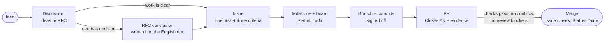
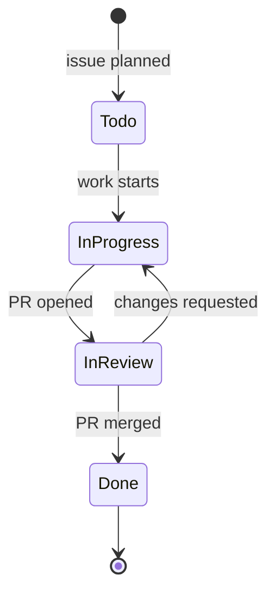
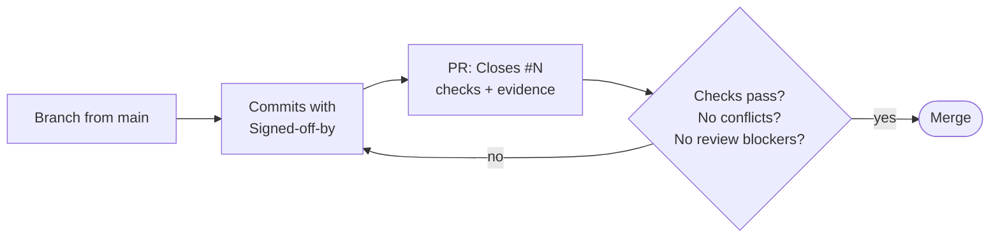

# dui 작업 흐름

[English](../en/workflow.md) | [简体中文](../zh-CN/workflow.md) | 한국어

> 이 문서는 [영어 원문](../en/workflow.md)의 한국어 번역이다. 내용이 다르면 영어가 기준이다.

> 상태: 2026-11-20 결정 · `de-novo/dui`에서 일이 GitHub를 거쳐 가는 방식의 기준 문서. 코드 구조: [아키텍처](architecture.md). 제품 설계: [설계 v0](design-v0.md).

이 문서는 dui가 GitHub Discussions, Issues, Labels, Milestones, Projects 보드, PR을 어떻게 쓰는지 정한다. 도구마다 한 종류의 정보를 맡는다. 다른 곳은 복사하지 않고 링크한다.

## 1. 무엇을 어디에 두나

| 정보 | 기준 | 다른 곳 |
|---|---|---|
| 제품 정의, 스펙, 원칙 | 문서: [설계 v0](design-v0.md), [아키텍처](architecture.md), [지원 프레임워크](supported-frameworks.md) | 링크만 |
| 용어와 번역 | [용어집](../i18n.md) | 용어만 쓰고 다시 정의하지 않는다 |
| 결정 | 결정을 적은 영어 문서의 절, "decided YYYY-MM-DD" 표시 | 링크만 |
| 열린 질문과 제안 | Discussions | 문서나 이슈에서 링크, 끝나면 닫는다 |
| 일 하나와 완료 기준 | Issue | PR 본문에 `Closes #N` |
| 버전 범위와 목표 | Milestone (목표 1~3줄 + 목표 문서 절 링크) | 이슈의 마일스톤 필드만 |
| 진행 상태 | Projects 보드 `Status` 필드 | 라벨이나 이슈 본문에 쓰지 않는다 |
| 분류 | Labels | 글로 옮겨 적지 않는다 |
| 바뀐 내용과 증거 | PR 본문 | 이슈에는 PR 링크만 |
| 릴리스 기록 | CHANGELOG와 GitHub Releases | 고쳐 쓰지 않는다 |

채팅 메시지와 봇 메모는 기준이 아니다. 중요한 것은 24시간 안에 문서, Discussion, 이슈로 옮긴다. 채팅에서 승인된 결정은 PR 본문에 승인 원문과 날짜를 인용한다.

## 2. 흐름

1. **아이디어나 질문.** `Ideas`에 Discussion을 연다.
2. **결정이 필요함.** `RFC`로 옮기거나 처음부터 RFC로 연다. RFC에는 선택지와 추천안을 적는다.
3. **결정됨.** 그 주제를 맡은 영어 문서에 결론을 적는다(같은 PR에서 zh-CN, ko 파일도, §7 참고). Discussion에 PR을 링크하고 닫는다.
4. **할 일이 정해짐.** 완료 기준을 넣어 이슈를 연다. Discussion과 문서 절을 링크한다. 스펙을 이슈에 복사하지 않는다.
5. **계획.** 이슈에 라벨(§4), 마일스톤(§5)을 달고 보드(§6)에 올린다.
6. **구현.** 브랜치 하나, PR 하나, 목적 하나. PR이 이슈를 닫는다.
7. **머지.** 이슈가 닫히고 보드는 `Done`으로 간다.

결정이 필요 없는 작은 변경은 Discussions를 건너뛴다: 이슈 → PR.

## 3. Discussions

카테고리는 두 개만 쓴다. GitHub 기본 카테고리(Announcements, General, Q&A, Show and tell, Polls)는 쓰지 않는다.

| 카테고리 | 용도 | 끝나는 때 |
|---|---|---|
| `Ideas` | 아직 할 일로 정해지지 않은 제안, 열린 질문, dui 사용 질문 | 할 일이 분명해지면 → 이슈를 열고 서로 링크하고 닫는다. 결정이 필요하면 → `RFC`로 옮긴다 |
| `RFC` | 결정이 필요한 주제: 설계, 아키텍처, 지원 스택, 정책 | 맡은 문서에 PR로 결론을 적고, PR을 링크하고 닫는다 |

| 템플릿 | 칸 | 필수 |
|---|---|---|
| `Ideas` | 한 줄 요약 | 예 |
| | 하고 싶은 것 | 예 |
| | 관련 문서 링크 | 있으면 |
| `RFC` | 배경 | 예 |
| | 선택지 (각각 장단점 한 줄) | 예 |
| | 추천안과 이유 | 예 |
| | 관련 문서 링크 | 있으면 |

- RFC 템플릿에는 "결론" 칸이 없다. 결론은 문서에만 둔다. Discussion 본문을 결론으로 고쳐 쓰지 않는다.
- Discussions는 진행 추적, 할 일 목록, 스펙 본문, 공지에 쓰지 않는다.
- Discussions는 영어, 간체 중국어, 한국어 중 아무 언어로 써도 된다. 결론은 영어로 먼저 쓴다.

## 4. 이슈와 라벨

### 4.1 이슈

이슈 하나 = 할 일 하나 + 완료 기준.

| 규칙 | 내용 |
|---|---|
| 본문 | 체크리스트로 된 완료 기준, 구현하는 문서 절 링크 |
| 이슈가 아닌 것 | 아이디어와 열린 질문(→ Discussions), 상태 메모(→ 보드), 완료 기준 없는 QA·메타·에픽 이슈 |
| 필수 | type, priority, area 라벨 각 1개; 마일스톤; 보드에 올림 |
| 부모·서브 이슈 | 한 일에 PR이 여러 개 필요할 때만. 부모도 자기 완료 기준이 있다. 한 단계까지. 부모와 서브는 한 마일스톤 안에서 닫힌다 |
| 언어 | 모든 기여자가 읽을 수 있게 영어 |
| 닫기 | `duplicate`·`wontfix` 라벨 대신 GitHub 닫힘 사유(completed, not planned, duplicate)를 쓴다. "Not planned"는 이유나 링크를 남긴다 |
| 막힘 | 추측하지 않는다. `needs-decision`을 붙이고 질문과 추천안을 이슈에 남긴다 |

### 4.2 라벨

라벨은 분류만 한다. 상태와 릴리스는 라벨로 표시하지 않는다.

| 묶음 | 값 | 이슈당 |
|---|---|---|
| type | `bug` `feature` `refactor` `chore` `docs` | 1 |
| priority | `P0` `P1` `P2` | 1 |
| area | 아래 8개 | 1 |
| 보조 | `needs-decision` `blocked` | 0~1, 풀리면 뗀다 |

**type** — 여러 개에 해당하면 이 순서에서 앞선 것을 고른다:

| 라벨 | 뜻 |
|---|---|
| `bug` | 문서와 다르게 동작한다 |
| `feature` | 사용자(사람 또는 AI 에이전트)가 볼 수 있는 동작을 더하거나 바꾼다. CLI·MCP 출력, 기본값, 문구 포함 |
| `refactor` | 동작은 같고 구조나 이름이 바뀐다 |
| `chore` | 제품 코드 밖: 빌드, CI, 의존성, 릴리스, 레포 관리, 테스트만 추가 |
| `docs` | 문서만. 코드와 문서를 함께 바꾸는 PR은 코드 쪽 type |

**priority**

| 라벨 | 뜻 |
|---|---|
| `P0` | 다른 일을 멈춘다: `main` 고장, 보안·비밀 유출, 열린 마일스톤이 막힘. 메인테이너만 붙인다. 다른 사람은 제안만 한다 |
| `P1` | 지금 마일스톤의 완료 기준에 필요하다 |
| `P2` | 그 밖의 모든 것 |

크기와 난이도는 우선순위가 아니다.

**area** — 이슈당 하나, [아키텍처 §5](architecture.md#5-모노레포-구조)의 단위에 대응한다. 최대 8개. area 추가나 변경은 결정(RFC)이다.

| 라벨 | 범위 |
|---|---|
| `area:core` | `dui-core`: model, pipeline, 규칙 엔진, session(Decider), 해시 |
| `area:ports` | `dui-ports`: `TypeOracle`, `Host`, `Renderer` 계약 |
| `area:adapters` | `crates/adapters/*`와 `packages/ts-sidecar`: 언어·호스트·렌더러 어댑터 |
| `area:app` | `dui-app`과 `dui-cli`: 효과 실행기, 캐시, CLI, MCP 서버, 캔버스 서버 |
| `area:rules` | `rules/` 팩과 스키마, `stacks.toml`, `fixtures/` |
| `area:canvas` | `apps/canvas`와 `packages/schemas` |
| `area:docs` | `docs/`, README, `CONTRIBUTING.md`, `AGENTS.md` |
| `area:tooling` | `xtask`, CI 워크플로, 라이선스·의존성 검사, Renovate 설정 |

다른 라벨은 쓰지 않는다. `documentation`, `enhancement`, `question`, `duplicate`, `wontfix`, `invalid` 같은 GitHub 기본 라벨도 포함이다. 옛 라벨 삭제는 되돌릴 수 없으므로 메인테이너 승인이 필요하다(§8).

## 5. 마일스톤과 버전

마일스톤 하나 = 버전 하나. 이름은 `vX.Y.Z`만 쓴다. 설명에는 목표 1~3줄과 문서의 목표 절 링크를 둔다.

| 마일스톤 | 버전 | 목표 ([설계 v0 §13](design-v0.md#13-mvp-범위와-단계) 기준) |
|---|---|---|
| M0 스파이크 | `v0.0.1` | 손으로 고른 상태로 실제 렌더 경로 증명 ([아키텍처 §7](architecture.md#7-m0와-m1-완료-조건)) |
| M1 자동 상태 | `v0.0.2` | 상태와 커버리지를 자동 계산 ([아키텍처 §7](architecture.md#7-m0와-m1-완료-조건)) |
| M2 GPUI 스파이크 | `v0.0.3` | pippip 화면 하나 렌더 |
| M3 시퀀스 상태 | `v0.0.4` | 리플레이로 검증한 시퀀스 상태 |
| M4 캔버스 | `v0.0.5` | AI 에이전트가 여는 캔버스 |
| M5 obora 99% 도전 | `v0.0.6` | 화면별 커버리지 보고 |

| 규칙 | 내용 |
|---|---|
| 열린 마일스톤 | 최대 2개: 지금과 다음 |
| 마감일 | 메인테이너가 정한 경우만. 마감을 넘기면 남은 이슈를 다음 마일스톤으로 옮기고 닫는다 |
| 버전 | 초기 M0~M5는 `v0.0.1`부터 `v0.0.6`까지 순서대로 계획한다. 이후 `0.x`에서는 범위·사용 방식·호환성이 크게 바뀌면 minor를, 그 밖에는 patch를 올린다. |
| 채널 | nightly `vX.Y.Z-nightly.YYYYMMDD.N` → 릴리스 후보 `vX.Y.Z-rc.N` → 정식 `vX.Y.Z` |
| 태그 | nightly 태그는 승인 없이 만든다. 릴리스 후보와 정식 태그는 메인테이너 승인이 필요하다 |
| 릴리스 노트 | 그 마일스톤에서 머지된 PR로 만든다. 지난 CHANGELOG 항목과 Releases는 고치지 않는다 |

홈페이지와 소스 설치기는 공개된 안정 태그 중 가장 높은 버전을 사용하며, 안정 태그가 없으면 `main`을 사용한다. 릴리스 태그는 해당 커밋의 Cargo 워크스페이스 버전과 일치해야 한다. 태그 없는 체크아웃은 `X.Y.Z-dev+<commit>`과 null인 `tag`를, 소스 아카이브는 `X.Y.Z-dev`를 표시한다. 개발 빌드는 같은 버전의 안정 태그가 나오면 업데이트할 수 있다. 세 언어의 변경 이력에 출시 전 내용을 `## [Unreleased] — vX.Y.Z` 아래 기록한다. 승인된 태그를 게시한 뒤 해당 내용을 날짜가 있는 릴리스 항목으로 옮기고 Unreleased 비교 링크를 갱신한다.

## 6. Projects 보드

레포에 보드 하나. 진행 상태는 `Status` 필드에만 둔다.

| 규칙 | 내용 |
|---|---|
| Status 값 | `Todo`, `In progress`, `In review`, `Done`. 막힘은 상태가 아니라 `blocked` 라벨 |
| 뷰 | 마일스톤별, area별, `needs-decision`. 뷰는 늘려도 되고 보드는 늘리지 않는다 |
| 추가 필드 | 없음 |
| 이슈 | 열린 이슈는 모두 보드에 있다. 이슈 본문에 상태를 쓰지 않는다 |

## 7. PR

**브랜치와 커밋**

| 규칙 | 내용 |
|---|---|
| 브랜치 | `feat/`, `fix/`, `refactor/`, `chore/`, `docs/` + 짧은 이름. 대상은 `main` |
| 커밋 | Conventional Commits(`feat:`, `fix:`, `docs:` …), 모두 `git commit -s`로 서명([DCO](../../CONTRIBUTING.md#1-sign-off-every-commit-dco)). 서명 없는 커밋은 머지할 수 없다 |
| 머지 방식 | squash가 아닌 merge commit. 원래 커밋마다 서명이 남게 한다 |

**PR 본문**

| 칸 | 내용 |
|---|---|
| 요약 | 무엇을 왜 바꿨는지 1~3줄 |
| 연결 | `Closes #N`; 따르는 문서 절이나 RFC |
| 검사 | 해당하는 검사(아래)와 결과 |
| 증거 | 동작 변경은 렌더 이미지나 CLI·MCP 출력 |
| 문서 | 바꾼 문서, 또는 "문서 변경 없음"과 이유 |
| 승인 | 되돌릴 수 없는 단계가 있으면 메인테이너 승인 원문과 날짜 |

**해당하는 검사** — [아키텍처 §6.2](architecture.md#62-자동-검사-위반하면-ci-실패)의 CI 검사: 워크스페이스 lint, 코어 순수성, `cargo xtask check-deps`, `cargo xtask check-licenses`, `cargo xtask gen` 최신 여부, 픽스처. crate를 건드린 PR은 그 crate의 테스트와 `insta` 스냅샷도 돌린다. 문서만 바꾼 PR은 CI가 필요 없고, 작성자가 링크가 이어지는지와 세 언어 구조가 같은지 확인한다(아래). 검사가 실패하면 검사를 느슨하게 하지 않고 코드를 고친다.

**세 언어 문서 규칙** — 모든 문서 변경은 [번역 규칙](../i18n.md#rules)을 따른다:

- 영어 파일을 먼저 바꾼다. 같은 PR에서 `zh-CN`과 `ko`를 고치거나, 못 고친 파일마다 "outdated" 배너를 단다.
- 숫자, 링크, 코드, 표, 다이어그램은 똑같이 둔다. 세 파일은 같은 제목, 표, 코드 블록을 유지한다.
- 스펙이나 용어를 바꾸는 코드는 문서 변경과 함께 낸다. 같은 PR이거나 문서 PR이 머지된 뒤다.

**머지 조건** — 셋 다 맞으면 PR을 머지한다:

1. 필수 검사가 모두 통과한다.
2. `main`과 충돌이 없다.
3. 풀리지 않은 리뷰 차단 사항이 없다.

그러면 리드(메인테이너 또는 레포를 맡은 에이전트)가 추가 승인 없이 머지할 수 있다. PR 하나에 목적 하나.

## 8. 승인

되돌릴 수 있는 일은 바로 하고 모아서 보고한다. 되돌릴 수 없는 일은 메인테이너를 기다린다.

| 바로 하고 보고 | 메인테이너의 명시적 승인 필요 |
|---|---|
| 라벨 붙이기·바꾸기, 마일스톤·보드 배정 | 레포나 산출물 공개 전환 |
| 이슈 다시 쓰기, 끝났거나 중복인 이슈 닫기 | 릴리스 후보·정식 태그 푸시, 패키지 배포 |
| §7을 만족한 PR 머지 | force-push, `main` 기록 고쳐 쓰기, 검사 건너뛰기(`--no-verify`) |
| 문서 정리, 브랜치 정리 | 라벨, 마일스톤, Discussion 등 GitHub 객체 삭제 |
| nightly 태그 | 지출, 유료 서비스 추가 |

에이전트의 동의는 승인이 아니다. 되돌릴 수 없는 일 여러 건은 한 번에 묶어 묻는다. 메인테이너가 24시간 안에 답하지 않으면 추천안 중 되돌릴 수 있는 부분만 하고 나머지는 계속 기다린다.

비밀값, 토큰, 일회용 코드, 개인 데이터를 레포, 이슈, PR, Discussions에 쓰지 않는다.
