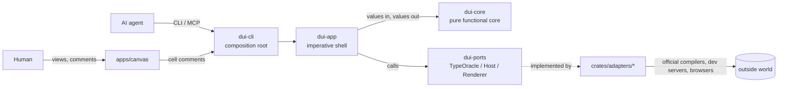
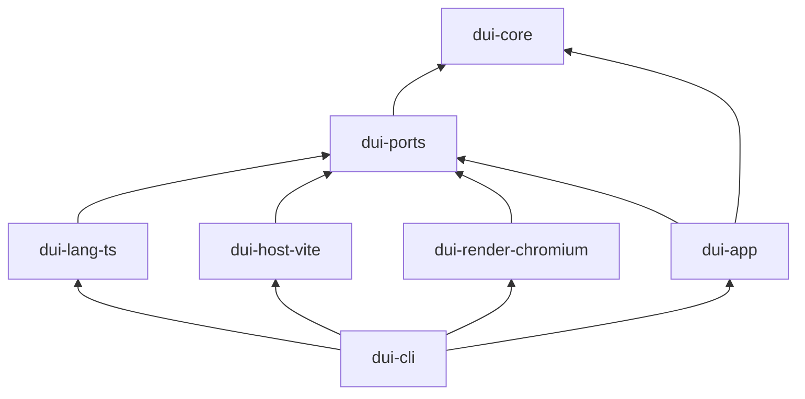

# dui 架构

[English](../en/architecture.md) | 简体中文 | [한국어](../ko/architecture.md)

> 本文是[英文原文](../en/architecture.md)的简体中文翻译。如有出入，以英文为准。

> 状态：2026-11-20 决定 · 代码结构的权威来源。设计背景：[设计 v0](design-v0.md)。领域实体与存储端口：[领域模型](domain-model.md)。支持的技术栈：[支持的框架](supported-frameworks.md)。

本文确定 dui 的 Rust 代码形态：架构风格、采用与禁止的模式、模块和 crate 边界，以及 M0 和 M1 的验收标准。与[设计 v0](design-v0.md)重叠时，代码结构以本文为准。

## 1. 风格：函数式核心 + 命令式外壳

dui 是一个 Rust 二进制文件。查找、组合和判定状态由**作用于不可变数据的纯函数**完成（函数式核心）。询问官方编译器、启动开发构建、驱动浏览器、读取文件，以及通过 CLI / MCP 与 AI 交互，由**边缘的薄代码**完成（命令式外壳）。

核心（`dui-core`）的规则：

- **零 I/O**：不访问文件系统、网络、进程、环境变量、时钟或随机数。
- **零 async**：API 中没有 `async fn`、运行时或 future。
- **相同输入，相同输出**：每个函数都是确定性的。来自外部世界的输入（源码快照、编译器答复、渲染观测、AI 推断的事实）都以值的形式传入。

副作用被推到边缘：外壳（`dui-app`）通过端口 trait 执行它们，并把结果作为普通值交回核心。



在平台边界共享渲染和测量流程。能够在 Chromium 中运行的 Web 应用共享浏览器导航、截图和布局测量。对于浏览器无法观测而源声明能提供的事实，添加路由器或编译器规则。适配器输出通用屏幕图，使卡片、存储与覆盖率在各框架上保持相同语义。

## 2. 采用的模式

### 2.1 函数式核心 + 命令式外壳

| 作用 | Rust 形式 |
|---|---|
| 让所有逻辑无需编译器或浏览器即可测试 | `dui-core` 只有作用于拥有 / 借用数据的纯 `fn`。外壳收集输入、调用核心、执行返回的副作用 |
| 让副作用可见 | 副作用是值（`Effect` 枚举，§2.6），绝不是分析中的隐藏调用 |

### 2.2 端口与适配器

**端口 trait 恰好三个**，都在 `dui-ports` 中，只位于真正的 I/O 边界：

```rust
pub trait TypeOracle {
    async fn query(&mut self, snapshot: &SourceSnapshot, queries: &[TypeQuery])
        -> PortResult<CompilerAnswers>;
}
pub trait Host {
    async fn start(&mut self, build: &DevBuild) -> PortResult<Target>;
    async fn stop(&mut self, target: Target) -> PortResult<()>;
}
pub trait Renderer {
    async fn open(&mut self, target: &Target, job: &RenderJob) -> PortResult<Session>;
    async fn capture(&mut self, session: &mut Session) -> PortResult<Observation>;
    async fn close(&mut self, session: Session) -> PortResult<()>;
}
```

- **`TypeOracle`** 向项目自己的官方编译器（完全相同的版本）询问符号和类型。每个答复带有查询 ID 和 `Known | Unknown(reason)`。AST 找候选，编译器判定类型；AI 只补空缺，并记录为 `Inferred`。
- **`Host`** 启动注入后的开发构建，返回 `Target`（Web URL 或原生入口）。源码变换属于语言适配器。
- **`Renderer`** 在 `Target` 上打开一个格子，然后收集值、图像、语义树和已执行的分支。
- **`Store` 端口**（[领域模型 §5](domain-model.md#5-存储端口)）是在 `dui-core::storage` 中基于纯 `dui-core::model` 聚合与值对象、按限界上下文拆分的持久化接口（`WorkspaceRepository`、`RunRepository`、`ArtifactStore`、`CacheRepository`、`CommentRepository`，组合为 `Store`）。具体存储后端（本地文件归档、基于 `rusqlite` / Drizzle 的 SQLite，或未来的远程 API）作为适配器位于这些端口之后；`dui-core` 零存储依赖。
- 端口 trait 可以是 `async`，因为适配器要与进程和浏览器通信。async 止于 `dui-ports`；`dui-core` 永远看不到它。
- 框架知识**绝不**作为核心中的代码：没有 `if framework == …`，没有按技术栈划分的插件层级。它放在规则包（§2.5）或某一个适配器 crate 中。

对应示例：React 和 TanStack Query 是规则包；Vite 是 `Host`；通过 CDP 的 Chromium 是 `Renderer`；TypeScript 是 `TypeOracle` 加注入变换。Rust Web 应用复用同一个 Chromium 渲染器。

### 2.3 不可变数据与按阶段区分类型的流水线

每个阶段有自己的类型，因此后面的阶段不会误收前面阶段的数据：

```rust
queries(&SourceSnapshot) -> Vec<TypeQuery>
facts(&SourceSnapshot, &CompilerAnswers, &[InferredFact]) -> Facts
model(&Facts, &[RulePack]) -> StateModel
plan(&StateModel, &PlanBudget, &BranchFeedback) -> Plan
jobs(&Plan, &[Width]) -> Vec<RenderJob>
verify(&[RenderJob], &OutcomesByCellId) -> Vec<Verification>
coverage(&[Verification]) -> Coverage
```

- ID 和单位用 **newtype**：`CellId`、`SymbolId`、`StateId`、`Width(u32)`。
- **智能构造器**：外部输入在边界处用 `TryFrom` / `Result` 解析一次（解析，而不是校验）。私有字段让无效值无法被构造。
- 状态用**代数数据类型**：`Evidence = Extracted | Inferred`；`CellStatus = Verified | Unverified(reason) | Unrenderable(reason)`；项目级 `Support = Supported | Unsupported(reason)`。对我们自己枚举的每个 `match` 都是穷尽的。
- **工作区 lint**（根 `Cargo.toml` 的 `[workspace.lints.clippy]`）：`unwrap_used = "deny"`，`wildcard_enum_match_arm = "deny"`。通配 lint 保护我们的内部枚举；在端口边界匹配外部 `#[non_exhaustive]` 枚举时，可以局部使用 `#[expect(clippy::wildcard_enum_match_arm, reason = "…")]`。

### 2.4 确定性变换

- ID 是**规范化数据的内容哈希**，绝不是计数器或地址。
- 输出使用 `BTreeMap` / `BTreeSet` 或显式排序。`dui-core` 中禁止 clippy `iter_over_hash_type`。
- 事实、计划、ID 和判定中不含时间戳、随机值或并发完成顺序。运行元数据（时间、工具版本、OS）记录在结果旁边，而不是结果里面。
- 报告是对格子的 `fold`。

### 2.5 声明式 `RulePack` 数据，与执行分离

- 规则包说明一个已解析的符号代表什么：**包 + 原始符号 + 类型条件 → 槽、状态、代表值提示**。别名和重新导出会匹配到同一个原始符号，因为编译器已经解析过它们。
- 格式：**带版本的小型 JSON schema**（`rules/schema/rule-pack.v1.schema.json`）。**没有 ast-grep YAML 语法层**：匹配基于编译器解析出的符号，而不是语法形状。
- 加载规则包时把它解析为有类型的 `RulePack`（解析，而不是校验）。错误的规则包在加载时就以清晰的错误失败。
- 规则包里**没有脚本、循环或 shell 命令**。多个技术栈都需要的新运算，作为带测试的纯 Rust 函数加入 `dui-core::rules`。
- `RenderJob` 也是普通数据：注入什么、拦截什么、断言什么。

### 2.6 Decider 模式 + `Effect` 枚举

分析保持为纯流水线（§2.3）。**运行编排和交互式画布会话**（运行开始 → 格子已捕获 → 判定 → 人工高亮 / 评论 → AI 重绘 → 文件变更失效）使用 Decider 模式：

```rust
pub fn decide(cmd: &Command, state: &SessionState) -> (Vec<Event>, Vec<Effect>);
pub fn evolve(state: SessionState, event: &Event) -> SessionState;
```

- `Command`、`Event`、`Effect`、`SessionState` 是 `dui-core::session` 中的枚举 / 结构体。不需要任何库。
- `Effect` 把副作用描述为值，例如 `QueryTypes`、`StartHost`、`RenderCell`、`StopHost`、`PersistSnapshot`、`PublishCanvas`、`NotifyAgent`。核心从不执行它们。
- `dui-app` 是 **effect 解释器**：它通过端口或存储执行每个 `Effect`，并把结果变成下一个 `Command`。
- 测试采用 given-when-then：给定事件，执行一个命令，期望得到的事件和副作用。会话可以从事件日志重放。

### 2.7 Typestate

顺序错误成为编译错误：

- `Host<Stopped>::start(self, …) -> PortResult<Host<Running>>`；`Host<Running>::stop(self) -> PortResult<Host<Stopped>>`。只有 `Host<Running>` 暴露其 `Target`。
- `Cell<Planned>::capture(self, …) -> Cell<Captured>`；`Cell<Captured>::judge(self, …) -> Judged`，其中 `Judged` 是一个枚举，持有 `Cell<Verified>` 或其他状态。`Cell<Planned>` 也可以直接变为 `Unrenderable`。
- 覆盖率只接受已判定的格子，因此不能从未判定的格子计算。
- typestate 包装放在状态所在之处：格子状态在 `dui-core::model`，host / 会话句柄在 `dui-app`。端口 trait 保持简单。

### 2.8 RAII 守卫 + 显式 `close(self)`

- 开发服务器进程、Chromium 会话 / 标签页、临时注入目录由守卫类型拥有。
- 正常路径是**显式、可失败**的 `close(self) -> PortResult<()>` / `stop(self)`，会报告错误。
- `Drop` 是 panic 和取消时的**兜底**：尽力清理，`Drop` 中不 panic，并记录警告。`Drop` 从来不是唯一的清理路径。
- 外壳在失败路径上也会清理自己启动的 host 和会话。

## 3. 禁止的反模式

| 禁止 | 原因 | 替代 |
|---|---|---|
| 分析中的隐藏 I/O（在核心里调用编译器或读文件） | 无法缓存、快照测试或重放 | 外壳收集输入；`Effect` 值 |
| `dui-core` 中的 `async` 或运行时类型 | 把逻辑绑在运行时上 | async 只在端口 / 适配器 / 外壳 |
| 核心中的 `if framework == …` 或版本分支（`if react_18`） | 随每个技术栈增长；旧主版本本来就不支持 | 规则包；某一个适配器 crate |
| 字符串表示的状态（`"loading"`） | 无法穷尽检查 | 枚举和 newtype |
| 非测试代码中的 `unwrap()`；对自己枚举的 `_ =>` | 隐藏失败和新变体 | `Result` + `?`；穷尽 `match`（lint 禁止两者） |
| 遍历哈希表生成输出 | 快照不稳定 | `BTreeMap`、排序 |
| 规则格式长成一门语言 | 数据中的逻辑无法测试 | 纯 Rust 函数 + 测试 |
| 深层 trait object 插件层级 | 难以追踪和修改 | 普通数据 + 自由函数；trait 只在 3 个端口 |
| 适配器依赖其他适配器 | 技术栈之间的隐藏耦合 | 共享代码放到 `dui-core` 或 `dui-ports` |
| `dui-app` 中出现具体适配器 | 外壳开始感知技术栈 | 只在 `dui-cli` 中装配适配器 |
| CI 中盲目接受快照 | 静默回归 | 审查快照差异 |
| 没有 fixture 的适配器或规则包 | 支持未经测试 | 没有 fixture 不合并 |
| 复制其他项目的代码；非宽松许可证依赖 | 许可证和洁净室规则 | 只参考思路；允许列表（§6.2） |

## 4. 已确定的决定（2026-11-20）

| 主题 | 决定 | 原因 |
|---|---|---|
| 规则包 | 带版本的小型 JSON schema。没有 ast-grep YAML 语法层 | 匹配基于编译器解析出的符号和类型，而不是语法形状 |
| WASM 插件 | 推迟到 M0 / M1 之后。先用进程内 Rust crate + 有类型 JSON 编译器 sidecar。只有当外部贡献者必须发布规则包数据无法表达的代码时才重新考虑 | 当前边界由内置适配器和数据规则包满足；编译器和浏览器本来就是进程 |
| 版本跟踪机器人 | Renovate，**仅作为外部服务**。它在同一个 PR 中更新 依赖目录（npm fixture 的精确版本）和 lockfile。绝不打包进 dui。提高支持基线仍只在 dui 主版本发布时进行 | 它能跟踪 `stacks.toml` 这类自定义文件。Renovate 是 AGPL-3.0，因此其代码绝不随 dui 发布 |
| 黄金渲染用 Chromium | 黄金 CI 固定一个**精确的稳定版构建**。普通运行记录所用的 Chromium 版本 | 区分浏览器变化和应用变化。黄金运行还固定 OS、字体、时钟、随机数和动画；更新 PR 审查差异 |
| salsa | 推迟到性能分析表明与变更无关的重复计算是主要瓶颈时（例如在 MCP 编辑循环中）。先用内容哈希缓存，键为阶段输入加工具和规则包版本 | 核心是纯的，所以以后可以加入增量查询而无需重写 |
| SwiftUI 屏幕发现（2026-11-25 决定） | `adapters/native-map/swift` 中的 Swift 包（像 Dart 工具一样缓存）按源码位置结合官方构建的**索引库**与 **swift-syntax** 调用结构。dui 将所选 scheme 以 `COMPILER_INDEX_STORE_ENABLE=YES` 构建到自己的 DerivedData（iOS 模拟器），不修改项目。按[路线图规则](roadmap.md#swiftui-screen-discovery)输出声明而非截图 | 类型和调用目标来自编译器，连接来自代码自身结构。仅用 swift-syntax 会猜测类型，仅用索引无法区分跳转目标与标签，逐点 SourceKit 请求在批量处理时慢且不稳定。两个库均为 Apache-2.0 |

## 5. Monorepo 布局

目标布局是一个**多语言 monorepo**：Rust 用 Cargo 工作区，TypeScript 部分用 pnpm 工作区，另有数据、fixture、文档和工具。在此规划中，`stacks.toml` 将记录适配器与规则包的映射。[当前能力表](supported-frameworks.md)链接到仓库中的实现和检查。

当前 npm 包的版本在 [dependency-catalog.json](../../dependency-catalog.json) 中修改，然后运行 `npm run deps:sync`。CI 运行 `npm run deps:check` 检查清单和锁文件。Rust crate 从根目录的 `[workspace.dependencies]` 继承版本要求。该目录管理 dui 自身及测试项目的依赖。支持基线在发布时单独确定。

```text
dui/
├── Cargo.toml                 # Cargo workspace root: members, [workspace.lints], shared versions
├── clippy.toml                # disallowed methods / types for the core (§6.2)
├── dependency-catalog.json    # exact npm versions for tooling, apps and fixtures
├── pnpm-workspace.yaml        # JS workspace: packages/*, apps/*
├── package.json
├── stacks.toml                # single source of truth: supported stacks, baselines, adapter + pack mapping
├── renovate.json              # config for the external Renovate service
├── crates/
│   ├── dui-core/              # pure functional core
│   │   └── src/
│   │       ├── model/         # immutable IR, newtypes, ADTs, typestate cells
│   │       ├── pipeline/      # queries → facts → model → plan → jobs → verify → coverage
│   │       ├── rules/         # RulePack parsing (TryFrom) + symbol matching
│   │       ├── session/       # Decider: Command, Event, Effect, SessionState, decide, evolve
│   │       └── hash.rs        # canonical content hashing, ordering helpers
│   ├── dui-ports/             # TypeOracle, Host, Renderer + typed request / response contracts
│   ├── dui-app/               # imperative shell: Effect interpreter, content-hash cache, store, shared CLI / MCP use cases
│   ├── dui-cli/               # the only binary `dui`: composition root, CLI, MCP server, embedded canvas server
│   └── adapters/
│       ├── dui-lang-ts/       # TS 7 TypeOracle (talks to packages/ts-sidecar) + oxc parsing / injection
│       ├── dui-host-vite/     # Vite dev-server Host
│       └── dui-render-chromium/ # Chromium over CDP Renderer (chromiumoxide)
├── packages/
│   ├── ts-sidecar/            # Node sidecar on the project's own TS 7 (typed JSON over stdio)
│   └── schemas/               # shared JSON Schemas (IR, results, sidecar protocol) for Rust and TS
├── apps/
│   └── canvas/                # React + React Flow canvas UI; built assets embedded in `dui`
├── rules/
│   ├── schema/rule-pack.v1.schema.json
│   └── packs/                 # react.json, tanstack-query.json, zod.json, …
├── fixtures/                  # one golden fixture per stack + insta snapshots
├── docs/                      # en (source of truth) / zh-CN / ko
└── xtask/                     # repo tooling (Rust): generation and boundary checks (§6.2)
```

| 单元 | 职责 | 可依赖（工作区内） |
|---|---|---|
| `dui-core` | 纯函数式核心：`model`、`pipeline`、`rules`、`session`、`hash` | 无 |
| `dui-ports` | 3 个端口 trait + 有类型契约（`TypeQuery`、`CompilerAnswers`、`DevBuild`、`Target`、`RenderJob`、`Observation`、`PortResult`） | `dui-core` |
| `crates/adapters/*` | 每个实现一个具体端口 | `dui-ports`、`dui-core`（类型）—— **绝不依赖其他适配器** |
| `dui-app` | Effect 解释器、缓存、存储、CLI 与 MCP 共用的用例；只面向端口 trait 工作 | `dui-core`、`dui-ports` —— **不依赖具体适配器** |
| `dui-cli` | 唯一的二进制 `dui`；装配具体适配器（组合根）；CLI（JSON 输出、稳定退出码、无交互提问）、MCP 服务器、内嵌画布服务器 | 以上全部 |
| `xtask` | 从 `stacks.toml` 生成三语言框架表和 CI 矩阵；强制依赖边界和许可证允许列表 | 不链接进 `dui` |
| `packages/ts-sidecar` | 用项目自己的官方 `typescript` 7 回答类型查询 | `packages/schemas` |
| `apps/canvas` | 供人查看的画布；格子评论通过 MCP 回到 AI | `packages/schemas` |

新技术栈遵循同样的形态：新语言增加 `crates/adapters/dui-lang-<x>`；新开发服务器增加 `dui-host-<x>`；新渲染器增加 `dui-render-<x>`；大多数框架和库只增加 `rules/packs/<x>.json` + 一个 fixture + 一个 `stacks.toml` 条目。

## 6. 依赖方向与强制检查

### 6.1 方向



箭头从使用方指向提供方。适配器之间没有箭头。只有 `dui-cli` 知道具体适配器。

### 6.2 自动检查（任何违规都会让 CI 失败）

1. **工作区 lint**：所有地方禁止 `unwrap_used` 和 `wildcard_enum_match_arm`；`dui-core` 中禁止 `iter_over_hash_type`。
2. **核心纯度**：`clippy.toml` 的 `disallowed-methods` / `disallowed-types` 在 `dui-core` 中屏蔽 `std::fs`、`std::net`、`std::process`、`std::env`、`SystemTime::now`、`Instant::now` 等。
3. **依赖图**（`cargo xtask check-deps`，读取 `cargo metadata`）：
   - `dui-core` 没有工作区依赖，也没有 async / I/O crate（如异步运行时、HTTP、进程、文件监听类 crate）——按纯 crate 允许列表检查；
   - `dui-ports` 在工作区内只依赖 `dui-core`；
   - 每个适配器在工作区内只依赖 `dui-ports` / `dui-core`；
   - `dui-app` 不依赖任何适配器；
   - 只有 `dui-cli` 产出二进制文件。
4. **许可证**（`cargo xtask check-licenses`，加上 Rust 的 `cargo-deny` 和 pnpm 工作区的同等检查）：直接和传递依赖必须是 MIT、Apache-2.0、BSD-2-Clause / BSD-3-Clause、ISC 或 Zlib。 仅限构建的例外：允许 Vite 和 Tailwind 为处理 CSS 而间接安装未经修改的 `lightningcss`（MPL-2.0）及其官方平台二进制包。构建工具还可将未经修改的 `tslib`（0BSD）作为可选的间接开发依赖安装。浏览器资源、Rust 可执行文件和发布归档中不得包含其代码或二进制文件。其他依赖仍须遵守允许列表。
5. **生成文件是最新的**：`cargo xtask gen` 的输出（三语言框架表、CI 矩阵）必须与提交的文件一致。
6. **Fixture**：`stacks.toml` 的每个条目都有 fixture 和经过审查的快照。
7. **Web 和工具源码**：Oxlint 检查 TypeScript、React 钩子与 JSX 无障碍规则。Oxfmt 检查 TypeScript 和 CSS 格式。本地和 PR 均运行 `npm run check:style`，使用 `npm run format` 应用格式。

### 6.3 项目设计检查

调用者通过 `dui audit RUN_DIR --design MANIFEST` 显式指定可信配置后，CLI 才会执行项目代码。在捕获配置中加入以下字段。

```json
{ "designSpec": "./tokens.json", "plugins": ["./token-check.mjs"] }
```

所有路径均在配置文件所在目录内解析。CLI 对每个拥有非空渲染树且已验证的单元按配置顺序调用插件。它使用 Node.js 执行 `.mjs` 文件，直接调用其他可执行文件。插件以调用者的本地权限运行，从标准输入读取一个 JSON 对象，向标准输出写入一个 JSON 对象。

- 输入字段为 `version`（1）、`index`（从 0 开始的单元序号）、`path`、`width`、`state`、`locale`、`scenario`、`renderTree`、`keyboard`、`dismissal` 和 `designSpec`。`keyboard` 是网页界面的 Tab 遍历记录：键盘目标、每个焦点停留处是否绘制了焦点指示，以及遍历是否回到起点。`dismissal` 记录真实的 Escape 按键是否关闭了浮层并把焦点还给触发元素。缺少相应证据时为 `null`。规范包含配置中的 `path` 和 `content`。`.json` 文件解析为 JSON，`DESIGN.md` 等文件按 UTF-8 文本读取。
- 输出包括 `findings` 和可选的原因列表 `unverified`。每条发现包含 `rule`、`severity`（`info`、`warning` 或 `error`）、`nodeId`、`rect`、`summary`、`measured`、`expected` 和可选的 `specRef`。节点 ID 和矩形必须匹配同一捕获节点。
- 覆盖率报告的 `designAudit` 包含单元位置和插件路径。检查通过返回 0；有发现或缺少证据返回 5；配置无效返回 2；插件失败、响应无效或插件超时 30 秒返回 3。

[示例检查器](../../examples/design-audit/token-check.mjs) 从[项目规范](../../examples/design-audit/tokens.json)读取标签、计算样式属性和设计令牌。它接受计算样式字符串以及六位 sRGB 十六进制颜色。

```sh
dui run examples/design-audit examples/design-audit/dui.json ./capture
dui audit ./capture --design examples/design-audit/dui.json
```

## 7. M0 和 M1 验收标准

**M0 —— 用手选状态证明真实的渲染路径。** 一个 obora-web 审阅界面，在 obora 满足 TS 7 基线之后。

1. 单个 `dui` 二进制把 5 个手选状态在 3 种宽度下渲染：15 个不同的格子 ID 和 15 张图片。
2. 至少一个本地状态通过 oxc 从外部注入，并读回其实际值且一致。证明 CDP Fetch 对选定的请求返回了模拟响应。
3. 注入后的开发构建通过项目的官方 `tsc` 检查，生产构建中 `__dui` 出现 0 次。在注入失败的测试中，计划的格子 ID 一个都不消失。

**M1 —— 为同一界面自动计算状态和覆盖率。**

1. 从 React、TanStack Router、TanStack Query 和 zod 的 fixture 中自动提取界面、槽、代表值和目标分支。原始 import、别名和重新导出必须产生相同的事实。至少一个用例从官方稳定版 TS 获得真实类型答复。仅靠 beta API 或 AI 推断不能通过此标准。
2. 在相同的快照、编译器答复、规则包、推断输入和预算下，即使执行顺序改变，事实、IR、计划和格子 ID 也完全相同。用 `insta` 快照检查；`proptest` 检查预算遵守情况以及未覆盖的有效值对是否被报告。
3. 对审阅界面，JSON 输出分别给出**已执行目标分支 / 全部目标分支**和**已验证格子 / 可渲染格子**，并附上运行时在分母之外发现的分支、未验证列表和无法渲染的原因。补全循环在没有改进或达到配置上限时停止。
4. 对相同输入，CLI 和 MCP 返回相同的计划和判定。

可复现的 M1 门禁输入、执行命令与已验证输出记录在 [M1 验收门禁](m1-gates.md)（`npm run check:m1`）。

发行顺序见[路线图](roadmap.md)，v0.0.2 的实现遵循 [Web 查看器架构](web-viewer.md)。

## 8. 剩余风险

1. TS 7 稳定版能提供多少结构化类型信息 `未确认`。M0 在 fixture 上测试符号 / 类型查询；未回答的查询保持 `Unknown`。
2. 分析器遗漏的分支也可能不出现在格子覆盖率中。从 M1 起与运行时分支列表比较，并单独报告分母之外的分支。
3. GPUI 的捕获和语义树访问 `未确认`。M2 在 pippip 界面上测试两者；已捕获但语义断言无法检查的格子保持 `未验证`。
