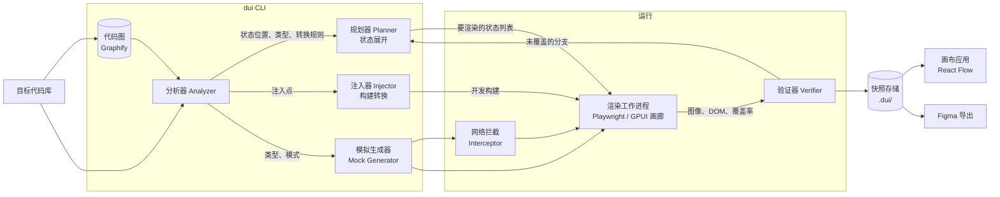

# dui 设计 v0（开发者工具）

[English](../en/design-v0.md) | 简体中文 | [한국어](../ko/design-v0.md)

> 本文是[英文原文](../en/design-v0.md)的简体中文翻译。如有出入，以英文为准。

> 状态：草案 · 编写于 2026-11-19 · 读者：构建 dui 的开发者
> 本文中的外部事实（许可证、star 数、版本）已于 2026-11-19 通过 GitHub API 核实。无法确认的标记为 `未确认`。

## 1. 问题与用户

**用户**：使用 TypeScript 或 Rust 构建 UI 的开发者、设计师和 QA。

**问题**
- 一个界面就有很多状态（空列表、加载中、错误、无权限、长文本、批准最后一页之后 …）。现在只能亲手点击到那个状态才能看到。
- 没有办法知道哪些状态从来没有画过。
- 每个响应式宽度都要单独调整窗口大小去看。
- Storybook 需要人逐个编写状态，Figma 又不是真实代码。

**dui 做什么**：读取代码库，用真实代码渲染应用的**所有界面 × 所有状态 × 所有宽度**，像 Figma 一样铺在无限画布上。画不出来的格子显示为 `未验证`。目标覆盖率为 99%，测量方法在 §8 中定义。

## 2. 目标与非目标

**目标**
- 只支持有类型的语言：TypeScript（Web、WebView）、Rust（GPUI 原生）。
- 不需要人编写状态，由 AI + 类型找出状态并生成模拟值。
- 不手写按框架划分的适配器。由 AI 按需生成适合目标代码的注入代码。
- 结果必须可测量（有分子和分母的覆盖率）。

**非目标**
- 在画布内点击、输入等交互。只展示静态画面。
- 视觉回归测试（像素对比审批流程）。那是 Chromatic、Percy 的领域。以后可以接入。
- 无类型的 JavaScript、Python、Dart、Swift、Kotlin 等。（v0 范围之外）
- 在生产构建中保留 SDK。所有注入代码仅用于开发构建。
- 设计编辑工具。会导出到 Figma，但不替代 Figma。

## 3. 核心思路

1. **AI 找出状态所在的所有位置**：全局 store、组件本地状态（`useState` 等）、context、URL / 路由、服务器响应缓存、GPUI Entity / 模型字段。
2. **在构建时插入强制注入代码**：源码保持不变，通过开发构建转换（TS 用 Vite/Babel/SWC 插件，Rust 用 proc-macro / 构建脚本）创建"以这个值开始"的入口。因此连本地状态也可以从外部注入。
3. **在网络层拦截 API**：用从类型生成的模拟数据响应。
4. **注入、渲染、检查**：注入状态，按宽度渲染，检查渲染结果是否与预期状态一致。不一致则为 `未验证`。

类型之所以关键：有了类型才能 (a) 完整列举状态形态，(b) 自动生成有效的模拟值，(c) 以注入代码能否通过编译器检查作为第一道验证。

## 4. 架构



| 组件 | 作用 | 输入 → 输出 |
|---|---|---|
| `dui` CLI | 整体运行、缓存、配置。`dui scan`、`dui render`、`dui open` | 配置文件 → 运行 |
| 分析器 | 查找界面、状态位置、事件、状态变更点、转换规则。Graphify 图 + 类型信息 + AI | 代码 → `Screen`、`StateSlot`、`Rule` |
| 注入器 | 在构建时为每个状态位置插入开发用注入入口 | `StateSlot` → 转换后的开发构建 |
| 模拟生成器 | 从类型 / 模式（zod、OpenAPI、Rust 类型）生成代表值 | 类型 → 值集合 |
| 规划器 | 把数据形态 × 分支 × 顺序组合成要渲染的状态列表，并为未覆盖分支重新规划 | 规则、覆盖率 → `State[]` |
| 网络拦截 | 拦截 API 请求，返回与状态匹配的模拟响应 | 请求 → 模拟响应 |
| 渲染工作进程 | 注入状态后按宽度渲染，收集图像、DOM、覆盖率。并行运行 | `State` × 宽度 → `RenderCell` |
| 验证器 | 检查渲染的是否为预期状态 | `RenderCell` → 验证状态 |
| 快照存储 | 所有结果以文件形式保存（`.dui/`），以提交哈希为单位 | — |
| 画布应用 | 在无限画布上排布界面×状态节点、宽度列、转换边 | 存储 → 画面 |
| Figma 导出 | 以 Figma 文件输出相同布局 | 存储 → Figma |

## 5. 数据模型

```ts
type Lang = "ts" | "rust";
type Provenance = "extracted" | "inferred" | "verified"; // 代码中明确 / AI 推断 / 回放确认

interface Screen {
  id: string;                 // "review", "export", "settings.team"
  route?: string;             // Web: "/projects/$id/review"
  entry: SourceRef;           // 界面根组件或 GPUI View
  lang: Lang;
}

interface StateSlot {         // 状态所在的一个位置
  id: string;
  kind: "store" | "local" | "context" | "route" | "server" | "entity";
  owner: SourceRef;           // 拥有该状态的组件 / store / Entity
  type: TypeRef;              // 类型信息（生成模拟数据的依据）
  injectable: boolean;        // 是否成功生成注入入口
}

interface State {
  id: string;                 // 内容哈希
  screenId: string;
  label: string;              // "列表为空"、"批准最后一页之后"
  kind: "data-shape" | "branch" | "sequence";
  values: Record<StateSlotId, unknown>;   // 每个槽的注入值
  network: MockResponse[];    // 该状态下 API 返回的响应
  path?: EdgeId[];            // 顺序状态：从起点到这里的路径
  expect: Assertion[];        // 验证器要检查的内容
  targets: BranchId[];        // 该状态想要覆盖的代码分支
}

interface Edge {              // 状态转换
  id: string;
  from: StateId;
  to: StateId;
  event: string;              // "onClick: 批准"、"快捷键 1"
  rule: SourceRef;            // 作为依据的处理函数 / reducer
  provenance: Provenance;
}

interface Snapshot {          // 一次运行的结果集合
  id: string;
  commit: string;             // 目标仓库的提交
  createdAt: string;
  widths: number[];           // 例：[375, 768, 1280]
  axes?: { theme?: ("light" | "dark")[]; locale?: string[] };
}

interface RenderCell {        // 画布上的一个格子 = 状态 × 宽度（× 维度）
  snapshotId: string;
  stateId: string;
  width: number;
  image?: string;             // 文件路径
  dom?: string;               // Web：序列化 DOM / 无障碍树
  coveredBranches: BranchId[];
  status: VerificationStatus;
}

type VerificationStatus =
  | { kind: "verified" }                          // 通过验证
  | { kind: "unverified"; reason: "render-failed" | "assert-failed" | "not-injectable" | "not-rendered" }
  | { kind: "suspect"; reason: string };          // 仅视觉检查失败，需要人工确认
```

`未验证` = 所有 `unverified`。在画布上显示为灰色斜线格子 + 原因。

## 6. 流水线

1. **扫描**（`dui scan`）
   - 用 Graphify 生成调用 / import 图。
   - 查找界面：路由定义（TanStack Router、Next app 目录等）、GPUI 根 View。
   - 查找状态位置：类型信息 + AI。结果为 `StateSlot[]`。
   - 代码分支列表：从界面可达的渲染分支（条件 JSX、early return、`match`）。
2. **列举状态**（规划器）— 合并三种。
   - **数据形态**：从类型生成代表值。列表 0 / 1 / 多，字符串 空 / 普通 / 超长，optional 有 / 无，union 的所有分支，API 成功 / 错误（4xx/5xx）/ 延迟。
   - **代码分支**：AI 反向求解每个分支条件，生成进入该分支的值。
   - **顺序**：沿图从事件处理函数走到状态变更点，构建 `状态 + 事件 → 下一个状态` 规则。从初始状态展开规则（模型检查方式）。无限展开用代表值（0、1、最后一个、最后一个的下一个）和深度上限截断。相同的值集合合并为一个。
3. **注入构建**：注入器生成开发构建。编译失败的槽标记为 `injectable=false`。
4. **渲染**（`dui render`）：工作进程按状态注入值 + 模拟响应，按宽度渲染。保存图像、DOM、分支覆盖率。
5. **验证**：见 §7。
6. **补充循环**：仍有未覆盖分支时，回到第 2 步为这些分支生成专用状态。没有改进或达到迭代上限时停止。
7. **顺序回放验证**：对顺序状态，不只是注入，还要从初始状态沿路径真实回放事件，检查是否出现相同画面。一致则该边为 `已验证`。
8. **查看**（`dui open`）：启动画布应用或导出到 Figma。

## 7. 验证

"渲染出来了"和"渲染出了预期状态"是两回事。分三步检查。

1. **值检查**（必需）：渲染后立即读回每个注入槽的实际值，与预期值比较。不同则说明注入失败。
2. **语义检查**（必需）：用从状态自动生成的断言检查 DOM / 无障碍树（Web）或 GPUI 元素树（原生，可行性 `未确认`）。例："空列表状态 → 列表项 0 个 + 存在空状态提示文字"，"错误状态 → 存在 role=alert"。
3. **视觉检查**（辅助）：AI 看图判断是否与状态描述一致。只有这一项失败时为 `suspect`。

另外还有**覆盖率检查**：通过覆盖率确认该状态想覆盖的分支（`targets`）确实被执行。如果没有，则为 `unverified: assert-failed`。

## 8. 如何测量 99%

用数字而不是感觉来测量。明确定义分母。

- **分母** =（每个界面的渲染分支数 + 每个界面的数据形态代表值数 + 深度上限内可达的顺序状态数）× 配置的宽度数。
  - 渲染分支：从界面根可达的组件内的条件渲染分支（条件 JSX、三元表达式、early return、`match` 分支）。对画面无影响的分支（日志等）通过排除规则去掉。
  - 分母本身也是分析器生成的，因此要单独测量"分母之外的分支"：与运行时覆盖率工具（V8 coverage / istanbul，Rust 用 `cargo llvm-cov` 系列）给出的全部分支列表对照。
- **分子** = 分母中 `verified` 格子的数量。
- **报告**：按界面、按类型的 % + 未验证格子列表（含原因）。例：`review 97.8%（分支 44/45，形态 18/18，顺序 23/24）× 3 种宽度`。
- **达到 99% 的条件**：我们的代码（obora、pippip）遵守规则，把界面状态用类型、reducer、状态机集中在一处。这样顺序状态的分母才准确。

## 9. 各语言细节

### 9.1 TypeScript（Web、Electron / Tauri WebView）

| 项目 | 方法 |
|---|---|
| 查找界面 | 静态分析路由定义（TanStack Router、React Router、Next app 目录）。obora-web 使用 TanStack Router（已确认） |
| 类型 | 用 TypeScript 编译器 API 解析槽类型。有 zod 模式时优先使用（obora-web 使用 zod，已确认） |
| 本地状态注入 | Vite 插件（内部为 Babel 或 SWC 转换）把 `useState(init)` 改写为 `useState(__dui.get("slotId") ?? init)` 的形式。`useReducer`、context Provider 的 value 同理 |
| store 注入 | Zustand、Redux、Jotai 等在创建处用同样方式包装初始值 |
| 服务器缓存 | TanStack Query：渲染前预先填充 `QueryClient`，或模拟网络 |
| 网络 | 类似 MSW（MIT，已确认）的 Service Worker 拦截。Node 侧请求用 MSW node 模式 |
| 渲染 | 用 Playwright（Apache-2.0，已确认）按视口宽度渲染。图像 + DOM + 无障碍树 + V8 覆盖率 |
| Electron | 渲染进程与 Web 相同。模拟 preload / IPC 调用，在浏览器中打开渲染进程包，或使用 Playwright 的 Electron 模式 |
| Tauri | 模拟 `invoke` 调用，与 Web 同样渲染 |
| 顺序回放 | 用 Playwright 回放真实点击和按键 |

注入运行时 `__dui` 只包含在开发构建中，生产构建中关闭转换。CI 检查构建产物中不存在 `__dui`。

### 9.2 Rust（GPUI 原生）

pippip 使用 `gpui-pre 0.3.12` + `gpui-kit 0.10.0`，HTTP 使用 `reqwest`（已在 Cargo.toml 中确认）。GPUI crate 的许可证为 Apache-2.0（已在 zed 仓库的 `crates/gpui/Cargo.toml` 中确认）。

| 项目 | 方法 |
|---|---|
| 查找界面 | 静态分析根 View 和界面切换点 + AI |
| 类型 | 用 rust-analyzer 或基于 `syn` 的解析获取 Entity / 模型字段类型 |
| 状态注入 | 仅在开发 feature 下给模型类型加上 `#[dui::state]` proc-macro，生成 `serde` 序列化 + "以这个值开始"的构造函数。添加该宏的补丁由 AI 在构建阶段生成 |
| 取出状态 | 用同一个宏导出当前状态（也用于实际使用中收集状态） |
| 网络 | 在开发 feature 下把 HTTP 客户端指向本地模拟服务器，或替换为包装后的 trait |
| 渲染 | 应用内 `dui` 画廊模式：读取状态文件构建 View，按各宽度的窗口尺寸绘制后保存图像。已确认 `gpui-pre 0.3.12` 源码中存在 `HeadlessAppContext::capture_screenshot`、`Window::render_to_image`（`test-support` feature）（2026-11-19，[语言调研](language-survey.md)）。在 pippip 中实际运行 `未确认` → M2 spike 的首要任务。不行则改用隐藏窗口 + 系统截图 |
| 顺序回放 | 在画廊模式中通过分发 action 回放 |
| 验证 | 值检查可通过导出对比完成。基于元素树的语义检查 `未确认` |

前提规则：界面状态放在 Entity / 模型中。散落在 View 里的状态会在导出 / 注入中遗漏，标记为 `not-injectable`。

## 10. 图引擎

- 第一选择 **Graphify**（Apache-2.0，★150,430，2026-11-19 确认）：通过 tree-sitter 支持约 40 种语言，每条边带 `EXTRACTED` / `INFERRED` 标签（已在 README 中确认）。dui 在其上叠加状态转换层，并把标签扩展为 `已提取` / `已推断` / `已验证`。
- 第二选择 **CodeGraph**（MIT，★78,082，2026-11-19 确认）：识别框架路由，支持 TypeScript 和 Rust（已在 README 中确认）。
- 集成方式（作为库调用，还是读取 CLI 输出文件）`未确认` → 在 M0 中决定。
- 为保证图引擎可替换，dui 内部只保留一个接口 `CodeGraphPort`（读取节点和边）。

## 11. 画布

布局：**行 = 界面×状态，列 = 宽度（以及主题、语言维度），边 = 转换**。未验证格子显示为灰色斜线 + 原因。

| 候选 | 许可证（2026-11-19 确认） | 判断 |
|---|---|---|
| React Flow（`xyflow/xyflow`） | MIT，★39,087 | **第一选择**。节点内放图像或 iframe（Web 为实时 DOM） |
| tldraw（`tldraw/tldraw`） | 自有许可证（GitHub 显示 NOASSERTION）。LICENSE.md：仅在开发环境免费，**生产使用需要另行购买商业许可或试用许可密钥**，强制许可密钥和水印，可能发送使用数据 | **v0 中排除**。dui 是商业产品，在确认费用和条件之前不使用 |
| Figma 导出 | Figma 插件 / REST API（费用、限额 `未确认`） | 辅助输出。以图像节点生成相同布局 |

## 12. 许可证政策

- dui 是**商业用途**。依赖只能使用允许商用的许可证：MIT、Apache-2.0、BSD、ISC 等。
- 禁止：非商业（PolyForm Noncommercial 等）、AGPL / GPL 等强 copyleft，以及像 tldraw 这样生产使用需要另签合同的（在签约之前）。
- 检查方法：新依赖用 `gh api repos/<owner>/<repo> --jq .license.spdx_id` 和 LICENSE 原文确认；JS 用许可证检查工具、Rust 用 `cargo deny` 在 CI 中拦截。
- 在分发物中保留许可证和版权声明（Apache-2.0 需包含 NOTICE）。

| 依赖 | 许可证 | 状态 |
|---|---|---|
| Graphify | Apache-2.0 | 允许 |
| CodeGraph | MIT | 允许 |
| React Flow | MIT | 允许 |
| MSW | MIT | 允许 |
| Playwright | Apache-2.0 | 允许 |
| GPUI（crate） | Apache-2.0 | 允许 |
| GitNexus | PolyForm Noncommercial | 禁止 |
| tldraw | 自有（生产需付费合同） | 暂缓 |

## 13. MVP 范围与里程碑

**MVP**：把 obora-web 的 3 个界面（审核、导出、设置）× 自动发现的状态 × 3 种宽度铺在 React Flow 画布上，并显示每个界面的覆盖率数字。原生在 MVP 之后。

| 阶段 | 内容 | 完成标准 |
|---|---|---|
| **M0 spike** | obora-web 审核界面 1 个。用 Vite 转换注入 + MSW + Playwright 把手选的 5 个状态按 3 种宽度渲染。在 obora 上运行 Graphify 并决定集成方式 | 至少 1 个本地状态从外部注入并渲染成功，图像 15 张 |
| **M1 自动状态** | 分析器 + 模拟生成器 + 规划器。自动列举数据形态和代码分支，测量覆盖率，补充循环 | 输出审核界面的分支覆盖率数字和未验证列表 |
| **M2 GPUI spike** | pippip 界面 1 个。确认离屏渲染是否可行，做 `#[dui::state]` 宏原型 | 状态文件 → 图像 1 张 |
| **M3 顺序状态** | 提取事件 → 状态变更规则，展开，用 Playwright 回放验证，把边标记为 `已验证` | 自动生成并验证审核界面"批准最后一页之后"这类顺序状态 |
| **M4 画布** | React Flow 画布（行 = 状态，列 = 宽度，边 = 转换，未验证标记），`dui open` | 排布 obora 全部 3 个界面 |
| **M5 obora 99% 尝试** | 3 个界面以 99% 为目标，应用状态显式化规则，Figma 导出 | 每个界面的覆盖率报告 |
| M6 以后 | pippip 全部、Electron（obora-desktop）、Vue、Svelte | — |

## 14. 风险与待定问题

**风险**
- **注入点判断错误**：AI 可能找错槽，转换也可能改变行为。→ 用值检查 + 编译检查 + 语义断言过滤，标记为 `未验证`。
- **状态爆炸**：顺序状态的组合会变得很大。→ 代表值、深度上限、合并相同渲染。上限在测量后调整。
- **分母可信度**：分析器漏掉的分支在分母中也不存在。→ 与运行时覆盖率的全部分支对照，单独报告"分母之外"的数字。
- **渲染不确定性**：时间、随机数、动画、字体加载。→ 固定时钟和随机数，关闭动画，等待字体加载。
- **GPUI 渲染路径不确定**：如果离屏渲染不可行，就要用系统截图，会带来 macOS 权限和速度问题。
- **AI 成本与时间**：大型代码库的扫描成本。→ 按提交缓存图和结果，只重做变更的文件。
- **对 Graphify 的依赖**：外部项目的方向可能改变。→ 通过 `CodeGraphPort` 保持可替换。

**待定问题**（按重要性排序）
1. GPUI（`gpui-pre 0.3.12`）的无头截图 API（已确认代码中存在）在 pippip 界面上能否实际工作？如果不行，原生渲染路径用什么？
2. 如何自动从覆盖率分母中去掉"对画面无影响的分支"？这条规则决定了 99% 的含义。
3. 顺序状态的展开上限（深度、代表值）定为多少，才能在可接受的渲染数量内覆盖所有有意义的状态？
4. Graphify 是作为库使用还是只读取 CLI 输出，以及如何与 TS 类型信息合并。
5. 画布是做成 Web 应用（开发者本地 `dui open`）还是托管服务。若托管，需要评估快照存储成本和安全性。
6. Figma 导出的费用和 API 限额（`未确认`）。

## 原则：组合由系统生成，而不是 AI（2026-11-19 决定）
AI **只用于找出状态在哪里、是什么类型**。画哪些组合由确定性算法决定，保证每次结果相同。
1. 代表值从类型机械地得出：列表 0 / 1 / 多，bool 两个值，enum 全部值，字符串 空 / 普通 / 超长，optional 包含 null，数字 0 / 边界值。
2. 独立分解：只把在代码图中同一渲染区域一起使用的状态归为一组，其余分别展开（乘积 → 求和）。
3. 组内用 pairwise（每对取值至少出现一次）确定性生成。
4. 顺序状态用有深度上限的 BFS，已访问的状态不再访问。
5. 不可能的组合用类型和代码条件（可辨识联合、守卫）去除。

**保证范围**：只保证用类型、enum、可辨识联合、状态机明确表达的状态。分散的隐式状态如实显示为 `未验证`。状态写得越明确，覆盖率越高——这就是 dui 提供的"通往好代码的捷径"。
