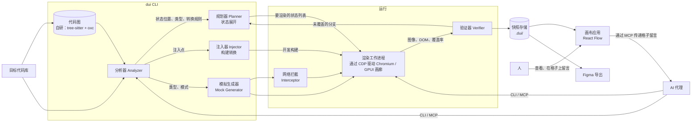

# dui 设计 v0（开发者工具）

[English](../en/design-v0.md) | 简体中文 | [한국어](../ko/design-v0.md)

> 本文是[英文原文](../en/design-v0.md)的简体中文翻译。如有出入，以英文为准。

> 状态：草案 · 编写于 2026-11-19 · 读者：构建 dui 的开发者
> 本文中的外部事实（许可证、star 数、版本）已于 2026-11-19 通过 GitHub API 核实。无法确认的标记为 `未确认`。
> 代码结构、模式、端口和 crate 边界：见[架构](architecture.md)（2026-11-20 决定）。两者重叠时，代码结构以架构文档为准。

> **定位**：设计生成类工具展示的是*将会怎样构建*：由 AI 想象尚不存在的界面。dui 展示的是*实际上是怎样构建的*：它通过官方编译器读取现有代码，把真实存在的每个状态都真正渲染出来。不编造任何东西；无法展示的部分标为 `未验证` 或 `无法渲染`。

## 0. 核心原则：AI 原生

**dui 是 AI 原生的。一切由 AI 使用；人只看画布。**（2026-11-19 决定）

| 界面 | 谁 | 内容 |
|---|---|---|
| AI 界面 | AI 代理 | `dui` CLI + MCP 服务器。JSON 输出、稳定的退出码、没有交互式提问、命令幂等。分析 / 注入 / 渲染 / 验证由 AI 运行，`未验证` 格子也由 AI 修复 |
| 人的界面 | 人 | **只有画布。** UI 中没有设置界面，也没有命令说明。只展示界面 × 状态 × 宽度 × 转换 |
| 循环 | 双方 | 人在画布格子上留言 → AI 通过 MCP 读取留言 → 修复代码 → 画布重新渲染 |

下面的所有组件都按这种分工设计：凡是需要"运行"的都由 AI 代理运行；凡是人需要"看"的都在画布上。

### 原则 #2：依赖官方编译器（2026-11-19 决定）

**dui 是依赖官方编译器的项目。**

- 只支持各语言的**官方编译器 / 工具链**：TypeScript → Microsoft `typescript` 包中的 `tsc`，**仅 7.0+**；Rust → `rustc`（Cargo），类型查询用 rust-analyzer；以后 Swift → `swiftc` + SourceKit-LSP；Kotlin → `kotlinc`。
- 非官方或替代的编译器 / 工具链为 **`不支持`**。
- dui 使用用户项目中已有的官方编译器（版本完全一致）。**不重新实现类型检查**。
- 详见[技术栈](#技术栈2026-11-19-决定)。

## 1. 问题与用户

**用户**：使用 TypeScript 或 Rust 构建 UI 的开发者、设计师和 QA。

**问题**
- 一个界面就有很多状态（空列表、加载中、错误、无权限、长文本、批准最后一页之后 …）。现在只能亲手点击到那个状态才能看到。
- 没有办法知道哪些状态从来没有画过。
- 每个响应式宽度都要单独调整窗口大小去看。
- Storybook 需要人逐个编写状态，Figma 又不是真实代码。

**dui 做什么**：读取代码库，用真实代码渲染应用的**所有界面 × 所有状态 × 所有宽度**，像 Figma 一样铺在无限画布上。画不出来的格子显示为 `未验证`。目标覆盖率为 99%，测量方法在 §8 中定义。

## 2. 目标与非目标

**目标**
- 只支持有类型的语言：TypeScript（Web、WebView）、Rust（GPUI 原生）。
- 不需要人编写状态，由 AI + 类型找出状态并生成模拟值。
- 不手写按框架划分的适配器。由 AI 按需生成适合目标代码的注入代码。
- 结果必须可测量（有分子和分母的覆盖率）。

**非目标**
- 在已归档的截图中直接输入。v0.0.2 在运行中的应用内检查实时状态。
- 视觉回归测试（像素对比审批流程）。那是 Chromatic、Percy 的领域。以后可以接入。
- 无类型的 JavaScript、Python、Dart、Swift、Kotlin 等。（v0 范围之外）
- 在生产构建中保留 SDK。所有注入代码仅用于开发构建。
- 设计编辑工具。会导出到 Figma，但不替代 Figma。

## 3. 核心思路

1. **AI 找出状态所在的所有位置**：全局 store、组件本地状态（`useState` 等）、context、URL / 路由、服务器响应缓存、GPUI Entity / 模型字段。
2. **在构建时插入强制注入代码**：源码保持不变，通过开发构建转换（TS 用 oxc 转换，Rust 用 proc-macro / 构建脚本；见[技术栈](#技术栈2026-11-19-决定)）创建"以这个值开始"的入口。因此连本地状态也可以从外部注入。
3. **在网络层拦截 API**：用从类型生成的模拟数据响应。
4. **注入、渲染、检查**：注入状态，按宽度渲染，检查渲染结果是否与预期状态一致。不一致则为 `未验证`。

类型之所以关键：有了类型才能 (a) 完整列举状态形态，(b) 自动生成有效的模拟值，(c) 以注入代码能否通过编译器检查作为第一道验证。

## 4. 架构

本节是组件视图。代码如何划分为纯核心、三个端口（`TypeOracle`、`Host`、`Renderer`）、适配器和 crate，由[架构](architecture.md)定义。



| 组件 | 作用 | 输入 → 输出 |
|---|---|---|
| `dui` CLI | **供 AI 代理使用**的入口（不是给人用的）：整体运行、缓存、配置。`dui scan`、`dui render`、`dui open`。JSON 输出、稳定退出码、无交互提问、幂等 | 配置文件 → 运行 |
| MCP 服务器 | 为 AI 代理提供与 CLI 相同的操作，并可读取、处理画布格子上的留言 | MCP 调用 → JSON |
| 分析器 | 查找界面、状态位置、事件、状态变更点、转换规则。自研代码图 + 官方编译器提供的类型信息 + AI | 代码 → `Screen`、`StateSlot`、`Rule` |
| 注入器 | 在构建时为每个状态位置插入开发用注入入口 | `StateSlot` → 转换后的开发构建 |
| 模拟生成器 | 从类型 / 模式（zod、OpenAPI、Rust 类型）生成代表值 | 类型 → 值集合 |
| 规划器 | 把数据形态 × 分支 × 顺序组合成要渲染的状态列表，并为未覆盖分支重新规划 | 规则、覆盖率 → `State[]` |
| 网络拦截 | 拦截 API 请求，返回与状态匹配的模拟响应 | 请求 → 模拟响应 |
| 渲染工作进程 | 注入状态后按宽度渲染，收集图像、DOM、覆盖率。并行运行 | `State` × 宽度 → `RenderCell` |
| 验证器 | 检查渲染的是否为预期状态 | `RenderCell` → 验证状态 |
| 快照存储 | 所有结果以文件形式保存（`.dui/`），以提交哈希为单位 | — |
| 画布应用 | 在无限画布上排布界面×状态节点、宽度列、转换边 | 存储 → 画面 |
| Figma 导出 | 以 Figma 文件输出相同布局 | 存储 → Figma |

## 5. 数据模型

```ts
type Lang = "ts" | "rust";
type Provenance = "extracted" | "inferred" | "verified"; // 代码中明确 / AI 推断 / 回放确认

interface Screen {
  id: string;                 // "review", "export", "settings.team"
  route?: string;             // Web: "/projects/$id/review"
  entry: SourceRef;           // 界面根组件或 GPUI View
  lang: Lang;
}

interface StateSlot {         // 状态所在的一个位置
  id: string;
  kind: "store" | "local" | "context" | "route" | "server" | "entity";
  owner: SourceRef;           // 拥有该状态的组件 / store / Entity
  type: TypeRef;              // 类型信息（生成模拟数据的依据）
  injectable: boolean;        // 是否成功生成注入入口
}

interface State {
  id: string;                 // 内容哈希
  screenId: string;
  label: string;              // "列表为空"、"批准最后一页之后"
  kind: "data-shape" | "branch" | "sequence";
  values: Record<StateSlotId, unknown>;   // 每个槽的注入值
  network: MockResponse[];    // 该状态下 API 返回的响应
  path?: EdgeId[];            // 顺序状态：从起点到这里的路径
  expect: Assertion[];        // 验证器要检查的内容
  targets: BranchId[];        // 该状态想要覆盖的代码分支
}

interface Edge {              // 状态转换
  id: string;
  from: StateId;
  to: StateId;
  event: string;              // "onClick: 批准"、"快捷键 1"
  rule: SourceRef;            // 作为依据的处理函数 / reducer
  provenance: Provenance;
}

interface Snapshot {          // 一次运行的结果集合
  id: string;
  commit: string;             // 目标仓库的提交
  createdAt: string;
  widths: number[];           // 例：[375, 768, 1280]
  axes?: { theme?: ("light" | "dark")[]; locale?: string[] };
}

interface RenderCell {        // 画布上的一个格子 = 状态 × 宽度（× 维度）
  snapshotId: string;
  stateId: string;
  width: number;
  image?: string;             // 文件路径
  dom?: string;               // Web：序列化 DOM / 无障碍树
  coveredBranches: BranchId[];
  status: VerificationStatus;
}

type VerificationStatus =
  | { kind: "verified" }                          // 通过验证
  | { kind: "unverified"; reason: "render-failed" | "assert-failed" | "not-injectable" | "not-rendered" }
  | { kind: "suspect"; reason: string };          // 仅视觉检查失败，需要人工确认
  | { kind: "unrenderable"; reason: "no-render-env" | "system-ui" | string }; // 在此环境中无法渲染；见“渲染限制”
```

`未验证` = 所有 `unverified`。在画布上显示为灰色斜线格子 + 原因。

`无法渲染`（`unrenderable`）是单独的状态，不属于 `未验证`：该格子在当前渲染环境中根本画不出来。在画布上显示为“无法渲染（原因）”。

## 6. 流水线

1. **扫描**（`dui scan`）
   - 用 dui 自研的代码图（tree-sitter + oxc）生成调用 / import 图。
   - 查找界面：路由定义（TanStack Router、Next app 目录等）、GPUI 根 View。
   - 查找状态位置：类型信息 + AI。结果为 `StateSlot[]`。
   - 代码分支列表：从界面可达的渲染分支（条件 JSX、early return、`match`）。
2. **列举状态**（规划器）— 合并三种。
   - **数据形态**：从类型生成代表值。列表 0 / 1 / 多，字符串 空 / 普通 / 超长，optional 有 / 无，union 的所有分支，API 成功 / 错误（4xx/5xx）/ 延迟。
   - **代码分支**：AI 反向求解每个分支条件，生成进入该分支的值。
   - **顺序**：沿图从事件处理函数走到状态变更点，构建 `状态 + 事件 → 下一个状态` 规则。从初始状态展开规则（模型检查方式）。无限展开用代表值（0、1、最后一个、最后一个的下一个）和深度上限截断。相同的值集合合并为一个。
3. **注入构建**：注入器生成开发构建。编译失败的槽标记为 `injectable=false`。
4. **渲染**（`dui render`）：工作进程按状态注入值 + 模拟响应，按宽度渲染。保存图像、DOM、分支覆盖率。
5. **验证**：见 §7。
6. **补充循环**：仍有未覆盖分支时，回到第 2 步为这些分支生成专用状态。没有改进或达到迭代上限时停止。
7. **顺序回放验证**：对顺序状态，不只是注入，还要从初始状态沿路径真实回放事件，检查是否出现相同画面。一致则该边为 `已验证`。
8. **查看**：AI 代理发布画布（`dui open`）或导出到 Figma；人只看画布并在格子上留言。留言通过 MCP 回到第 1 步。

## 7. 验证

"渲染出来了"和"渲染出了预期状态"是两回事。分三步检查。

1. **值检查**（必需）：渲染后立即读回每个注入槽的实际值，与预期值比较。不同则说明注入失败。
2. **语义检查**（必需）：用从状态自动生成的断言检查 DOM / 无障碍树（Web）或 GPUI 元素树（原生，可行性 `未确认`）。例："空列表状态 → 列表项 0 个 + 存在空状态提示文字"，"错误状态 → 存在 role=alert"。
3. **视觉检查**（辅助）：AI 看图判断是否与状态描述一致。只有这一项失败时为 `suspect`。

另外还有**覆盖率检查**：通过覆盖率确认该状态想覆盖的分支（`targets`）确实被执行。如果没有，则为 `unverified: assert-failed`。

## 8. 如何测量 99%

用数字而不是感觉来测量。明确定义分母。

- **分母** =（每个界面的渲染分支数 + 每个界面的数据形态代表值数 + 深度上限内可达的顺序状态数）× 配置的宽度数。
  - 渲染分支：从界面根可达的组件内的条件渲染分支（条件 JSX、三元表达式、early return、`match` 分支）。对画面无影响的分支（日志等）通过排除规则去掉。
  - 分母本身也是分析器生成的，因此要单独测量"分母之外的分支"：与运行时覆盖率工具（V8 coverage / istanbul，Rust 用 `cargo llvm-cov` 系列）给出的全部分支列表对照。
- **无法渲染的格子**（见“渲染限制”）**不计入分母**，但始终作为单独的数量连同原因一起报告。因此覆盖率 = `verified` 格子数 ÷ 可渲染格子数。
- **不支持**的项目 / 模块（低于当前最新稳定主版本，或非官方编译器；见技术栈）在扫描前就被拒绝，完全不参与测量。
- **分子** = 分母中 `verified` 格子的数量。
- **报告**：按界面、按类型的可渲染覆盖率 % + 未验证格子列表（含原因）+ 无法渲染的数量（含原因）。例：`review 97.8%（分支 44/45，形态 18/18，顺序 23/24）× 3 种宽度；无法渲染 2（system-ui）`。
- **达到 99% 的条件**：我们的代码（obora、pippip）遵守规则，把界面状态用类型、reducer、状态机集中在一处。这样顺序状态的分母才准确。

## 9. 各语言细节

### 9.1 TypeScript（Web、Electron / Tauri WebView）

| 项目 | 方法 |
|---|---|
| 查找界面 | 静态分析路由定义（TanStack Router、React Router、Next app 目录）。obora-web 使用 TanStack Router（已确认） |
| 类型 | 通过 `TypeOracle` 用项目中的官方 TypeScript 编译器解析槽类型（见技术栈）。有 zod 模式时优先使用（obora-web 使用 zod，已确认） |
| 本地状态注入 | 开发构建中的 oxc 转换把 `useState(init)` 改写为 `useState(__dui.get("slotId") ?? init)` 的形式。`useReducer`、context Provider 的 value 同理 |
| store 注入 | Zustand、Redux、Jotai 等在创建处用同样方式包装初始值 |
| 服务器缓存 | TanStack Query：渲染前预先填充 `QueryClient`，或模拟网络 |
| 网络 | 用 CDP Fetch 域拦截请求并返回模拟响应（不用 MSW）。浏览器之外（服务器端）发出的请求如何拦截 `未确认` |
| 渲染 | 由 Rust 通过 CDP 驱动 Chromium（chromiumoxide），按视口宽度渲染。图像 + DOM + 无障碍树 + V8 覆盖率 |
| Electron | 渲染进程与 Web 相同。模拟 preload / IPC 调用，通过 CDP 在 Chromium 中打开渲染进程包 |
| Tauri | 模拟 `invoke` 调用，与 Web 同样渲染 |
| 顺序回放 | 通过 CDP 输入事件回放真实点击和按键 |

注入运行时 `__dui` 只包含在开发构建中，生产构建中关闭转换。CI 检查构建产物中不存在 `__dui`。

### 9.2 Rust（GPUI 原生）

pippip 使用 `gpui-pre 0.3.12` + `gpui-kit 0.10.0`，HTTP 使用 `reqwest`（已在 Cargo.toml 中确认）。GPUI crate 的许可证为 Apache-2.0（已在 zed 仓库的 `crates/gpui/Cargo.toml` 中确认）。

| 项目 | 方法 |
|---|---|
| 查找界面 | 静态分析根 View 和界面切换点 + AI |
| 类型 | 用 rust-analyzer 或基于 `syn` 的解析获取 Entity / 模型字段类型 |
| 状态注入 | 仅在开发 feature 下给模型类型加上 `#[dui::state]` proc-macro，生成 `serde` 序列化 + "以这个值开始"的构造函数。添加该宏的补丁由 AI 在构建阶段生成 |
| 取出状态 | 用同一个宏导出当前状态（也用于实际使用中收集状态） |
| 网络 | 在开发 feature 下把 HTTP 客户端指向本地模拟服务器，或替换为包装后的 trait |
| 渲染 | 应用内 `dui` 画廊模式：读取状态文件构建 View，按各宽度的窗口尺寸绘制后保存图像。已确认 `gpui-pre 0.3.12` 源码中存在 `HeadlessAppContext::capture_screenshot`、`Window::render_to_image`（`test-support` feature）（2026-11-19，[语言调研](language-survey.md)）。在 pippip 中实际运行 `未确认` → M2 spike 的首要任务。不行则改用隐藏窗口 + 系统截图 |
| 顺序回放 | 在画廊模式中通过分发 action 回放 |
| 验证 | 值检查可通过导出对比完成。基于元素树的语义检查 `未确认` |

前提规则：界面状态放在 Entity / 模型中。散落在 View 里的状态会在导出 / 注入中遗漏，标记为 `not-injectable`。

## 10. 图引擎

- **2026-11-19 变更**：核心是 Rust，因此代码图在 dui 二进制内部**基于 tree-sitter + oxc 自研**。Graphify 是 Python，不能作为内嵌引擎。
- **Graphify**（Apache-2.0，★150,430，2026-11-19 确认）现在**仅参考（思路）**：通过 tree-sitter 支持约 40 种语言，每条边带 `EXTRACTED` / `INFERRED` 标签（已在 README 中确认）。dui 沿用这一思路，并把标签扩展为 `已提取` / `已推断` / `已验证`。
- **CodeGraph**（MIT，★78,082，2026-11-19 确认）：仅参考其识别框架路由的方式（已在 README 中确认）。
- 代码图是 `dui-core` 中的纯数据结构，只由解析器事实构建。它不是端口：端口只存在于 I/O 边界（[架构 §2.2](architecture.md#22-端口与适配器)）。

## 11. 画布

布局：**行 = 界面×状态，列 = 宽度（以及主题、语言维度），边 = 转换**。未验证格子显示为灰色斜线 + 原因。

<a id="web-viewer"></a>

### Web 查看器

**v0.0.2 查看器使用 React 19 和 TypeScript 7。TanStack Start 负责路由和构建，shadcn/ui 提供控件，Tailwind CSS 管理布局与主题变量，React Flow 显示界面地图。** 使用 Start 的 SPA 模式构建静态入口页。Rust 二进制提供入口页、静态资源和本地捕获数据。直接打开查看器路由时应加载入口页；找不到捕获或资源时返回相应错误。保留对已有独立 HTML 图库的访问。[SPA 模式](https://tanstack.com/start/latest/docs/framework/react/guide/spa-mode)

选择项由项目、运行、界面、状态和捕获宽度标识。使用经过验证的路由参数，在总览和详情之间切换、浏览器后退或刷新后保留选择。地图和界面列表均支持键盘导航。在捕获图像旁显示报告中的验证状态及原因。[路由搜索参数](https://tanstack.com/router/latest/docs/framework/react/guide/search-params) · [查看器开发与审查技能](../../.agents/skills/dui-web-viewer/SKILL.md)

**维护边界。** Rust 负责捕获证据、验证结果和覆盖率计算。查看器在统一入口读取归档报告和图数据，将其转换为地图、列表和详情视图共用的类型。旧记录中缺少的可选字段也在此处理。遇到未知状态或无效的必填字段时显示明确的数据错误。路由管理当前选中的格子，React Flow 管理地图布局、平移和缩放，组件管理菜单开合等临时状态。

| 候选 | 许可证（2026-11-19 确认） | 判断 |
|---|---|---|
| React Flow（`xyflow/xyflow`） | MIT，★39,087 | **第一选择**。节点内放图像或 iframe（Web 为实时 DOM） |
| tldraw（`tldraw/tldraw`） | 自有许可证（GitHub 显示 NOASSERTION）。LICENSE.md：仅在开发环境免费，**生产使用需要另行购买商业许可或试用许可密钥**，强制许可密钥和水印，可能发送使用数据 | **v0 中排除**。其生产使用条款会转嫁给商业使用 dui 的用户和企业，在确认费用和条件之前不使用 |
| Figma 导出 | Figma 插件 / REST API（费用、限额 `未确认`） | 辅助输出。以图像节点生成相同布局 |

### 参考项目：Whiteboard（仅参考思路）

[devdotfast/whiteboard](https://github.com/devdotfast/whiteboard)（MIT，★3,553，2026-11-19 确认）是一款人和 AI 代理在同一画布上设计软件的桌面应用。dui **只参考思路，不复制代码**：

| Whiteboard 的思路 | dui 如何借鉴 |
|---|---|
| 让代理在画布上作图的 SDK（AI 通过 API 作图） | 作为 dui MCP 服务器画布部分的范本 |
| 点击画布上的项目即可跳转到对应代码 | 点击 dui 格子即可跳转到定义该状态的代码 |
| 人标出某处，代理重新绘制 | 与 dui 的循环相同：画布格子留言 → AI 修复代码 → 画布重新渲染 |

dui **不**内嵌 Whiteboard：它内置（vendor）了 Code-OSS（打包很重），并且除非用户关闭，否则会发送匿名遥测数据。将来可能的集成方式是把 dui 的结果作为 Whiteboard 插件显示。dui 的命名中绝不使用 Whiteboard 商标。

## 12. 许可证政策

- dui 是 **Apache-2.0 开源项目**。为了让用户和企业可以商业使用 dui，依赖只能使用允许商用的许可证（MIT、Apache-2.0、BSD、ISC）。
- 禁止：非商业（PolyForm Noncommercial 等）、AGPL / GPL 等强 copyleft，以及像 tldraw 这样生产使用需要另签合同的（在签约之前）。
- 检查方法：新依赖用 `gh api repos/<owner>/<repo> --jq .license.spdx_id` 和 LICENSE 原文确认；JS 用许可证检查工具、Rust 用 `cargo deny` 在 CI 中拦截。
- 在分发物中保留许可证和版权声明（Apache-2.0 需包含 NOTICE）。

| 依赖 | 许可证 | 状态 |
|---|---|---|
| Graphify | Apache-2.0 | 允许（仅参考，不是依赖） |
| CodeGraph | MIT | 允许（仅参考，不是依赖） |
| React Flow | MIT | 允许 |
| rmcp（官方 Rust MCP SDK） | Apache-2.0 | 允许 |
| oxc | MIT | 允许 |
| tree-sitter | MIT | 允许 |
| chromiumoxide | MIT OR Apache-2.0 | 允许 |
| syn、`ra_ap_*` | MIT OR Apache-2.0 | 允许 |
| GPUI（crate） | Apache-2.0 | 允许 |
| GitNexus | PolyForm Noncommercial | 禁止 |
| tldraw | 自有（生产需付费合同） | 暂缓 |

## 13. MVP 范围与里程碑

**MVP**：把 obora-web 的 3 个界面（审核、导出、设置）× 自动发现的状态 × 3 种宽度铺在 React Flow 画布上，并显示每个界面的覆盖率数字。原生在 MVP 之后。

| 阶段 | 内容 | 完成标准 |
|---|---|---|
| **M0 spike** | obora-web 审核界面 1 个（obora 先迁移到 TS 7；TS < 7 为 `不支持`）。用 oxc 转换注入 + CDP Fetch 拦截 + 通过 CDP 驱动的 Chromium 把手选的 5 个状态按 3 种宽度渲染，全部由 Rust 二进制驱动 | [架构 §7](architecture.md#7-m0-和-m1-验收标准) 的 M0 标准（15 个格子 ID 和 15 张图像、读回值一致、生产构建中 `__dui` 为 0） |
| **M1 自动状态** | 分析器 + 模拟生成器 + 规划器。自动列举数据形态和代码分支，测量覆盖率，补充循环 | [架构 §7](architecture.md#7-m0-和-m1-验收标准) 的 M1 标准（JSON 输出分支和格子覆盖率、未验证列表、CLI 与 MCP 结果相同） |
| **M2 GPUI spike** | pippip 界面 1 个。确认离屏渲染是否可行，做 `#[dui::state]` 宏原型 | 状态文件 → 图像 1 张 |
| **M3 顺序状态** | 提取事件 → 状态变更规则，展开，用 CDP 回放验证，把边标记为 `已验证` | 自动生成并验证审核界面"批准最后一页之后"这类顺序状态 |
| **M4 画布** | React Flow 画布（行 = 状态，列 = 宽度，边 = 转换，未验证和无法渲染标记）；由 AI 代理通过 CLI / MCP 打开（`dui open`），人只查看 | 排布 obora 全部 3 个界面 |
| **M5 obora 99% 尝试** | 3 个界面以 99% 为目标，应用状态显式化规则，Figma 导出 | 每个界面的覆盖率报告 |
| M6 以后 | pippip 全部、Electron（obora-desktop），然后按[支持的框架](supported-frameworks.md)的优先级处理其余技术栈 | — |

## 14. 风险与待定问题

**风险**
- **注入点判断错误**：AI 可能找错槽，转换也可能改变行为。→ 用值检查 + 编译检查 + 语义断言过滤，标记为 `未验证`。
- **状态爆炸**：顺序状态的组合会变得很大。→ 代表值、深度上限、合并相同渲染。上限在测量后调整。
- **分母可信度**：分析器漏掉的分支在分母中也不存在。→ 与运行时覆盖率的全部分支对照，单独报告"分母之外"的数字。
- **渲染不确定性**：时间、随机数、动画、字体加载。→ 固定时钟和随机数，关闭动画，等待字体加载。
- **GPUI 渲染路径不确定**：如果离屏渲染不可行，就要用系统截图，会带来 macOS 权限和速度问题。
- **AI 成本与时间**：大型代码库的扫描成本。→ 按提交缓存图和结果，只重做变更的文件。
- **对官方编译器 API 的依赖**：TS 7 的编程 API 是新的（7.1 beta），`ra_ap_*` 没有兼容性保证。→ 放在 `TypeOracle` 之后；固定版本。

**待定问题**（按重要性排序）
1. GPUI（`gpui-pre 0.3.12`）的无头截图 API（已确认代码中存在）在 pippip 界面上能否实际工作？如果不行，原生渲染路径用什么？
2. 如何自动从覆盖率分母中去掉"对画面无影响的分支"？这条规则决定了 99% 的含义。
3. 顺序状态的展开上限（深度、代表值）定为多少，才能在可接受的渲染数量内覆盖所有有意义的状态？
4. TS 适配器如何从 Rust 调用 TS 7.1 的 API（用 `typescript/sync` 的小型 Node 边车进程，或有文档的通信协议，后者 `未确认`）。
5. Figma 导出的费用和 API 限额（`未确认`）。

## 原则：组合由系统生成，而不是 AI（2026-11-19 决定）
AI **只用于找出状态在哪里、是什么类型**。画哪些组合由确定性算法决定，保证每次结果相同。
1. 代表值从类型机械地得出：列表 0 / 1 / 多，bool 两个值，enum 全部值，字符串 空 / 普通 / 超长，optional 包含 null，数字 0 / 边界值。
2. 独立分解：只把在代码图中同一渲染区域一起使用的状态归为一组，其余分别展开（乘积 → 求和）。
3. 组内用 pairwise（每对取值至少出现一次）确定性生成。
4. 顺序状态用有深度上限的 BFS，已访问的状态不再访问。
5. 不可能的组合用类型和代码条件（可辨识联合、守卫）去除。

**保证范围**：只保证用类型、enum、可辨识联合、状态机明确表达的状态。分散的隐式状态如实显示为 `未验证`。状态写得越明确，覆盖率越高——这就是 dui 提供的"通往好代码的捷径"。

## 渲染限制（2026-11-19 决定）

有些 UI 不能在任何环境中渲染。最典型的例子是 Apple 生态：

| 限制 | 详情 |
|---|---|
| 工具链绑定 | SwiftUI / UIKit / AppKit 只能在装有 Xcode 工具链的 macOS 上渲染。需要 Mac 运行器；Linux CI 无法渲染 |
| iOS 渲染 | 需要模拟器、`ImageRenderer` 或快照测试。都很慢，而且只能在 Mac 上运行 |
| 系统 UI | 应用之外的 UI（权限弹窗、通知、键盘、部分 sheet）无法注入，也无法渲染 |
| 依赖操作系统的渲染 | 字体、深色模式、Dynamic Type、操作系统版本都会改变结果，因此不同操作系统版本的渲染可能不同 |

原则：

1. 无法渲染的格子绝不隐藏。它们在画布上以单独的状态 **无法渲染（原因）** 显示，与 `未验证` 区分。
2. 每个平台都要写明所需的渲染环境（例如 Apple 平台需要装有 Xcode 的 Mac 运行器）。

## 技术栈（2026-11-19 决定）

**从第一天起核心就是 Rust**：一个二进制文件，自身不需要 Node 或 Python 运行时。CLI、MCP 服务器、分析器和确定性组合规则全部用 Rust 实现。这取代了前文中 Vite / Babel / SWC、MSW、Playwright、ts-morph 以及把 Graphify 作为引擎的说法。版本和许可证于 2026-11-19 确认（crates.io、npm、GitHub）。

| 层 | 选择 | 许可证 | 说明 |
|---|---|---|---|
| 核心 | Rust，edition 2024 | — | 单一二进制。构建 dui 需要 Rust ≥ 1.98，因为 oxc 0.159.0 和 `ra_ap_hir` 0.0.363 声明 `rust-version` 1.98（crates.io） |
| MCP 服务器 | `rmcp` 3.11.0（官方 SDK，[modelcontextprotocol/rust-sdk](https://github.com/modelcontextprotocol/rust-sdk)） | Apache-2.0（workspace `Cargo.toml`；GitHub 显示 NOASSERTION） | 与 CLI 相同的操作 + 读取画布留言 |
| 快速扫描 | `tree-sitter` 0.27.2 | MIT | 界面和文件列表，任何语言 |
| TS/JS 解析 + 注入转换 | `oxc` 0.159.0（`oxc_parser`、`oxc_semantic`、`oxc_transformer`） | MIT | 取代 Babel / SWC / Vite 插件 |
| 代码图 | 基于 tree-sitter + oxc 自研，是 `dui-core` 中的纯数据结构（不是端口） | — | Graphify（Python）和 CodeGraph 仅参考 |
| TS 类型 | `TypeOracle` → TypeScript 适配器 → 项目中的官方编译器 | Apache-2.0（[microsoft/TypeScript](https://github.com/microsoft/TypeScript)） | 见下方“TypeScript 编译器现状”。拿不到类型时结果为 `已推断` |
| Rust 类型 | `ra_ap_*`（固定版本；`ra_ap_hir` 0.0.363）+ `syn` 3.0.10 | MIT OR Apache-2.0 | `ra_ap_*` 没有兼容性保证 → 固定版本 |
| Web 渲染 | `chromiumoxide` 0.9.1（2026-02-25 发布），通过 CDP 驱动 Chromium，每种宽度一个视口 | MIT OR Apache-2.0 | 最近一次发布为 2026-02-25 → 关注维护情况 |
| 网络拦截 | CDP Fetch 域（chromiumoxide 中的 `Fetch.pdl` 和 `examples/interception.rs`） | — | 不用 MSW |
| GPUI 渲染 | 以后在同一个 Rust 进程中（`gpui-pre`） | Apache-2.0 | 见 §9.2 |
| 画布 UI | React 19, TanStack Start, shadcn/ui, Tailwind CSS, React Flow | 按包审查（§12） | TypeScript 7 构建，Rust 提供静态资源 |

**TypeScript 编译器现状**（官方来源）：
- TS 7.0 是 Go 原生编译器。npm 上的稳定版 `typescript` 7.0.2 发布于 2026-07-08。从 7.0 RC 起命令是 `tsc`（预览名 `tsgo` 已不再使用）（[typescript-go README](https://github.com/microsoft/typescript-go)，该仓库已归档，开发转回 microsoft/TypeScript）。TS 7 提供 LSP 语言服务器（[TS 7.0 发布公告](https://devblogs.microsoft.com/typescript/announcing-typescript-7-0/)）。
- 编程 API 在 **TS 7.1**（beta 2026-10-20）中以 JS 入口 `typescript/sync`、`typescript/async`、`typescript/fs`、`typescript/ast` 回归（[TS 7.1 beta 公告](https://devblogs.microsoft.com/typescript/announcing-typescript-7-1-beta/)）。
- 因此 TS 适配器在项目自己的 Node 上运行一个小型边车进程，加载项目的 `typescript` 并回答类型查询。不经 Node 直接从 Rust 调用原生编译器需要有文档的协议，这一点 `未确认`。

### 语言适配器：核心与语言无关

- Rust 核心不认识任何语言。每种语言通过一个**语言适配器**接入 = `TypeOracle`（来自官方编译器的类型信息）+ 仅开发用的注入变换。开发服务器作为 `Host` 适配器接入，渲染环境作为 `Renderer` 适配器接入（[架构](architecture.md)）。
- **增加一种语言 = 增加一个适配器。**核心不变。
- **编译器选择策略**：
  1. 使用用户项目中已有的官方编译器，版本与项目**完全一致**。
  2. 只有缺失时，才下载项目声明版本的**官方发行版**并缓存。
  3. 否则该项目为 `不支持`（显示原因）。

| 语言 | 官方编译器 / 工具链 | 许可证（来源） | 状态 |
|---|---|---|---|
| TypeScript | npm `typescript`（Microsoft）中的 `tsc` | Apache-2.0（[microsoft/TypeScript](https://github.com/microsoft/TypeScript)） | v0 |
| Rust | `rustc` / Cargo；类型查询用 rust-analyzer | MIT 和 Apache-2.0（[rust-lang/rust README](https://github.com/rust-lang/rust)）；rust-analyzer MIT OR Apache-2.0 | v0 |
| Swift | `swiftc` + SourceKit-LSP | Apache-2.0 附 Runtime Library Exception（[swiftlang/swift LICENSE.txt](https://github.com/swiftlang/swift/blob/main/LICENSE.txt)）；SourceKit-LSP Apache-2.0 | 以后。Apple 平台渲染需要 Xcode（Apple 许可）→ dui 使用已安装的 Xcode，绝不下载或再分发 |
| Kotlin | `kotlinc`（JetBrains） | Apache-2.0（[JetBrains/kotlin license/README.md](https://github.com/JetBrains/kotlin/blob/master/license/README.md)；GitHub 未显示 SPDX 标识） | 以后 |

### 支持的版本：只支持当前最新稳定主版本

**规则（2026-11-20 决定）**：每个技术栈，dui **只支持当前最新的稳定主版本**（以 2026 年 11 月为准）及更新的版本。更新的版本始终受支持。更旧的主版本由 `dui scan` 事先拒绝，标为 **`不支持`（原因）**：这不是 `无法渲染`，也不是格子状态，不计入覆盖率（§8）。非官方编译器同样为 `不支持`。基线只会在**未来的 dui 主版本**中提高。

2026-11-20 对照官方来源确认（npm registry、crates.io、GitHub releases、nodejs.org）：

| 技术栈 | 支持基线 | 最新稳定版（日期，来源） | 不支持 |
|---|---|---|---|
| TypeScript | **7.x**（7.0+） | 7.0.2（2026-07-08，npm `latest`；7.1.0 仍是 beta） | 6.x 及更早 |
| React | **19.x**（19.0+） | 19.3.1（2026-10-14，npm `latest`） | 18.x 及更早 |
| Node.js（运行 TS 边车，使用项目自己的） | **26.x** | 26.13.1（2026-11-10，LTS "Lithium"；nodejs.org；26.0.0：2026-05-05；27 仅有 alpha） | 25.x 及更早 |
| Rust | **edition 2024** | [Edition Guide](https://doc.rust-lang.org/edition-guide/) 中最新的 edition；最新工具链 1.100.0（2026-11-12，GitHub release） | edition 2021 及更早 |
| GPUI（`gpui-pre`） | **0.3.x** | 0.3.13（2026-11-16，crates.io） | 0.2.x 及更早 |

说明：
- **Rust** 在 1.0 之后没有主版本，因此用 edition 作为“主版本”。是否还要求最低工具链版本是待定决定（`未确认`）。
- **`gpui-pre`** 是 0.x crate。按 Cargo 的 semver 规则，0.x 的次版本升级是破坏性的，因此把 0.3 视为主版本线。
- **TypeScript**：dui 使用的类型 API（`typescript/sync`）在 7.1 中提供，而 7.1 仍是 beta。在 7.1 稳定之前，TS 适配器的 API 路径为 `未确认`。
- **Chromium**：v0 中不固定版本。dui 通过 CDP 驱动哪个浏览器二进制文件 `未确认`。
- obora（M0 目标）将迁移到 TS 7。

**支持的框架**：受支持技术栈的完整列表（38 个，按优先级排序）、暂不支持的 11 个及各自的加入条件，见[支持的框架](supported-frameworks.md)。它遵循上面的规则：每个技术栈一个基线，即当前最新的稳定主版本。
