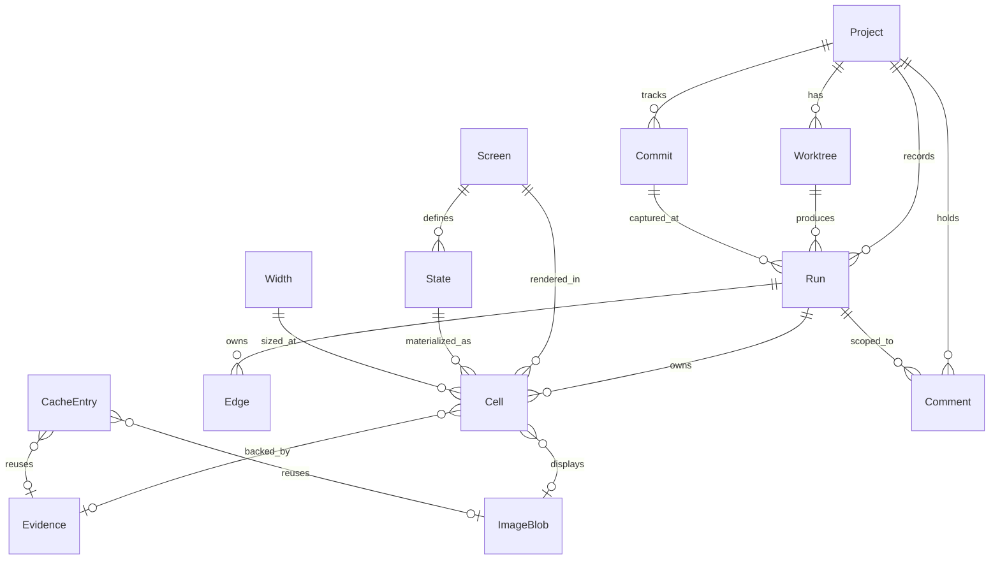

# dui 领域模型

[English](../en/domain-model.md) | 简体中文 | [한국어](../ko/domain-model.md)

> 本文是[英文原文](../en/domain-model.md)的简体中文翻译。如有出入，以英文为准。

> 状态：2026-11-21 决定 · 供 `dui-core`、存储适配器、界面地图、缓存、差异对比与评审批注共用的权威实体模型。相关文档：[架构](architecture.md) · [Web 查看器](web-viewer.md) · [路线图](roadmap.md#v002)。

本文定义 `dui-core::model` 中的 13 个领域实体、确定性标识、可变性规则、代数状态类型，以及 `dui-core::storage` 中薄的 `Store` 端口。所有类型均为纯 Rust 值，不依赖数据库、文件系统或异步运行时。

## 1. 实体关系



### 所有权与可变性

- **共享不可变产物：** `Commit`、`Screen`、`State`、`Width`、`Evidence` 与 `ImageBlob` 均为内容寻址值。相同的截图与运行时观测依据只保存一次，在多个运行、分支与工作树之间复用引用。
- **运行拥有的不可变记录：** `Run` 拥有其 `Cell` 行和运行范围内的 `Edge` 转换。一旦发布，运行及其格子不可再修改；保存实时编辑（#3）会发布一个新的 `Run`（`RunKind::LiveSave`）。
- **可变指针与评审记录：** 仅 `Project`（`display_name`）、`Worktree`（切换分支时的 `branch`）、`Comment`（`body`、`status`、`updated_at_ms`）以及 `CacheEntry`（`last_hit_at_ms`、清理/替换）会原地更新。只有不再被任何 `Cell` 或 `CacheEntry` 引用的 `ImageBlob` 才可被清理（prune）。

## 2. 实体与标识

所有哈希 ID 均为经过校验的 64 位小写十六进制 SHA-256 摘要（`ContentHash`）。派生 ID 对采用确定性排序（`BTreeMap` / `BTreeSet`）的规范 `[tag, payload]` 元组取哈希。标识符以文本存储，时间戳以整数 Unix epoch 毫秒（`i64`）存储，确保 SQLite 与未来 Postgres 模式之间的可移植性。

| 实体 | ID 类型与派生方式 | 字段 | 所有权 | 可变性与生命周期 |
|---|---|---|---|---|
| **Project** | `ProjectId` — `sha256(primary_root_bytes)`（兼容 `~/.dui/projects/<id>`） | `id`、`display_name`、`primary_root` | 跨运行共享 | `display_name` 可变（首次捕获时固定）；随项目历史存在 |
| **Worktree** | `WorktreeId` — `sha256(["dui:worktree:v1", project_id, path, app_relative])` | `id`、`project_id`、`path`、`app_relative`、`branch` | 跨运行共享 | `branch` 可变；切换分支时更新 |
| **Commit** | `CommitId` — `sha256(["dui:commit:v1", project_id, git_sha, dirty, tree_digest])` | `id`、`project_id`、`git_sha`、`dirty`、`tree_digest` | 跨运行共享 | 不可变 |
| **Run** | `RunId` — 非空可移植运行 ID（兼容现有 `~/.dui` 快照 ID） | `id`、`project_id`、`worktree_id`、`commit_id`、`kind`、`created_at_ms`、`environment`、`source_files` | 拥有 `Cell` 与运行 `Edge` | 发布后不可变 |
| **Screen** | `ScreenId` — `sha256(["dui:screen:v1", path])` | `id`、`path`、`origin`（`Entry` \| `Router` \| `Anchor`） | 按路由共享 | 不可变值 |
| **State** | `StateId` — `sha256(["dui:state:v1", screen_id, scenario, locale, inputs])` | `id`、`screen_id`、`scenario`、`locale`、`inputs`、`plan_index` | 按格子输入共享 | 不可变值 |
| **Width** | `Width(NonZeroU32)` — 正整数 CSS 像素 | `pixels` | 值对象 | 不可变 |
| **Cell** | `CellId` — `sha256(["dui:cell:v1", run_id, screen_id, state_id, width, locale])` | `id`、`run_id`、`screen_id`、`state_id`、`width`、`locale`、`status`、`image_blob`、`evidence_id`、`cache` | 归单个 `Run` 所有 | `Run` 发布后不可变 |
| **Evidence** | `EvidenceId` — `sha256(["dui:evidence:v1", canonical_observation])` | `id`、`observed_path`、`observed_width`、`ready`、`settled`、`slots`、`instances`、`hits`、`links`、`responses`、`assertions`、`live_edits` | 内容寻址共享产物 | 不可变 |
| **ImageBlob** | `BlobId` — `sha256(image_bytes)` | `id`、`media_type`、`byte_len`、`width_px`、`height_px` | 磁盘共享二进制块（元数据存于存储层） | 不可变；仅在无引用时可清理 |
| **Edge** | `EdgeId` — `sha256(["dui:edge:v1", run_id, from, to, source, trigger])` | `id`、`run_id`、`from`、`to`、`source`、`trigger`、`selector`、`observed_widths` | 归 `Run` 所有 | 按运行不可变（回放确认后发布 `Verified` 边） |
| **Comment** | `CommentId` — `sha256(["dui:comment:v1", run_id, target, author, created_at_ms, initial_body])` | `id`、`project_id`、`run_id`、`target`、`author`、`body`、`status`、`created_at_ms`、`updated_at_ms` | 关联至 `Project` 与 `Run` 目标 | 可变（`body`、`status`、`updated_at_ms`） |
| **CacheEntry** | `CacheKey` — `sha256(["dui:cache:v1", cache_inputs])` | `key`、`inputs`、`status`、`image_blob`、`evidence_id`、`created_at_ms`、`last_hit_at_ms` | 跨运行与工作树共享 | 可变指针（`last_hit_at_ms`，清理时可淘汰） |

## 3. 纯领域规则（ADT）

定义于 `crates/dui-core/src/model.rs`，采用穷尽匹配且不含任何存储代码：

- **`CellStatus`** — `Verified | Unverified { reason } | Unrenderable { reason }`。未验证（`Unverified`）与无法渲染（`Unrenderable`）为独立变体，两者均必须提供非空原因。覆盖率（`CoverageSummary::from_cells`）将 `Unrenderable` 格子排除在 `renderable` 分母之外并单独报告。
- **`EdgeSource`** — `Extracted | Inferred | Verified`。DOM 链接发现记为 `Extracted`（已提取），AI 推断记为 `Inferred`（已推断），只有通过回放确认后才可构造 `Verified`（已验证）。
- **`CacheOutcome`** — `Hit { key } | Miss { key, changed: BTreeSet<CacheInputKind> }`。`evaluate_cache` 比较 `CacheInputs`（`source_files`、`types_digest`、`mocks_digest`、`state_id`、`width`、`locale`、`dui_version`、`rule_pack_digest`、`renderer_env_digest`），未命中时精确返回发生变化的输入集合（强制重绘时为 `Forced`，无历史记录时为 `Missing`）。

## 4. 无需新增实体即可覆盖的功能

| 功能 | 13 个实体的表示方式 |
|---|---|
| 界面地图（[#7](https://github.com/de-novo/dui/issues/7)） | `Run` → `Screen`（`origin`）、`State`、`Width`、`Cell`（`CellStatus`、`ImageBlob`、`Evidence`）及 `Edge`（`EdgeSource::Extracted`、`selector`、`observed_widths`）。 |
| 保存实时捕获（[#3](https://github.com/de-novo/dui/issues/3)） | 发布包含 `RunKind::LiveSave { source_run, source_state, source_width, revision }` 的新不可变 `Run`、1 个 `Cell`、对应 `ImageBlob` 以及携带 `live_edits` 和断言的 `Evidence`。 |
| 内容寻址缓存（[#8](https://github.com/de-novo/dui/issues/8)） | `CacheEntry` 将 `CacheKey`（`CacheInputs`）映射到已有 `ImageBlob` + `Evidence` + `CellStatus`；`Cell.cache` 记录 `Hit` 或 `Miss(changed)`。 |
| SQLite + Drizzle 存储（[#10](https://github.com/de-novo/dui/issues/10)） | 在 `Store` 端口后按实体建表；文本 ID/哈希、整数 epoch 毫秒时间戳与 JSON 字段保持对 Postgres 的可移植性。大体积 PNG 字节按 `BlobId` 存于磁盘文件。 |
| 捕获差异对比（[#11](https://github.com/de-novo/dui/issues/11)） | 按 `Cell::diff_key()`（`screen_id`、`state_id`、`width`、`locale`）对比两次 `Run`；`(status, image_blob, evidence_id)` 相同的格子视为未变化。 |
| 多语言捕获（[#12](https://github.com/de-novo/dui/issues/12)） | `State.locale`、`Cell.locale` 与 `CacheInputs.locale` 将语言维度纳入 ID 与缓存键。 |
| 评审批注（v0.0.5） | `Comment` 挂接至 `Project`/`Run` 下的 `CommentTarget::{Screen, State, Cell, Edge}`，跟踪 `Open` / `Resolved` 状态。 |

## 5. 存储端口

`crates/dui-core/src/storage.rs` 定义了同步、与具体存储无关的 `Store` trait、值类型 `RunBundle` / `RunFilter` / `RunSummary`，以及用于测试的纯 `BTreeMap` 内存实现 `MemoryStore`：

```rust
pub trait Store {
    fn upsert_project(&mut self, project: &Project) -> StoreResult<()>;
    fn upsert_worktree(&mut self, worktree: &Worktree) -> StoreResult<()>;
    fn put_commit(&mut self, commit: &Commit) -> StoreResult<()>;
    fn put_blob(&mut self, blob: &ImageBlob, bytes: &[u8]) -> StoreResult<()>;
    fn get_blob(&self, id: &BlobId) -> StoreResult<Option<(ImageBlob, Vec<u8>)>>;
    fn put_evidence(&mut self, evidence: &Evidence) -> StoreResult<()>;
    fn get_evidence(&self, id: &EvidenceId) -> StoreResult<Option<Evidence>>;
    fn save_run(&mut self, bundle: &RunBundle) -> StoreResult<()>;
    fn load_run(&self, id: &RunId) -> StoreResult<Option<RunBundle>>;
    fn list_runs(&self, filter: &RunFilter) -> StoreResult<Vec<RunSummary>>;
    fn get_cache(&self, key: &CacheKey) -> StoreResult<Option<CacheEntry>>;
    fn put_cache(&mut self, entry: &CacheEntry) -> StoreResult<()>;
    fn upsert_comment(&mut self, comment: &Comment) -> StoreResult<()>;
    fn list_comments(&self, run_id: &RunId) -> StoreResult<Vec<Comment>>;
    fn unreferenced_blobs(&self) -> StoreResult<Vec<BlobId>>;
    fn delete_blob(&mut self, id: &BlobId) -> StoreResult<()>;
}
```

具体存储后端（本地文件归档、#10 中基于 `rusqlite` / Drizzle 的 SQLite，或未来的远程 HTTP 同步）在 `dui-core` 之外的适配器层实现 `Store`。
