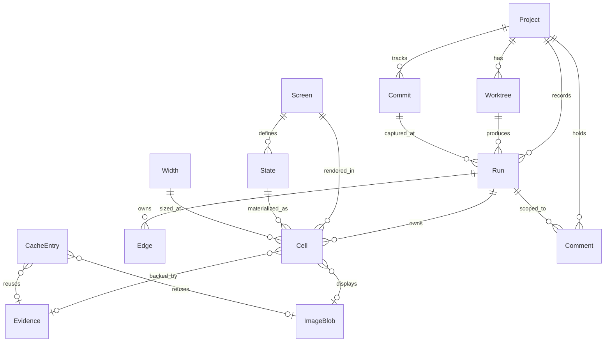

# dui 领域模型

[English](../en/domain-model.md) | 简体中文 | [한국어](../ko/domain-model.md)

> 本文是[英文原文](../en/domain-model.md)的简体中文翻译。如有出入，以英文为准。

> 状态：2026-11-21 决定 · 供 `dui-core`、存储适配器、界面地图、缓存、差异对比与评审批注共用的权威 DDD 模型。相关文档：[架构](architecture.md) · [Web 查看器](web-viewer.md) · [路线图](roadmap.md#v002)。

本文定义 `dui-core::model` 与 `dui-core::storage` 中的 4 个限界上下文、聚合根、实体、不可变值对象、领域不变量，以及按上下文划分的仓储端口。所有类型均为带有私有字段与智能构造器的纯 Rust 值，不依赖数据库、文件系统或异步运行时。

## 1. 限界上下文与实体关系



| 限界上下文 | 模块 | 聚合根与实体 | 值对象 | 仓储端口 |
|---|---|---|---|---|
| **Workspace** | `dui_core::model::workspace` | `Project`、`Worktree` | `Commit` | `WorkspaceRepository` |
| **Capture / Map** | `dui_core::model::capture` | `RunAggregate`（拥有 `Run`、`Cell`、`Edge` 的聚合根） | `Screen`、`State`、`Width`、`Evidence`、`ImageBlob`、`CellStatus`、`EdgeSource`、`CoverageSummary` | `RunRepository`、`ArtifactStore` |
| **Build Cache** | `dui_core::model::cache` | `CacheEntry` | `CacheInputs`、`CacheOutcome`、`CacheInputKind` | `CacheRepository` |
| **Review** | `dui_core::model::review` | `Comment` | `CommentTarget`、`CommentStatus` | `CommentRepository` |

### 所有权与可变性

- **共享不可变值对象：** `Commit`、`Screen`、`State`、`Width`、`Evidence` 与 `ImageBlob` 均为内容寻址值。相同的截图与运行时观测依据只保存一次，在多个运行、分支与工作树之间复用引用。
- **运行拥有的不可变聚合：** `RunAggregate` 是已发布运行的聚合根，在构造时（`RunAggregate::publish`）强制校验 `Run`、`Screen`、`State`、`Cell` 与 `Edge` 之间的引用完整性。一旦发布不可修改；保存实时编辑（#3）会发布新的 `Run`（`RunKind::LiveSave`）。
- **带行为方法的可变聚合根：** `Project::rename`、`Worktree::checkout`、`Comment::{edit, resolve, reopen}` 与 `CacheEntry::record_hit` 强制执行不变量（非空文本、合法状态转换、单调递增时间戳）。仅当没有任何 `Cell` 或 `CacheEntry` 引用时才可清理（prune）`ImageBlob`。

## 2. 实体、值对象与标识

所有哈希 ID 均为经过校验的 64 位小写十六进制 SHA-256 摘要（`ContentHash`）。派生 ID 对采用确定性排序（`BTreeMap` / `BTreeSet`）的规范 `[tag, payload]` 元组取哈希。标识符以文本存储，时间戳以整数 Unix epoch 毫秒（`i64`）存储，确保 SQLite 与未来 Postgres 模式之间的可移植性。

| 类型 | DDD 角色与上下文 | ID 类型与派生方式 | 字段 | 可变性与不变量 |
|---|---|---|---|---|
| **Project** | 聚合根（`workspace`） | `ProjectId` — `sha256(primary_root_bytes)`（兼容 `~/.dui/projects/<id>`） | `id`、`display_name`、`primary_root` | 通过 `rename` 修改；根路径与名称不可为空 |
| **Worktree** | 聚合根（`workspace`） | `WorktreeId` — `sha256(["dui:worktree:v1", project_id, path, app_relative])` | `id`、`project_id`、`path`、`app_relative`、`branch` | 通过 `checkout` 更新 `branch`；路径不可为空 |
| **Commit** | 值对象（`workspace`） | `CommitId` — `sha256(["dui:commit:v1", project_id, git_sha, dirty, tree_digest])` | `id`、`project_id`、`git_sha`、`dirty`、`tree_digest` | 不可变 |
| **Run** | `RunAggregate` 根头（`capture`） | `RunId` — 非空可移植运行 ID（兼容现有 `~/.dui` 快照 ID） | `id`、`project_id`、`worktree_id`、`commit_id`、`kind`、`created_at_ms`、`environment`、`source_files` | `RunAggregate::publish` 后不可变 |
| **Screen** | 值对象（`capture`） | `ScreenId` — `sha256(["dui:screen:v1", path])` | `id`、`path`、`origin`（`Entry` \| `Router` \| `Anchor`） | 不可变；路径不可为空 |
| **State** | 值对象（`capture`） | `StateId` — `sha256(["dui:state:v1", screen_id, scenario, locale, inputs])` | `id`、`screen_id`、`scenario`、`locale`、`inputs`、`plan_index` | 不可变；场景名不可为空 |
| **Width** | 值对象（`capture`） | `Width(NonZeroU32)` — 正整数 CSS 像素 | `pixels` | 不可变；必须 `> 0` |
| **Cell** | `RunAggregate` 拥有的实体（`capture`） | `CellId` — `sha256(["dui:cell:v1", run_id, screen_id, state_id, width, locale])` | `id`、`run_id`、`screen_id`、`state_id`、`width`、`locale`、`status`、`image_blob`、`evidence_id`、`cache` | 不可变；`Unrenderable` 格子禁止携带 `image_blob` |
| **Evidence** | 值对象（`capture`） | `EvidenceId` — `sha256(["dui:evidence:v1", canonical_observation])` | `id`、`observed_path`、`observed_width`、`ready`、`settled`、`slots`、`instances`、`hits`、`links`、`responses`、`assertions`、`live_edits` | 内容寻址不可变产物 |
| **ImageBlob** | 值对象（`capture`） | `BlobId` — `sha256(image_bytes)` | `id`、`media_type`、`byte_len`、`width_px`、`height_px` | 磁盘不可变二进制块；仅无引用时可清理 |
| **Edge** | `RunAggregate` 拥有的实体（`capture`） | `EdgeId` — `sha256(["dui:edge:v1", run_id, from, to, source, trigger])` | `id`、`run_id`、`from`、`to`、`source`、`trigger`、`selector`、`observed_widths` | 按运行不可变；仅带确认宽度的 `confirm_by_replay` 可构造 `Verified` |
| **Comment** | 聚合根（`review`） | `CommentId` — `sha256(["dui:comment:v1", run_id, target, author, created_at_ms, initial_body])` | `id`、`project_id`、`run_id`、`target`、`author`、`body`、`status`、`created_at_ms`、`updated_at_ms` | 通过 `edit` / `resolve` / `reopen` 转换；时间戳单调递增，正文不可为空 |
| **CacheEntry** | 聚合根（`cache`） | `CacheKey` — `sha256(["dui:cache:v1", cache_inputs])` | `key`、`inputs`、`status`、`image_blob`、`evidence_id`、`created_at_ms`、`last_hit_at_ms` | 通过 `record_hit` 更新；`Unrenderable` 禁止携带 `image_blob` |

## 3. 纯领域规则（ADT）

以私有字段与穷尽匹配定义于 `crates/dui-core/src/model/`，不含任何存储代码：

- **`CellStatus`** — `Verified | Unverified { reason: NonEmptyText } | Unrenderable { reason: NonEmptyText }`。未验证（`Unverified`）与无法渲染（`Unrenderable`）为独立变体，两者均须提供非空原因。`Cell::new` 拒绝给 `Unrenderable` 格子附加 `image_blob`。`CoverageSummary::from_cells` 将 `Unrenderable` 排除在 `renderable` 分母之外并单独报告。
- **`EdgeSource`** — `Extracted | Inferred | Verified`。`Edge::discovered` 恒构造 `Extracted`；`Edge::inferred` 恒构造 `Inferred`；只有带非空确认宽度的 `Edge::confirm_by_replay` 才可构造 `Verified`。
- **`CacheOutcome`** — `Hit { key } | Miss { key, changed: BTreeSet<CacheInputKind> }`。`evaluate_cache` 比较 `CacheInputs`（`source_files`、`types_digest`、`mocks_digest`、`state_id`、`width`、`locale`、`dui_version`、`rule_pack_digest`、`renderer_env_digest`），未命中时精确返回发生变化的输入集合（强制重绘为 `Forced`，无历史记录为 `Missing`）。
- **`RunAggregate::publish`** — 校验所有 `Cell` 与 `Edge` 归属 `run.id()`，引用的 `Screen` 与 `State` 存在于聚合内，`Cell` 的 `State` 与其 `Screen` 一致，且不存在重复 `CellId`。

## 4. 无需新增实体即可覆盖的功能

| 功能 | 模型表示方式 |
|---|---|
| 界面地图（[#7](https://github.com/de-novo/dui/issues/7)） | `RunAggregate` → `Screen`（`origin`）、`State`、`Width`、`Cell`（`CellStatus`、`ImageBlob`、`Evidence`）及 `Edge::discovered`（`EdgeSource::Extracted`、`selector`、`observed_widths`）。 |
| 保存实时捕获（[#3](https://github.com/de-novo/dui/issues/3)） | 发布包含 `RunKind::LiveSave { source_run, source_state, source_width, revision }` 的新不可变 `RunAggregate`、1 个 `Cell`、对应 `ImageBlob` 以及携带 `live_edits` 和断言的 `Evidence`。 |
| 内容寻址缓存（[#8](https://github.com/de-novo/dui/issues/8)） | `CacheEntry` 将 `CacheKey`（`CacheInputs`）映射到已有 `ImageBlob` + `Evidence` + `CellStatus`；`Cell.cache()` 记录 `Hit` 或 `Miss(changed)`。 |
| SQLite + Drizzle 存储（[#10](https://github.com/de-novo/dui/issues/10)） | 在 5 个仓储端口后按聚合/产物建表；文本 ID/哈希、整数 epoch 毫秒时间戳与 JSON 字段保持对 Postgres 的可移植性。大体积 PNG 字节按 `BlobId` 存于磁盘文件。 |
| 捕获差异对比（[#11](https://github.com/de-novo/dui/issues/11)） | 按 `Cell::diff_key()`（`screen_id`、`state_id`、`width`、`locale`）对比两次 `RunAggregate`；`(status, image_blob, evidence_id)` 相同的格子视为未变化。 |
| 多语言捕获（[#12](https://github.com/de-novo/dui/issues/12)） | `State.locale()`、`Cell.locale()` 与 `CacheInputs.locale` 将语言维度纳入 ID 与缓存键。 |
| 评审批注（v0.0.5） | `Comment` 挂接至 `Project`/`Run` 下的 `CommentTarget::{Screen, State, Cell, Edge}`，通过 `edit`、`resolve`、`reopen` 管理状态。 |

## 5. 存储端口

`crates/dui-core/src/storage.rs` 定义了 5 个按上下文划分的仓储/产物端口（组合为 `Store` 超 trait），以及用于测试的纯 `BTreeMap` 内存实现 `MemoryStore`：

```rust
pub trait WorkspaceRepository {
    fn upsert_project(&mut self, project: &Project) -> StoreResult<()>;
    fn get_project(&self, id: &ProjectId) -> StoreResult<Option<Project>>;
    fn upsert_worktree(&mut self, worktree: &Worktree) -> StoreResult<()>;
    fn get_worktree(&self, id: &WorktreeId) -> StoreResult<Option<Worktree>>;
    fn put_commit(&mut self, commit: &Commit) -> StoreResult<()>;
    fn get_commit(&self, id: &CommitId) -> StoreResult<Option<Commit>>;
}
pub trait RunRepository {
    fn save_run(&mut self, aggregate: &RunAggregate) -> StoreResult<()>;
    fn load_run(&self, id: &RunId) -> StoreResult<Option<RunAggregate>>;
    fn list_runs(&self, filter: &RunFilter) -> StoreResult<Vec<RunSummary>>;
}
pub trait ArtifactStore {
    fn put_blob(&mut self, blob: &ImageBlob, bytes: &[u8]) -> StoreResult<()>;
    fn get_blob(&self, id: &BlobId) -> StoreResult<Option<(ImageBlob, Vec<u8>)>>;
    fn put_evidence(&mut self, evidence: &Evidence) -> StoreResult<()>;
    fn get_evidence(&self, id: &EvidenceId) -> StoreResult<Option<Evidence>>;
    fn unreferenced_blobs(&self) -> StoreResult<Vec<BlobId>>;
    fn delete_blob(&mut self, id: &BlobId) -> StoreResult<()>;
}
pub trait CacheRepository {
    fn get_cache(&self, key: &CacheKey) -> StoreResult<Option<CacheEntry>>;
    fn put_cache(&mut self, entry: &CacheEntry) -> StoreResult<()>;
}
pub trait CommentRepository {
    fn upsert_comment(&mut self, comment: &Comment) -> StoreResult<()>;
    fn get_comment(&self, id: &CommentId) -> StoreResult<Option<Comment>>;
    fn list_comments(&self, run_id: &RunId) -> StoreResult<Vec<Comment>>;
}
```

具体存储后端在 `dui-core` 之外的适配器层实现这些端口：

- **本地 SQLite + Drizzle 适配器（[#10](https://github.com/de-novo/dui/issues/10)）：** `crates/dui/src/sqlite_store.rs`（内置 SQLite WAL 模式的 `rusqlite`）与 `packages/db/`（`drizzle-orm` `1.0.0-rc.5` SQLite 方言）共用同一套仅向前 SQL 迁移（`packages/db/migrations/`）。元数据存于 `~/.dui/dui.db`，内容寻址图片存于 `~/.dui/blobs/<sha256>.png`。`~/.dui/projects/` 下的现有运行会自动导入；删除数据库文件后也可从磁盘文件无损重建。
- **内存测试适配器：** `dui_core::storage::MemoryStore`（基于 `BTreeMap`，零 I/O）。
- **未来的远程 Postgres 同步：** 通过 API 同步，不共享 SQLite 文件，并沿用相同的文本 ID、epoch 毫秒时间戳与 JSON 列结构。
