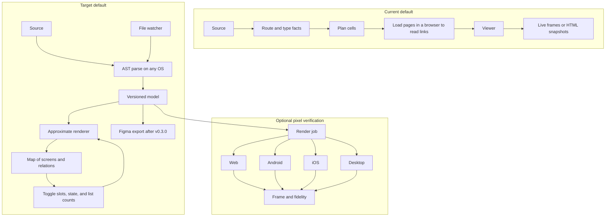

# dui 路线图 · 用 UI 地图评审应用

[English](../en/roadmap.md) · [한국어](../ko/roadmap.md) · 简体中文

## 目标

如今，做产品的事实来源分散在策划文档、Figma 设计和代码里。dui 把开发与 UI 工作统一到同一个来源：代码本身。界面地图和设计视图由代码生成，UI 修改再写回同一份代码，因此不会再有一份单独的设计文件逐渐偏离。

**这意味着**

- 对照代码实际渲染出的界面进行评审和修改。
- 在地图上所做的改动会进入最终发布的同一代码库。

**这不是**

- 一个拥有独立文件格式的设计工具。
- 同时支持所有平台。优先完善实现上述目标所需的解析与近似渲染；截图仅作为可选校验。

<a id="never"></a>

**绝不做的事。** `dui map`、`dui open`、热重载和绘制卡片的默认路径不得启动 Chromium 或其他高内存渲染器：禁止无头浏览器、实时浏览器会话、仿真器或模拟器。重型渲染器只允许作为显式选择的像素校验（`--capture`、`dui run` 或渲染机器）。它们绝不能作为填补卡片的回退路径。同一规则见 [AGENTS.md](../../AGENTS.md#never) 和[架构 §3](architecture.md#never-default-path)。

**当前重点。** 先闭环：从代码生成地图，再把 UI 修改写回同一份代码（v0.3.0 规划的基于代码的画布）。更广的平台支持和打包工作可以稍后进行。默认路径是将源码解析为抽象语法树，再组装为带版本的模型，并由 dui 自己的近似渲染器绘制，无需浏览器或平台构建（[决定](architecture.md#4-已确定的决定2026-11-20)）。截图仅作为可选的像素校验保留。

dui 把应用实际渲染的页面连成一张地图，便于从头到尾评审一项任务。节点代表页面，展开后可查看状态和视口宽度。连接线记录哪个操作会进入下一个页面或状态。

**在手机上取消订单后，用户会回到哪里？** 评审者从订单详情进入确认页，再查看操作后的页面。如果完成提示或下一步操作不够清楚，就在对应位置留言。AI 修改代码后，评审者回到地图上的同一位置，对比两个工作树。这是 dui 要实现的评审流程。

用 `dui map .` 捕获提货看板，检查对话框、比较标题改动，并在原生桌面端打开同一次运行。[运行 Dispatch 示例](../../examples/dispatch/README.zh-CN.md)

## v0.0.1 · 截图基线已完成

Chromium 结合项目类型和模拟数据渲染应用。本地画廊按状态和宽度展示截图，历史查看器按项目、分支和工作树比较 `~/.dui/` 中的记录。npmgraph 示例从一个入口地址发现搜索页，在两个宽度下验证两个页面，共四个格子。 [运行示例](../../examples/npmgraph/README.md)

M0 审核页面的五种状态在 375、768 和 1280 px 下全部通过验证，共生成 15 张不同的 PNG。检查涵盖对话框的实际打开状态、拦截的响应正文以及生产构建的客户端和服务端产物。Chromium 断开连接后，报告仍保留全部 15 个格子的 ID。

“已验证”表示观测到的状态通过了相应检查。布局和文案是否自然、下一步是否清晰，由评审者判断。后续版本将这些页面和证据组织成一张可评审的地图。

## v0.0.2

**从地图打开页面，检查运行中的状态。** 每个已发现的页面对应一个节点，展开即可选择状态和宽度并进入实时网页。同一页面有两个菜单时，AI 应能打开其中一个、查看内容并关闭它，另一个菜单保持原状。

[Web 查看器技术栈与交互规则](design-v0.md#web-viewer) · [Web 查看器架构](web-viewer.md)

| 工作 | 验收依据 |
| --- | --- |
| [页面地图](https://github.com/de-novo/dui/issues/7) | 在 npmgraph 上显示两个页面节点，各有两个宽度。在概览与实时查看之间切换时保留所选页面。主页链接标明发现依据。 |
| [查询元素状态](https://github.com/de-novo/dui/issues/1) | 用布尔值和枚举进行验证。CLI 和 MCP 返回所属组件、实例、源码位置、类型、当前值以及是否可编辑。目标不明确或值无效时返回原因并保留原状态。 |
| [实时渲染](https://github.com/de-novo/dui/issues/2) | 仅启动一次宿主和浏览器。设置和恢复状态后，同时检查读回的值以及 DOM 或无障碍树中的可见结果。 |
| [修改延迟和捕获](https://github.com/de-novo/dui/issues/3) | 在同一会话中连续修改 30 次，以毫秒记录从收到请求到确认画面变化的 p50 和 p95。单独记录冷启动时间。修改期间宿主重建和浏览器重启均为 0 次。将选定状态及其证据保存到 `~/.dui/`。 |
| [领域模型](https://github.com/de-novo/dui/issues/9) | 用图表记录每个实体的 ID、字段和可变性。核心类型放在 `dui-core`，不依赖存储，覆盖地图、已保存捕获、缓存和评论。 |
| [SQLite 存储](https://github.com/de-novo/dui/issues/10) | 通过 Drizzle 迁移将元数据存入 SQLite，图片按内容哈希存为文件，并无损导入现有 `~/.dui/` 历史。表结构需便于日后用于远程 Postgres 服务器，同步走 API。 |
| [多语言捕获](https://github.com/de-novo/dui/issues/12) | 按应用支持的每种语言捕获页面，标出缺失翻译和溢出文本。 |
| [M1 覆盖率](https://github.com/de-novo/dui/issues/4) | 通过已有的确定性规划和覆盖率验收。比较 CLI 和 MCP 的结果，为每个未验证的格子记录缺失的证据。 [M1 验收条件](architecture.md) |

首次基准测试会记录设备和测试项目，得出延迟基线。跨项目的延迟目标在测量后确定。

## v0.0.3

**在地图中评审原生页面。** 在给定宽度下，用两种有类型的状态渲染一个真实的 GPUI 页面。复用网页会话的查询、设置、读回和恢复操作。随图片记录操作系统、渲染器和工具链。值一致且有独立的界面语义证据才能标记为已验证。缺少语义证据则保留为未验证。缺少渲染环境则标记为无法渲染并说明原因。

基线已在 `fixtures/gpui-kit` 上验证（`gpui-kit 0.10.0`、`gpui-pre 0.3.12`、`rustc 1.100.0`、macOS Metal 离屏渲染 480 px，通过 AccessKit / `TestQueryExt` 提供 `elementTreeAvailable: true`，缺少渲染环境时报告 `unrenderable` 与 `no-render-env`）。运行 `npm run check:gpui` 可复现。共享 `dui live` / MCP `live` 协议下的原生实时会话 30 次热编辑也已验证（**p50 3.65 ms / p95 4.23 ms**，宿主重建 0 次，原生重启 0 次，第二个视图实例独立状态保持不变，缺少语义证据时报告 `unverified` 与 `missing-semantic-evidence`）。运行 `npm run check:gpui-live` 可复现。

实施任务 · [#5](https://github.com/de-novo/dui/issues/5) · [#6](https://github.com/de-novo/dui/issues/6)

**只渲染有变化的部分。** 输入未变的格子复用已存结果，每张图片只存一次（[缓存](https://github.com/de-novo/dui/issues/8)）。比较两次捕获时只列出有变化的格子（[差异](https://github.com/de-novo/dui/issues/11)）。

## 后续里程碑

当前已有本地网页 URL 捕获、原生路由发现及部分运行时的界面捕获，各项范围见[能力表](supported-frameworks.md)。后续平台和打包工作根据上述目标安排。预编译二进制和 Homebrew（[#176](https://github.com/de-novo/dui/issues/176)）等打包工作等到产品稳定后再做。符合目标的下一步，是把 UI 修改写回代码（v0.3.0）。

| 版本 | 目标 |
| --- | --- |
| v0.0.4 | 沿操作在页面或状态之间移动。每条边标明依据来自代码提取、推断或重放验证。从初始状态重放并确认到达目标后，才将边标记为已验证（[#31](https://github.com/de-novo/dui/issues/31)，`dui transitions` / MCP `transitions`，`npm run check:transitions`）。 |
| v0.0.5 | 在 GPUI 和 gpui-kit 桌面查看器（`apps/desktop`、`dui desktop`，[#40](https://github.com/de-novo/dui/issues/40)，`npm run check:desktop`）中打开项目地图。评审者可在页面、状态、宽度或转换上留言。AI 通过 MCP 读取位置，评审者在修改后的工作树中回到同一位置，对比修改前后（[#38](https://github.com/de-novo/dui/issues/38)，`dui comment` / MCP `comment_*` / 查看器 `/api/comments`，`npm run check:comments`）。 |
| v0.0.6 | 在参考页面上测量 99% 覆盖率目标，公布已验证和可渲染格子数、遗漏分支及原因。在对应页面保留尚未解决的评审意见（[#44](https://github.com/de-novo/dui/issues/44)，`dui audit` / MCP `audit` / 查看器 `/api/audit`，`npm run check:audit`）。 |
| v0.0.7 | Priority 2 声明式规则包（Zustand 5、Redux Toolkit 2、Jotai 3、XState 5、React Hook Form 7、valibot 1、React Router 8、TanStack Start 1）、可选 `hybrid`/`live` 真实 API 模式（只读保护）、分支对比（`dui diff --base main`）、带动态 ID 折叠（`/orders/:id`）的无环多跳 BFS、贪心成对覆盖数组、`<select>` 真实选项发现、视觉变化佐证（`visualWitness`）、2D 画布内联对比（`元素` 渲染树 Diff + 惰性 `像素` 回退）以及常规运行 `linksTo` 连线（[#56](https://github.com/de-novo/dui/issues/56)、[#63](https://github.com/de-novo/dui/issues/63)、[#66](https://github.com/de-novo/dui/issues/66)、[#70](https://github.com/de-novo/dui/issues/70)、[#74](https://github.com/de-novo/dui/issues/74)、[#76](https://github.com/de-novo/dui/issues/76)、[#80](https://github.com/de-novo/dui/issues/80)、[#82](https://github.com/de-novo/dui/issues/82)、[#84](https://github.com/de-novo/dui/issues/84)、[#86](https://github.com/de-novo/dui/issues/86)、[#88](https://github.com/de-novo/dui/issues/88)）。 |
| v0.0.8 | **多平台抽象层与通用 Web · TUI。** 固定 `SurfaceRegistry`、`NoopOracle` 与统一的 `RenderNodeSnapshot` 中间表示，使新增平台只需实现单个适配器而不重复缓存、SQLite、Diff 或画布代码（[#99](https://github.com/de-novo/dui/issues/99)）。交付支持任意 HTML/JS 应用的 Universal Web 宿主（`static` / `url` / `command`，[#100](https://github.com/de-novo/dui/issues/100)）与 Universal TUI 适配器（`pty` + VT100 单元网格 → `RenderNodeSnapshot` + 等宽 PNG，[#101](https://github.com/de-novo/dui/issues/101)）。 |
| v0.0.9 | **Android · 桌面 · 设计缺陷检测与开发者工具级元素检查器。** 新增 Android 适配器（`adb screencap` + `uiautomator`/Semantics → `RenderNodeSnapshot`，[#102](https://github.com/de-novo/dui/issues/102)）、Electron 45 宿主 + GPUI AccessKit 渲染树 Diff（[#103](https://github.com/de-novo/dui/issues/103)）、Radix UI / shadcn 规则包 + Next.js 16 宿主（[#104](https://github.com/de-novo/dui/issues/104)）、多标签页并行捕获 + 基于 `renderTree` 的自动设计缺陷与无障碍诊断（溢出、重叠、文本截断、对比度不足、触控目标过小、间距与对齐偏差——人类在画布上直观查看，AI 通过 CLI/MCP 获取结构化 JSON，[#105](https://github.com/de-novo/dui/issues/105)），以及在画布上查看任意元素属性、宽高、外边距、内边距与间距标尺的开发者工具级元素检查器（[#106](https://github.com/de-novo/dui/issues/106)）。 |
| v0.1.0 | **跨平台移动端捕获与编译器预言机基础。** 新增 iOS Simulator（`xcrun simctl` + XCUI）捕获、通用认证会话（`storageState.json` / `POST authFlow`）、PR Markdown Diff 输出、React Native / Expo Router / Ink `tsc` 规则包、共享编译器预言机 IR 与 6 个官方工具链探测（`dui toolchains`：`tsc`、`rustc`、`go`、`swiftc`、`kotlinc`、`dart`）。 |
| v0.2.0 | **框架无关路由树、全页真实比例节点、模态框自动捕获与客观事实核心。** 按页面完整高度（含嵌套滚动容器）捕获并按真实宽高比排列画布与桌面节点（[#147](https://github.com/de-novo/dui/issues/147)），通过 WAI-ARIA 导航展开与官方编译器路由注册表实现框架无关路由树发现、零配置 `dui scan` 与多宿主 `dui map`（[#149](https://github.com/de-novo/dui/issues/149)、[#153](https://github.com/de-novo/dui/issues/153)），对齐 GPUI 桌面原生 macOS `TitleBar` 与避障走廊连线（[#155](https://github.com/de-novo/dui/issues/155)、[#159](https://github.com/de-novo/dui/issues/159)），基于 WAI-ARIA 自动捕获模态框/抽屉并以子叠加层节点展示（[#157](https://github.com/de-novo/dui/issues/157)），并移除硬编码的全局设计缺陷启发式规则与过早的 iframe 实时挂载，使 `dui` 严格报告客观渲染证据（[#163](https://github.com/de-novo/dui/issues/163)、[#169](https://github.com/de-novo/dui/issues/169)）。 |
| v0.3.0 | **插件化设计系统一致性校验（`DESIGN.md` / 插件）与基于代码的画布渲染。** 保持 `dui-core` 严格输出客观事实，在 `dui.json` 中提供可选插件架构接入自有 `DESIGN.md`、W3C Design Tokens 或自定义审计插件（[#167](https://github.com/de-novo/dui/issues/167)）。画布的默认画面是 dui 近似渲染器根据带版本模型绘制的结果，而不是位图截图。 |

<a id="default-pipeline"></a>

**默认流水线（2026-11-27 决定）。** 目标是屏幕及其关系的地图，而不是现场演示业务逻辑。默认路径必须能在任一操作系统上运行，且不得依赖特定渲染引擎。源码被解析为抽象语法树，再组装为带版本的 JSON 模型，并由 dui 自己的近似渲染器绘制。模型包含屏幕、组件及其 props、跳转、代码位置、数据槽位、已声明状态及其依赖的 UI 分支、列表项 schema、字段到 UI 的绑定、中立样式属性，以及保留 token 名称的 token 层（供日后映射为 Figma 变量）。仅在运行时可知的值保持为占位。评审者可以在 UI 中更改槽位、状态和列表数量，而无需运行处理函数或访问网络。保存的值集日后可以成为 Figma 变体。

一种新语言只需要一个适配器，把它映射到该模型：布局元素、已声明状态与数据、导航，以及样式语法。模型、近似渲染器、热重载和 Figma 导出均可复用。

**样式与设计 token。** 中立样式属性为 spacing、color、typography、radius、size 和 layout。每个适配器把自己的样式语法映射到这些属性，并把 token 名称保留在 token 层。

- 简单：Tailwind 类、SwiftUI modifier、Compose Modifier 和内联样式可直接映射。
- 中等：主题、设计 token 和 CSS 变量根据定义文件解析。
- 困难：CSS 文件和 CSS Modules 需要层叠、优先级和媒体查询。由不使用浏览器的轻量 CSS 解析器做近似。运行时 CSS-in-JS 值按槽位处理：记录声明，评审者可在 UI 中设置值，而无需运行代码。

未能解析的样式保持为占位。不得通过启动浏览器来填充。

截图、HTML 快照、实时浏览器会话，以及模拟器或仿真器录制，仅作为可选的像素校验保留。它们不再是默认地图，也不是用来填补卡片的回退路径，也不是 Figma 导出或代码修改的中间格式。第一种语言是 TypeScript/TSX，然后是可在任一操作系统上运行的 Swift syntax only。编译器索引或类型检查器是可选的精度增强，不是卡片出现的前提。



**通向默认流水线的阶段。**

| 阶段 | 时间 | 目标 | 完成标准 |
| --- | --- | --- | --- |
| 1. Schema | v0.2.x | 将屏幕、组件、跳转、代码位置、槽位、已声明状态与分支、列表项 schema、字段到 UI 的绑定、中立样式属性（spacing、color、typography、radius、size、layout），以及保留 token 名称的 token 层，冻结为带版本的 JSON 模型。 | 一个包含样式属性和 token 名称的示例通过 schema 校验。已完成：[源码模型，schema 版本 1](source-model.md)。 |
| 2. Browserless default map | v0.2.x | 默认情况下 `dui map` 和 `dui open` 不再启动浏览器。`--capture` 和 `dui run` 仍用于校验。 | 无浏览器的 CI 运行能给出屏幕和跳转，且现有截图检查仍然通过。在同一示例上测量截图路径与 AST 路径的端到端地图生成时间（冷启动和增量），并记录数字。AST 默认路径必须明显更快。在测量之前不要公布目标时间。 |
| 3. AST extractors | v0.2.x–v0.3.0 | 从源码提取模型。先做 TypeScript/TSX，再做可在任一操作系统上运行的 Swift syntax only。类型检查器或编译器索引是可选项。每个适配器把布局、状态、导航和样式语法映射到模型。 | 在 Linux 上，不启动浏览器、不使用 Xcode，一个 TSX fixture 和一个 Swift fixture 能输出模型，包括简单样式映射。 |
| 4. Approximate renderer | v0.3.0 | 仅根据模型绘制卡片，包括其样式属性。标注为近似。 | 卡片非空；文本、堆叠和样式与模型一致；不启动浏览器。 |
| 5. Hot reload | v0.3.0 | 监视文件（与 Vite 同一思路），只重新解析变更部分，只补丁受影响的模型节点，再用近似渲染器重绘。跟踪 import 图，使依赖所改文件的屏幕一并更新。无需重新构建应用，也不启动浏览器。 | 在同一示例上测量从编辑到更新的延迟并记录。修改文件后，依赖卡片会更新，且不重新构建应用、不启动浏览器。 |
| 6. Slots, state, and lists | v0.3.0 | 在 UI 中切换槽位值、已声明状态和列表数量（0、1、many）。根据列表项 schema 自动生成 mock 项。隐藏或未知类型保持为占位。 | 切换 `isOpen` 或列表数量时，画面在无网络、无处理函数的情况下变化。已保存的值集会保留。 |
| 7. Optional render machine | v0.3.x | 通用校验任务：输入 surface、cell、state、size，输出 frame、render tree 和 fidelity。关于常驻渲染服务器和并发浏览器工作的议题（[#343](https://github.com/de-novo/dui/issues/343)、[#344](https://github.com/de-novo/dui/issues/344)）属于这条轨道，而不是默认地图。 | 任务运行时记录保真度。默认地图 CI 仍不使用浏览器。 |
| 8. Figma export | after v0.3.0 | 仅根据模型创建画板和变体。在可能时把 token 名称映射为 Figma 变量。 | 只读导出不需要快照。 |
| 9. GPUI web canvas | from v1.0.0 | 从优化出发，尝试用 GPUI（wasm32 网页后端，WebGPU，回退为 WebGL2）绘制应用内画布——仅限屏幕渲染器。React 外壳保持不变。 | 前提：包含网页后端的稳定官方 `gpui` crate；已验证韩语 IME 和文本选择。对照 TypeScript 渲染器测量打包体积和标签页内存并记录数字（已公布的参考值是 Zed 的 Delta 网页打包，约 23MB）。在这些测量上胜出之前，GPUI 画布保持为可选项。在此之前，默认屏幕渲染器仍是 TypeScript/DOM 或轻量画布。 |

**第 2 阶段测量（2026-11-27）。** 在一台笔记本上用发布构建端到端运行 `dui map --build-dir`，每项在同一主目录中运行两次（[#368](https://github.com/de-novo/dui/issues/368)）。对显式目标的第二次运行会重新渲染所有格子，因此截图路径从中得不到加速。文件变更后的真正增量更新属于第 5 阶段。

| 示例 | 无浏览器默认路径，第一次 / 第二次 | `--capture`，第一次 / 第二次 |
| --- | --- | --- |
| 合成静态站点，301 页，602 个格子 | 2.3 s / 2.4 s | 312 s / 325 s |
| dui 网站，4 页，8 个格子 | 0.23 s / 0.19 s | 11.3 s / 9.9 s |

**默认路径范围之外。** 运行业务逻辑、调用 API，或精确复现原生或 Web 像素。这些留在校验轨道。

**像素校验与渲染服务器（可选，v0.3.x）。** 常驻的官方引擎渲染服务器是可选的像素校验，而不是默认地图（[决定](architecture.md#4-已确定的决定2026-11-20)）。默认的 `dui map` 和 `dui open` 不启动浏览器。启用时，它是 `--capture`、`dui run` 以及后续其他界面的任务分发器。[#343](https://github.com/de-novo/dui/issues/343) 和 [#344](https://github.com/de-novo/dui/issues/344) 中的工作属于这条轨道。它仍可由共享的实时会话所有者进程（[#333](https://github.com/de-novo/dui/issues/333)）发展而来，但只能放在显式选择之后。

**dui 近似渲染器（v0.3.0）。** 基于代码的画布的默认画面，是 dui 近似渲染器根据带版本模型（含样式属性）绘制的结果。不需要浏览器，也不需要平台构建。帧会标注为近似。为可选保真度而与官方引擎帧对齐，仍是校验轨道上的研究；在此之前，那些帧是校验证据，而不是默认卡片。

**Figma 导出（v0.3.0 之后）。** 在基于代码的画布闭环就位之后，把屏幕地图作为由代码生成的只读视图导出到 Figma。代码仍是唯一的事实来源。不把 Figma 中的修改写回代码；若同步回去，来源会再次分裂，因此目前不是目标。

1. **以画板导出屏幕。** 将一次 `dui map` 运行中的屏幕导出到 Figma：把带版本的模型（布局、文本和样式属性）变成可编辑图层，每个屏幕一个画板，便于在 Figma 中直接查看。在可能时，模型中的 token 名称映射为 Figma 变量。
2. **组件与变体。** 从代码读取组件信息（例如 React 组件及其 props），渲染相关的 props 组合，并创建 Figma 组件集，将 props 映射为变体属性。屏幕上对应的元素作为这些组件的实例放入。

尚待明确的问题包括：组合过多时渲染哪些组合，如何捕获 hover、disabled、focus 等状态，以及颜色和字体是否应映射为 Figma 变量或样式。

首个概念验证使用若干 obora 设计系统组件（Button、Input、Badge）和两三个 obora 屏幕。

**GPUI 网页画布（自 v1.0.0）。** 在默认近似渲染器就位之后，从优化出发，尝试用 GPUI 的 wasm32 网页后端（WebGPU，回退为 WebGL2）绘制应用内画布。仅替换屏幕渲染器，React 外壳保持不变。这是页面内运行的渲染器，不是无头浏览器，也不改变默认地图路径的[绝不做的事](#never)规则。

此尝试须等到官方 `gpui` crate 稳定且包含网页后端，并在该后端上验证韩语 IME 和文本选择之后再开始。必须对照 TypeScript 渲染器测量打包体积和标签页内存并记录数字。已公布的参考值是 Zed 的 Delta 网页打包，约 23MB；该数字既不是 dui 的测量结果，也不是目标。在这些测量上胜出之前，GPUI 画布保持为可选项。在此之前，默认屏幕渲染器是 TypeScript/DOM 或轻量画布。

**托管方向。** 正在考虑类似 Sentry 的模式：核心 CLI（`dui map`、diff、本地渲染和 JSON 导出）保持开源，日后可由托管服务保存带有代码位置映射的 CI 上传、在每个 pull request 上展示界面对比、与 Figma 插件同步，并把设计评论关联回代码位置，同时提供团队权限。这只是待探索的方向，并非承诺。

**源码预览（实验性）。** 在装有 Node 26 和 Swift 6 或 Kotlin 2/JDK 的检出目录中，对受信任的本地源码运行以下任一命令。导出器将所选组件与布局、文本和布尔开关的可移植预览实现一起编译并运行。独立 HTML 可离线回放实际观察到的状态转换，并标识为源码预览。原生外观、平台服务和运行验证需要单独运行原生应用。

原型接受一个独立文件和一个无参入口。状态必须是确定性的布尔值，声明顺序须稳定。最多探索 32 个可达状态，每个状态最多 16 个开关。遇到不支持的 API 或超过上限时导出失败。独立 HTML 可在浏览器中打开，项目声明的入口也可在[屏幕地图](web-viewer.md#portable-source-map)中打开。

```sh
node scripts/source-preview.mts fixtures/source-preview/Settings.swift Settings swift.html
node scripts/source-preview.mts fixtures/source-preview/Settings.kt example.Settings compose.html
```

<a id="swiftui-screen-discovery"></a>
**SwiftUI 屏幕发现（实验性）。** 默认路径仅凭语法发现 SwiftUI 屏幕，并可在任一操作系统上运行（[决定](architecture.md#4-已确定的决定2026-11-20)）。结合官方 macOS 构建的编译器索引仍是可选的精度增强，不是卡片出现的前提。规则：`App` 的场景根（`WindowGroup`、`DocumentGroup`）为入口；`NavigationLink`、`.navigationDestination`（按值类型匹配）和 `TabView` 子视图为屏幕；`.sheet`、`.fullScreenCover`、`.popover` 内容为浮层。UIKit 通过 `UIHostingController(rootView:)` 显示的 SwiftUI 视图也是屏幕。`NavigationStack`、`NavigationView`、`Group` 包装、修饰符链和 `#if` 后缀块会被穿透。`NavigationStack` 或 `NavigationView` 根部的视图类型也是屏幕。对项目属性或函数的引用（`root`、`view(for:)`）会进入其函数体，按同样的规则读取。运行时才确定的跳转目标标为动态并附条件，或报告为限制。卡片路径为 `Target/File.swift#TypeName`。v1 中 UIKit `UIViewController` 子类只列出、不连线。项目有多个 scheme 时在 `dui.json` 中设置 `"scheme"`。检查：`npm run check:swift-map`。原生画面来自经 `dui map attach` 关联的模拟器录制，保持未验证。Linux 和 Windows 使用仅语法的默认路径。上游 fixture 为固定到某个提交的 [home-assistant/iOS](https://github.com/home-assistant/iOS)（Apache-2.0），UIKit 连线随后用 [NetNewsWire](https://github.com/Ranchero-Software/NetNewsWire)（MIT）。

## 多平台架构与演进路线

dui 面向四大界面形态——**Web**、**Desktop App**、**Mobile App（Android 与 iOS）**、**TUI**——以**客观渲染证据**与**插件化设计系统校验**为核心，兼顾**人类与 AI 双方的高可读性**：

1. **三端口设计（`TypeOracle` · `Host` · `Renderer`）**：具备官方编译器类型时提供 Level 2 深度状态覆盖；任意应用也可通过 `NoopOracle` 立即获得 Level 1 通用捕获与对比。
2. **统一 `RenderNodeSnapshot` 中间表示**：DOM、AccessKit、VT100 终端网格、Android `uiautomator`/Semantics 与 iOS `XCUI` 树均归一化为同一平台无关场景图，记录坐标、盒模型（`margin`、`padding`、`border`、`gap`）、排版、颜色与属性。
3. **单一模板方法流水线（`CaptureEngine`）**：缓存、SQLite 存储、渲染级 Diff、惰性像素 Diff、视觉变化佐证、覆盖率审计、CLI/MCP 一致性仅在共享核心与外壳实现一次。
4. **人类与 AI 双向友好**：人类在 2D 画布上通过视觉高亮、盒模型测量与 Diff 快速审阅；AI 通过 CLI/MCP 直接读取相同的 `renderTree`、尺寸指标、Diff 与评论锚点，无需从像素猜测。
5. **客观事实核心 → 插件化设计系统规范与代码级画布渲染**：核心不强加硬编码审美规则，团队可按需接入自有 `DESIGN.md`、Token 规范或自定义审计插件检测设计偏离（`v0.3.0`，[#167](https://github.com/de-novo/dui/issues/167)），后续里程碑将从位图截图演进到直接基于代码的画布渲染。

[GitHub 里程碑](https://github.com/de-novo/dui/milestones) · [变更日志](changelog.md)

[Compose 示例](../../fixtures/android-compose) 挂载同一设置行的两个独立实例。[模拟器检查](../../scripts/check-compose.mts) 在 720 和 1080 px 两种宽度下，从 dui 新采集的数据读取两个控件的名称、边界和选中状态。点击其中一行后检查另一行，再次点击以验证状态恢复。要复现，请构建 dui，在专用模拟器中安装示例的调试 APK，设置 `ANDROID_SERIAL`，然后运行 `node scripts/check-compose.mts`。[CI 工作流](../../.github/workflows/android-compose.yml) 包含构建和启动模拟器的命令。
