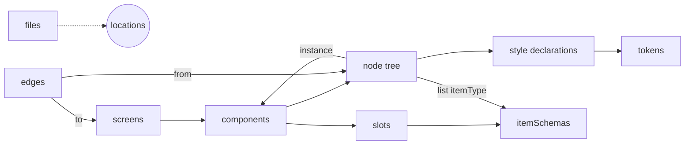

# dui 源码模型

[English](../en/source-model.md) | 简体中文 | [한국어](../ko/source-model.md)

> 本文是[英文原文](../en/source-model.md)的简体中文翻译。如有出入，以英文为准。

> 注意：本文档尚未同步英文版关于 `documentStyle.externalStylesheets` 和 `documentStyle.fontFaces` 的最新增补。

> 状态：schema 版本 1，2026-11-27 决定（[#353](https://github.com/de-novo/dui/issues/353)）。[默认流水线](roadmap.md#default-pipeline)的第 1 阶段。相关：[架构](architecture.md) · [领域模型](domain-model.md) · [路线图](roadmap.md)。

源码模型是源码对其 UI 的声明。语言适配器根据语法写出模型，官方编译器可以对其细化。近似渲染器、热重载、槽位与状态切换以及之后的导出只读取这个模型，因此新语言只需要一个写出该模型的适配器。

| 部分 | 文件 |
| --- | --- |
| JSON Schema | [`schemas/source-model.v1.schema.json`](../../schemas/source-model.v1.schema.json) |
| Rust 类型与读取器 | [`crates/dui-core/src/source_model/`](../../crates/dui-core/src/source_model/mod.rs) |
| 参考示例 | [`fixtures/source-model/src/`](../../fixtures/source-model/src/) 中 TSX 源码对应的 [`fixtures/source-model/model.json`](../../fixtures/source-model/model.json) |
| 检查 | `npm run check:source-model` |

运行 `dui model PROJECT ENTRY.tsx`，从 TSX 入口及其相对导入生成 schema v1 JSON。可用 `dui model fixtures/source-model src/App.tsx` 运行示例。适配器读取具名函数和箭头函数组件、解构的 props、本地状态、已声明的调用返回类型、JSX 分支和列表模板、React Router 路由和链接、内联样式，以及导入 Tailwind CSS 的项目中的常见工具类。CSS Modules、未支持的类和动态表达式保留原文。无需安装项目依赖、类型检查器或浏览器。

字面量的 URL 查询选择也是源码证据。当严格的 `URLSearchParams` 相等判断控制一个能解析为单个组件的分支时，适配器会记录 `/` 或 `/?name=value` 屏幕。选择这些组件的字面量动态导入也会作为源码读取。`?name=value` 或 `?` 这类仅含查询串的链接，只有在源屏幕是根查询屏幕且目标存在时才解析；运行时条件和 `history` 写入保持为不透明或未解析。

对于 React 类组件，适配器读取实例 `render()` 方法。它会保留在 `if` 块中赋值一次并用于返回 JSX 的条件子元素。`componentDidMount()` 中已初始化的字面量 `Router({...})` 表，只有在其中的路径也出现在类屏幕可达的字面量哈希链接中时，才能识别哈希视图。位置指向路由键和链接，条件链接在模型中仍保持有条件。

使用 `--built-css FILE` 可读取项目内的单个 CSS 构建产物。适配器可为静态 HTML 元素解析弹性布局的方向、换行、扩展与对齐、间距、内外边距、尺寸及其上下限、前景色与背景色、不透明度、边框宽度、颜色与圆角、字号、行高和字间距。支持的规则按层、选择器优先级和声明顺序处理，并记录生效声明的字节位置。可能生效但条件或取值无法解析的规则保留为未解析值。模型记录元素上的声明，继承值和浏览器默认计算值不在此提取范围内。

同一次样式表读取还可以添加可选的顶层 `documentStyle` 上下文，其中包含 `root` 和 `body` 的排版声明。只有锚定到文档的选择器参与：`html`、`body`、`:root`、它们受支持的复合选择器，以及 `html` 的直接子代或后代。`!important`、层、优先级、源码顺序和调用方提供的根属性共同决定生效声明。无法证明选择器、at-rule 或层叠结果时，声明会明确记为 `unresolved`，而不是猜测。没有文档锚点的裸类选择器或 ID 选择器不参与。

添加 `--viewport-width PX` 可在指定视口下判断单个以像素为单位的宽度媒体条件。支持 `min-width`、`max-width` 和 `(width < 768px)` 等比较。其他媒体条件保留为未解析。

对于由两个简单选择器组成的子代或后代选择器，TSX 适配器会检查组件边界内的 JSX 原生祖先元素。运行 `dui serve`，在工作区选择器中选择**打开源模型**并打开导出的 JSON。查看器根据 v1 模型绘制选定组件，并列出未解析的样式。

如果项目通过根元素的数据属性选择主题，提取时应传入相同的值，例如 `--root-attribute data-theme=dark`。适配器会解析构建产物中匹配的根变量声明。未提供此上下文时，冲突的定义保持未解析。

构建后的 CSS 可以将显示模式、横向溢出、指定最小列宽的自动适配网格以及单个弹性列映射为模型属性。body 根节点保留文档颜色。无法确认祖先链时，局部主题覆盖仍保持未解析。

构建产物的 CSS 读取器分别解析行间距和列间距，并将常用 flex 简写映射为增长系数、收缩系数和基准尺寸。

读取器在横排布局中展开块方向间距，并保留字体族回退列表（包括可解析的 var() 引用）。构建 CSS 中的文本装饰线、间距的视口最小值和 ID 选择器保留为未解析。

构建 CSS 保留四边的边框宽度、颜色和样式、表格边框合并、垂直和文本对齐关键字、大小写及空白处理。适配器解析单一背景模糊，以及具有显式百分比的受支持颜色与透明色的 sRGB、oklab 或 oklch 混合。其他滤镜组合及颜色插值空间保留为未解析。

JSX 片段保留子节点且不生成布局框。构建 CSS 支持定位、堆叠顺序、物理偏移及圆形圆角半径。同一位置硬切换的点状背景、两个显式平铺尺寸和颜色置于末尾的单个外阴影，以模型颜色与长度表示。

## 1. 原则

1. **声明，而非观察。** 模型只记录代码所说的内容。它不运行处理函数，不调用 API，也不启动浏览器。捕获结果留在[捕获上下文](domain-model.md#2-实体值对象与标识)中。
2. **不编造。** 只有运行时才知道的值是 `opaque` 表达式。适配器读不出的类型是 `unknown`。无法映射的语法是 `placeholder` 节点。无法解析的样式是 `unresolved` 值或 `unresolvedStyle` 条目。每一项都保留源码文本或原因。
3. **每个事实都有位置。** 界面、组件、槽位、节点、样式、token、列表项 schema 和边都带有源码位置。可能来自不同来源的事实带有 `origin`：`syntax`、`compiler` 或 `inferred`。`inferred` 表示由 AI 或启发式填补的空缺。
4. **确定性。** 相同的源码产生相同的字节。模型没有时间戳，也没有绝对路径。顶层列表按标识符排序。子节点保持源码顺序。写入方省略缺失的可选字段、`false` 标志以及空列表和空映射。
5. **语言中立。** 布局、状态、导航和样式使用中立术语。每个适配器把自己的语法映射到这些术语上。

## 2. 文档

| 字段 | 内容 |
| --- | --- |
| `schemaVersion` | `1` |
| `extractor` | 写出模型的适配器的 `name` 和 `version` |
| `files` | 相对项目的 `path`（`/` 分隔）、`language`（`typescript`、`swift`、`kotlin`、`dart`、`css`）、所读字节的 `sha256`，以及它 `imports` 的项目文件。热重载使用这些摘要和导入图 |
| `screens` | `id`、`name`、路由器声明时的 `route`、根 `component`、`origin`、`location` |
| `components` | `id`、`name`、`location`、`slots`，以及一个 `root` 节点 |
| `itemSchemas` | 集合项的形状：`id`、`name`、`fields`（`name`、`type`、`optional`）、`origin`、`location` |
| `tokens` | 设计 token：`id`、按原样书写的 `name`、`group`、`value`、可选的 `modes`、`syntax`，以及 `location` 或 `package` |
| `edges` | 导航：`id`、触发节点 `from`、`kind`、`to`、`origin`、`location` |
| `diagnostics` | 适配器要报告的其他内容：`code`、`message` 和可选的 `location` |

**位置**由 `file`、从 1 开始的 `line` 和 `column`（column 按 Unicode 标量值计数），以及从 0 开始的 UTF-8 字节偏移 `start` 和 `end`（不含 `end`）组成。

## 3. 标识符

标识符是不透明的字符串。只有适配器创建标识符；只要声明的文件、名称和在树中的位置不变，标识符就必须不变，这样热重载才能只修补变化的部分。参考示例使用下面的模式，其他适配器也应遵循。

| 实体 | 模式 | 示例 |
| --- | --- | --- |
| Component | `<file>#<name>` | `src/Orders.tsx#Orders` |
| Slot | `<component>.<name>` | `src/Orders.tsx#Orders.filter` |
| Node | `<component>@<path>`：从根开始的子节点索引，分支 arm 计为一层 | `src/Orders.tsx#Orders@0.2.1.0` |
| Screen | `route:<path>`，根视图使用组件 ID | `route:/settings` |
| Item schema, token | `<file>#<name>`，框架默认值使用 `<package>#<name>` | `tailwindcss#--text-2xl` |
| Edge | `<trigger node>:<kind>` | `src/Orders.tsx#Orders@0.3:link` |

带有 `route` 的界面通过路径对应到捕获上下文的 `ScreenId`，因此可以在模型旁边展示可选的捕获依据。

## 4. 槽位与表达式

**槽位**是组件读取、审阅者可以设置的值：`prop`、已声明的 `local` 状态，或来自 `store`、`context`、`route`、`query` 或其他 `external` 调用的数据。它就是术语表中的[状态槽](../i18n.md#glossary)。槽位有 `type`、可选的 `initial` 值（local 状态的初始值或 prop 的默认值）、prop 的 `optional`，以及非 local 数据读取的 `source` 文本。

| 类型 `kind` | 含义 |
| --- | --- |
| `boolean`、`string`、`number` | 基本值 |
| `enum` | 字面量 `values` 的封闭集合 |
| `array` | `item` 的列表 |
| `object` | 由列表项 schema `schema` 描述的对象 |
| `node` | 传入的 UI 内容（children、`ReactNode`、`@ViewBuilder`） |
| `function` | 回调 |
| `unknown` | 无法读取；可选的源码 `text` |

**表达式**说明值从哪里来。

| 表达式 `kind` | 含义 |
| --- | --- |
| `literal` | 源码中写出的 JSON `value` |
| `slot` | 读取同一组件的槽位，可带字段 `path`，例如 `["length"]` |
| `item` | 读取外层 `list` 节点的当前项，并带字段 `path`。这就是字段到 UI 的绑定 |
| `opaque` | 模型不求值的代码：其 `text` 以及其中的槽位与列表项 `reads` |

## 5. 节点

| 节点 `kind` | 字段 | 含义 |
| --- | --- | --- |
| `element` | `tag`、`module`、`props`、`style`、`unresolvedStyle`、`children` | 平台元素，或模型未描述的某个包（`module`）中的组件。已变成样式的属性不再重复写入 `props` |
| `instance` | `component`、`props`、`children` | 对模型中组件的使用。prop 名称与目标的 `prop` 槽位一致 |
| `text` | `parts` | 由字面量片段和绑定片段组成的文本 |
| `branch` | `on`、`arms` | 依赖某个值的 UI：`if`、`&&`、三元表达式和 `switch`。每个 arm 有 `when` 和 `children` |
| `list` | `source`、`item`、`itemType`、`key`、`children` | 为每一项重复的 UI。`children` 是单项模板 |
| `outlet` | `slot` | 绘制 `node` 槽位所持有的 UI 内容 |
| `placeholder` | `reason` | 适配器无法映射的源码 |

每个节点都有 `id` 和 `location`。分支 arm 的 `when` 是 `{"equals": <value>}`、`{"truthy": true|false}` 或 `"otherwise"`。`otherwise` 放在最后。审阅者可以直接选择 `on` 的值或某个 arm，因此切换 `isOpen` 或列表数量会改变画面，而无需运行代码。

## 6. 样式

模型只有一个 `gap` 值。CSS 和内联 TSX 中的 `1.5rem 1.5rem` 均可表示该间距。两个值不同时，以及单独声明 `row-gap` 或 `column-gap` 时，保留未解析的源码。

元素的 `style` 是一个声明列表。每条声明有 `property`、`value`、可选的 `when` 条件和 `from`（声明的来源）：`syntax`（`class`、`inline`、`modifier`、`stylesheet`、`theme`）、其 `text`（一个类、一个内联条目、一个 modifier）和 `location`。声明按顺序生效。在条件成立的声明中，后面的生效。

| 分组 | 属性 | 值 |
| --- | --- | --- |
| Layout | `direction` | `row`、`column`、`overlay` |
| | `alignItems` | `start`、`center`、`end`、`stretch`、`baseline` |
| | `justifyContent` | `start`、`center`、`end`、`spaceBetween`、`spaceAround`、`spaceEvenly` |
| | `wrap` | `wrap`、`nowrap` |
| | `grow` | number |
| Spacing | `gap`、`paddingTop`、`paddingBottom`、`paddingStart`、`paddingEnd` | length |
| | `marginTop`、`marginBottom`、`marginStart`、`marginEnd` | length、`auto` |
| Size | `width`、`height`、`minWidth`、`maxWidth`、`minHeight`、`maxHeight` | length、`auto`、`fill`、`fit` |
| Color | `color`、`background`、`borderColor` | color |
| | `opacity` | number |
| Typography | `fontFamily` | 任意 keyword |
| | `fontSize`、`letterSpacing` | length |
| | `fontWeight` | number |
| | `fontStyle` | `normal`、`italic` |
| | `lineHeight` | length 或 number |
| | `textAlign` | `start`、`center`、`end`、`justify` |
| Radius and border | `borderRadius`、`borderWidth` | length |

`Start` 和 `end` 是书写方向上的起始侧和结束侧。

| 值 `kind` | 字段 |
| --- | --- |
| `length` | `value` 和 `unit`：`px`、`rem`、`em`、`percent`、`pt`、`dp`、`vw`、`vh`、`svw`、`svh`、`lvw`、`lvh`、`dvw`、`dvh`、`vmin`、`vmax` |
| `clamp` | 字面长度操作数 `min`、`preferred` 和 `max` |
| `color` | `value`：小写 sRGB `#rrggbb` 或 `#rrggbbaa` |
| `number` | `value` |
| `keyword` | 属性列表中的 `value` |
| `token` | `token` ID，解析后以 `resolved` 给出最终值 |
| `unresolved` | 源码 `text` 和 `reason`，以及可选的类型化 `refinement`。所有属性都接受 |

视口长度和有界的字面 `clamp()` 表达式仍在现有 `unresolved` 外壳中输出，并带有类型化的数值 `refinement`，因此不认识该 refinement 的 v1 消费者仍保留原来的回退。任意 calc 表达式、无界或非字面 clamp 以及不支持的单位仍保持未解析，并且没有 refinement。

当条件的所有字段都成立时条件成立：`minWidth` 和 `maxWidth`（length）、`interaction`（`hover`、`focus`、`pressed`、`disabled`）、`colorScheme`（`light`、`dark`），以及必须为真的表达式 `expr`。适配器看到但无法映射到属性的样式（例如 CSS Module 类）连同其 `syntax`、`text`、`reason` 和 `location` 放入 `unresolvedStyle`。浏览器永远不会填补它。

参考示例映射简单语法：Tailwind 类和内联样式。Tailwind 的 spacing 步长记录为解析后的长度。中等和困难语法（[样式与设计 token](roadmap.md#default-pipeline)）在其适配器出现后使用相同的声明。

对于 `.module.css` 的默认导入，`className={styles.card}` 读取匹配的 `.card` 和 `tag.card` 规则。适配器按选择器优先级及源码顺序排列声明，最后应用内联样式，并记录简单的 `min-width` 或 `max-width` 媒体条件。每条声明都指向 CSS 源码位置。未支持的值和属性保留原文。若模块使用此范围之外的选择器或 at-rule、类组合或 `!important`，则类引用保留为未解析。

样式表中的 `padding-inline-start: 12px` 和内联的 `paddingInlineStart: 12` 都输出 `paddingStart`，长度为 `12px`。两种书写方向均保留逻辑起点和终点。外边距也支持负长度和 `auto`。

例如，`padding-inline: 2px 5%` 和 `paddingInline: "2px 5%"` 都输出值为 `2px` 的 `paddingStart` 和值为 `5%` 的 `paddingEnd`。

## 7. Token

token 保留源码使用的名称（`--color-brand`、`--text-2xl`），以便之后成为设计变量。`group` 是 `color`、`spacing`、`typography`、`radius`、`size` 或 `other`。`value` 是最终值，或指向另一个 token 的 `token` 值（别名）。别名不得形成循环。`modes` 保存各模式的值，例如 `dark`。项目 token 有 `location`。框架默认值有 `package`（`tailwindcss`），没有位置。

在同一个导入的主题样式表中，颜色或圆角 token 可以通过 `var(--name)` 引用同组的另一个 token。模型保留直接引用及解析后的值。循环引用、缺失的定义和带回退值的表达式以未解析值保留源码。

## 8. 边

`kind` 是 `link`（声明式链接，例如 `<Link>` 或 `NavigationLink`）、`navigate`（命令式调用）或 `present`（覆盖在当前界面上的弹层或对话框）。`to` 是 `screen`、不匹配模型中任何界面的 `route` 路径，或 `opaque` 表达式。边从触发它的节点开始。其所属界面由绘制该节点的界面决定，包括经由组件实例的情况（`SourceModel::screen_edges`）。

## 9. 校验与版本

JSON Schema 检查形状、枚举、模式和必填字段。Rust 读取器（`SourceModel::from_json`）还会检查 schema 无法表达的规则：

- 标识符有序且唯一，槽位名称在组件内唯一；
- 每个位置和导入都指向已列出的文件；
- 每个引用都能解析：界面与实例的组件、实例 prop、同一组件内的槽位读取、列表内的列表项读取、列表项 schema、token，以及边的节点和界面；
- 样式值符合其属性，token 别名不循环，`otherwise` arm 位于最后。

`npm run check:source-model` 用 schema 校验参考示例，检查错误形状会被拒绝，并运行读取器的测试。这些测试还会检查参考示例中的每个位置都指向 fixture 源码，并且文件摘要一致。

版本 1 只通过新增来变化。旧读取器可以忽略的新可选字段、新样式属性、新枚举值或新节点种类仍属于版本 1。删除或重命名字段、枚举值或种类，把可选字段改为必填，或改变已有值的含义，都会产生带有新 schema 文件的 `schemaVersion` 2，此后版本 1 的文件和读取器不再改变。`npm run check:source-model-additive` 将版本 1 schema 与拉取请求的基准分支比较，出现删除或重命名即失败。读取器拒绝它不认识的版本。

## 10. 绘制模型

渲染器读取 `dui-core` 中的 `SourceModel`。`dui-core` 没有 I/O，并且可以构建为 `wasm32-unknown-unknown`，因此桌面查看器和网页画布共用同一个读取器。所有属性都映射到 flexbox 引擎。参考目标 [GPUI](roadmap.md#default-pipeline) 的映射如下。以这种方式绘制的卡片标注为近似。

| 模型 | GPUI |
| --- | --- |
| `direction` `row`、`column` | `flex_row`、`flex_col` |
| `direction` `overlay` | 子节点以 `absolute` 相互叠放 |
| `alignItems`、`justifyContent`、`wrap`、`grow` | 同名的 Taffy flexbox 值 |
| Spacing 和 size 属性 | 同名的 padding、margin、gap 和 size。GPUI 从左到右布局，因此 `start` 和 `end` 对应 left 和 right |
| `fill`、`fit`、`auto` | `relative(1.)`、内容尺寸、`auto` |
| `px`、`rem`、`percent` | `px`、`rems`、`relative` |
| `pt`、`dp` | `px`。三者都是逻辑像素 |
| `em` | 乘以元素字号后的 `px` |
| `color` | `rgba` |
| `lineHeight` number | `line_height(relative(n))` |
| `textAlign` `justify` | `start`。GPUI 只有 left、center 和 right |
| 带 `minWidth` 或 `maxWidth` 的 `when` | 相对单位使用逻辑视口的初始用户代理字号，独立于模型化的根字号和父级字号，然后在布局前按格子宽度判定 |
| 带 `interaction`、`colorScheme` 或 `expr` 的 `when` | 审阅者选择该状态时应用 |
| `token` | 其 `resolved` 值。没有该值的 token 按 `unresolved` 绘制 |
| `unresolved`、`unresolvedStyle`、`placeholder`、`opaque` 文本 | 带标签的占位符。绝不由浏览器填充 |

对于网页画布的 TypeScript/DOM 模型预览，`documentStyle` 的根排版应用于隔离的模型文档或 shadow host，body 排版应用于 body 或 document-body 包装元素。普通 `em` 保持为 CSS 长度，因此在其属性上下文中解析。在 shadow-root 卡片中，`rem` 按模型化的根字号解析，视口长度按逻辑卡片视口解析；二者都输出为像素，因此不会使用查看器文档或外部视口。类型化 clamp 对每个操作数使用相同的基础解析，并保留为有界 CSS clamp。
