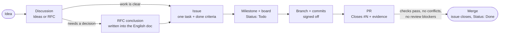
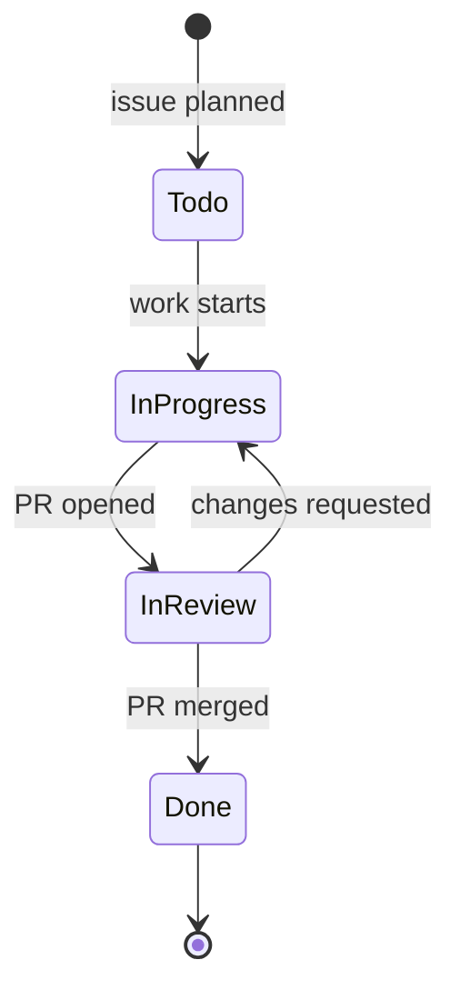
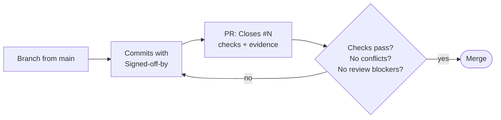

# dui 工作流程

[English](../en/workflow.md) | 简体中文 | [한국어](../ko/workflow.md)

> 本文是[英文原文](../en/workflow.md)的简体中文翻译。如有出入，以英文为准。

> 状态：2026-11-20 决定 · `de-novo/dui` 中工作如何经由 GitHub 流转的权威来源。代码结构：[架构](architecture.md)。产品设计：[设计 v0](design-v0.md)。

本文规定 dui 如何使用 GitHub Discussions、Issues、Labels、Milestones、Projects 看板和拉取请求（PR）。每个工具只负责一类信息。其他地方只链接，不复制。

## 1. 信息归属

| 信息 | 权威来源 | 其他地方 |
|---|---|---|
| 产品定义、规格、原则 | 文档：[设计 v0](design-v0.md)、[架构](architecture.md)、[支持的框架](supported-frameworks.md) | 只链接 |
| 术语和翻译 | [术语表](../i18n.md) | 使用术语，不重新定义 |
| 决定 | 记录该决定的英文文档章节，标注 "decided YYYY-MM-DD" | 只链接 |
| 未决问题和提议 | Discussions | 从文档或 issue 链接；结束后关闭 |
| 一项工作及其完成标准 | Issue | PR 正文写 `Closes #N` |
| 版本范围和目标 | Milestone（1~3 行目标 + 目标文档章节链接） | 只用 issue 的 milestone 字段 |
| 进度状态 | Projects 看板的 `Status` 字段 | 不写在标签或 issue 正文中 |
| 分类 | Labels | 不抄写到正文 |
| 改了什么及证据 | PR 正文 | issue 只链接 PR |
| 发布历史 | CHANGELOG 和 GitHub Releases | 不改写 |

聊天消息和机器人笔记不是权威来源。重要内容须在 24 小时内移到文档、Discussion 或 issue。在聊天中批准的决定，在 PR 正文中引用批准原文和日期。

## 2. 生命周期

1. **想法或问题。** 在 `Ideas` 中开一个 Discussion。
2. **需要决定。** 移到 `RFC`，或直接开 RFC。RFC 列出选项和推荐方案。
3. **已决定。** 把结论写进负责该主题的英文文档（同一 PR 中也更新 zh-CN 和 ko 文件，见 §7）。在 Discussion 中链接该 PR 并关闭。
4. **工作明确。** 开一个带完成标准的 issue。链接 Discussion 和文档章节。不要把规格复制到 issue 中。
5. **计划。** 给 issue 打标签（§4）、设置 milestone（§5），并加入看板（§6）。
6. **实现。** 一个分支、一个 PR、一个目的。PR 关闭该 issue。
7. **合并。** issue 关闭；看板移到 `Done`。

不需要决定的小改动跳过 Discussions：issue → PR。

## 3. Discussions

只用两个分类。不使用 GitHub 默认分类（Announcements、General、Q&A、Show and tell、Polls）。

| 分类 | 用途 | 何时结束 |
|---|---|---|
| `Ideas` | 尚未定为工作的提议、未决问题、关于使用 dui 的问题 | 工作明确 → 开 issue，双向链接，关闭。需要决定 → 移到 `RFC` |
| `RFC` | 需要决定的主题：设计、架构、支持的技术栈、政策 | 用 PR 把结论写进负责的文档，链接该 PR，关闭 |

| 模板 | 字段 | 必填 |
|---|---|---|
| `Ideas` | 一行摘要 | 是 |
| | 想做什么 | 是 |
| | 相关文档链接 | 如有 |
| `RFC` | 背景 | 是 |
| | 选项（每个一行优缺点） | 是 |
| | 推荐方案和理由 | 是 |
| | 相关文档链接 | 如有 |

- RFC 模板没有“结论”字段。结论只写在文档中。不要把 Discussion 正文改写成结论。
- Discussions 不用于进度跟踪、任务列表、规格正文或公告。
- Discussions 可以用英文、简体中文或韩文撰写。结论先用英文写。

## 4. Issues 和标签

### 4.1 Issues

一个 issue = 一项任务 + 完成标准。

| 规则 | 说明 |
|---|---|
| 正文 | 以清单形式写完成标准，并链接所实现的文档章节 |
| 不是 issue 的内容 | 想法和未决问题（→ Discussions）、状态笔记（→ 看板）、没有完成标准的 QA、元或史诗 issue |
| 必需 | type、priority、area 标签各 1 个；milestone；加入看板 |
| 父 / 子 issue | 仅当一项任务需要多个 PR 时使用。父 issue 有自己的完成标准。只有一层。父和子在同一个 milestone 内关闭 |
| 语言 | 英文，让每位贡献者都能读懂 |
| 关闭 | 用 GitHub 关闭原因（completed、not planned、duplicate）代替 `duplicate` / `wontfix` 标签。"Not planned" 要留下理由或链接 |
| 受阻 | 不要猜。加 `needs-decision`，在 issue 中写下问题和推荐方案 |

### 4.2 标签

标签只用于分类。状态和发布从不用标签表示。

| 组 | 值 | 每个 issue |
|---|---|---|
| type | `bug` `feature` `refactor` `chore` `docs` | 1 |
| priority | `P0` `P1` `P2` | 1 |
| area | 下列 8 个 | 1 |
| 辅助 | `needs-decision` `blocked` | 0~1，解决后移除 |

**type** — 同时符合多个时，按此顺序取靠前的：

| 标签 | 含义 |
|---|---|
| `bug` | 行为与文档不一致 |
| `feature` | 新增或改变用户（人或 AI 代理）可见的行为，包括 CLI / MCP 输出、默认值和文案 |
| `refactor` | 行为不变；结构或名称改变 |
| `chore` | 产品代码之外：构建、CI、依赖、发布、仓库维护、仅添加测试 |
| `docs` | 仅文档。同时改代码和文档的 PR 取代码一方的 type |

**priority**

| 标签 | 含义 |
|---|---|
| `P0` | 停下其他工作：`main` 损坏、安全或密钥泄露、当前 milestone 受阻。只由维护者设置；其他人可以建议 |
| `P1` | 当前 milestone 的完成标准需要 |
| `P2` | 其他一切 |

规模和难度不是优先级。

**area** — 每个 issue 一个，对应[架构 §5](architecture.md#5-monorepo-布局)中的单元。最多 8 个。新增或修改 area 是一项决定（RFC）。

| 标签 | 范围 |
|---|---|
| `area:core` | `dui-core`：model、pipeline、规则引擎、session（Decider）、哈希 |
| `area:ports` | `dui-ports`：`TypeOracle`、`Host`、`Renderer` 契约 |
| `area:adapters` | `crates/adapters/*` 和 `packages/ts-sidecar`：语言、宿主和渲染器适配器 |
| `area:app` | `dui-app` 和 `dui-cli`：effect 解释器、缓存、CLI、MCP 服务器、画布服务器 |
| `area:rules` | `rules/` 规则包和 schema、`stacks.toml`、`fixtures/` |
| `area:canvas` | `apps/canvas` 和 `packages/schemas` |
| `area:docs` | `docs/`、README、`CONTRIBUTING.md`、`AGENTS.md` |
| `area:tooling` | `xtask`、CI 工作流、许可证和依赖检查、Renovate 配置 |

不使用其他标签，包括 `documentation`、`enhancement`、`question`、`duplicate`、`wontfix`、`invalid` 等 GitHub 默认标签。删除旧标签不可撤销，需要维护者批准（§8）。

## 5. Milestones 与版本

一个 milestone = 一个版本。名称只用 `vX.Y.Z`。描述写 1~3 行目标，并链接文档中的目标章节。

| Milestone | 版本 | 目标（依据[设计 v0 §13](design-v0.md#13-mvp-范围与里程碑)） |
|---|---|---|
| M0 spike | `v0.0.1` | 用手选状态证明真实渲染路径（[架构 §7](architecture.md#7-m0-和-m1-验收标准)） |
| M1 自动状态 | `v0.0.2` | 自动计算状态和覆盖率（[架构 §7](architecture.md#7-m0-和-m1-验收标准)） |
| M2 GPUI spike | `v0.0.3` | 渲染一个 pippip 界面 |
| M3 序列状态 | `v0.0.4` | 通过回放验证的序列状态 |
| M4 画布 | `v0.0.5` | 由 AI 代理打开的画布 |
| M5 obora 99% 尝试 | `v0.0.6` | 每个界面的覆盖率报告 |

| 规则 | 说明 |
|---|---|
| 开放的 milestone | 最多 2 个：当前和下一个 |
| 截止日期 | 仅在维护者设定时使用。超过截止日期时，把剩余 issue 移到下一个 milestone 并关闭 |
| 版本号 | 初期 M0 至 M5 依次规划为 `v0.0.1` 至 `v0.0.6`。此后在 `0.x` 期间，范围、用法或兼容性有重大变化时升 minor，其他变化升 patch。 |
| 渠道 | nightly `vX.Y.Z-nightly.YYYYMMDD.N` → 候选版 `vX.Y.Z-rc.N` → 正式版 `vX.Y.Z` |
| 标签（tag） | nightly tag 无需批准。候选版和正式版 tag 需要维护者批准 |
| 发布说明 | 由该 milestone 中合并的 PR 生成。过去的 CHANGELOG 条目和 Releases 从不修改 |

## 6. Projects 看板

仓库只有一个看板。进度状态只放在它的 `Status` 字段中。

| 规则 | 说明 |
|---|---|
| Status 值 | `Todo`、`In progress`、`In review`、`Done`。受阻用 `blocked` 标签，不是状态 |
| 视图 | 按 milestone、按 area、`needs-decision`。视图可以增加，看板不增加 |
| 额外字段 | 无 |
| Issues | 所有开放 issue 都在看板上。issue 正文不写状态 |

## 7. 拉取请求（PR）

**分支和提交**

| 规则 | 说明 |
|---|---|
| 分支 | `feat/`、`fix/`、`refactor/`、`chore/`、`docs/` + 简短名称。目标为 `main` |
| 提交 | Conventional Commits（`feat:`、`fix:`、`docs:` …），每个都用 `git commit -s` 签署（[DCO](../../CONTRIBUTING.md#1-sign-off-every-commit-dco)）。未签署的提交不能合并 |
| 合并方式 | merge commit（不用 squash），让每个原始提交保留签署 |

**PR 正文**

| 字段 | 内容 |
|---|---|
| 摘要 | 改了什么、为什么，1~3 行 |
| 链接 | `Closes #N`；所依据的文档章节或 RFC |
| 检查 | 适用的检查（见下）及结果 |
| 证据 | 行为变化附渲染图像或 CLI / MCP 输出 |
| 文档 | 修改的文档，或“无文档变更”及理由 |
| 批准 | 有不可撤销步骤时，引用维护者的批准原文和日期 |

**适用的检查** — [架构 §6.2](architecture.md#62-自动检查任何违规都会让-ci-失败) 中的 CI 检查：工作区 lint、核心纯度、`cargo xtask check-deps`、`cargo xtask check-licenses`、`cargo xtask gen` 是否最新、fixture。改动某个 crate 的 PR 还要运行该 crate 的测试和 `insta` 快照。仅文档的 PR 不需要 CI；作者确认链接有效、三种语言结构一致（见下）。检查失败时修代码，绝不放宽检查。

**三语文档规则** — 所有文档变更都遵循[翻译规则](../i18n.md#rules)：

- 先改英文文件。在同一 PR 中更新 `zh-CN` 和 `ko`，或给未更新的文件加 "outdated" 横幅。
- 数字、链接、代码、表格和图保持一致。三个文件保持相同的标题、表格和代码块。
- 改变规格或术语的代码与文档变更一起提交：在同一 PR 中，或在文档 PR 合并之后。

**合并条件** — 三条都满足时合并 PR：

1. 所有必需检查通过。
2. 与 `main` 没有合并冲突。
3. 没有未解决的评审阻碍。

此时负责人（维护者或负责该仓库的代理）可以无需额外批准直接合并。一个 PR 一个目的。

## 8. 批准

可撤销的工作直接做，汇总报告。不可撤销的工作等待维护者。

| 直接做，然后报告 | 需要维护者明确批准 |
|---|---|
| 添加或修改标签、分配 milestone 和看板 | 公开仓库或任何产物 |
| 重写 issue、关闭已完成或重复的 issue | 推送候选版和正式版 tag、发布包 |
| 合并满足 §7 的 PR | force-push、改写 `main` 历史、跳过检查（`--no-verify`） |
| 文档清理、分支清理 | 删除标签、milestone、Discussion 或其他 GitHub 对象 |
| nightly tag | 花钱、添加付费服务 |

代理的同意不是批准。多个不可撤销事项一次性打包询问。维护者 24 小时内未答复时，只执行推荐方案中可撤销的部分，其余继续等待。

不要把密钥、令牌、一次性验证码或私人数据写进仓库、issue、PR 或 Discussions。
